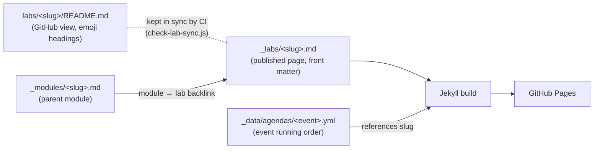

# New Lab Checklist

Quick reference for adding a new lab to the MCS Labs repository.

## ✅ Quick Checklist

A lab is **two markdown files plus images**. There is no generation script — both files are written and committed by hand, and CI fails a PR that changes one without the other.

### Step 1: Create the lab folder (GitHub view)

```bash
mkdir -p labs/your-lab-name/images
# write labs/your-lab-name/README.md
```

`labs/*/README.md` is the copy people read on GitHub. House style here uses emoji section headings (`## 🧭 Lab Details`).

### Step 2: Create the published page

Write `_labs/your-lab-name.md` — same content, plus Jekyll front matter, and **plain headings with no emoji**:

```yaml
---
layout: lab
module: agent-skills
title: "Deep Dive: Skills"
order: 295
duration: 30
difficulty: 300
lab_type: local
section: intermediate_labs
journeys: ["developer"]
description: "One-sentence summary used on cards and in search results."
---
```

> Emoji in `_labs/*.md` headings render on the live page and change the anchor ids kramdown generates (`## 🧭 Lab Details` → `#-lab-details` instead of `#lab-details`), which silently breaks the hand-written in-page Table of Contents. Keep them in the README only.

### Step 3: Serve and verify

```bash
bash tools/run.sh
# then open http://localhost:4000/mcs-labs/labs/your-lab-name/
```

Check: the page renders, images resolve, the "Part of: <module>" link works, the lab appears on the All Labs page and in each journey you listed, and every in-page TOC link scrolls somewhere.

Then run the lab audit, which checks both copies, front matter, anchors, images, durations, retired product names and agenda references:

```bash
npm run audit:labs -- your-lab-name
```

It exits with 1 on errors. CI does not run it, so run it before opening the PR.

---

## 📋 Front Matter Reference

| Property | Required | Description | Example |
|----------|----------|-------------|---------|
| `title` | ✅ | Full lab title | `"Build a Support Agent"` |
| `description` | ✅ | One-sentence summary for cards/SEO | `"Package a procedure as a Skill…"` |
| `difficulty` | ✅ | Numeric level — `100`, `200`, or `300` | `200` |
| `duration` | ✅ | Minutes to complete | `30` |
| `section` | ✅ | Grouping on the All Labs page | `intermediate_labs` |
| `order` | ✅ | Global sort key (`site.labs \| sort: "order"`) | `295` |
| `journeys` | ✅ | Learning paths that surface the lab | `["business-user", "developer"]` |
| `module` | ⚠️ Recommended | Slug of the parent module | `agent-skills` |
| `lab_type` | ⚠️ Optional | `local` or `external` | `local` |
| `layout` | ⚠️ Optional | Defaulted to `lab` by `_config.yml`. Leave it alone: the content feed strips `layout`, so the deployed site silently ignores a custom value even though `jekyll serve` honours it. Use `lab_format` to change how a lab renders | `lab` |
| `lab_format` | ⚠️ Optional | `missions` renders guided missions inside the usual site header, event rail, and bottom nav. Omit it for the classic format. Consumers that don't know the key render the readable Markdown body | `missions` |
| `mission_lab` | ⚠️ Required with `missions` | Structured mission content; see the authoring contract below and `_labs/cowork-zava-sales.md` | object |
| `unlisted` | ⚠️ Preview only | Keeps the page out of the homepage, All Labs, the Events index, event navigation, and feed listings (manifests, bundles, index counts), and adds `noindex`. The URL remains public | `true` |

Mark both an unlisted preview lab and its separate preview event with `unlisted: true`, `search: false`, and `sitemap: false` (search and sitemap are separate switches). Do not repoint an advertised event at draft content. An unlisted URL is not access-controlled.

A preview event may also list existing, advertised labs so reviewers can compare formats with Previous and Next. Those labs stay unchanged for everyone else: the event-nav manifest emits an unlisted event only on unlisted pages and on the pages its agenda (or `labs:`) lists, and its rail appears only when the URL carries `?event=<preview-id>`, which the rail's own links pass along but session storage never remembers.

An unlisted page still gets a per-item feed document (`feed/items/<collection>/<slug>.json`), because the deployed site is built from those documents. No manifest or bundle links to it, so feed subscribers never discover it, but the file is reachable by direct URL.

### Authoring a guided mission lab

Use `_labs/cowork-zava-sales.md` as the working example. Set `lab_format: missions`
and supply `mission_lab` in front matter. The feed preserves both keys, including
the nested content; do not put rendering-critical content in a separate data file.

- `headline`, `headline_emphasis`, `promise`, `scenario`, `prerequisites` and `pacing` introduce the lab.
- `hero_image` and a step's optional `screenshot` have `src`, `alt`, `width`, `height` and `caption`; step screenshots also have `title`. Use root-relative `/labs/<slug>/images/...` paths. The include applies the site's base URL. Reference every image in the Markdown body too, so the feed discovers and packages it.
- A step screenshot may add `src_dark` (convention: `<name>-dark.webp`) when the product UI has a dark theme. `src` is the light capture; both captures share the declared `width` and `height`. The page shows the variant matching the site theme (light → `src`; dark, high contrast and no JavaScript → `src_dark`), and the hidden one is not downloaded. Reference both in the Markdown body with one identical line in each readable copy: `<picture><source media="(prefers-color-scheme: dark)" srcset="images/<name>-dark.webp">.webp" alt="..."></picture>`. GitHub then follows the reader's theme. The feed packages both. Use theme-neutral document content or a content-focused light product capture for the single, eagerly loaded `hero_image`, rather than dark application chrome. Do not invent a dark variant: omit `src_dark` when no genuine matching capture exists. Zava Sales pairs every product UI screenshot; only its cropped slide is shared between themes.
- Prefer capturing real product states without changing records or disconnecting working connections just for an image. A connected-state view or historical approved action can be safer than replaying setup or a write. If the environment owner explicitly authorizes a disconnect/reconnect capture, restore the working connection afterward. Keep the alt text and caption explicit about the state shown, especially when an approval is already completed.
- Each entry in `missions` has a unique, stable `id`, `verb`, `title`, `minutes`, `tool`, `brief`, `outcome`, `steps` and `reveal`. Core mission minutes must sum to the lab's `duration`. Put extensions after the core and set `optional: true`; they are labeled separately and do not count toward core completion. Keep all prompts in the readable copies, including optional ones.
- Each step has a `title` and Markdown `instruction`; optional `prompt`, `prompt_label`, `help`, `screenshot` and `notice` add progressive disclosure. Prompts stay visible by default. Use `|-` for multiline prompts to avoid an extra copied newline.
- Keep reference responses distinct from inputs: put expected-output examples in an `output` fenced block within `instruction`, not in `prompt`. Repeat those blocks verbatim in both readable copies. When converting a classic lab, preserve its unlabelled sample email/expression fences as well as `text` fences; do not turn an example answer into a prompt to send.
- A `reveal` has `title`, `line`, Markdown `explanation` and a `flow` list. An optional `check` has a `question` and `options` (`text`, boolean `correct`, and `feedback`), with exactly one correct answer. Optional `stuck` entries have `problem` and Markdown `solution`.
- `finish` contains `title`, `message`, `takeaways` (`label`, `text`) and `reflection`; optional Markdown `cleanup` explains how to stop lab-created recurring work. `sources` contains authoritative `title`/`url` links.

The template renders the full experience on the server. JavaScript adds copying,
progress and answer feedback, but is not required to read the
steps or open screenshots. CSS lives in `assets/css/lab-missions.css`; behavior
lives in `assets/js/lab-missions.js`. Both are opt-in and scoped to the lab island.
Do not add design-review controls or hide the core path behind an alternate mode.

Maintain the full Markdown body and `labs/<slug>/README.md` alongside the structured
content. Consumers without this renderer use that body. Keep every prompt verbatim
across all three representations, and add a contract test like
`scripts/lab-missions.test.js`. Check no-JavaScript rendering, light/dark/high-contrast
themes, keyboard controls, storage/clipboard failure, mobile layout and event-context
navigation in both a local build and a feed-consumed build.

**Valid `section` values** (from the label map in `_layouts/lab.html`):

`core_learning_path`, `intermediate_labs`, `advanced_labs`, `specialized_labs`, `optional_labs`, `external_labs`

Anything else falls through and renders the raw string as the section label.

**Valid `journeys` values**: `quick-start`, `business-user`, `developer`, `autonomous-ai`

## 🔢 Order Numbers

`order` is a **single global sort** across all labs — it is not scoped per section. Two numbering schemes currently coexist:

- A compact per-group scheme (`1, 3, 4` … `11, 12, 13` … `21, 22, 23`)
- The legacy three-digit scheme (`105`–`295`, plus one at `800`)
- `999` on six labs, which parks them at the end

There is no clean range table to follow. Pick a number adjacent to the labs you want to sit beside, and check what is already taken:

```bash
grep -H '^order:' _labs/*.md | sort -t: -k3 -n
```

## 🧩 Linking a Lab to its Module

Labs belong to a module in the `_modules` collection. `_layouts/lab.html` resolves `page.module` against module slugs (the `_modules/<slug>.md` filename), so:

1. `module: agent-skills` in the lab front matter requires `_modules/agent-skills.md` to exist
2. The module points back with `lab: "your-lab-name"` in its own front matter

Both directions are needed for the "← Part of: …" header and the module page's lab link to render.

## 📅 Content Update Date

Do not add a manual update date to lab or module front matter. Every lab page
derives its **Content last updated** value automatically:

1. If the parent module has a local `slides:` PowerPoint path, the page uses the
   deck's latest Git commit date.
2. If there is no local PowerPoint, the page uses the latest Git commit date of
   `_labs/<slug>.md`.
3. If a linked deck is missing or cannot be resolved, the build emits a warning
   and falls back to the lab date.

The public date changes after the relevant deck or lab file is committed. Keep
the GitHub README and `_labs` copy synchronized as usual; `_labs/<slug>.md` is
the source used for the no-deck fallback.

The parent module page displays the same deck date. If that module has no local
PowerPoint, its page falls back to the latest Git commit date of
`_modules/<slug>.md`.

## 🎪 Adding a Lab to an Event

Event running order lives in `_data/agendas/<event_id>.yml`, read by `_layouts/event.html`. Add a `lab` row at the right position in the schedule:

```yaml
schedule:
  - type: lab
    slug: your-lab-name
    label: "Lab 5"
    time: "13:30"
    duration: 45
```

See `_data/agendas/README.md` for the full schema (`day`, `session`, `module`, `lab`, `break` row types) and the per-event conventions.

> **Legacy**: `bootcamp_order`, `azure_ai_workshop_order`, and `mcs_in_a_day_order` still appear in some lab front matter. No template reads them — agenda files replaced them. Don't add new ones.

## 🌐 External Labs (Hosted Elsewhere)

```yaml
---
layout: lab
title: "Copilot Studio Agent Academy - Recruit Level"
order: 160
duration: 240
difficulty: 200
lab_type: external
section: external_labs
external: true
external_url: "https://microsoft.github.io/agent-academy/recruit/"
repository: "microsoft/agent-academy"
journeys: ["quick-start", "business-user"]
description: "Comprehensive 13-lesson curriculum…"
---
```

External labs still need an `_labs/<slug>.md` stub — that file is what puts the card on the site — but no `labs/<slug>/` folder.

## 🧰 Maintaining Labs with Agent Skills

Products change faster than labs. Four agent skills in `.github/skills/` cover the lab lifecycle in both the classic and guided missions formats. Copilot and other agents that support skills load them when a request matches; you can also name one ("use the lab-review skill on mcs-tools").

| Skill | Use it to | Changes files? |
|-------|-----------|----------------|
| `lab-create` | Scaffold a new lab from templates, wire its module and agendas, preview it unlisted | Yes |
| `lab-review` | Audit a lab, an event or all labs, check product claims and learning design, write a report | No |
| `lab-runthrough` | Run a lab in a training tenant as an attendee would, log drift, recapture screenshots (light and dark) | Captures only, outside the repo |
| `lab-update` | Apply review or run-through findings to both copies and open a PR | Yes |

All four rely on `scripts/lab-audit.js`:

```bash
npm run audit:labs -- <slug> [<slug> ...]       # one or more labs
npm run audit:labs -- --changed                 # labs changed against origin/main
npm run audit:labs -- --all --format markdown   # every lab and agenda
```

Codes and fixes are listed in `.github/skills/lab-review/references/audit-codes.md`. Retired product names live in `scripts/lab-audit-terms.json`; add one only with an official source.

## 🔍 Troubleshooting

| Symptom | Cause / Fix |
|---------|-------------|
| Lab doesn't appear on the site at all | You created the README but not `_labs/<slug>.md`. The README alone publishes nothing. |
| CI job "Lab Doc Sync" failed | `labs/<slug>/README.md` and `_labs/<slug>.md` must change in the **same PR** (`scripts/check-lab-sync.js`). |
| Lab is in the wrong position | Check `order` against the sorted list above. |
| Section header shows a raw string like `advanced` | `section` value isn't in the map — use one of the six listed values. |
| No "Part of: …" link in the header | `module:` has no matching `_modules/<slug>.md`. |
| In-page TOC links go nowhere | Heading text changed; the TOC bullets are hand-written. Emoji in headings are the usual culprit. |
| Images 404 on the site but work on GitHub | Reference them from `labs/<slug>/images/` with a path that resolves for both files. |

## 🔄 How It Works



Both markdown files are source. Jekyll reads `_labs/*.md` front matter directly — there is no intermediate config file and no generation step.

> **Legacy note**: `_data/lab-config.yml` is still committed but no layout, include, or script reads it. Adding an entry there does nothing. There is no root `lab-config.yml`.
