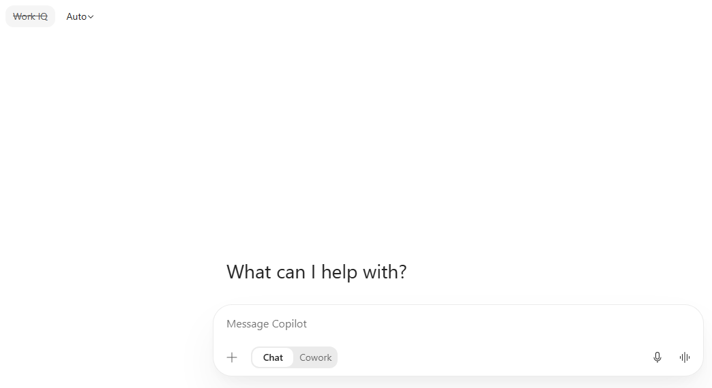
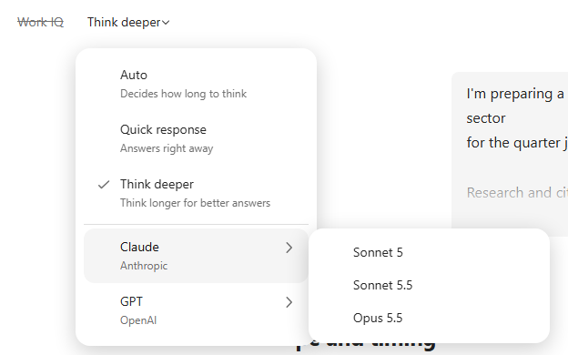
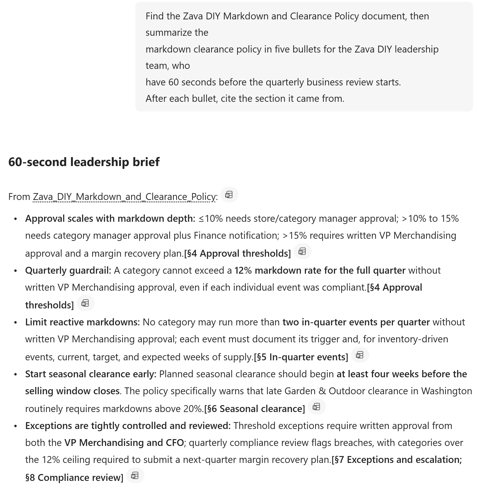
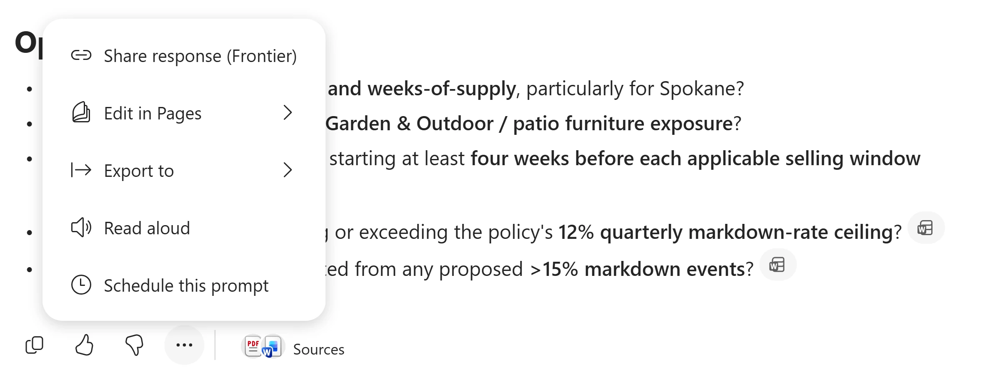
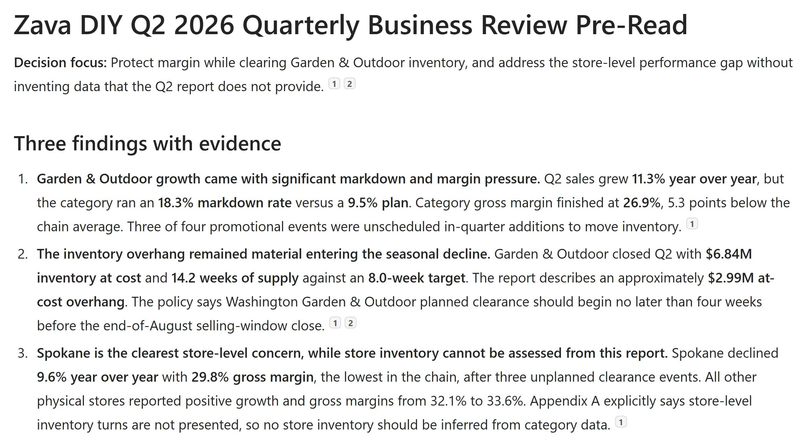
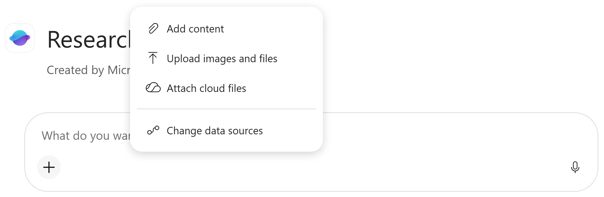

# Microsoft Copilot Chat and Work IQ

Follow this lab in [Copilot & Agents Bootcamp](https://microsoft.github.io/mcs-labs/events/architecture-bootcamp/).

Build a cited Zava DIY decision brief with Copilot Chat, deeper reasoning and Work IQ, then optionally explore Pages, Researcher and Analyst.

## 🧭 Lab Details

| Level | Persona | Duration | Finish line |
| --- | --- | --- | --- |
| 100 | Business User | 15 minutes | A cited market summary, policy decision checklist and checked store-performance table |

You have joined **Zava DIY**, a home improvement retailer with seven Washington State stores plus Zava Retail Online, as an operations analyst. The quarterly business review is in two days.

<p class="lab-setup-note">At a proctor-led event with a provided, pre-provisioned account? <strong>You're ready to start.</strong></p>

<details class="lab-setup" markdown="1">
<summary>Using your own tenant? View setup requirements</summary>

Complete the [classic lab prerequisites](../mcs-m365-copilot-latest/#prerequisites) before starting. That section covers licensing, agent availability and placing the two Zava DIY files in accessible OneDrive or SharePoint content.

</details>

**Attendee readiness**

- Sign in to [Microsoft Copilot](https://copilot.cloud.microsoft/) with your provided **training account**.

Ask, Reason, Apply and Verify take about 15 minutes; Publish, Research and Model are optional.

## 📚 Table of Contents

- [Ask: Find the public market context](#-ask-find-the-public-market-context)
- [Reason: Compare a deeper market analysis](#-reason-compare-a-deeper-market-analysis)
- [Apply: Turn a policy into a decision](#-apply-turn-a-policy-into-a-decision)
- [Verify: Make missing evidence visible](#-verify-make-missing-evidence-visible)
- [Publish: Turn the checked answer into a pre-read (optional)](#-publish-turn-the-checked-answer-into-a-pre-read)
- [Research: Connect the issues across a hotel report (optional)](#-research-connect-the-issues-across-a-hotel-report)
- [Model: Calculate the financial case (optional)](#-model-calculate-the-financial-case)
- [Take it with you](#-take-it-with-you)

## 🔎 Ask: Find the public market context

**3 minutes · Copilot Chat**

**Finish line:** A short market summary with a source you have opened.

1. Open [Microsoft Copilot](https://copilot.cloud.microsoft/). In the prompt box, select **Chat**, not the default **Cowork**.
2. Select **Work IQ**, next to **Auto**, so it is crossed out.

<details>
<summary>Why these controls?</summary>

Close any first-run tour covering the controls before choosing Chat. The old `m365.cloud.microsoft` bookmark redirects here. Cowork keeps Work IQ on; this exercise uses regular Chat with public-web grounding. Work IQ off excludes work-context retrieval from your files, mail, meetings and chats.

</details>

<picture><source media="(prefers-color-scheme: dark)" srcset="images/chat-workiq-off-dark.webp"></picture>

Check both controls before prompting.

3. Leave **Auto** selected. Paste the prompt and select **Send**:

```text
I've just joined a home improvement retailer as an operations analyst.
Give me the state of the US home improvement retail market right now:
demand, consumer behaviour, and the pressures on retail margin.
Under 150 words, with a link for anything you state as a fact.
```

4. Select a reference in the answer and check that its source supports the claim and is current enough for your briefing. No file or URL was supplied; public search can provide context, but an unsupported statement still needs verification.
<details>
<summary>Reveal: What made this a public-web answer?</summary>

**Choose the context before asking the question.** Work IQ was off and the task asked for cited public market information. Response mode affects the speed-versus-reasoning choice; model choice can change the answer's voice and structure. Neither replaces checking a reference.

Choose grounding → Ask a focused question → Open a reference.

</details>

**Quick check:** Which action makes the market summary checkable?

- A. Use the longest answer from the newest model.
- B. Open a cited source and compare it with the claim.

<details>
<summary>Check your answer</summary>

**B is correct:** verify both what the source says and when it was published. Length and model choice do not prove a claim.

</details>

**Stuck?** If Work IQ will not switch off, check that the composer is in Chat, not Cowork. If the picker offers different models, keep Auto or an available model; the goal is deliberate choice, not access to one model version.

## 🧪 Reason: Compare a deeper market analysis

**3 minutes · Copilot Chat**

**Finish line:** A comparison of evidence, calculations and uncertainty across two market answers.

1. In the same market chat, select **Chat** if needed and confirm **Work IQ** is off. Open the response-mode selector and select **Think deeper**.
2. Paste the prompt and select **Send**. Allow more time than for the short market question:

```text
I'm preparing a market briefing on the US home improvement retail sector for the quarter just ended.

Research and cite, with a source and date for each:
- Comparable-store sales at the large national home improvement retailers
- US housing starts and existing home sales
- The prevailing 30-year mortgage rate
- Producer prices for lumber and building materials

Prefer Washington State or Pacific Northwest figures where they exist, and say when you substituted national data.

Then answer, showing your working:
1. Is this market growing or shrinking in real terms once inflation is stripped out? Show the arithmetic and say which inflation figure you applied.
2. Which two indicators best predict next quarter's DIY demand, and what are they saying right now? Say how far ahead each one leads.
3. Where would you expect margin pressure to show up first, and why? Argue against your own answer before you commit to it.

Flag anything you could not source. Do not present an estimate as a fact.
```

3. Scroll to the first response. Select **Reasoned for**, when shown, to inspect the displayed reasoning details. Compare references, retrieved versus calculated numbers, named uncertainties and whether the conclusion argues against itself.

The prompt changed as well as the response mode, so this is not a controlled model benchmark. Auto can also reason deeply on a complex question; leave Auto selected when unsure.

4. Open the selector beside **Work IQ**. Notice **Auto**, **Quick response** and **Think deeper**. Below them, point to **Claude** and choose an available model, such as **Sonnet 5.5**, or inspect **GPT**.

<details>
<summary>Choose a response mode and model</summary>

Auto decides how long to think; Quick response favors speed for recall, rewriting and short lookups; Think deeper spends longer on multi-step reasoning. When unsure, use Auto. Model names and availability depend on tenant and admin settings. Optionally ask a fresh question of your own after switching models; do not ask it to assess an earlier model's web results.

</details>

<picture><source media="(prefers-color-scheme: dark)" srcset="images/model-picker-dark.webp"></picture>

The menu shows Auto selected and the available Claude models. Your available models may differ. Compare voice, structure and evidence, not just fluency. A different model can fail to recognize earlier web results in the same conversation.

<details>
<summary>Reveal: Did the selector do all the work?</summary>

**The question asks for the reasoning you need.** The detailed prompt requests dated sources, arithmetic, caveats and a counterargument. Think deeper makes the reasoning preference explicit, but you still have to inspect the evidence and calculations.

Specify the analysis → Allow reasoning time → Compare evidence.

</details>

**Quick check:** Does Think deeper make every claim reliable?

- A. Yes, longer reasoning replaces source checks.
- B. No, I must check sources, dates and calculations.

<details>
<summary>Check your answer</summary>

**B is correct:** reasoning depth is a choice, not a factual guarantee. More reasoning can still produce unsupported claims.

</details>

**Stuck?** If the response is still working, check whether it needs input, then wait or read the comparison criteria. Do not start a duplicate request just to meet the time budget.

## 📋 Apply: Turn a policy into a decision

**4 minutes · Copilot Chat + Work IQ**

**Finish line:** A cited policy summary and an approval, timing and evidence checklist for a 17% patio-furniture markdown.

1. Select **New** in the left pane, then **Chat** if needed. A new chat retains the last Work IQ setting: select **Work IQ** to turn it on and confirm it is no longer crossed out.

The training environment already contains the **Zava DIY Markdown and Clearance Policy** and **Q2 2026 Store Performance Report** in SharePoint. Own-tenant preparation is linked above, not part of this attendee checklist.

2. Paste the prompt and select **Send**:

```text
Find the Zava DIY Markdown and Clearance Policy document, then summarize the markdown clearance policy in five bullets for the Zava DIY leadership team, who have 60 seconds before the quarterly business review starts.
After each bullet, cite the section it came from.
```

<picture><source media="(prefers-color-scheme: dark)" srcset="images/policy-answer-dark.webp"></picture>

Inspect the cited sections rather than expecting identical wording.

3. Select a citation, such as the document name after **From**. Read the source in the right-hand preview. Select **Open in Word** for the full file, or **X** to close the preview.
4. Send the next prompt in the same conversation. Check each approval, lead-time and attachment requirement against its governing section, including whether next Tuesday is achievable:

```text
I'm the category manager for Garden & Outdoor.
I want to run a 17% markdown on patio furniture starting next Tuesday to clear inventory before the season closes.

Walk me through exactly what this policy requires:
- Who has to approve it
- How much lead time is required
- What I have to attach to the request
- Whether next Tuesday is achievable at all

Quote the governing section for each requirement, and tell me if any part of my plan isn't allowed.
```

<details>
<summary>Reveal: Why ask twice?</summary>

**Summarizing a rule is not the same as applying it.** The first answer orients you. The second must connect multiple requirements to a specific proposal. Citations let you test that reasoning; the answer does not itself approve a markdown.

Find the policy → Apply each requirement → Check the conclusion.

</details>

**Quick check:** Copilot says the proposal needs approval. What have you obtained?

- A. A checklist to verify against the policy, not an actual approval.
- B. Approval to launch the markdown next Tuesday.

<details>
<summary>Check your answer</summary>

**A is correct:** the relevant decision-maker still has to approve the real proposal. A chat response is not a recorded business approval.

</details>

**Stuck?** If the policy cannot be found, check the provided account and Work IQ setting. Ask the facilitator to check sample-data access; do not substitute a generic policy answer.

## 🔍 Verify: Make missing evidence visible

**5 minutes · Copilot Chat + Work IQ**

**Finish line:** A physical-store performance table with explicit missing inventory values.

1. Stay in the same grounded chat. Do **not** attach a file or paste a link. Send the prompt and let Work IQ locate the named report:

```text
Find the DIY Q2 2026 performance and cross-reference it with the policy.

Build a table of all stores besides online with these columns:
- Store
- Gross Margin
- Year-over-year growth
- Store-level inventory

Use only figures actually printed in that report.
Where the report does not state a value, write "not stated."
Do not estimate, calculate, or infer anything.
```

2. Open the citations and confirm they point to the Q2 2026 performance-report PDF. Compare the table with the report: include physical stores, exclude online, and check gross margin and year-over-year growth.

Store-level inventory should read **not stated**. The report deliberately withholds it and says so in the methodology appendix. Category-level inventory is not store-level inventory.

3. Keep this conversation for the optional **Publish** mission. You now have a market summary, policy decision checklist and checked performance table; do not turn missing values into estimates.

<details>
<summary>Reveal: Was the empty inventory column a failure?</summary>

**A visible gap is better than a plausible number.** Work IQ retrieved organizational content without an attachment or supplied location. It still respects the signed-in user's existing access. Retrieval does not mean every requested value exists; the report's missing inventory is part of the answer.

Name the report → Check the cited PDF → Preserve missing evidence.

</details>

**Quick check:** The report has no store-level inventory. What belongs in the table?

- A. An estimate allocated from category inventory.
- B. Not stated.

<details>
<summary>Check your answer</summary>

**B is correct:** that accurately preserves the source's limitation. The prompt forbids calculating or inferring missing values.

</details>

**Stuck?** If inventory numbers appear or the wrong document is cited, inspect the PDF and methodology appendix. Do not accept the numbers as verified; point out the source mismatch in chat or ask the facilitator. If the report cannot be found, confirm the training account and Work IQ on, then ask the facilitator to check file access. Switching Work IQ on does not grant new permissions.

## 📄 Publish: Turn the checked answer into a pre-read

**Optional · 2 minutes · Copilot Chat + Pages**

**Finish line:** An editable Copilot Page with evidence, actions and open questions.

1. Return to the grounded Zava DIY conversation from **Verify**. Confirm **Work IQ** is on. Send the prompt and wait until the response is complete:

```text
Turn this into a one-page pre-read for the Zava DIY quarterly business review:
- Title
- Three findings with evidence
- Three recommended actions with owners left blank
- Open questions
```

2. At the bottom of that response, select **More options** (**...**) → **Edit in Pages**. Wait for the page to open on the right and the chat to confirm **Page created**.

<picture><source media="(prefers-color-scheme: dark)" srcset="images/edit-in-pages-dark.webp"></picture>

Create the answer first, then open its menu.

3. Check the new findings and open questions against the original sources, then edit the page directly to correct or add information. For example, the report does describe Spokane's competitive pressure and declining foot traffic; do not accept a claim that it gives no cause. Keep owners blank until agreed. To share with colleagues, use the share icon at the top right and review recipients; in this lab, share only if your facilitator directs you to.

For a later Copilot revision, request a new answer in chat and open that answer in Pages again.

<picture><source media="(prefers-color-scheme: dark)" srcset="images/preread-excerpt-dark.webp"></picture>

An example of the optional Pages deliverable: findings with evidence, ready for your review.

4. In the same chat, turn the pre-read into a Word deliverable. Send the prompt, then open the Word file Copilot creates and check it against the edited page and original sources before sharing. A Word version can reuse uncorrected chat text; edits to the page are not automatically carried into it.

```text
Turn this into a one-page Word pre-read for the Zava DIY quarterly business review:
- Title
- Three findings with evidence
- Three recommended actions with owners left blank
- Open questions
```

<details>
<summary>Reveal: What changed beyond the answer?</summary>

**You now have an editable artifact.** Pages gives the checked response a place to be edited and shared. The recommendations still need human review, and a message claiming an edit succeeded is not proof the page changed.

Complete the chat response → Edit in Pages → Verify the artifact.

</details>

**Quick check:** What is the verified path to this pre-read?

- A. Create it in chat, then use More options → Edit in Pages.
- B. Ask beside an open page and trust a success message.

<details>
<summary>Check your answer</summary>

**A is correct:** open the completed response as the page, then inspect it. In B, the visible page may not have changed.

</details>

**Stuck?** If the page did not update after a chat request, generate the revised answer in chat and use its Edit in Pages action, or edit the page directly.

**Check your result:** The open Page shows your corrections, source-backed findings and blank owners—not just a chat message claiming it changed. If you also created Word, its contents match the corrected pre-read.

## 📖 Research: Connect the issues across a hotel report

**Optional · 10 minutes · Researcher**

**Finish line:** A sourced executive briefing and a problem-to-recommendation gap analysis. You are now the regional vice president reviewing Contoso Grand Hotel & Resort.

1. Download the [Contoso Grand Hotel Performance Report](https://github.com/microsoft/mcs-labs/raw/main/labs/agent-builder-m365/Contoso_Grand_Hotel_Performance_Report.pdf). Save it somewhere you can find for this mission and **Model**. It contains financial and operational tables across 18 sections.
2. In [Microsoft Copilot](https://copilot.cloud.microsoft/), start a new chat, type `@Researcher` in the prompt box and select the **Researcher** suggestion. Look for **What do you want to research today?**
3. Select **+** → **Upload images and files**, choose `Contoso_Grand_Hotel_Performance_Report.pdf`, and wait for the attachment to appear.

<picture><source media="(prefers-color-scheme: dark)" srcset="images/upload-report-dark.webp"></picture>

Wait for the report attachment before sending. Researcher and Analyst are **built-in agents**, not agents you need to create. Use the fictional sample only; uploading from your device sends a copy to OneDrive.

4. Send the prompt after the file is attached:

```text
Create an executive briefing for the GM that summarizes:
- The five most urgent operational issues
- Their root causes
- Their financial impact
- Recommended fixes

Source every finding from this report.
```

5. If Researcher asks whether to proceed or use its best judgement, send the short reply below. Otherwise, skip this step. Allow a few minutes and follow its progress rather than starting again:

```text
go ahead
```

6. Review the **Research Plan** and **Thought process** when shown. Open the briefing full screen and check its **Sources**: connect housekeeping, WiFi, HVAC, F&B margins and elevator issues to root causes, financial impact and Section 16 recommendations.

<details>
<summary>Trace the sections and inspect output options</summary>

The analysis connects occupancy (Section 3), housekeeping (6), satisfaction (8), online reviews (9), maintenance (12) and recommendations (16). Inspect rather than assume complete coverage. If offered, use Convert to for Word, PowerPoint, PDF or Infographic output.

</details>

7. Send the follow-up in the **same conversation** so it retains the report context. First confirm the composer still shows **Research** or **Researcher**. If it has returned to **Message Copilot**, type `@Researcher` and select the suggestion again before pasting the prompt, particularly after returning from the full-screen briefing:

```text
Identify every metric in this report that is trending in the wrong direction or below target.

For each one, trace the root cause and map it to a specific recommendation.
Are there any gaps where a problem exists but no recommendation addresses it?
```

Check KPI tables and recommendations R1–R10. Examples to verify include housekeeping SLA at 77% versus a 90% target and WiFi satisfaction at 3.60 versus 4.0; inspect linen costs, parking revenue and valet retrieval time for gaps. The follow-up may finish without another research plan.

8. Optionally send this follow-up with **Research** or **Researcher** still selected, then compare the counterargument with the report:

```text
What's the strongest counterargument to your top recommendation?
```

<details>
<summary>Reveal: Why is this different from a section summary?</summary>

**The useful insight crosses section boundaries.** Researcher is being asked to connect causes, impacts and recommendations rather than retell one section. The gap analysis tests coverage; do not assume that a polished briefing is exhaustive.

Attach one report → Connect sections → Check recommendation gaps.

</details>

**Quick check:** A metric is below target but no recommendation addresses it. What should the briefing say?

- A. Name the gap and cite the evidence.
- B. Assign it to the closest recommendation even if unrelated.

<details>
<summary>Check your answer</summary>

**A is correct:** an uncovered problem is a finding, not something to hide. Assigning an unrelated recommendation would conceal a gap instead of demonstrating coverage.

</details>

**Stuck?** If Researcher is not offered when you type `@Researcher`, ask the facilitator to check availability for the assigned account. Continue the core Chat missions; do not build a replacement agent. If it pauses, read and answer its clarification; use the go ahead reply only when it asks to proceed, not to bypass a missing attachment or permission.

## 📊 Model: Calculate the financial case

**Optional · 5 minutes · Analyst**

**Finish line:** A ranked ROI table and a financial approve, marginal or defer summary. As the hotel's CFO, go beyond simple payback using explicit cash-flow assumptions.

1. Start a new chat, type `@Analyst` in the prompt box and select the **Analyst** suggestion.
2. Select **+** → **Upload images and files** and attach `Contoso_Grand_Hotel_Performance_Report.pdf` again. If you skipped Research, [download the same hotel report here](https://github.com/microsoft/mcs-labs/raw/main/labs/agent-builder-m365/Contoso_Grand_Hotel_Performance_Report.pdf). Wait for the attachment. Uploading from your device sends a copy to OneDrive; use only the fictional sample.
3. Send the prompt. Let Analyst extract Section 16's costs and returns and compute the requested model:

```text
Using the recommendation data from Section 16 of this hotel performance report, build a detailed ROI analysis for each of the 10 recommendations (R1 through R10).

For each recommendation, extract the investment cost and estimated annual ROI, then calculate:
1. Net Present Value (NPV) at an 8% discount rate over a 5-year horizon
2. Internal Rate of Return (IRR)
3. Payback period, both simple and discounted
4. 5-year cumulative net benefit, total returns minus investment

Assume annual ROI begins in Year 1 and remains constant over the 5-year period.
For the elevator modernization (R5), assume the $1.2M investment is split evenly across Year 0 and Year 1, with returns beginning in Year 2.
For ongoing annual programs (R7, R10), treat the annual investment as a recurring cost each year.

Present the results in a ranked table sorted by NPV, highest to lowest.
Include a column indicating whether each recommendation creates or destroys value at the 8% hurdle rate.

Then provide a summary recommendation on which investments should be approved, which are marginal, and which should be deferred, based purely on the financial analysis.
```

4. Check that all ten recommendations appear, sorted by NPV. Compare extracted costs and annual returns with Section 16; inspect the 8% rate, five-year horizon, R5 timing and recurring R7/R10 costs before accepting the approve, marginal or defer summary.

The source provides simple payback. NPV, IRR and discounted payback here are computed results, not facts copied from the report. An undefined IRR needs explanation, not an invented number. If investment is not recovered within five years, label it accordingly; a longer payback requires an explicit assumption about returns beyond the model horizon. Model generation can take a couple of minutes.

For R7/R10, ask for a Year 0–5 cash-flow table if payment timing is unclear. Check whether the five annual costs are paid in advance in Years 0–4 or alongside benefits in Years 1–5. Conventional IRR needs both negative and positive cash flows; a model with only positive net flows must not invent an IRR. With no initial outflow, annual cost divided by annual benefit is not a conventional project payback period; ask Analyst to reconcile any such figure with its cash flows.

5. Optionally send this follow-up in the same Analyst conversation:

```text
Now create a chart showing NPV vs. Investment Cost for all 10 recommendations, with bubble size representing IRR.
```

If you see code or a file name instead of a rendered chart, try the answer's **Provide the chart as a downloadable PNG** suggestion if offered, or rely on the ranked table.

6. Optionally send the second follow-up. Check the proposed combination, its total cost and total NPV against the ranked table and the cash-flow assumptions. Ask Analyst to state whether the budget covers initial funding or total five-year spending: R7/R10 recur and R5 has two installments. A first-year total does not include every later commitment.

```text
Which combination of recommendations gives the highest total NPV while staying under a $1.5M total budget constraint?
```

<details>
<summary>Reveal: What did Analyst add to the source?</summary>

**Extraction supplies inputs; calculation produces a model.** Researcher connected strategic evidence. Analyst uses the same report for quantitative analysis, including discounted cash flows and a budget-constrained investment choice. Those results depend on the assumptions you supplied and still need validation.

Extract report data → Apply explicit assumptions → Check computed results.

</details>

**Quick check:** Where did the NPV and IRR figures come from?

- A. They were necessarily printed in the source report.
- B. They were calculated from report data and the prompt's assumptions.

<details>
<summary>Check your answer</summary>

**B is correct:** check both the inputs and the cash-flow model before relying on them. This exercise asks Analyst to calculate beyond the report's simple payback.

</details>

**Stuck?** If Analyst is missing or cannot see the report, check the assigned account and wait for the upload to finish. Ask the facilitator about missing agent access; an attachment in Researcher is not automatically an attachment in Analyst.

## 🎒 Take it with you

Your core result is a cited market summary, policy decision checklist and checked store table. Optional missions add an editable pre-read, a research briefing and a financial model.

- **Grounding:** choose public-web or permitted work context before prompting; Work IQ does not widen access.
- **Judgment:** open citations, preserve missing values, and distinguish a recommendation from an approval.
- **Tool choice:** use response modes deliberately; compare models, use Researcher for synthesis and Analyst for computation.
- **Deliverables:** create the pre-read in chat before opening it in Pages, and verify any later edits.

**Reflect:** Which recurring policy or investment decision in your job needs better evidence rather than a more fluent answer? What source would you check first?

**Cleanup:** Keep all outputs within the training environment. Do not send or broadly share them. No recurring work is created by this lab; follow your facilitator's retention guidance for uploaded PDFs and Pages.

### 📚 Product guidance

- [Microsoft Copilot documentation](https://learn.microsoft.com/copilot/)
- [What is Researcher agent in Microsoft Copilot?](https://learn.microsoft.com/copilot/manage/researcher-agent)

Product UI and available capabilities can vary by tenant. Generated results will differ.
