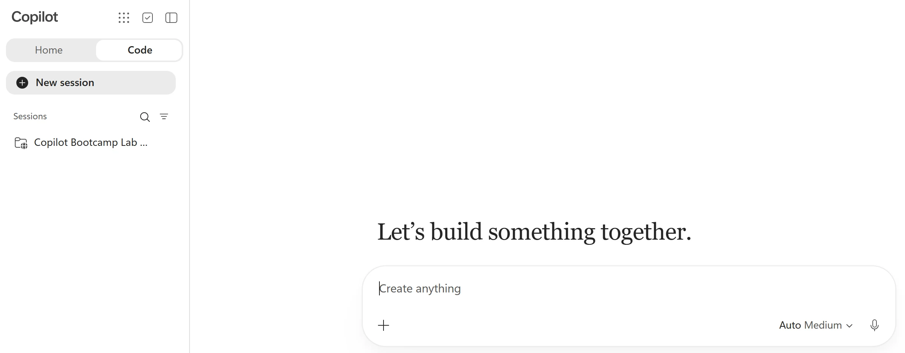
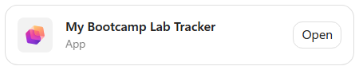
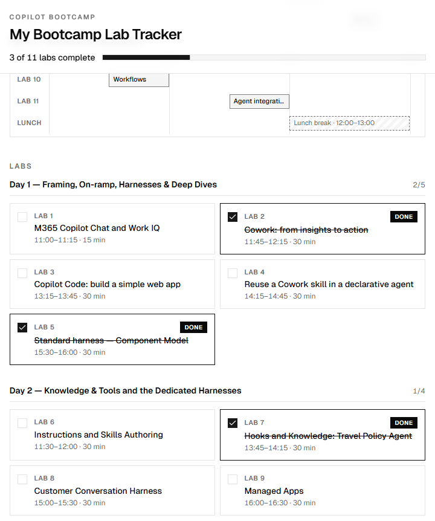
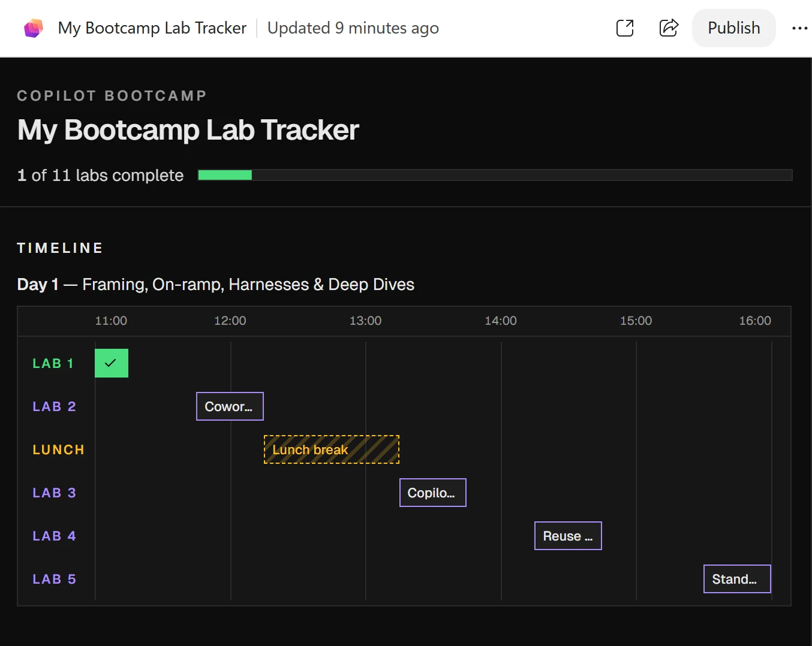
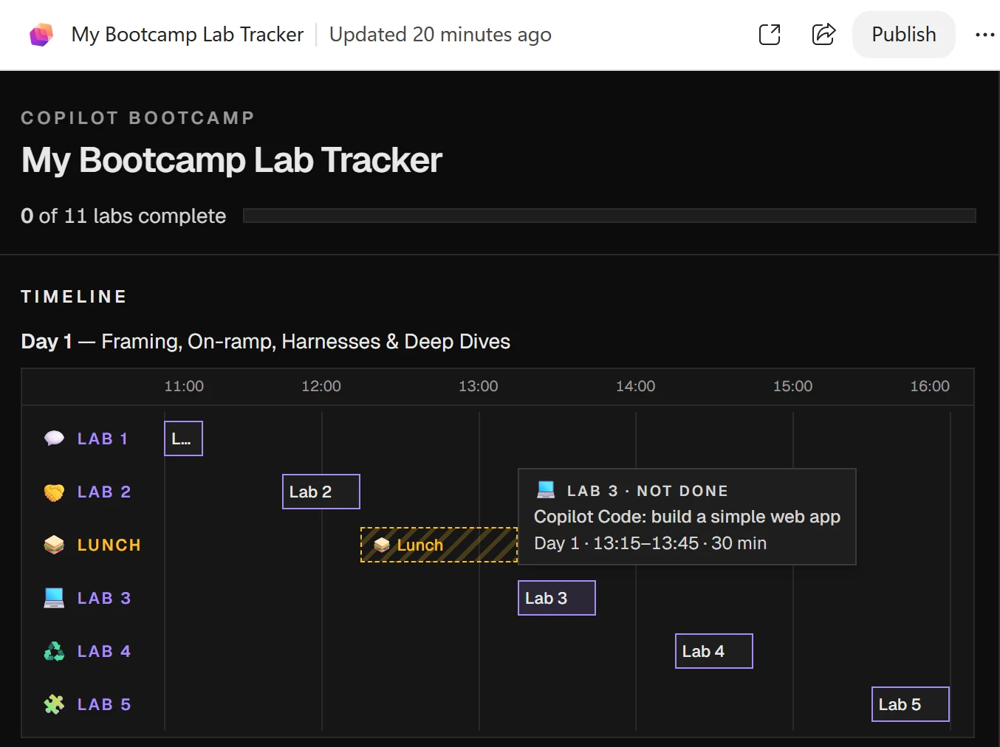
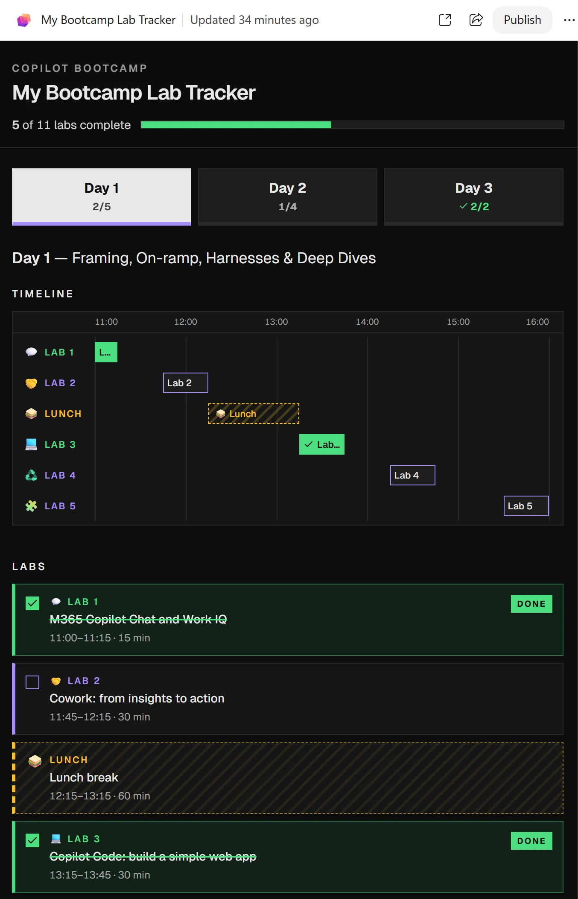
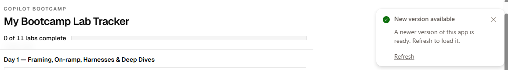
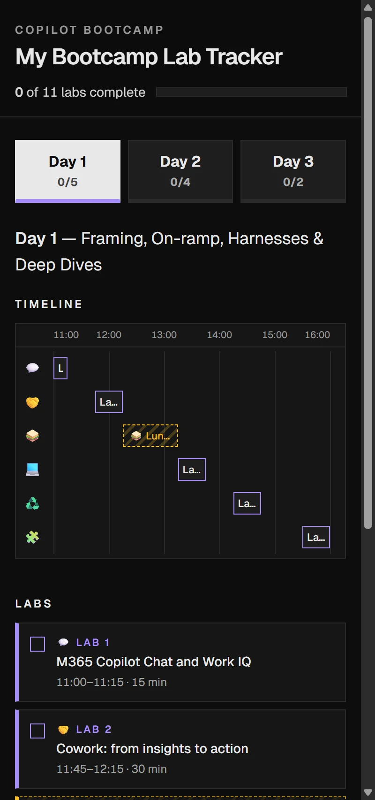

# Copilot Code: build a simple web app

Follow this lab in [Copilot & Agents Bootcamp](https://microsoft.github.io/mcs-labs/events/architecture-bootcamp/).

Build, refine, and publish a Bootcamp Lab Tracker through four sequential prompts, checking its schedule, progress, and accessible day tabs.

## 🧭 Lab Details

| Level | Persona | Duration | Finish line |
| --- | --- | --- | --- |
| 100 | Maker | 30 minutes | A published tracker built from the agenda, with a dark design, emojis, accessible day tabs, and verified completion behavior. |

**Scenario:** You need one place to see every day's labs and mark them complete. Build from the published agenda, not an invented schedule. Lunch belongs on the timeline but must never count toward progress.

<p class="lab-setup-note">At a proctor-led event with a provided, pre-provisioned account? <strong>You're ready to start.</strong></p>

<details class="lab-setup" markdown="1">
<summary>Using your own tenant? View setup requirements</summary>

Complete the [classic lab's prerequisite setup](https://microsoft.github.io/mcs-labs/labs/mcs-copilot-code/#prerequisites) separately before starting. Copilot Code is a Frontier preview in the browser; this exercise needs no local development toolchain.

</details>

- Sign in to [Microsoft Copilot](https://copilot.cloud.microsoft) with your provided **lab account** in a separate browser profile or private window, not a personal or production account.
- Open the [published bootcamp agenda](https://microsoft.github.io/mcs-labs/events/architecture-bootcamp/) for comparison.
- Ask your facilitator if **Code** or the app link is unavailable; do not change tenant settings during the lab.

Plan **30 minutes for Build (11) → Style (4) → Label (3) → Navigate (4) → Publish (8)**. Extend is an **optional 3-minute reflection**. Prompt 1 usually takes **5–7 minutes**; each update and final publishing take about **1–2 minutes**. These are working budgets, not guaranteed run times. Read ahead or answer a check while waiting; do not resend prompts, start duplicate sessions, or submit the remaining prompts together.

## 📚 Table of Contents

- [Build: Turn the agenda into a tracker](#-build-turn-the-agenda-into-a-tracker)
- [Style: Change the look, preserve the behavior](#-style-change-the-look-preserve-the-behavior)
- [Label: Shorten labels without losing meaning](#-label-shorten-labels-without-losing-meaning)
- [Navigate: Give each day an accessible tab](#-navigate-give-each-day-an-accessible-tab)
- [Publish: Verify the version other people can open](#-publish-verify-the-version-other-people-can-open)
- [Extend: Transfer the method to your own idea (optional)](#-extend-transfer-the-method-to-your-own-idea)
- [Take it with you](#-take-it-with-you)

## 🔨 Build: Turn the agenda into a tracker

**11 minutes · Copilot Code**

**Outcome:** A published neutral-grey tracker whose schedule and completion controls match the brief.

1. Open [Microsoft Copilot](https://copilot.cloud.microsoft) and sign in with your lab account.
2. Select **Code** in the **Home &#124; Code** switcher at the top of the left pane, then **New session**.
3. Find **Let's build something together.** and the **Create anything** box.

<picture><source media="(prefers-color-scheme: dark)" srcset="images/code-new-session-dark.webp"></picture>

Start in Create anything. Keep the same session for all four prompts.

4. Paste **Prompt 1** unchanged into **Create anything**, including the agenda URL and final instructions, then select the send arrow. Do not send Prompts 2–4 yet.

```text
Build an app called "My Bootcamp Lab Tracker". Progress is kept in memory only: it starts with every lab unchecked and resets on reload.

Fetch the agenda at https://microsoft.github.io/mcs-labs/events/architecture-bootcamp/ and use every day's "Lab N:" items and "Lunch break" as the app's data (day, number, title, start, end). Skip everything else, including optional labs. If the page can't be fetched, stop and tell me.

Layout (max 720px, centered):

- **Sticky header:** "COPILOT BOOTCAMP" eyebrow, title, "N of TOTAL labs complete" (aria-live) and a progress bar.

- **Timeline:** a Gantt chart for each day with hourly gridlines. Each row is labelled "LAB N" or "LUNCH". Lab bars are toggle buttons (aria-pressed) showing the title, truncated with "…". Hovering or focusing a bar shows a tooltip with its details. Lunch bars aren't clickable.

- **Cards:** grouped by day. Each lab card is a label around a checkbox, showing "LAB N", the title and the time. Done cards get a strike-through and a "DONE" badge.

Keep the bars, checkboxes, counter and progress bar in sync. Use neutral greys and square corners, with visible focus outlines. When done, give me a preview link I can open in my browser.
```

5. Keep the tab open for about **5–7 minutes** while Copilot Code fetches the agenda, writes and checks the code, then publishes. If it asks for permission to continue, for example to search the web, review and approve that lab action.
6. Select **Open** on the **My Bootcamp Lab Tracker** app card to show **Preview** beside the chat. Then select the **Open in app** arrow in Preview's toolbar (accessible name: **Open My Bootcamp Lab Tracker in app**) to open the published tracker in a new browser tab.

   The app tab may ask you to sign in again. Use the same lab account. If an account picker also lists your personal or work account, choose the lab account or **Use another account**; do not select the account connected to your device.

<picture><source media="(prefers-color-scheme: dark)" srcset="images/prompt1-app-card-dark.webp"></picture>

Open shows Preview; use its Open in app arrow for the published app. Copilot Code checks that the code builds and publishes, but it cannot click through the app itself in this flow. The behavior checks are yours.

### ✅ Check the basic tracker

1. Compare every day's lab numbers, titles, start/end times, and Lunch with the [published agenda](https://microsoft.github.io/mcs-labs/events/architecture-bootcamp/). Confirm time order.
2. Confirm modules, welcome/re-cap, coffee breaks, Q&A, social, and all optional labs are excluded.
3. Count the included labs. Confirm the header starts at **0 of TOTAL**, using that count rather than a fixed number.
4. Confirm neutral greys and square corners. The initial app may follow your browser's light or dark theme; purple, green, amber, emojis, and day tabs come in the next three prompts.
5. Click a lab's timeline bar. Check that its checkbox, styling, overall completion count, and progress bar update together.
6. Toggle a card's checkbox and check that its timeline bar updates too.
7. Uncheck a completed lab to reverse completion.
8. Complete every included lab and confirm **TOTAL of TOTAL**.
9. Try each day's Lunch: it must not toggle or count toward progress.
10. Reload the page and confirm all labs reset to unchecked.
11. Use **Tab** and **Space** to operate the controls and confirm visible keyboard focus.

<picture><source media="(prefers-color-scheme: dark)" srcset="images/tracker-basic-checked-dark.webp"></picture>

Your first milestone: a working tracker in neutral greys. The example has 11 labs; use the current agenda's total.

Fix failed checks before refining: describe the action, expected result, and actual result to Copilot Code in this same session. Ask it to preserve the original specification, correct the defect, and publish the correction. Select **Refresh** in **New version available**, then repeat the check. Ask your facilitator if it still fails. Only then continue to Prompts 2–4.

**Reveal — What makes this more than a convincing screen?** A working app passes observable checks, including undo and reload. The prompt specifies content, interactions, and constraints. The agenda is the source of truth; synchronized state makes several controls reflect one completion value. A successful build alone does not establish that behavior.

**Flow:** Published agenda → Explicit specification → Generated app → Behavior you verify.

**Quick check:** The screenshot shows 11 labs. Which total should your tracker use?

- Always 11, because that is the example.
- The number of included scheduled labs parsed from the agenda, excluding Lunch and optional labs.

<details>
<summary>Check your answer</summary>

**The parsed scheduled-lab total is correct.** An example screenshot is not the data source; the agenda can change. The total must match the source data and the explicit exclusions.

</details>

**If generation overruns:** Check whether Copilot Code is waiting for permission. If it is actively working, read ahead without submitting the next prompt. Do not resend Prompt 1 or start a second session. Ask your facilitator for help if generation or troubleshooting overruns.

**If the link fails:** Ask Copilot Code for a working link before continuing. If it still fails, tell your facilitator. If the agenda cannot be fetched or contains no matching labs, stop and tell your facilitator; do not fabricate a schedule.

<details>
<summary>If a behavior or keyboard-focus check fails</summary>

Report the action, expected result, and actual result in the same Code session. Ask for a focused correction without changing the agenda or in-memory progress, publish it, and select **Refresh** in the app's **New version available** notice. A browser reload alone may still open the previous version. Repeat the failed check before continuing; ask your facilitator if it still fails.

If **Tab** and **Space** work but focus is invisible, ask Copilot Code to give timeline buttons and card checkboxes (or their enclosing labels) a clearly visible solid focus outline in both themes. Publish, load the notified version, and repeat **Tab** and **Space** on both control types. A successful build does not prove that the outline is visible.

</details>

## 🎨 Style: Change the look, preserve the behavior

**4 minutes · Copilot Code + Preview**

**Outcome:** A dark preview with purple to-do labs, green completed labs, and amber Lunch.

1. Paste **Prompt 2** unchanged into **Ask a follow-up or request changes** in the same session and send it.

```text
Update with a dark theme, keeping everything else the same.
- Background #0d0d0d, surfaces #161616/#1e1e1e, borders #2a2a2a, text #d4d4d4, headings #e8e8e8.
- To do = purple #a78bfa (outlined bars, purple left border on cards).
- Done = solid green #4ade80 bars, green-tinted cards.
- Lunch = amber #fbbf24, with a dashed border and diagonal stripes.
Keep focus outlines visible and respect prefers-reduced-motion.
```

2. Wait for Copilot Code to finish the update, then inspect the **Preview** pane beside the chat. The **Open in app** arrow opens the published app, not this live preview.
3. Confirm incomplete labs are purple, completed labs green, and Lunch amber with dashed borders and stripes.
4. Toggle a lab in both directions. Confirm its bar, card, counter, and progress bar still agree, and focus outlines remain visible.

<picture><source media="(prefers-color-scheme: dark)" srcset="images/tracker-dark-theme-dark.webp"></picture>

The published tracker uses the dark appearance requested in the prompt.

Prompts 2–4 change **Preview** only; the published link keeps the basic version until you publish at the end. Each update reloads the preview, so earlier ticks reset because progress is in memory only.

**Reveal — Why say 'keeping everything else the same'?** A visual refinement is not a new specification. The design changes, but schedule and completion behavior remain acceptance criteria. Repeating a small behavior check after each update catches regressions before the final test.

**Flow:** One focused change → Wait for Preview → Recheck existing behavior.

**Quick check:** The preview is dark, but your published link is still grey. What happened?

- The follow-up changed the preview; the finished version still needs publishing.
- The prompt failed, so you should start a new app.

<details>
<summary>Check your answer</summary>

**The follow-up changed Preview only.** Publish after the refinements, then refresh the app tab. Preview and published versions are separate at this stage; keep the same session.

</details>

**If completed labs reset after an update:** That is expected because the app reloads. Do not add storage to fix it; resetting on reload is an explicit requirement.

**If bars look cut off:** Expand Preview or check the published app in its own tab. The next prompt also shortens bar labels while retaining full titles elsewhere.

## 🔎 Label: Shorten labels without losing meaning

**3 minutes · Copilot Code + Preview**

**Outcome:** Consistent topic emojis and short Lab N bars with full titles still available.

1. Paste and send **Prompt 3** in the same session.

```text
Update by giving each lab a distinct emoji that suits its topic; lunch is 🥪. Show it before "LAB N" in the timeline row labels, on the cards and in the tooltips. Lunch bars read "🥪 Lunch", and lunch cards show 🥪 instead of a checkbox. Hide emojis from screen readers. At ≤480px, the timeline row labels show the emoji only.

Lab bars should say "Lab N" instead of the title, which gets cut off. The full title stays in the tooltip, the aria-label and the card.
```

2. Wait about **1–2 minutes** for the update and inspect **Preview**.
3. Confirm each lab's emoji is consistent across its timeline row, card, and tooltip.
4. Check **Lab N** on the bars and the full title in the tooltip, accessible name, and card.
5. Confirm Lunch remains non-interactive. Save the narrow-screen check for the published tracker.

<picture><source media="(prefers-color-scheme: dark)" srcset="images/tracker-emojis-tooltip-dark.webp"></picture>

Short visual labels must not remove the full title. Generated emoji choices can differ.

**Reveal — Did shorter labels mean less information?** A compact visual label still needs a meaningful accessible name. Emojis help scanning, but they are decorative here. The tooltip, aria-label, and card retain the title so a shortened bar does not become an unexplained control.

**Flow:** Short visual label → Full title retained → Accessible name checked.

**Quick check:** Which change would violate Prompt 3?

- Showing Lab N on the bar while retaining the title in its accessible name.
- Replacing the accessible name with only an emoji.

<details>
<summary>Check your answer</summary>

**Replacing the accessible name with only an emoji violates the prompt.** Decorative emojis must not replace the meaningful lab name. A compact visual label with a complete accessible name is the intended result.

</details>

**If the full title is missing:** Hover or focus a bar and inspect the card and accessible name. Report the missing information to your facilitator; do not accept shortened labels that remove meaning.

## 🧭 Navigate: Give each day an accessible tab

**4 minutes · Copilot Code + Preview**

**Outcome:** Equal-sized day tabs with per-day counts and preserved completion across tab switches.

1. Paste and send **Prompt 4** in the same session.

```text
Update so each day is its own tab ("Day N" plus an x/y count), using the accessible ARIA tabs pattern with arrow-key navigation. Each tab shows that day's timeline and cards. Keep the header's overall progress, and keep ticks when switching tabs.

Make the tabs stand out: full-width, equal-size buttons with bold text. Unselected tabs are #1e1e1e with a #2a2a2a border and light text, and get lighter on hover. The selected tab is near-white #e8e8e8 with dark #0d0d0d text and a purple bottom border. A day's count turns green when all its labs are done.
```

2. Wait about **1–2 minutes** for the update.
3. Confirm **Preview** shows equal-sized day buttons, a clearly highlighted selected tab, and only that day's timeline and cards.
4. Complete a lab, switch days, then switch back: its tick must remain. Keep the session open for publishing.

<picture><source media="(prefers-color-scheme: dark)" srcset="images/tracker-day-tabs-dark.webp"></picture>

The sample's Day 3 count is green because all its labs are complete. Verify your own counts.

**Reveal — Why must tab switches keep ticks?** Navigation changes the view, not the underlying completion state. Each day displays a subset of the same app state. The header includes all days; the selected tab shows one day's controls. A reload deliberately starts a new in-memory state.

**Flow:** Complete a lab → Change the visible day → Keep shared state.

**Quick check:** Which behavior matches the specification?

- Switching tabs keeps ticks; reloading the page resets them.
- Both switching tabs and reloading must reset ticks.

<details>
<summary>Check your answer</summary>

**Switching tabs keeps ticks; reloading resets them.** Resetting on tab switches loses progress while you navigate and violates Prompt 4. A reload resets this intentionally in-memory prototype.

</details>

**If switching days loses a completed lab:** Reproduce the sequence in Preview and tell your facilitator the day, lab, and action that lost state. Do not confuse this defect with the expected reset after an update or page reload.

## 🚀 Publish: Verify the version other people can open

**8 minutes · Preview + published app + browser DevTools**

**Outcome:** A published tracker checked against the original specification, not just its appearance.

1. Select **Publish** at the top of **Preview**. Wait about **1–2 minutes** while it shows **Publishing…**, until **Your app is published** appears with **Open app** and **Share**. You can also ask Copilot Code to publish.
2. Return to the tracker browser tab and select **Refresh** in **New version available**. If the notice is absent after publishing completes, reload the tab to check for it, then select the notice's **Refresh** button; a browser reload alone may retain the older version. If the tab is closed, select **Open app**.

<picture><source media="(prefers-color-scheme: dark)" srcset="images/published-new-version-dark.webp"></picture>

Refresh loads the finished version; the notification is shown over the earlier published app. Run the remaining checks in the published app's tab, not just Preview.

### ✅ Check the finished tracker

1. Repeat [Check the basic tracker](#-check-the-basic-tracker): every day's numbers, titles, times, Lunch, exclusions, dynamic total, toggles, reversal, and **TOTAL of TOTAL** must still be correct.
2. Complete a lab on one day, switch to another, and switch back. Confirm the tick remains and the header includes completions from all days.
3. Compare each tab's **x/y** count with that day's completed and total labs.
4. Complete all labs on a day and confirm its count turns green both while that tab is selected and after selecting another day; uncheck one and confirm complete-day styling reverses.
5. Confirm bars, checkboxes, per-day counts, the overall counter, and progress bar stay synchronized. Lunch must never count.
6. Use **Tab** to reach the day tabs and selected day's controls.
7. Use arrow keys to navigate tabs; activate with **Enter** or **Space** if needed. Confirm visible focus.
8. Hover over or focus a lab bar and confirm its full title remains available.
9. Check with a screen reader that decorative emojis are not announced and each lab still has a meaningful name.
10. Make the published app narrower than 480px. In browser DevTools, press **F12**, then **Ctrl+Shift+M**, and set device emulation to **400px** wide.
11. Confirm timeline row labels show only emojis and day tabs remain usable. Also test **480px**: Prompt 3 includes that boundary. At **481px**, the row text should be visible again. If 480px fails, ask for a focused correction and repeat the check; passing at 400px alone is not enough.
12. Reload the page and confirm completion resets because there is no storage. This differs from switching tabs, which must keep ticks.
13. Confirm square corners and the dark theme remain after all updates.

<picture></picture>

Check usability at 400px, then verify the inclusive 480px boundary and the return of row text at 481px.

**Reveal — When is the task really finished?** After you open and use the published app. Publishing moves the refinements beyond Preview. Repeating the original checks catches regressions; keyboard, screen-reader, and narrow-width checks test whether a polished layout remains usable.

**Flow:** Publish → Refresh the app → Repeat functional checks → Test access and width.

**Quick check:** The app looks finished in Preview. What is still required?

- Nothing; a successful preview proves the published version works.
- Publish, refresh the app tab, and run the schedule, state, keyboard, and narrow-screen checks.

<details>
<summary>Check your answer</summary>

**Publish, refresh, and test.** The published link can still show the older version, and appearance does not prove behavior. Verify the version that opens from the app link and the behaviors specified in the prompts.

</details>

**If the link shows an older version:** Prompts 2–4 changed Preview only. Select **Publish**, wait for **Your app is published**, then **Refresh** in the app tab. If the link still fails, ask Copilot Code for a working link and tell your facilitator.

<details>
<summary>If short labels are clipped or the 480px check fails</summary>

If even **Lab N** is clipped on a short bar, or disappears when completed, ask Copilot Code to keep it readable before and after completion, including at 400px, without changing the agenda times or accessible name. A label beside a short bar can remain part of the same toggle button. Recheck the label, tooltip, and toggle after the correction.

If row text remains visible at 480px, tell Copilot Code that Prompt 3 requires emoji-only row labels at **480px inclusive**, not just below it. Ask it to preserve screen-reader text and all other behavior, publish the correction, and load it with the app's **Refresh** notice. Recheck 400px, 480px, and 481px.

</details>

**If a final check fails:** Report your action, expected result, and actual result. Keep the initial specification available; do not add persistent storage or invent a new schedule to conceal a failure.

## 💡 Extend: Transfer the method to your own idea

**Optional · 3 minutes · Your notes**

**Outcome:** A focused change brief with an acceptance check.

1. Write down one further refinement for this tracker or your own small app.
2. Name the existing behavior you would explicitly preserve; do not submit another build during the core lab.
3. Write one action and its expected result.
4. Explain why Prompt 2 preserves behavior, why Prompt 3 retains full titles, why a tab switch differs from reload, and why you check after each prompt instead of submitting all four together.

**Reveal — What transfers beyond this tracker?** Specify, inspect, and refine one change at a time. This is a deliberately scoped prototype, not a production-ready service. The prompts do not require a single HTML file or a particular framework. Plain HTML/CSS/JavaScript and React still face the same acceptance checks. React can help organize reusable components and state as an interface grows, but adds dependencies and build tooling; accounts, shared data, saved cross-device progress, or server-side credentials call for a different, full-stack scope.

**Flow:** One change → Preserved behavior → Observable acceptance check.

**Quick check:** Which follow-up brief is easiest to verify?

- Make it better in every way.
- Name one improvement, the behavior to preserve, and an action that proves it works.

<details>
<summary>Check your answer</summary>

**Name one improvement, preserved behavior, and an observable check.** A focused brief makes both the refinement and a regression check concrete. "Better in every way" gives neither a bounded change nor an observable success criterion.

</details>

## 🎒 Take it with you

You built, refined, and checked a web app through four unchanged prompts. Your acceptance checks—not the generation summary—establish whether it works.

- **Specify:** Describe content, interactions, and constraints. The agenda determines the total; Lunch is not a lab.
- **Verify:** Exercise completion and reversal across bars, cards, day counts, and overall progress.
- **Preserve:** Change one thing at a time and recheck existing behavior. Tab switches keep ticks; reloads reset them.
- **Include:** Check keyboard focus, arrow-key tabs, meaningful names, and narrow-screen labels.
- **Publish:** Preview changes do not update the published link until you publish and refresh.

**Reflection:** What small app would help your work, and what existing behavior would you explicitly preserve in its next refinement?

### 📖 Product guidance

- [Get started with Copilot Code (Frontier)](https://learn.microsoft.com/copilot/code/get-started)
- [Use Copilot Code (Frontier)](https://learn.microsoft.com/copilot/code/use-code)
- [What is Copilot Managed Runtime (preview)](https://learn.microsoft.com/microsoft-365/managed-apps/)
- [Get started with web development using Visual Studio Code](https://learn.microsoft.com/training/modules/get-started-with-web-development/)
- [Overview of DevTools (Microsoft Edge)](https://learn.microsoft.com/microsoft-edge/devtools/overview)
- [Accessibility-testing features in Microsoft Edge DevTools](https://learn.microsoft.com/microsoft-edge/devtools/accessibility/reference)
