# Cowork: from insights to action

Find a proposal in Copilot Chat, prepare a live deal brief with the Zava Sales Hub agent, and create a lead in its MCP App. Then delegate a Zava-branded pipeline review to Cowork and turn the procedure into a reusable, scheduled skill.

## 🧭 Lab Details

| Level | Persona | Duration | Finish line |
| --- | --- | --- | --- |
| 200 | Business user | 30 minutes core; about 52 with all extensions | A cited proposal, an agent-assisted brief and lead, a branded deck, draft follow-ups, a reusable skill and scheduled preparation. |

Use your assigned **training account**, not a personal or production account. Your facilitator prepares Copilot access, credits, the sample Northwind proposal, Zava Sales data, the Zava Sales Hub agent and plugins. Start in **Chat, not Cowork**. Keep customer emails as **drafts**.

Keep [Zava Sales Hub](https://aka.ms/ZavaSalesHub) open in another tab. It is the CRM in this scenario: a Copilot Managed Runtime app and Copilot Studio agent built on Dataverse sample sales data (accounts, contacts, leads, opportunities and activities). On first use, check that the Microsoft Dataverse consent shows your assigned training account, then select **Allow**. Wait for **Live CRM** before checking what Copilot finds and the records you create.

Plan **30 minutes for the four core missions**: Ask (3) → Act (7) → Delegate (11) → Repeat (9). The Riley call and CRM update, Friday feedback loop, and Zava Sales plugin exercise remain as **optional extensions: 8 + 6 + 8 minutes**, about 52 minutes for everything. These are working budgets, not guaranteed run times. At minute 21, move toward saving and scheduling the review; skip extensions, not approvals or output checks. Read ahead while Cowork works; do not start duplicate tasks.

## ✅ Prerequisites

<p class="lab-setup-note">At a proctor-led event with a provided, pre-provisioned account? <strong>You're ready to start.</strong></p>

<details class="lab-setup" markdown="1">
<summary>Using your own tenant? View setup requirements</summary>

Arrange Copilot access with Work IQ, the sample Northwind proposal, Cowork credits, and Zava Sales training data before starting. Make the **Zava Sales Hub agent with its lead-creation MCP App** available in Chat, and provide the **Microsoft Dataverse** and **Zava PowerPoint** plugins in Cowork. The separate **Zava Sales** Cowork plugin is needed only for the optional Specialize mission. These are demo assets to obtain from your facilitator, not built-in capabilities to recreate during this lab.

</details>


## 📚 Table of Contents

- [Prerequisites](#-prerequisites)
- [Ask: find the proposal](#-ask-find-the-proposal)
- [Act: use the sales agent and MCP App](#-act-use-the-sales-agent-and-mcp-app)
- [Delegate: make the review](#️-delegate-make-the-review)
- [Repeat: save and schedule](#-repeat-save-and-schedule)
- [Record: log the call and commitment (optional)](#-record-log-the-call-and-commitment)
- [Improve: learn from feedback (optional)](#-improve-learn-from-feedback)
- [Specialize: use the Zava Sales plugin (optional)](#-specialize-use-the-zava-sales-plugin)
- [Take it with you](#-take-it-with-you)

## 🔎 Ask: find the proposal

**3 minutes · Copilot Chat**

1. Open [Microsoft Copilot](https://copilot.cloud.microsoft/home?auth=2) with your assigned training account.
2. Select **Chat, not Cowork** in the Home composer. Explore the model picker, then leave **Auto** selected. Quick response favors speed; Think deeper spends longer reasoning.
3. Keep **Work IQ on**. It uses work context such as files, email, meetings and Teams within your permissions. Finding a proposal does not prove that Chat can retrieve a live CRM deal.
4. Send:

```text
Can you help me find and summarize the proposal we made to Northwind Trader a few month back? who was the economic buyer again, what was their decision criteria? my boss is asking...
```

Open the proposal citation and check the economic buyer and decision criteria against the document. The sample file is **Commercial_Proposal_Northwind_Traders**. A past proposal is not evidence of today's CRM status.

<picture><source media="(prefers-color-scheme: dark)" srcset="images/chat-model-picker-dark.webp">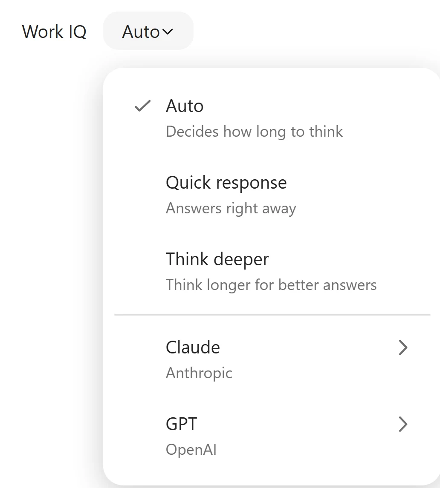</picture>

<picture><source media="(prefers-color-scheme: dark)" srcset="images/proposal-answer-dark.webp">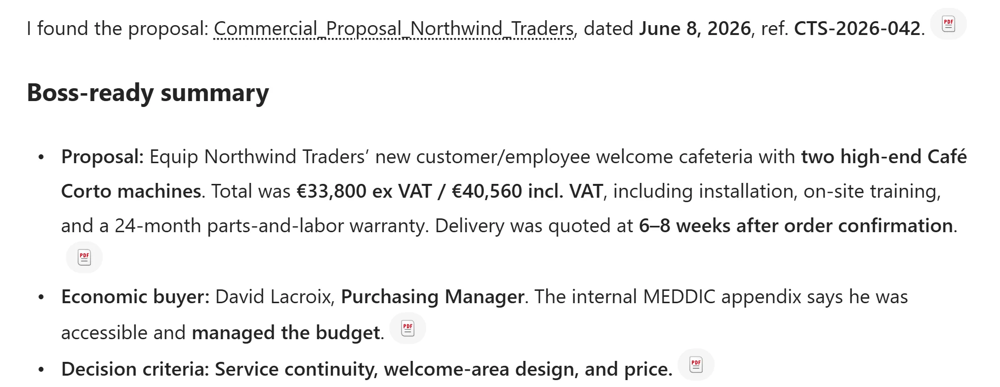</picture>

**Quick check:** Does Work IQ unlock every company record? **No.** Source configuration, your permissions and available data still apply.

**If the proposal is missing:** check the assigned account and Work IQ, then ask the facilitator to check access to the sample file. Do not provision Dataverse or invent a buyer.

## ✅ Act: use the sales agent and MCP App

**7 minutes · Copilot Chat and Zava Sales Hub**

Select **New**, then confirm **Chat**, not Cowork. Start this in a **new Copilot Chat session**, separate from the Northwind conversation:

```text
Help me prepare for a call about Northstar Teamwear’s $250K Pulse renewal. Where does the deal stand, what needs my attention, and what are the three most important questions to ask on the call?
```

In this training experience, Chat may not retrieve the live deal and can recommend **Zava Sales Hub** instead. Select the recommendation to **Try Zava Sales Hub**. Check that the same prompt is carried into the agent conversation; send it if it is only prefilled. Confirm that you are now talking to **Zava Sales Hub**, then check the deal status, attention points and three call questions against its returned records.

The recommendation's wording can vary. If no card appears, open **Agents & Plugins → Chat**, find the facilitator-provided **Zava Sales Hub** agent, and paste the same prompt there. Some sessions shorten the sidebar label to **Plugins**. If Chat starts a research task instead, select **Stop task** on that task card before opening the agent; do not wait for a separate research run in this exercise. If Chat answers directly, inspect its sources, then open the agent for the next step anyway. The lab does not require making Chat fail, and this result does **not** establish that Dataverse is unavailable in every Copilot Chat tenant.

In the **same Zava Sales Hub agent conversation**, follow up:

```text
Thanks, btw can you help me create a new lead for them? John Doe mentioned a $50,000 project in the Denver area, details to be sent in a couple of weeks.
```

Confirm when prompted, then complete and review the embedded lead form. **This interactive form inside the agent is an MCP App**, not a switch to Cowork. Review **John Doe**, **$50,000**, **Denver**, and the Northstar context before saving. Keep unknown contact details unknown. This lead is separate from the **$250K renewal**; do not overwrite the renewal amount.

In **Create new lead record**, complete **Lead Name** if blank, for example `Northstar Teamwear - Denver project`. Fill **Topic** with the known project details, including that more details are expected in a couple of weeks. Scroll **inside the form** to check **Estimated value: 50000**. If it is blank or the form warns that it could not fill `$50,000`, enter `50000` without the currency symbol or comma. A company-name string is not proof that the **Account** lookup is linked. Select **Accept and save** once, then look for **Your changes have been saved successfully** and **Update lead record**. Use **Open** to inspect the saved record if needed.

<picture><source media="(prefers-color-scheme: dark)" srcset="images/lead-mcp-app-dark.webp">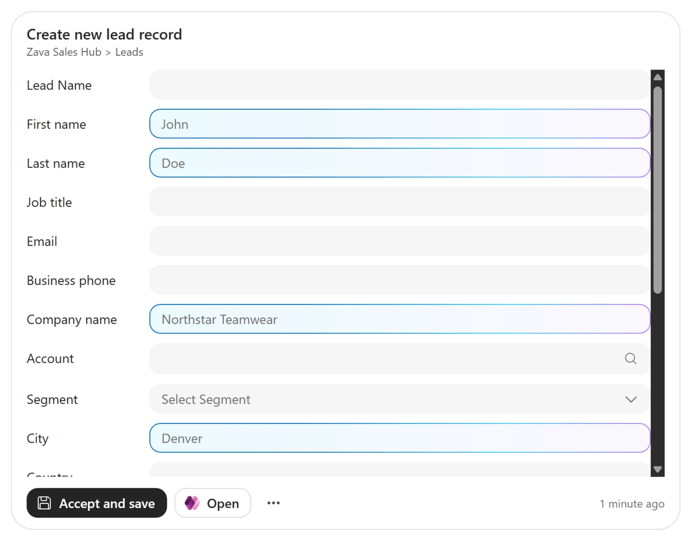</picture>

Check the saved lead before retrying to avoid duplicates. If the agent or form is missing, ask the proctor to check the deployment; do not install a lookalike or treat plain suggested field values as an interactive form.

**Quick check:** Does seeing a lead form prove the record exists? **No. Review the fields, save once, and verify the resulting CRM record.**

## 🛠️ Delegate: make the review

**11 minutes · Cowork, Microsoft Dataverse and Zava PowerPoint**

1. Go to **Agents & Plugins → Cowork → Microsoft Dataverse**. Some sessions shorten the sidebar label to **Plugins**. This is Cowork's connection, separate from the Chat agent.
2. Turn **Enable Microsoft Dataverse** on, then **Connect Microsoft Dataverse**.
3. Enter `https://zavasalesdemo.crm.dynamics.com/`, select **Connect**, and confirm **Connected**. If already connected, leave it alone.

   <picture><source media="(prefers-color-scheme: dark)" srcset="images/dataverse-connection-dark.webp">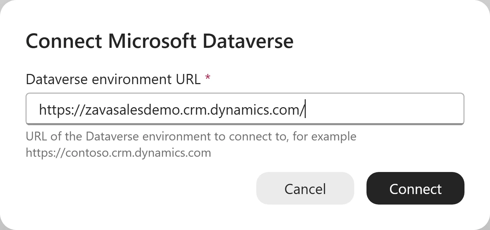</picture>

4. Still in **Agents & Plugins → Cowork**, enable **Zava PowerPoint** and inspect its company-branding guidance. If already enabled, leave it enabled. This is not the optional **Zava Sales** plugin. Ask the facilitator if it is missing; do not silently substitute a generic deck.

   <picture><source media="(prefers-color-scheme: dark)" srcset="images/zava-powerpoint-plugin-dark.webp">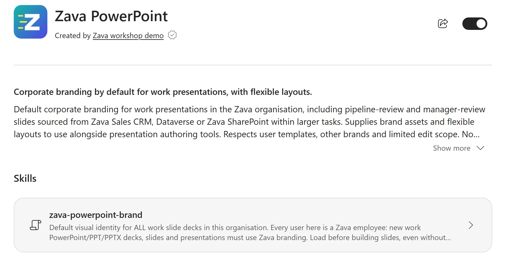</picture>

5. After both plugin checks, select **New → Cowork** explicitly. Leave **Auto / Medium** selected. Higher effort spends more time and credits. Cowork uses metered Copilot Credits; available models and tools depend on the tenant.

   <picture><source media="(prefers-color-scheme: dark)" srcset="images/cowork-model-effort-dark.webp">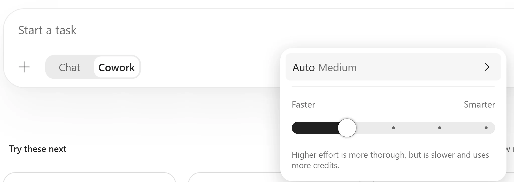</picture>

6. Send the following. Keep the **same Cowork task for Repeat and the optional Riley call**. Improve starts here before its separate Friday task:

```text
I've got a pipeline review with my manager at the office tomorrow. Build me a new Zava-branded PowerPoint deck covering our biggest open deals with Northstar Teamwear, Coastal Performance Supply and BluePeak Athletics: where each stands and what we need to do to close. Then draft the customer follow-up emails I should send.
```

Watch Cowork discover and use **Zava PowerPoint** for the branded deck, query CRM through **Microsoft Dataverse**, and create Outlook drafts. Check the visible plugin/skill activity as well as the deck; saying “Zava” on a title slide is not proof of plugin use. As soon as a first deck exists, inspect it and send the correction below. If still working, use **Queue**:

```text
This is a good start, but you’re making a few calls I’d want to check with the deal owners first. Don’t assume we need to push Coastal to Q1 or change anyone’s forecast. Make it clear what we know and what we still need to ask. And cut it to three slides—I’ve only got five minutes with my manager.
```

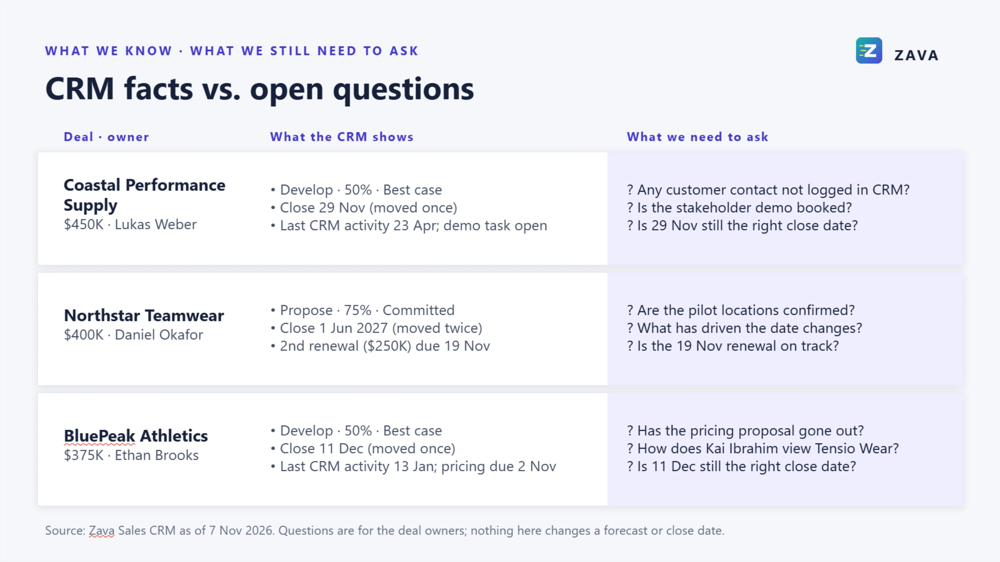

The image is a real result after the steering prompt, with Zava branding retained. Your wording and CRM values will differ. The biggest open Northstar deal can differ from the $250K renewal in your call brief; inspect the record links rather than assuming they are the same. Verify **three slides**, the **Zava PowerPoint branding guidance**, and actual output cards marked **Saved to drafts**, not just suggested email text. Customer emails stay unsent. If the preview is blank, dismiss a first-run Office notice or use the file's open action; do not restart the task.

**Quick check:** Should a CRM-informed recommendation automatically change a forecast? **No.** Confirm assumptions with the owner. Delegate preparation, not unchecked business decisions.

## 🔁 Repeat: save and schedule

**9 minutes · Skills and Automations**

Send each prompt in order in the same task:

```text
Let’s make this my weekly pipeline review. Every Monday morning, refresh the three slides for these accounts, highlight what’s changed, and draft any follow-ups I should review.
```

If asked for a time zone, confirm the one you intend. If **Create recurring task** appears, review it. Clear **Run once now** unless you want an extra test run; it may be selected by default. Then select **Schedule** before continuing. The later prompt refines this same Monday job rather than creating a duplicate.

```text
This is how I want to prepare for my pipeline reviews. Save it as a skill called Weekly Deal Review: the same three accounts, three slides, clear separation between what we know and what we need to ask, and customer follow-up drafts for me to review.
```

If a **Copy file** approval appears, check that its destination is your Cowork folder's `skills/weekly-deal-review` before approving. In a scheduled task, **Always allow Copy artifact** grants ongoing copy permission to that task; do not approve unexpected destinations or overwrites.

Let skill creation finish. Inspect the saved instructions: the same three accounts, three slides, facts versus questions, Zava PowerPoint branding guidance, and draft-only customer follow-ups. Find skills under **Agents & Plugins → Cowork**; this one may appear as **weekly-deal-review**. A skill is reusable instructions and a procedure, **not model retraining**.

<picture><source media="(prefers-color-scheme: dark)" srcset="images/saved-skill-dark.webp"></picture>

```text
Run Weekly Deal Review every Monday at 8:30 a.m. and email me the slides. Keep the customer emails as drafts for me to review.
```

Review the schedule card or **Automations**. Check **Monday, 8:30 a.m., the intended time zone, your own email recipient, and customer emails kept as drafts**. Compare **Next run** with the recurrence; if they disagree, flag it with your facilitator before relying on delivery. For an update, complete **Next → Review permissions → Approve** when offered, with email permission limited to your account. A new schedule uses **Schedule**; some tenants show **Save** or **Activate** instead. Keep only one Monday review schedule.

When offered, **Run once now**, **Activate and run now**, or a preview lets you test without waiting for Monday. Leave it off if you only want the scheduled run. Any test email goes only to your training account. Check **Automations → Runs** afterwards; setup is not proof of future execution.

**Quick check:** Does saving a skill start a recurrence? **No. The skill is the how; an activated schedule is the when.**

Return to the task and check its cost:

```text
/cost
```

The command is free and shows **approximate cumulative task usage**, not an invoice or advance estimate. One Copilot Credit is roughly **US$0.01 at the standard pay-as-you-go rate**; pricing, discounts and tenant arrangements vary.

<picture><source media="(prefers-color-scheme: dark)" srcset="images/task-cost-dark.webp">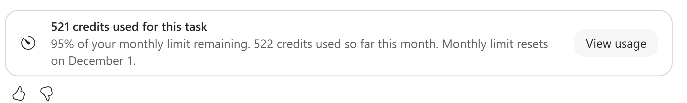</picture>

**Core lab complete.** [Take it with you](#-take-it-with-you), or continue with the optional missions below.

## 📝 Record: log the call and commitment

**Optional · 8 minutes · Dataverse, PowerPoint and Outlook**

Return to the **pipeline-review Cowork task**, not the Zava Sales Hub agent chat. Send:

```text
Just spoke with Riley at Northstar about the $250K renewal. They need a phased rollout plan before final approval, and I promised to send it by next Friday. Create a completed phone call with that recap and a task for me to send the plan. Link both to the renewal.
```

Review the **$250K Northstar renewal**, recap, task owner and calendar date for **next Friday** before approving. Prefer one-time **Approve/Allow** while learning. Session-wide always-allow, if offered, reduces future prompts for that permission; it does not remove your responsibility to review.

<picture><source media="(prefers-color-scheme: dark)" srcset="images/dataverse-approval-dark.webp">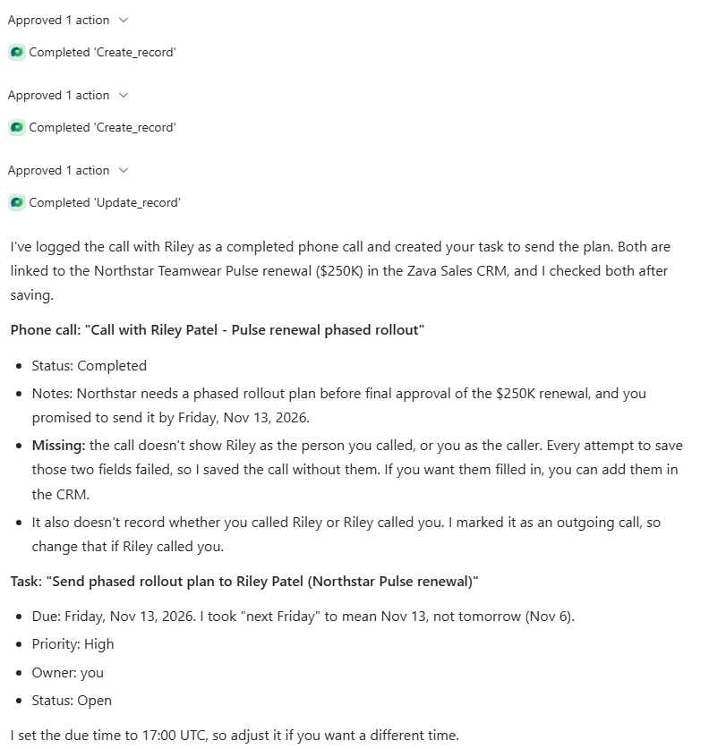</picture>

This example shows the actions **after approval**, followed by the saved records and disclosed omissions.

Creating the call, completing it and creating the task can need separate approvals. Verify the phone call is **Completed**, the task is assigned to you with the right date, and both records are linked to the renewal. If a write fails, read the error and check for an existing record before retrying.

Check any disclosed omissions too. In the training run, the call recap and renewal link were saved but caller/recipient fields failed. A completed status does not mean every field was populated; ask your facilitator before treating omitted details as complete.

Then send:

```text
Update my slides with what we learned from Riley, and change the draft email to her into a recap of our call. Mention that I’ll send the rollout plan by the deadline on my task.
```

Check the updated slides and Riley's unsent draft. The deadline must match the **saved task**, not a new interpretation of “next Friday.”

**Quick check:** What proves completion? **The returned records and their actual status, owner, due date and relationship**, not just an acknowledgment.

## 🧠 Improve: learn from feedback

**Optional · 6 minutes · Work IQ and skill maintenance**

Send the complete prompt in the same task:

```text
Every Friday afternoon, look back at this week’s deal review and the feedback my manager gave me—in comments on the deck, the review meeting recording or transcript, Teams, and email.

Use that feedback to improve the Weekly Deal Review skill so next week’s review gets better without me repeating the same instructions. Pick up on what they wanted more or less of, which questions they kept asking, and what helped them make decisions. Distinguish lasting preferences from requests that only apply to a particular deal or week.

In the email you send with my weekly review, coach me based on previous feedback too: what to prepare, which questions my manager is likely to ask, and how I can present the deals more clearly. Keep it specific to that week’s deals and point out where I’ve addressed earlier feedback.

Update the skill automatically and send me a short recap of what changed, with links to the feedback behind it. Keep the previous version so we can undo changes. Leave the accounts, permissions, and recipients unchanged. If feedback conflicts or you can’t access a source, flag it rather than guessing.
```

If asked, choose **Separate Friday task**. This experience supports one recurring schedule per task: keep Monday at 8:30 a.m., rather than replacing it or adding extra no-op runs. If your training account has no configured manager or review meeting, say so and require it to report the gap without unsupported skill changes. Confirm a Friday afternoon time and time zone; **4:00 p.m. Europe/Paris** is one example.

Review Cowork's generated handoff, then copy it into **New → Cowork**. Check it names **Weekly Deal Review** and your existing deck, requires a backup before skill edits, preserves accounts and permissions, keeps customer emails as drafts, and sends the recap only to you. Complete the Friday schedule confirmation. Handoff text alone is not a saved schedule.

This configures future work, not a demonstrated learning result. **No accessible feedback** is valid; invented feedback is not. Automatic changes depend on available sources, permissions and successful runs. Skill-file changes may still wait for approval.

Find **Weekly Deal Review** under **Agents & Plugins → Cowork** and the separate Monday and Friday schedules under **Automations**. Check the Friday instructions require a dated backup before edits and report missing or conflicting feedback. After a real feedback run, inspect the change recap, source links and saved previous version.

<picture><source media="(prefers-color-scheme: dark)" srcset="images/separate-automations-dark.webp">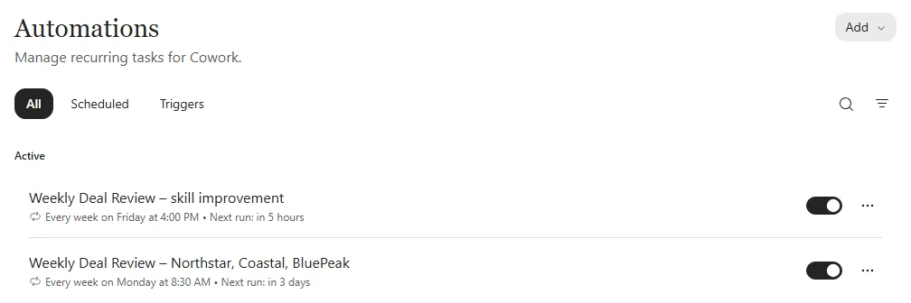</picture>

**Quick check:** If a transcript cannot be accessed, should Cowork infer the feedback? **No. Flag the gap and use only substantiated feedback.**

## 🧩 Specialize: use the Zava Sales plugin

**Optional · 8 minutes · New Cowork task**

1. Open **Agents & Plugins → Cowork**, search for **Zava Sales**, and install/add it if your facilitator has supplied it. If already installed, leave it enabled. This optional plugin is separate from the **Zava Sales Hub agent** and the **Zava PowerPoint plugin** already used.
2. Review its skills and connections. Complete any requested connection only in the supplied training environment.
3. Start **New → Cowork** so the task discovers the plugin. Leave **Auto / Medium** selected.
4. Send:

<picture><source media="(prefers-color-scheme: dark)" srcset="images/zava-sales-plugin-dark.webp">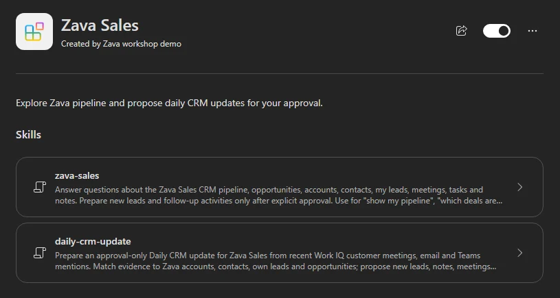</picture>

```text
Can you catch up on this week’s activity and help me get the CRM up to date?

One thing I haven’t logged anywhere: I had lunch with Morgan Patel from Northstar last Friday. She said they’re planning to grow by 20% next year. Add a note to Northstar so we remember to bring that up in our next account review.

She also mentioned her friend Jamie Chen, who runs purchasing at Summit Youth Sports. They’re adding six youth leagues next season and looking for a supplier for custom team kits. Morgan offered to introduce us next week. Can you create a lead and add a task for me to follow up with Morgan about the introduction next week. I don’t have Jamie’s contact details yet.
```

If asked, confirm the three requested records, your intended follow-up date and time zone. Review each proposed write and inspect the saved account note, lead and task. The **20% growth** is attributed to Morgan; Jamie's email and phone stay unknown; the introduction follow-up is with **Morgan**.

<picture><source media="(prefers-color-scheme: dark)" srcset="images/zava-created-records-dark.webp">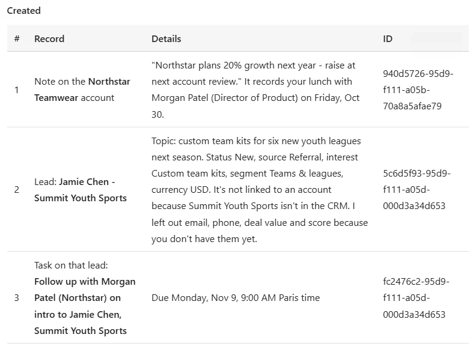</picture>

A plugin can combine **skills, connectors, or both**. It supplies business guidance as well as tools, without bypassing your permissions. Follow the **Zava Sales Hub** link if recommended, or open [Zava Sales Hub](https://aka.ms/ZavaSalesHub): a purpose-built app can be the best place to manage the results.

If Zava Sales is missing from the catalog, skip this optional extension and ask your facilitator rather than installing a lookalike. The core lab needs Zava Sales Hub, Microsoft Dataverse and Zava PowerPoint, not this additional plugin. Before rerunning the prompt, check for existing records to avoid duplicates.

**Quick check:** Should Cowork generate a plausible email address for Jamie? **No. Unknown details remain unknown.**

## 🚀 Take it with you

**Copilot Chat** finds work-file evidence. A specialist **agent** provides business tools, and an **MCP App** lets you review and complete an action inside its conversation. **Cowork** coordinates work across files and tools. A **skill** saves the method, an **automation** schedules it, and a **plugin** supplies connected capabilities and guidance such as Zava's PowerPoint branding.

Which recurring task in your own work deserves a playbook like this?

Explore more scenarios in the **[Cowork Demo Hub](https://aka.ms/CoworkDemoHub)**.

**Before leaving:** open **Automations** and pause the Monday review and any Friday feedback schedule **you created for this lab**, unless your facilitator asks you to keep them running. This prevents unattended credit usage and training emails. Do not change unrelated automations. Resetting the lab's checkmarks does not pause Cowork.

### Product guidance

- [Get started with Cowork](https://learn.microsoft.com/en-us/copilot/cowork/get-started)
- [Using Cowork, approvals, skills and scheduled tasks](https://learn.microsoft.com/en-us/copilot/cowork/use-cowork)
- [Models and effort](https://learn.microsoft.com/en-us/copilot/cowork/cowork-models)
- [Plugins](https://learn.microsoft.com/en-us/copilot/cowork/cowork-plugins)
- [Dataverse data in Copilot](https://learn.microsoft.com/en-us/power-apps/maker/data-platform/data-platform-data-copilot)
- [Copilot Credits and /cost](https://learn.microsoft.com/en-us/copilot/implement/usage-based-billing-copilot-credits-cost)

Product UI and available capabilities can vary by tenant. Screenshots show the training experience; generated results and calendar dates will differ.
