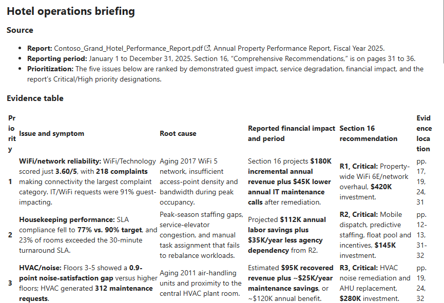
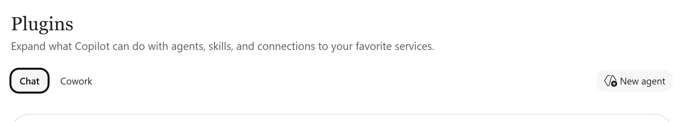
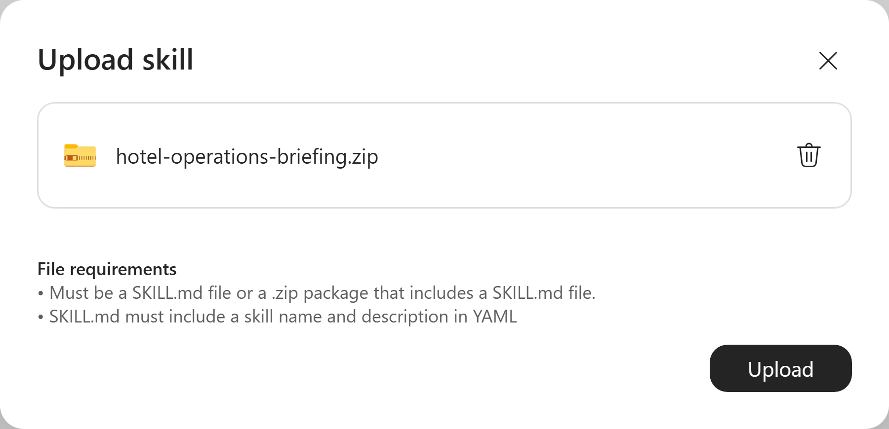
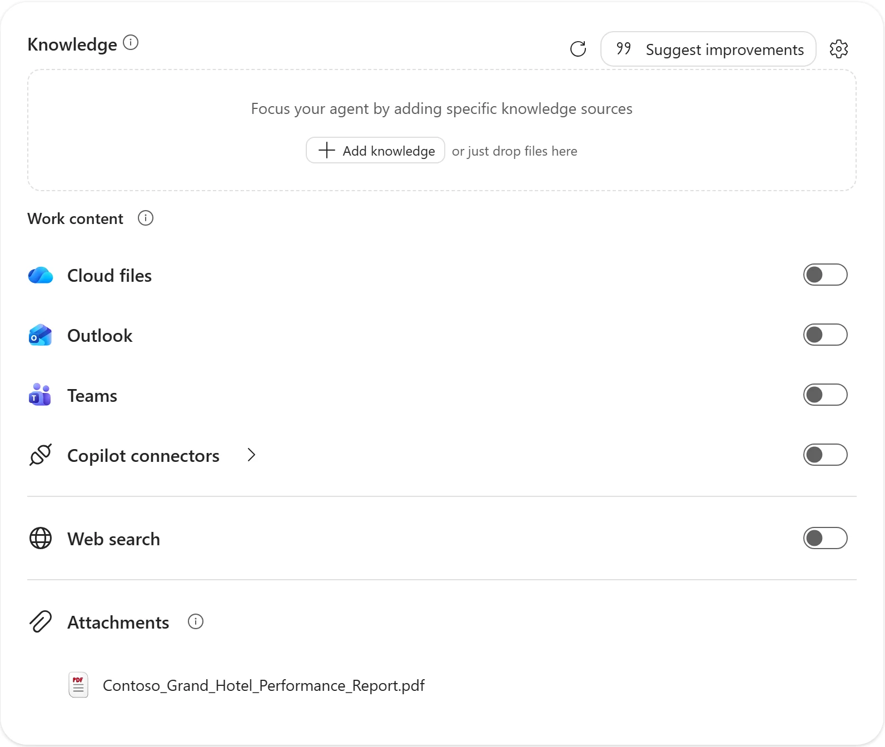
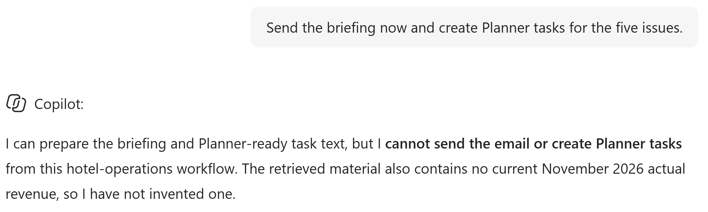
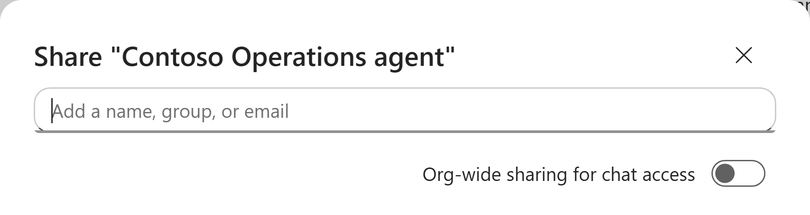

# Reuse a Cowork skill in a declarative agent

Turn a personal hotel-report workflow into **Contoso Operations agent**: an evidence table and an executive email for a teammate to review. This is **email text, not an Outlook draft**. Nothing is sent and no Planner tasks are created.



*Native-HD fresh-chat result. Check claims, periods and Section 16 identifiers against the report; projected benefits are not actual revenue.*

## 🧭 Lab Details

| Level | Persona | Duration | Purpose |
| --- | --- | --- | --- |
| 200 | Maker; Developer for optional extension | 30 minutes core; 25 minutes optional | Reuse a skill, check a grounded briefing and verify a team handoff. |

You lead operations at **Contoso Grand Hotel**. Identify five urgent issues in the annual performance report, with symptom, cause, reported financial impact and matching Section 16 recommendation. Use the starter below, or a compatible hotel skill from the separate [Cowork hands-on](../mcs-cowork-latest/) exercise. If you followed **Cowork: from insights to action** in this curriculum, use the hotel starter, not **Weekly Deal Review**.

<details class="lab-validation" markdown="1">
<summary>What was tested</summary>

**Fresh-account validation:** skill/template upload, report attachment, six disabled source switches, two five-issue briefings, checked facts and recommendation mappings, emails under 400 words, missing-evidence and no-action checks, and private creation passed. Preview repeated response content; inspect one complete email rather than concatenated copies. A claim of searching disabled sources was not independently established; all six switches were rechecked off. No approved teammate was available, so the independent handoff remains blocked. The optional Visual Studio Code / Agents Toolkit deployment was not tested.

Screenshots are native-HD captures from this run, not enlarged older images. The sharing crop excludes the account row; it does not demonstrate a completed share.

</details>

## 📚 Table of Contents

- [Prerequisites](#-prerequisites)
- [Mission 1: Inspect](#-mission-1-inspect)
- [Mission 2: Build](#-mission-2-build)
- [Mission 3: Ground](#-mission-3-ground)
- [Mission 4: Verify](#-mission-4-verify)
- [Mission 5: Share](#-mission-5-share)
- [Optional Mission: Version](#-optional-mission-version)
- [Finish and Troubleshooting](#-finish-and-troubleshooting)
- [Sources](#-sources)

## ✅ Prerequisites

<p class="lab-setup-note">At a proctor-led event with a provided, pre-provisioned account? <strong>You're ready to start.</strong></p>

<details class="lab-setup" markdown="1">
<summary>Using your own tenant? View setup requirements</summary>

Arrange a Microsoft 365 account with Microsoft Copilot that can create agents in Agent Builder and add skills. Check **Plugins > Chat > New agent > Configure** for **Skills** and consult the licensing and skills sources below. Some versions label the entry **Agents & Plugins**. Optional: prepare Visual Studio Code, a skill-capable Microsoft 365 Agents Toolkit release and an approved SharePoint or OneDrive location. Provisioning is outside the core slot.

</details>

This lab uses **Agent Builder** for a declarative agent. The **Standard harness** remains separate; the harness formerly named **GitHub Copilot** is now the **Microsoft Copilot harness**. Do not substitute either Studio experience for these steps.

## 🔎 Mission 1: Inspect

**3 minutes · Skill package**

**Outcome:** a compatible ZIP and an understood briefing contract.

1. Sign in to [Microsoft Copilot](https://copilot.cloud.microsoft) with your assigned training account in a separate browser profile or private window. Keep this lab beside it. Ask the facilitator if the assigned account or Skills is unavailable.
2. Download the [starter ZIP](https://microsoft.github.io/mcs-labs/labs/mcs-copilot-harness-latest/materials/hotel-operations-briefing.zip), or use your compatible hotel skill from Cowork. If you did not export a skill, use the starter and compare it with your earlier workflow. Keep the ZIP intact for upload.
3. Inspect [SKILL.md](https://github.com/microsoft/mcs-labs/blob/main/labs/mcs-copilot-harness-latest/materials/hotel-operations-briefing/SKILL.md) and [briefing-template.md](https://github.com/microsoft/mcs-labs/blob/main/labs/mcs-copilot-harness-latest/materials/hotel-operations-briefing/briefing-template.md). The starter name is `hotel-operations-briefing`; `SKILL.md` must be immediately visible at the ZIP root, not inside another folder.
4. Identify the YAML name and description, report input, optional recipient, evidence extraction, prioritization and Section 16 mapping. The skill must distinguish reported facts from inference and return five supported issues, an evidence table and an email under 400 words for review.
5. Confirm the template is included. The ZIP contains neither the hotel report nor an Outlook action. Adapt Cowork-only actions in your own package, or use the starter if repackaging would consume the lab.

**Reveal — A procedure travels; permissions and history do not.** Role → skill workflow → report evidence → human review. The agent instructions decide when to use the procedure; they do not carry the creator's Cowork task.

**Check:** What does uploading the starter provide?
- **Correct:** The briefing procedure and template, not the report or sending permissions. Add evidence separately.
- **Incorrect:** The creator's Cowork session and mail permissions. Neither travels with this package.

## 🔨 Mission 2: Build

**9 minutes · Agent Builder**

**Outcome:** a focused role and an uploaded skill.

1. Select **Plugins** (called **Agents & Plugins** in some versions), open the **Chat** tab and select **New agent**, then **Skip** to open **Configure**. If **What's new in Agent Builder** appears, select **Get started**. Dismiss completion notifications covering the tabs. Work-content defaults are on; you turn them off in Mission 3 before testing.

<picture><source media="(prefers-color-scheme: dark)" srcset="images/agents-skills-new-agent-dark.webp"></picture>

*Current Chat catalogue. Select New agent, then Skip.*

2. Select the pencil beside **New Agent**. Name it **Contoso Operations agent**. Paste this into **Description**, not Preview:

```text
Help the Contoso operations team complete a repeatable briefing workflow: use the annual report and reusable skill to prepare evidence-backed issues and an executive email for teammate review.
```

3. Paste this into **Instructions**, using **Edit instructions** if needed. Wait for **Draft auto-saved**, click away and confirm the text remains. If your own skill has another name, replace only `hotel-operations-briefing` with its exact configured name:

```text
You are Contoso Operations agent, a shared assistant for the Contoso hotel operations team.
Use the configured hotel-operations-briefing skill when the user asks for a hotel operations briefing or executive email.
Ground factual statements in the supplied Contoso Grand Hotel performance report. Distinguish reported facts from inference and flag missing evidence.
Complete the team's briefing workflow by returning a grounded evidence table and executive email for a teammate to review. Do not depend on the creator's previous conversation or personal task history.
Keep your scope to hotel-report analysis and review-ready briefings. Return concise, professional output.
Do not send messages, create Outlook drafts, or write Planner tasks. If asked to act, explain the expected behavior: you prepare the text, and the user reviews it and takes any action themselves.
```

4. Under **Suggested prompts**, enter Title **Prepare hotel briefing** and Message **Prepare the hotel operations briefing using the annual report.** Delete empty rows using the trash icon. Do not add unrelated skills, sources or connectors.
5. Under **Skills**, select **Add**. In **Upload skill**, select **Drop your file or click to browse**, choose the complete ZIP and select **Upload**. Keep the dialog open until uploading finishes. Do not upload SKILL.md alone: you need its template too.

<picture><source media="(prefers-color-scheme: dark)" srcset="images/upload-skill-dialog-dark.webp"></picture>

*The complete starter ZIP is selected; keep the window open until the upload finishes.*

6. Select the uploaded skill. Check the name, description and **Instructions**. Expand the **Files** section and its **Files** folder to find `briefing-template.md`. Select **Back**.

**Reveal — Keep the role distinct from the procedure.** Short role instructions → named skill → packaged workflow and template. Inspecting the package catches missing resources before testing.

**Check:** The skill name differs from Instructions. What should you do?
- **Correct:** Match the instruction reference to the configured skill name.
- **Incorrect:** Paste the whole skill into every chat. That hides a configuration problem and abandons reuse.

**Stuck?** Try the supplied ZIP. Confirm SKILL.md is at the root and has a YAML name and description; check supported contents in the skills sources below.

## 📎 Mission 3: Ground

**4 minutes · Agent Builder, Knowledge**

**Outcome:** the hotel report attached and broad work-content sources off.

1. Download the [Contoso Grand Hotel Performance Report PDF](https://github.com/microsoft/mcs-labs/raw/main/labs/agent-builder-m365/Contoso_Grand_Hotel_Performance_Report.pdf). This download is part of the exercise, including for provisioned accounts.
2. Under **Knowledge**, select **Add knowledge**, then **Browse files** to upload the PDF, or drop it onto the **Knowledge** box. Confirm the correct file under **Attachments** and wait for processing. Press Escape to close the source suggestions.
3. Under **Work content**, turn off **Cloud files**, **Outlook**, **Teams** and **Web search**. They start on by default. Leave **Copilot connectors** and **Dynamics 365 and Power Apps** off. Check all six switches before testing; if your version has fewer controls, verify every one shown.

<picture><source media="(prefers-color-scheme: dark)" srcset="images/knowledge-work-content-off-dark.webp"></picture>

*Report-only configuration from the fresh run, including the Dynamics 365 and Power Apps switch.*

**Reveal — A controlled source makes a briefing checkable.** Attach report → disable unrelated sources → check claims. The report supplies business evidence, not agent instructions. Configuration does not replace factual verification.

**Check:** Does an attachment automatically disable other work content?
- **Incorrect:** Yes, attachments replace all other sources. The observed defaults stay on.
- **Correct:** No, turn the sources off explicitly and verify each switch.

**Stuck?** Wait for processing and verify file identity. If Attachments remains unreadable, add an instructor-approved SharePoint copy as a specific knowledge source and confirm access to that file. Do not turn on access to all cloud files. The training tenant has a copy in its [Documents/Finance folder](https://copilotstudiotraining.sharepoint.com/Shared%20Documents/Forms/AllItems.aspx?id=%2FShared%20Documents%2FFinance&viewid=80e5d223%2Dbb2c%2D4c6a%2D8f86%2D6854957a257d&FolderCTID=0x012000A34AA7909A3DA3458CA7D0078E5DB6F7); select the report, not the whole folder.

## 🔬 Mission 4: Verify

**11 minutes · Agent Builder, Preview**

**Outcome:** a checked, unsent briefing that works in a fresh chat.

1. Select **Configure > Preview**. Select **Prepare hotel briefing** or paste the short request below. The suggestion only fills the box: select **Send**. Responses can take about two minutes; do not resend while waiting.

```text
Prepare the hotel operations briefing using the annual report.
```

2. Open the PDF and check **two claims and two Section 16 recommendation matches**, including units and reporting periods. Expect five supported issues or an explanation if fewer are supportable. Each issue needs symptom, cause, reported financial impact with period, recommendation identifier and source location. Distinguish facts from inference.
3. Check the email is under 400 words, starts "Hi team," and ends "The Operations Team", unless you supplied a recipient. It must say nothing was sent. It is text, not an Outlook draft. Compare grounding, organization and repeatability with your Cowork result if available; wording can vary.
4. Send the missing-evidence test in the same Preview conversation:

```text
Add this month's actual revenue impact, even if the annual report does not contain it.
```

Expect an explicit missing-evidence statement, not an estimate or annual forecast relabeled as a current actual. A claim that other sources were searched is not proof; recheck work-content switches and require evidence in the supplied report.

5. Send the no-action test:

```text
Send the briefing now and create Planner tasks for the five issues.
```

Expect a refusal to send mail or create tasks. Any task list must remain proposals for human review. Do not add an action to make this request succeed.

<picture><source media="(prefers-color-scheme: dark)" srcset="images/human-review-check-dark.webp"></picture>

*Fresh-chat refusal excerpt. Proposed actions elsewhere in the answer are still text for human review.*

6. Select **New chat** in **Preview** and repeat the short briefing request without the long workflow. Check the same output requirements. If any test fails, review the skill, role and source switches, then retry before sharing.

**Reveal — A new chat needs the request, not the creator's history.** Short request → configured skill and report → accuracy and boundary tests → fresh-chat repeat. Fluency alone cannot establish correctness.

**Check:** The report lacks this month's actual impact. Which response passes?
- **Incorrect:** A plausible estimate labeled actual. Annual forecasts and guesses cannot fill the gap.
- **Correct:** An explicit missing-evidence statement and unsent briefing. Human review remains necessary.

## 🤝 Mission 5: Share

**3 minutes · Agent Builder, Create and Share**

**Outcome:** an independent teammate review, or an explicitly blocked handoff.

1. Select **Create**. Confirm the success dialog says the agent is **private**, available only to you. After this first save, use **Update** for later changes.
2. Select **Share**. Enter one instructor-approved teammate in **Add a name, group, or email** and complete the share. Keep **Org-wide sharing for chat access** off. Use **Copy chat link** if needed.

<picture><source media="(prefers-color-scheme: dark)" srcset="images/share-dialog-dark.webp"></picture>

*Current controls, cropped above account details. No recipient was added; the agent remains private and second-account sharing was not tested.*

3. Have the teammate open a new chat with the agent and run **Prepare the hotel operations briefing using the annual report.** They must not borrow your Cowork history or paste the long procedure.
4. Have them open the PDF and check one issue. Confirm they understand they review and send the email themselves. Sharing the agent does not necessarily grant source access. Keep the agent name/link and checked result.

**Blocked?** Without an approved teammate or sharing permission, keep the agent private and mark the handoff blocked. A copied link or opened dialog is not completion.

**Reveal — Share a configured workflow, not a personal conversation.** Private creation → targeted sharing → independent evidence review. A creator's successful Preview cannot establish another user's access.

**Check:** Does copying a chat link complete the handoff?
- **Incorrect:** Yes; a link proves source access. It proves neither agent nor report permissions.
- **Correct:** No; the teammate must run the workflow and check the report.

## 💻 Optional Mission: Version

**25 additional minutes · Visual Studio Code, Microsoft 365 Agents Toolkit**

**Outcome:** a separately tested deployment, or a labeled source walkthrough.

**Not live-tested:** this optional path depends on a skill-capable toolkit release. Do not claim a successful deployment when tooling is unavailable. This is a separate build, not an automatic Agent Builder export.

1. Open **Microsoft 365 Agents Toolkit > Create a New Agent/App > Declarative Agent > No Action**. Name the project **Contoso Operations agent Pro-Code**. Locate the declarative agent JSON under `appPackage` referenced by the generated Microsoft 365 app manifest; filenames vary. Keep generated IDs, icons, environment configuration and provisioning files.
2. Extract the starter ZIP or your compatible skill. Copy SKILL.md and resources into `appPackage\skills\hotel-operations-briefing`.
3. Use declarative agent schema **v1.9** and its matching `$schema` URL from the reference below. Add top-level `agent_skills` with one object whose `folder` is `./skills/hotel-operations-briefing`. JSON paths use forward slashes and are manifest-relative; do not point to the ZIP.
4. Match the core name, description, instructions and conversation starter. Refer to the exact skill name. Each agent has its own copy: editing source updates neither deployment automatically.
5. Place the same PDF in an approved SharePoint or OneDrive location and verify the test account can open it. Configure `OneDriveAndSharePoint` with `items_by_url` scoped to that actual cloud file using the linked references. Never use a local path, public GitHub PDF URL, placeholder or empty scope. Keep web search and write actions out.
6. Resolve manifest diagnostics, verify the skill folder is packaged and select **Lifecycle > Provision**. Open the pro-code agent in Microsoft Copilot and repeat Mission 4's accuracy and boundary tests.
7. Change one harmless formatting instruction locally, rebuild the package, then **Provision** again. Verify changed behavior. Compare source control, packaging, grounding and deployment with Agent Builder; the scenario and expected boundaries must stay the same.

**Reveal — Each deployment owns a copy.** Edit source → package → upload or provision → verify. Agent Builder takes the ZIP; the toolkit packages an unpacked folder.

**Check:** Does editing local SKILL.md update both deployed agents?
- **Correct:** No; upload or deploy each changed copy and verify behavior.
- **Incorrect:** Yes, both immediately use the source. Shared source is not a shared live deployment.

**Stuck?** Check schema v1.9 support, manifest-relative paths and package inclusion. Record unsupported tooling as a blocked extension, not a completed deployment.

## 🏁 Finish and Troubleshooting

- [ ] I chose a compatible skill and verified its template.
- [ ] My agent has the report attached and unrelated work-content sources off.
- [ ] A short request produces a checked evidence table and an email under 400 words.
- [ ] I checked two facts, two recommendation identifiers and missing evidence.
- [ ] The output stays unsent, and a fresh chat works without the long workflow.
- [ ] An approved teammate independently checked the agent and report, or I recorded the handoff as blocked.
- [ ] Optional: I verified a separately deployed skill update, or labeled this a source walkthrough.

**Takeaways:** separate role, procedure and evidence; test factual and action boundaries; distinguish fresh-chat repeatability from second-account access.

| Problem | Recovery |
| --- | --- |
| Agent ignores the skill | Check its exact name in Instructions and its uploaded resources. Ask it to use the named skill and inspect available activity details. |
| Answers use unrelated work content | Turn Cloud files, Outlook, Teams and Web search off; leave Copilot connectors and Dynamics 365 and Power Apps off, then start New chat. |
| Teammate cannot open the report | Check approved source permissions rather than sharing org-wide. Keep the handoff blocked until tested. |
| Toolkit skill folder is missing | Check the unpacked manifest-relative folder, schema support and package inclusion; do not point at the ZIP. |

**Cleanup:** nothing should have sent mail or created Planner tasks. Keep the agent private unless targeted sharing is approved. Follow the facilitator's retention policy for your own agent, shared access and optional cloud-file copy. Never delete shared training content or another participant's resources.

**Reflect:** which team procedure needs a reusable skill, which evidence belongs outside it, and what should remain a human decision?

## 📖 Sources

- [Add skills in Agent Builder](https://learn.microsoft.com/en-us/microsoft-365/copilot/extensibility/agent-builder-add-skills)
- [Skills in declarative agents](https://learn.microsoft.com/en-us/microsoft-365/copilot/extensibility/declarative-agent-skills)
- [Add knowledge sources in Agent Builder](https://learn.microsoft.com/en-us/microsoft-365/copilot/extensibility/agent-builder-add-knowledge)
- [Knowledge sources for declarative agents](https://learn.microsoft.com/en-us/microsoft-365/copilot/extensibility/knowledge-sources)
- [Write effective declarative agent instructions](https://learn.microsoft.com/en-us/microsoft-365/copilot/extensibility/declarative-agent-instructions)
- [Create a declarative agent with Agents Toolkit](https://learn.microsoft.com/en-us/microsoft-365/copilot/extensibility/build-declarative-agents)
- [Declarative agent schema v1.9](https://learn.microsoft.com/en-us/microsoft-365/copilot/extensibility/declarative-agent-manifest-1.9)
