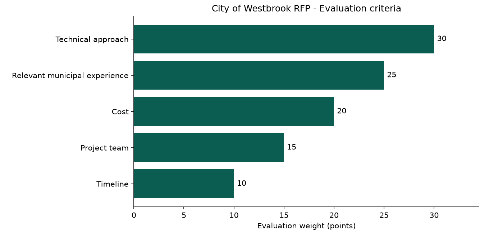
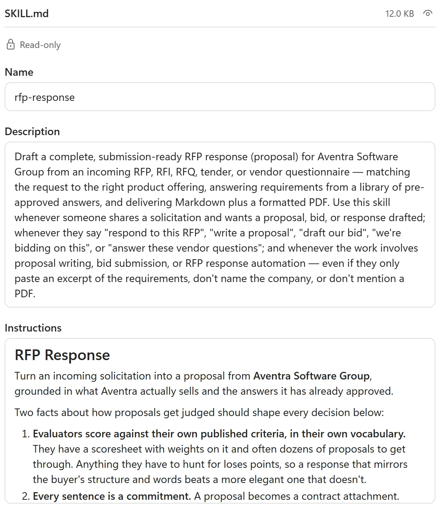
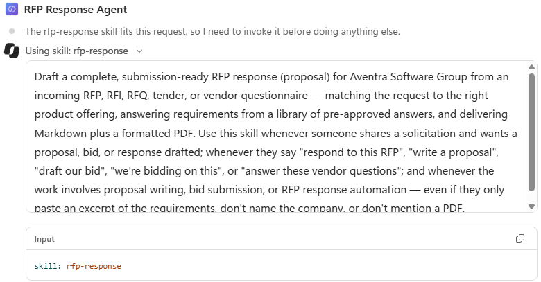

# Instructions and Skills Authoring

Build an RFP Response agent, inspect its reusable Skill, verify a proposal and chart against source data, then optionally author and test your own Skill.

## 🧭 Lab Details

| Level | Persona | Duration | Finish line |
| --- | --- | --- | --- |
| 300 | Maker | 30 minutes | A Skill-equipped RFP agent, reviewed proposal files, and a source-checked evaluation-weight chart |

**Taking part in a proctor-led event with a pre-provisioned user account? Skip tenant setup.** Sign in with your provided lab account; your environment, licences, connections and sample data are already prepared. Ask your facilitator if anything is missing. Keep this lab beside [Copilot Studio](https://copilotstudio.microsoft.com/), use the assigned training identity rather than a personal or production account, and use only fictional materials. Download each file when its step needs it; no prior Skill-authoring experience is needed.

**Running in your own tenant?** Complete the [classic lab prerequisites](https://microsoft.github.io/mcs-labs/labs/mcs-skills-authoring/#prerequisites) separately, including harness access, permissions, credits, Work IQ, and sandbox capabilities. These are not attendee setup tasks.

You are a proposal maker for fictional **Aventra Software Group**. Your job is to give an agent approved material and verify its outputs before sharing them with a customer.

Plan **30 minutes: Configure (6) → Inspect (6) → Test (10) → Verify (8)**. **Author (25), Explore (8), and Generate (10)** are optional extensions after the core. These are working budgets, not execution guarantees; model, connection, and file-generation waits vary.



*Your finish line: a real chart checked against the RFP, not scores inferred from a proposal. This content-only crop comes from the classic lab run.*

## 📚 Table of Contents

- [Configure: Give the agent its role](#-configure-give-the-agent-its-role)
- [Inspect: Read the playbook before trusting it](#-inspect-read-the-playbook-before-trusting-it)
- [Test: Watch the Skill earn its place](#-test-watch-the-skill-earn-its-place)
- [Verify: Turn source weights into evidence](#-verify-turn-source-weights-into-evidence)
- [Author: Package and test a guided intake (optional)](#-author-package-and-test-a-guided-intake)
- [Explore: Inspect this runtime, not an imagined one (optional)](#-explore-inspect-this-runtime-not-an-imagined-one)
- [Generate: Try the in-product authoring route (optional)](#-generate-try-the-in-product-authoring-route)
- [Take it with you](#-take-it-with-you)

## 🔎 Configure: Give the agent its role

**6 minutes · Copilot Studio · Build**

**Outcome:** An RFP Response Agent with reviewed Work IQ access and concise base instructions.

1. Open [Copilot Studio](https://copilotstudio.microsoft.com/). On **Home**, select **Agent** to create an agent on the **Microsoft Copilot harness**. The designer opens on **Build** with an unsaved **Draft**. This is not the separate **Standard harness**.
2. Select the top name field and replace **Untitled Agent** with:

```text
RFP Response Agent
```

<details>
<summary>Another route to the same agent</summary>

Open **Agents → More create options** beside **New agent**, then choose the **Agent** option for the Microsoft Copilot harness. Avoid the plain **New agent** button for this lab. Check the **Agent harness** column in the list. Older badges can retain the former harness name; a **New name, same harness** notice explains the rename.

</details>

3. Inspect the right-hand components panel: **Model**, **Channels**, **Skills**, **Tools**, **Knowledge**, **Connected agents**, and **Memory**. **Skills** sits above Tools and Knowledge: it carries the playbook for when and how those components are used. A new agent already has **Work IQ** and **Search all websites**; do not add extra connectors.
4. Select **Work IQ** under **Tools**. In **Edit tool**, check the green connection check and review **SharePoint**, **OneDrive**, **Outlook mail**, **Teams**, **Calendar**, and **People**. If not connected, open **Connection** and sign in with your lab account. Select **Done**. Work IQ uses that identity's Microsoft 365 data; it does not grant new permissions.

**If Work IQ is missing:** Select **+** beside **Tools**, search for `Work IQ`, select the **MCP** tab, then **Work IQ**. Ask your facilitator if access is missing; do not switch to a production identity.

5. Paste this entire block into **Build → Instructions**, not Preview chat:

```text
You are the RFP Response Agent for our organization. You help our team write clear, accurate answers to customer RFPs (requests for proposal).

When you are given an RFP question or document:
- Find the material we already have: past RFP responses, product documentation, and company policies.
- Draft the answer in our voice - direct, specific, and free of marketing filler.
- Keep each answer self-contained so it can be pasted straight into the RFP form.
- Never invent facts about our products, pricing, security posture, or certifications. If you cannot find a source, say so.

Ask a clarifying question when the request is ambiguous. Keep answers concise unless the RFP asks for detail.
```

**Reveal — Why not paste the whole procedure here?** Base instructions define the role; a Skill supplies a relevant procedure. Short role instructions avoid repeating long procedures across agents. The Skill bundles activation language, instructions, and references so the relevant playbook can load on demand.

**Quick check:** Where should the detailed reusable RFP procedure live?
- **In a Skill, separate from the short base instructions. — Correct.** The agent keeps its role and loads the matching procedure and references when needed.
- Only in a long greeting pasted into every conversation. — A greeting does not create an attached, reusable Skill package.

**If your options differ:** Check the Microsoft Copilot harness and lab account. Ask the facilitator about missing rollout or connection access instead of creating an agent on a different harness.

## 🔎 Inspect: Read the playbook before trusting it

**6 minutes · Copilot Studio · Skills**

**Outcome:** The rfp-response Skill attached, with its description and answer library inspected.

1. Download [rfp-response.zip](https://github.com/Dewain27/AgentDudeSamples/blob/main/samples/RFP%20Skill/packages/rfp-response.zip). It contains `SKILL.md`, an answer library, offering catalogs, past-performance and pricing references, and worked RFP examples.
2. Select **Build → Skills → +** (**Add skill**) → **Upload a skill**. Select the upload area and choose `rfp-response.zip`. Wait for **Saving skill...** (about 10 seconds in the reference run); the dialog closes. Confirm **rfp-response** appears above Work IQ.

The package describes fictional **Aventra Software Group**, so Aventra appears in output despite the instructions saying “our organization.” Replace those references with approved company material for real deployment. Uploads accept `SKILL.md` or a ZIP containing it, with YAML **name** and **description** fields. **Create from blank** is a separate authoring option.

Uploading saves the agent: its URL changes from `/agents/new` to a permanent ID, and **Evaluate** and **Monitor** become available. Use **Save** after later changes if needed.

3. Select the **rfp-response** chip. Inspect the package tree (16 files in the reference package), selected-file size, and `SKILL.md`. Read **Name**, **Description**, and **Instructions**. Notice phrases such as “respond to this RFP,” “draft our bid,” and “answer these vendor questions.”



*Approved classic content crop, shown in its captured light theme. The description is the matching surface; uploaded fields are read-only.*

4. Select **references/answer-library.md**. Review its topic-key table for security, privacy, accessibility, hosting, SSO, SLAs, and pricing. Inspect how `references/`, `assets/`, and `scripts/` support `SKILL.md`.
5. Open **...** (**More options**) to locate **Download** and **Replace**, then close the viewer with **X**. Uploaded Skills are **Read-only**: edit the downloaded package and replace it to change it. A Skill authored with **Create from blank** is editable in place. You do not need to replace this sample.

**Reveal — What travels with the procedure?** A matching description and vetted material make the Skill reusable. The description helps select the playbook; references supply approved facts, while assets and scripts support examples and artifacts. A vague description can prevent activation before the procedure runs.

**Quick check:** The uploaded Skill needs a correction. What is the right path?
- Edit its read-only Name and Instructions fields directly. — Uploaded fields are read-only; blank-authored Skills are the editable-in-place case.
- **Download, edit the package, then use Replace. — Correct.** An authoring chat does not synchronize the installed package automatically.

**If upload fails:** Keep the exact validation error. Check for `SKILL.md` with YAML name and description and ask your facilitator; a failed upload is not an attached Skill.

## 🔎 Test: Watch the Skill earn its place

**10 minutes · Copilot Studio · Preview**

**Outcome:** A source-grounded proposal, a visible Skill-load trace, and claims identified for human review.

1. Select **Preview**. Notice the credits header, **New chat**, **History**, and **Debug mode** (on by default).
2. Download [01-westbrook-permitting-portal.md](https://github.com/Dewain27/AgentDudeSamples/blob/main/samples/RFP%20Skill/test-rfps/01-westbrook-permitting-portal.md), a City of Westbrook permitting-portal RFP.
3. Select **+** (**Upload images and files**) beside the Preview composer and attach the RFP. Send:

```text
We are bidding on this RFP. Draft our response.
```

The sample's fixed submission date has passed; a deadline warning is careful behavior, not a failed run. Microsoft Copilot harness agents use metered Copilot Credits. The classic RFP conversation used about **115 credits**, not a cost guarantee.

4. Watch **Using skill: rfp-response** become **Used skill: rfp-response**. Expand it to inspect the matched description and **Input** (`skill: rfp-response`). Follow the reasoning about offering, price, and gaps. You did not name the Skill in the request.



*Approved classic light capture. Current completed traces say Used skill. The intended procedure identifies the offering, then reads the answer library, past performance, and pricing before drafting.*

5. Let the run finish. The reference draft-plus-PDF run took about four minutes for a nine-page proposal. Read the summary: matched offering, fee, duration, buyer-scoring structure, and numbered requests for your input.
6. Select the Markdown and PDF file chips to download and open both proposals. Names such as `westbrook-WB-2026-031-proposal.md` and `westbrook-WB-2026-031-proposal.pdf` vary by run.
7. Check that unsupported experience with Esri ArcGIS, Tyler, or Okta is not invented, and unresolved hosting/support pricing is marked **NEEDS SME INPUT** instead of fabricated. Review certifications and commercial numbers before sharing. Wording, figures, page count, and timing can differ.

**Reveal — Why did the Skill load without being named?** The orchestrator matched the request to its description. The playbook directs it toward approved evidence and gaps; that is guidance, not a guarantee. A promised file is not an attachment, and confident wording is not a verified commitment.

**Quick check:** Which result demonstrates intended Skill activation?
- **The Used skill trace identifies rfp-response and its input. — Correct.** You still need to review the proposal.
- The answer sounds professional. — Polished wording does not establish that the Skill loaded or facts are supported.

**If the Skill does not load:** Inspect its activation description first. **If the run is slow or the PDF is missing:** Read the active trace and any error, allow several minutes for rendering, and ask the facilitator if generation fails. Do not launch duplicate work or claim a missing attachment exists.

## 🔎 Verify: Turn source weights into evidence

**8 minutes · Preview · Agent sandbox**

**Outcome:** An actual downloadable PNG plus five source weights totaling 100.

1. In the **same Preview conversation**, reattach the sample RFP if needed. Send:

```text
Use your sandbox to analyze section 4, Evaluation criteria, of the attached City of Westbrook RFP. Read the source file with code and extract the criterion names and numeric weights; do not use scores or coverage claims from our proposal.

Execute code to create a horizontal bar chart using matplotlib if it is installed, or another charting library already available in your sandbox. Keep the criteria in source order, label every bar with its weight, and label the axis "Evaluation weight (points)". Title the chart "City of Westbrook RFP - Evaluation criteria".

Check that there are five criteria and that their weights sum to 100. If the source differs, report the discrepancy rather than changing its values. Save the chart as westbrook-evaluation-weights.png, verify the image opens, and attach the actual PNG. Also show the extracted data table and name the charting library you used.

Do not regenerate the proposal, install packages, call external services, or invent data. If sandbox execution, the source file, or a usable charting library is unavailable, report that explicitly instead of claiming to have created a chart.
```

2. Look for the attached PNG, extracted table, and named library/version. **Debug mode** may show reasoning bullets without individual sandbox calls. Without concrete evidence, record execution as **unverified**. The reference chart run usually finished in under a minute; actual waits vary.
3. Open the inline chart preview and select **Download** to save `westbrook-evaluation-weights.png`.
4. Compare the chart and table with **section 4 of the RFP**: Technical approach **30**, Relevant municipal experience **25**, Cost **20**, Project team **15**, Timeline **10**. Check source order, labels, five bars, and total **100**. These are evaluation weights, not scores awarded to Aventra.


*Real classic-run result cropped to the chart, not an illustration. Your chart styling may differ; verify its data.*

**Reveal — What did you actually verify?** Artifact evidence and source agreement matter more than a confident claim. Sandbox capabilities must be observed, not assumed. Opening the image and comparing the table with the RFP verifies the result without confusing weights with vendor scores.

**Quick check:** Technical approach has value 30. What does that mean?
- Aventra has been awarded 30 points. — The source gives evaluation weights, not vendor scores.
- **Technical approach carries 30 of the RFP's 100 evaluation points. — Correct.** It is a checked source weight, not a performance claim.

**If you get only a script or text chart:** Capture the exact error and check sandbox access with your facilitator or admin. A real downloadable image is required. The optional Explore mission can inspect the runtime; it is not a prerequisite or a substitute for this chart.

**Core complete.** Review the takeaways or continue with the optional extensions below. No publishing is required.

## 🧪 Author: Package and test a guided intake

**Optional · 25 minutes · Copilot Studio · Preview + Skills**

**Outcome:** A project-intake Skill ZIP, installed with base instructions and checked in two fresh conversations.

### 🔎 Prepare the authoring chat

1. Download and extract the [Skill-generation materials](assets/skill-generation/skill-generation-materials-v3.zip) **outside OneDrive for Business**. Automatic encryption there may make files unreadable to the agent. Use only `project-intake-process-v2.docx`, not the other documents or the materials ZIP.
2. Create a separate **Home → Agent** on the **Microsoft Copilot harness** named **Project Process Assistant**. Do not reuse the RFP agent.
3. Leave **Build → Instructions empty**; clear generated instructions if present. Do not add intake instructions, Skills, or connectors yet. Pre-attached **Work IQ** and **Search all websites** may stay.
4. Under **Model**, select a reasoning-capable model such as **Claude Opus 5.5**, if offered. Ask your facilitator which model to use if it is missing.
5. In **Preview → New chat**, use **+ → Upload images and files** to attach only `project-intake-process-v2.docx`.

These are fictional source documents, not a ready-made Skill. The procedure collects **business goal, intended users, desired outcome, and target date**, reuses supplied answers, accepts unknowns, asks one missing question at a time, and requests confirmation. Skills can guide conversations like topics, but do not replace deterministic ordering, validation, or branching.

6. Send the full block below in **Preview chat**, alongside the document. Keep **Build → Instructions** empty. The prompt deliberately retains the old phrase **GitHub Copilot harness**, exactly as live-tested; it refers to the current **Microsoft Copilot harness**.

```text
Create a portable Agent Skill named project-intake-guide for a Copilot Studio agent powered by the GitHub Copilot harness.

Use the attached project-intake-process-v2.docx as the procedure. Activate for requests such as "I want to request a project" or "Help me scope a new project", not for general questions about project management.

Collect the business goal, intended users, desired outcome, and target date. Reuse details already supplied. Ask only one missing question at a time. Accept "not yet known" and record it without asking again. Once all four fields have either a value or an explicit unknown, show a summary and ask for confirmation. Apply corrections without restarting. Confirmation means the summary is accurate, not that the project is approved.

Use your sandbox to create a real downloadable ZIP with SKILL.md at its root. SKILL.md must have valid YAML front matter with name and description, followed by Markdown instructions. Include a faithful Markdown version of the Word process under references/ and refer to it from the instructions. The finished intake Skill must not require tools, scripts, external services, or automatic actions. Keep the agent's base instructions separate from the Skill. Create the package now; do not start the intake interview or add agent instructions.

Before packaging, check the procedure against an incomplete opening request and a request that supplies all four fields. Report limitations; this drafting check does not prove the uploaded Skill works. Provide the actual ZIP file, not just a description or a suggested script. If file generation fails, report the error rather than inventing a download.
```

7. **Only if no downloadable Skill ZIP exists**, answer clarifying questions, then send this follow-up in the **same Preview chat** if you got only a draft or an intake interview. Skip it if the package already exists:

```text
Create the reusable Skill package from the process; do not run intake yet. Provide the downloadable ZIP.
```

Capture a file-generation failure and ask your facilitator or admin. A text-only answer is not a package.

### 🔎 Review, upload, then add the role

1. Download the generated ZIP chip (for example `project-intake-guide.zip`), **not the materials archive**, and unzip it.
2. Compare the procedure with the process document: four details, reuse, unknowns, and confirmation without approval. Check root `SKILL.md`, valid YAML **name** and **description**, and every referenced file. Return upload validation errors and the package structure to the authoring chat for repair.
3. In the **same agent → Build → Skills → + → Upload a skill**, upload only the intake Skill and wait for saving. Generation does not install a Skill.
4. After upload succeeds, paste this into **Build → Instructions** and wait for it to save. This is agent configuration, not a chat prompt:

```text
You help users capture and confirm project intake details. Use relevant Skills when requests match, and follow the loaded Skill's procedure for the conversation.

Never invent missing details or imply that a project has been approved, funded, or scheduled. Do not send messages or make changes to external systems. Answer general project-management questions without starting intake unless the user requests it.
```

### 🔎 Test 1: Complete an incomplete request

Start a **new Preview conversation** in the same agent, without attachments. Send this without naming the Skill and check its load in the reasoning trace:

```text
I want to request a new project: an agent to help our support team.
```

Wait for a missing-detail question. Send **only the matching reply** in the **same Test 1 conversation**, not all three together.

**If asked about the business goal:**

```text
Reduce repeat onboarding questions for our support team.
```

**If asked about the desired outcome:**

```text
A searchable FAQ assistant covering common onboarding questions.
```

**If asked about the target date:**

```text
Not yet known.
```

When the summary appears, check that it reused the support-team audience, asked one missing question at a time, and did not invent a date. Confirm in the same chat:

```text
Yes, that summary is accurate.
```

Confirmation means accuracy, **not project approval**.

### 🔎 Test 2: Correct a complete summary

Start another **new Preview conversation** without attachments. Send:

```text
Help me scope a new project. Goal: reduce repeat support questions. Intended users: our support team. Desired outcome: a searchable FAQ assistant. Target date: not yet known.
```

Check that it summarizes without repeating intake questions. Send this correction in the **same Test 2 conversation**:

```text
Change the intended users to new support hires.
```

After the revised summary, confirm:

```text
Yes, that summary is accurate.
```

Check that only the audience changed: the goal, FAQ outcome, and unknown date remain. It should request confirmation without restarting or claiming approval.

### 🔎 Refine only a real failure

**If both tests pass, record the result and stop.** Do not invent a failure to force a revision. If a test fails, keep its prompt and output.

1. Create a **separate blank agent** with **Instructions empty** and a reasoning model. Attach the process and latest Skill ZIP in its **Preview**. Leave **Project Process Assistant** unchanged as the test agent.
2. Fill in the placeholders with observed evidence and send the completed block in the blank agent, not the intake test chat:

```text
Revise the Skill, not the test input or expected result.
Test prompt: [paste]
Expected behavior: [paste]
Actual output or exact error: [paste]
Skill loaded in the reasoning trace: [yes/no/not visible]
Fix the procedure or activation description responsible for the mismatch.
Keep the existing guardrails and provide a new downloadable ZIP.
```

3. Download the revised ZIP. In **Project Process Assistant → Build → Skills**, open the Skill's **...** menu → **Replace** and upload it. Start fresh Preview conversations and rerun both tests. See [Replace an uploaded Skill](https://learn.microsoft.com/microsoft-copilot-studio/agents-experience/skills-add-existing#replace-an-uploaded-skill).
4. Record success. Further revisions and an out-of-scope prompt to check unnecessary activation are optional follow-on work.

There is **no automatic synchronization** between authoring chat and installed Skill. Aim for one package, one upload, and two short tests in 25 minutes. If a repair runs long, record the next change for later. Never share credentials or real customer data. A Harness Explorer report can supply optional context, not proof.

**Reveal — What makes the generated package usable?** Upload, observe, and test. The authoring prompt makes a ZIP, base instructions define the role, and fresh conversations test the loaded Skill. A drafting self-check is not evidence that the installed package works; Skill guidance is not deterministic validation.

**Quick check:** The authoring chat says the Skill passed its self-check. Are you done?
- Yes; its self-review proves the uploaded Skill works. — A drafting check is not a test in a fresh conversation.
- **No; upload it and run both intake tests. — Correct.** Check actual activation, reuse, unknowns, correction, and confirmation.

**If it interviews instead of packaging:** Check that Build instructions were empty and only the process document was attached. Use the conditional package follow-up once. Keep authoring, installation, and testing as separate actions.

## 🧪 Explore: Inspect this runtime, not an imagined one

**Optional · 8 minutes · Copilot Studio · Agent Harness Explorer**

**Outcome:** An inspected HTML runtime report, with optional JSON and Markdown exports.

1. Open the [Agent Harness Explorer gallery page](https://microsoft.github.io/cat-agent-skills/skills/agent-harness-explorer/). Review instructions, source, and safety boundaries. Under **Add this skill**, read **Add only what you trust**. Acknowledge only if you trust it, then select **Download bundle (.zip)**. Keep the ZIP if you need it offline.
2. Create a separate **Home → Agent** on the Microsoft Copilot harness named **Harness Explorer**, apart from the RFP and intake agents. Paste this into **Build → Instructions**, not chat:

```text
Help me understand the capabilities actually available in this agent's harness. Use the Harness Explorer Skill for runtime inspection. Distinguish observed capabilities from assumptions and unavailable observations. Never expose secrets or full environment-variable values.
```

3. Select **Build → Skills → + → Upload a skill** and upload the gallery ZIP, preserving bundled instructions, references, and scripts. Confirm **agent-harness-explorer** appears. Do not add connectors or publish. Remove pre-attached **Work IQ** for a minimal baseline, or keep it and expect `work_iq` tools in the report.
4. Open **Preview** and send:

```text
Inspect the harness. Use the Skill's passive probes only. Report the observed Python runtime and installed libraries, and the tools, Skills, and MCP servers actually visible to this agent. Clearly distinguish observed, not visible, and unverified capabilities. Do not install packages, make network requests, run active-safe probes, or read unrelated files. Generate a downloadable HTML harness report.
```

5. Check **Used skill: agent-harness-explorer** and the `harness-report.html` attachment, usually produced in under a minute in the reference run. Download and open it. Check that it describes this run's observations, not a generic platform feature list. Capture errors rather than counting unexecuted probes as success.
6. Send this in the **same Preview chat** and inspect the package names and versions:

```text
Based on this snapshot, which installed libraries could create a chart like our RFP evaluation-weight chart, and which could help read documents or create PDFs? For each recommendation, give the observed package name and version, its purpose, and any unverified capability. Do not install or assume missing packages.
```

7. Optionally send this in the same chat:

```text
Export the latest snapshot.
```

Download the JSON and Markdown exports. You may provide the report to an authoring chat as supporting context; **do not share reports containing sensitive information**. It is a snapshot of this agent's observed runtime, not a guarantee about another agent, tenant, future session, or tool permission.

**Reveal — Does a missing observation mean a missing feature?** Visibility and support are different questions. A Python probe cannot independently see every agent tool or MCP server. **Not visible does not mean unsupported.** Unobserved capabilities remain unverified.

**Quick check:** A Python probe cannot see an MCP server. What can you conclude?
- That server is unsupported everywhere. — Probe visibility is not a product-wide support statement.
- **It was not visible to that probe in this run. — Correct.** Scope the observation to the agent and run that produced it.

**If no report file appears:** Record the exact generation error and ask the facilitator. A generic capability list or an invented download is not runtime evidence.

## 🧪 Generate: Try the in-product authoring route

**Optional · 10 minutes · Copilot Studio · Add skill**

**Outcome:** If available, a reviewed generated Skill added to a separate test agent and checked with the same two intake tests.

1. In a separate test agent on the Microsoft Copilot harness, open **Build → Skills → + → Add skill** and select **Generate with AI**, if offered (it may say **Generate with AI (preview)**). If only **Upload a skill** and **Create from blank** appear, skip this extension or use the Author mission.

**Validation boundary:** This option was absent during the earlier Skill-authoring run and later seen in Add skill during an Agent Integration run. Generation itself was **not executed or validated** in that later observation. Availability varies by environment.

2. Use the project-intake authoring prompt from the Author mission as your starting point, then paste the text from `project-intake-process-v2.docx` into the same description box. If needed, download the [Skill-generation materials](assets/skill-generation/skill-generation-materials-v3.zip) and extract outside OneDrive for Business. Remove instructions about attachments and downloadable ZIP packaging for this UI.
3. Select **Build** and answer Copilot's questions. When ready, select **View** to review the Skill, then **Add to agent**.
4. Run the same two intake tests in fresh **Preview** conversations, using the intake base instructions from Author. Review current [Create a skill guidance](https://learn.microsoft.com/microsoft-copilot-studio/agents-experience/skills-create) if the UI differs, and record your observed result.

The documented preview description box does **not** accept file attachments. This is separate from the agent's **Preview** chat, where the process document can be attached. These optional documented steps are not a claim that the generation path passed the lab run.

**Reveal — What changes between creation routes?** The authoring surface changes; inspection and testing do not. Preview chat creates a package you upload manually. The Skills-menu flow can add a generated Skill, but neither result proves activation or conversational correctness.

**Quick check:** Seeing Generate with AI in a menu proves what?
- **The option is visible, not that generation or the resulting Skill has been validated. — Correct.** Availability, execution, and behavior need separate checks.
- The full generator and both intake tests have passed. — A menu observation is not an executed generation or test result.

**If the option is missing or different:** Skip it and retain the working Preview-based authoring route. Ask your facilitator about rollout; this optional capability is not a core prerequisite.

## 🎒 Take it with you

- **Match:** Write descriptions in the user's words. If a Skill never loads, inspect activation language first.
- **Separate:** Keep the role in base instructions and reusable procedures, references, assets, and scripts in the Skill.
- **Ground:** Use approved files and report missing certifications, experience, or prices rather than inventing commitments.
- **Verify:** Open real artifacts, compare them with sources, and distinguish observed execution from a claim. A human must review proposal facts and commercial numbers before customer sharing.
- **Refine:** Generate, test, and manually replace. A self-review is not proof, and a Skill is not deterministic validation.

**Reflect:** Which repeatable procedure in your work belongs in a Skill, which source files would you trust, and what two tests would reveal a misleading success?

**Cleanup:** No publishing, scheduled jobs, or customer sends are required. Keep proposals as reviewed drafts; stop test runs when finished to avoid unnecessary credit use. Follow facilitator guidance for retaining or removing lab agents and downloaded files.

### 📚 Product guidance

- [Microsoft Copilot harness overview](https://learn.microsoft.com/microsoft-copilot-studio/harnesses-overview#github-copilot-harness) — Learn may retain the former section name.
- [Skills overview for agents](https://learn.microsoft.com/microsoft-copilot-studio/agents-experience/skills-overview)
- [Add and replace an uploaded Skill](https://learn.microsoft.com/microsoft-copilot-studio/agents-experience/skills-add-existing)
- [Manage and delete Skills](https://learn.microsoft.com/microsoft-copilot-studio/agents-experience/skills-manage)
- [Create a Skill, including Generate with AI](https://learn.microsoft.com/microsoft-copilot-studio/agents-experience/skills-create)
- [CAT: Agents Have Skills Now](https://microsoft.github.io/mcscatblog/posts/modern-mcs-agent-skills/)
- [CAT: Turn Your Daily Digest Into a Podcast](https://microsoft.github.io/mcscatblog/posts/podcast-script-skill/)

Product UI, models, and capabilities vary by environment; generated results differ. The three illustrations are lossless WebP conversions of reviewed classic-lab screenshots: `uc1-chart-weights.png` (content-only hero/result crop), `uc1-skill-contents.png` (description-only crop), and `uc1-skill-load-trace.png` (trace capture). They contain no account identity or navigation sidebar. Only genuine light captures were available for these states; no dark variants are fabricated.
