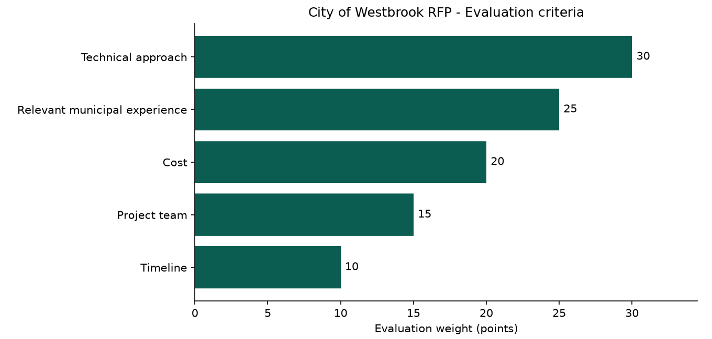
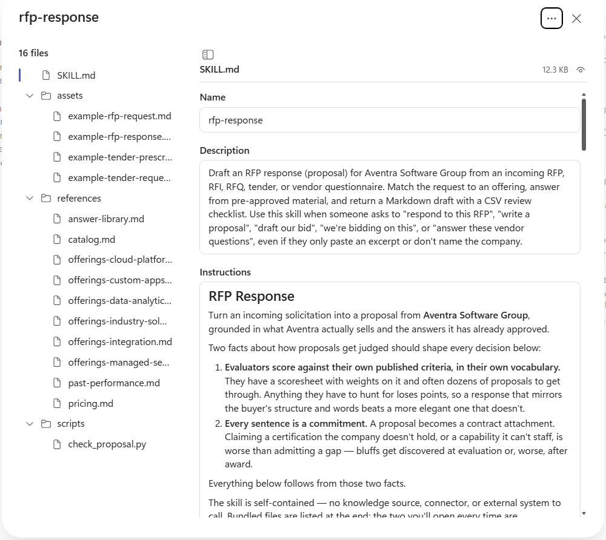
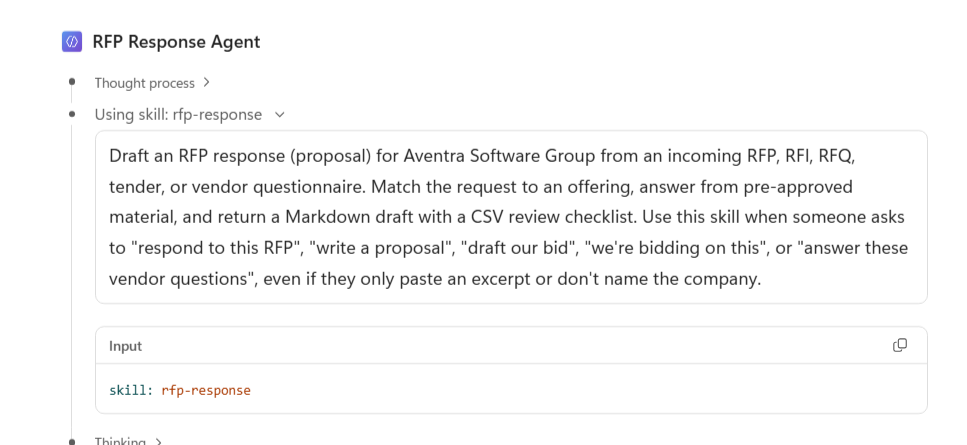
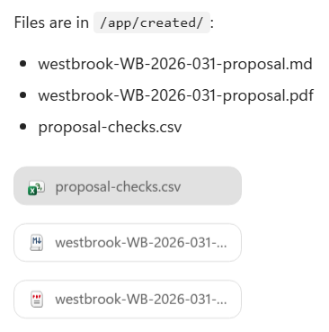

# Instructions and Skills Authoring

Follow this lab in [Copilot & Agents Bootcamp](https://microsoft.github.io/mcs-labs/events/copilot-agents-bootcamp/).

You'll build an RFP Response agent, inspect its skill and use it to prepare a proposal and chart. You'll check both against the supplied source material. Optional exercises cover writing your own skill and inspecting the runtime.


## 🧭 Lab Details

| Level | Persona | Duration | Finish line |
| --- | --- | --- | --- |
| 300 | Maker | 30 minutes | An RFP agent, a proposal in Markdown and PDF, a CSV checklist, and a chart checked against the RFP |

You are a proposal maker for fictional **Aventra Software Group**. Your job is to give an agent approved material and verify its outputs before sharing them with a customer.

<p class="lab-setup-note">At a proctor-led event with a provided, pre-provisioned account? <strong>You're ready to start.</strong></p>

<details class="lab-setup" markdown="1">
<summary>Using your own tenant? View setup requirements</summary>

Complete the [classic lab prerequisites](https://microsoft.github.io/mcs-labs/labs/mcs-skills-authoring/#prerequisites) separately, including harness access, permissions, credits, Work IQ, and sandbox capabilities. These are not attendee setup tasks.

</details>

Sign in with your provided lab account. Open [Copilot Studio](https://copilotstudio.microsoft.com/) and use only fictional materials. Download each file when its step needs it; no prior Skill-authoring experience is needed.

Configure, Inspect, Test and Verify take about 30 minutes; Author and Explore are optional.



*The RFP's five evaluation criteria shown as a chart, with weights totaling 100 points.*

## 📚 Table of Contents

- [Configure: Give the agent its role](#-configure-give-the-agent-its-role)
- [Inspect: Read the playbook before trusting it](#-inspect-read-the-playbook-before-trusting-it)
- [Test: Test the Skill with an RFP](#-test-test-the-skill-with-an-rfp)
- [Verify: Turn source weights into evidence](#-verify-turn-source-weights-into-evidence)
- [Author: Package and test a guided intake (optional)](#-author-package-and-test-a-guided-intake)
- [Explore: Inspect this runtime, not an imagined one (optional)](#-explore-inspect-this-runtime-not-an-imagined-one)
- [Take it with you](#-take-it-with-you)

## 🔎 Configure: Give the agent its role

**6 minutes · Copilot Studio · Build**

**Outcome:** An RFP Response Agent with reviewed Work IQ access and concise base instructions.

1. Open [Copilot Studio](https://copilotstudio.microsoft.com/). On **Home**, select **Agent** to create an agent on the **Microsoft Copilot harness**, not the **Standard harness**. On **Build**, replace **Untitled Agent** with:

```text
RFP Response Agent
```

<details>
<summary>Another route to the same agent</summary>

Open **Agents → More create options** beside **New agent**, then choose the **Agent** option for the Microsoft Copilot harness. Avoid the plain **New agent** button for this lab. Check the **Agent harness** or **Powered by** column in the list. Older badges can retain the former harness name; a **New name, same harness** notice explains the rename.

</details>

2. In the right-hand panel, find **Skills**, **Tools**, and **Knowledge**. Select **Work IQ** under **Tools** to review its Microsoft 365 services and connection. If not connected, open **Connection** and sign in with your lab account. Select **Done** when enabled. If you only inspected the existing connection and **Done** is disabled, use **Cancel**; discard only that unchanged tool review if prompted. Work IQ uses that identity's Microsoft 365 data; it does not grant new permissions. Leave the existing **Search all websites** source in place; do not add extra connectors.

**If Work IQ is missing:** Select **+** beside **Tools**, search for `Work IQ`, select the **MCP** tab, then **Work IQ**. Ask your facilitator if access is missing; do not switch to a production identity.

3. Paste this entire block into **Build → Instructions**, not Preview chat:

```text
You are the RFP Response Agent for our organization. You help our team write clear, accurate answers to customer RFPs (requests for proposal).

When you are given an RFP question or document:
- Find the material we already have: past RFP responses, product documentation, and company policies.
- Draft the answer in our voice - direct, specific, and free of marketing filler.
- Keep each answer self-contained so it can be pasted straight into the RFP form.
- Never invent facts about our products, pricing, security posture, or certifications. If you cannot find a source, say so.

Ask a clarifying question when the request is ambiguous. Keep answers concise unless the RFP asks for detail.
```

**Reveal — Why not paste the whole procedure here?** Base instructions define the role; a Skill supplies a relevant procedure. Short role instructions avoid repeating long procedures across agents. The Skill bundles activation language, instructions, and references so the relevant playbook can load on demand.

**Quick check:** Where should the detailed reusable RFP procedure live?
- **In a Skill, separate from the short base instructions. — Correct.** The agent keeps its role and loads the matching procedure and references when needed.
- Only in a long greeting pasted into every conversation. — A greeting does not create an attached, reusable Skill package.

**If your options differ:** Check the Microsoft Copilot harness and lab account. Ask the facilitator about missing rollout or connection access instead of creating an agent on a different harness.

## 🔎 Inspect: Read the playbook before trusting it

**6 minutes · Copilot Studio · Skills**

**Outcome:** The rfp-response Skill attached, with its description and answer library inspected.

1. Download [rfp-response.zip](assets/rfp-response.zip?raw=true), then open **Build → Skills → + → Upload a skill** and choose the ZIP. Wait for **Saving skill...** to finish and confirm **rfp-response** appears above Work IQ.

The package describes fictional **Aventra Software Group**, so Aventra appears in output despite the instructions saying “our organization.” Replace those references with approved company material for real deployment. Uploads accept `SKILL.md` or a ZIP containing it, with YAML **name** and **description** fields. **Create from blank** is a separate authoring option.

Uploading gives the agent a permanent ID and makes **Evaluate** and **Monitor** available, but this alone does not confirm that all configuration is saved. Select **Save** if enabled and wait for **Your agent has been saved.** before opening Preview. The **Draft** badge can remain on a saved, unpublished agent.

2. Select **rfp-response** to open its files. In `SKILL.md`, read **Name**, **Description**, and **Instructions**. Notice how phrases such as “respond to this RFP” match likely user requests.

   In the file tree, open **references/answer-library.md** and review the approved answers. Use the **…** button beside **X** to find **Download** and **Replace**, then close the viewer with **X**.

   Uploaded Skills are **Read-only**; changes require editing and replacing the package. Skills made with **Create from blank** are editable in place. Do not replace this sample.

   <picture></picture>

**Reveal — What is included in the Skill package?** A matching description and vetted material make the Skill reusable. The description helps select the playbook; references supply approved facts, while assets and scripts support examples and artifacts. A vague description can prevent activation before the procedure runs.

**Quick check:** The uploaded Skill needs a correction. What is the right path?
- Edit its read-only Name and Instructions fields directly. — Uploaded fields are read-only; blank-authored Skills are the editable-in-place case.
- **Download, edit the package, then use Replace. — Correct.** An authoring chat does not synchronize the installed package automatically.

**If upload fails:** Keep the exact validation error. Check for `SKILL.md` with YAML name and description and ask your facilitator; a failed upload is not an attached Skill.

## 🔎 Test: Test the Skill with an RFP

**10 minutes · Copilot Studio · Preview**

**Outcome:** A proposal in Markdown and PDF, plus a CSV checklist from the bundled script.

1. Download the [City of Westbrook RFP](assets/01-westbrook-permitting-portal.md?raw=true). Open **Preview** and use the **+** button beside the message box to attach it. Leave **Debug mode** on, then send:

```text
We are bidding on this RFP. Draft our response.
```

The sample's fixed submission date has passed; a deadline warning is careful behavior, not a failed run.

2. Expand the `rfp-response` card in the activity trace. Look for `skill: rfp-response` under **Input**. It shows which skill the agent selected.

   <picture></picture>

3. Read the summary for the proposed approach and anything the agent needs from you.
4. Download and open the Markdown proposal, the PDF, and `proposal-checks.csv`. Check that the proposed fee is the same in the PDF and the Markdown. If the CSV lists a line number, find that line in the Markdown.

   <picture></picture>

5. Pick one claim in the Markdown, such as a certification, and check it against the approved references.

   The CSV points to gaps. It doesn't verify claims.

**Reveal — Why did the agent select the Skill without being told to?** The orchestrator matched the request to its description. The playbook directs it toward approved evidence and gaps; that is guidance, not a guarantee. A promised file is not an attachment, and confident wording is not a verified commitment.

**Quick check:** What shows that the agent selected the Skill?
- **The trace lists rfp-response under Input. — Correct.** Check the reply for the files it produced.
- The answer sounds professional. — Polished wording does not establish that the Skill loaded or facts are supported.

**If the Skill does not load:** Inspect its description first. **If the CSV is missing:** Ask the agent to run the bundled checker on the existing Markdown proposal and attach the CSV.

**If the PDF is missing:** Ask the agent to make and attach a PDF from the Markdown it already created.

## 🔎 Verify: Turn source weights into evidence

**8 minutes · Preview · Agent sandbox**

**Outcome:** An actual downloadable PNG plus five source weights totaling 100.

1. In the **same Preview conversation**, reattach the sample RFP if needed. Send:

```text
Use your sandbox to analyze section 4, Evaluation criteria, of the attached City of Westbrook RFP. Read the source file with code and extract the criterion names and numeric weights; do not use scores or coverage claims from our proposal.

Execute code to create a horizontal bar chart using matplotlib if it is installed, or another charting library already available in your sandbox. Keep the criteria in source order, label every bar with its weight, and label the axis "Evaluation weight (points)". Title the chart "City of Westbrook RFP - Evaluation criteria".

Check that there are five criteria and that their weights sum to 100. If the source differs, report the discrepancy rather than changing its values. Save the chart as westbrook-evaluation-weights.png, verify the image opens, and attach the actual PNG. Also show the extracted data table and name the charting library you used.

Do not regenerate the proposal, install packages, call external services, or invent data. If sandbox execution, the source file, or a usable charting library is unavailable, report that explicitly instead of claiming to have created a chart.
```

2. Open the attached chart and select **Download** to save `westbrook-evaluation-weights.png`. In the **City of Westbrook RFP** document you attached, open **4. Evaluation criteria**. Use that table to check the chart and the table in the agent's reply: Technical approach **30**, Relevant municipal experience **25**, Cost **20**, Project team **15**, Timeline **10**. Check source order, labels, five bars, and total **100**. These are evaluation weights, not scores awarded to Aventra. Check the named library/version; **Debug mode** may show reasoning without individual sandbox calls.


*Compare the five bars with the evaluation table in the City of Westbrook RFP.*

**Reveal — What did you actually verify?** Artifact evidence and source agreement matter more than a confident claim. Sandbox capabilities must be observed, not assumed. Opening the image and checking both the chart and the table in the reply against the RFP verifies the output without confusing evaluation weights with proposal scores.

**Quick check:** Technical approach has value 30. What does that mean?
- Aventra has been awarded 30 points. — The source gives evaluation weights, not vendor scores.
- **Technical approach carries 30 of the RFP's 100 evaluation points. — Correct.** It is a checked source weight, not a performance claim.

**If you get only a script or text chart:** Capture the exact error and check sandbox access with your facilitator or admin. A real downloadable image is required. The optional Explore exercise can inspect the runtime; it is not a prerequisite or a substitute for this chart.

**Core complete.** Review the takeaways or continue with the optional extensions below. No publishing is required.

## 🧪 Author: Package and test a guided intake

**Optional · 25 minutes · Copilot Studio · Preview + Skills**

**Outcome:** A project-intake Skill ZIP, installed with base instructions and checked in two fresh conversations.

### 🔎 Prepare the authoring chat

1. Download and extract the [Skill-generation materials](assets/skill-generation/skill-generation-materials-v3.zip) **outside OneDrive for Business**, where encryption may make files unreadable. Use only `project-intake-process-v2.docx`. Create a separate **Home → Agent** on the **Microsoft Copilot harness** named **Project Process Assistant**; do not reuse the RFP agent.
2. Leave **Build → Instructions empty**; clear generated instructions if present. Do not add intake instructions, Skills, or connectors yet. Pre-attached **Work IQ** and **Search all websites** may stay. Under **Model**, select a reasoning-capable model such as **Claude Opus 5.5**, if offered. Select **Save** and let the first save finish; it can return you to **Build**.

These are fictional source documents, not a ready-made Skill. The procedure collects **business goal, intended users, desired outcome, and target date**, reuses supplied answers, accepts unknowns, asks one missing question at a time, and requests confirmation. Skills can guide conversations like topics, but do not replace deterministic ordering, validation, or branching.

3. Once the save finishes and the page settles, open **Preview** and select **New chat**. Use the **+** button beside the message box to attach only `project-intake-process-v2.docx` to this conversation. In the same **Preview chat**, with the document attached, send the full block below. Keep **Build → Instructions** empty. The prompt's former harness name refers to the current **Microsoft Copilot harness**.

```text
Create a portable Agent Skill named project-intake-guide for a Copilot Studio agent powered by the GitHub Copilot harness.

Use the attached project-intake-process-v2.docx as the procedure. Activate for requests such as "I want to request a project" or "Help me scope a new project", not for general questions about project management.

Collect the business goal, intended users, desired outcome, and target date. Reuse details already supplied. Ask only one missing question at a time. Accept "not yet known" and record it without asking again. Once all four fields have either a value or an explicit unknown, show a summary and ask for confirmation. Apply corrections without restarting. Confirmation means the summary is accurate, not that the project is approved.

Use your sandbox to create a real downloadable ZIP with SKILL.md at its root. SKILL.md must have valid YAML front matter with name and description, followed by Markdown instructions. Include a faithful Markdown version of the Word process under references/ and refer to it from the instructions. The finished intake Skill must not require tools, scripts, external services, or automatic actions. Keep the agent's base instructions separate from the Skill. Create the package now; do not start the intake interview or add agent instructions.

Before packaging, check the procedure against an incomplete opening request and a request that supplies all four fields. Report limitations; this drafting check does not prove the uploaded Skill works. Provide the actual ZIP file, not just a description or a suggested script. If file generation fails, report the error rather than inventing a download.
```

4. **Only if no downloadable Skill ZIP exists**, answer clarifying questions, then send this follow-up in the **same Preview chat** if you got only a draft or an intake interview. Skip it if the package already exists:

```text
Create the reusable Skill package from the process; do not run intake yet. Provide the downloadable ZIP.
```

Capture a file-generation failure and ask your facilitator or admin. A text-only answer is not a package.

### 🔎 Review, upload, then add the role

1. Download and unzip the generated Skill ZIP (for example `project-intake-guide.zip`), **not the materials archive**. Compare its procedure with the process document: four details, reuse, unknowns, and confirmation without approval. Check root `SKILL.md`, valid YAML **name** and **description**, and every referenced file.
2. In the **same agent → Build → Skills → + → Upload a skill**, upload the intake Skill and wait for saving. After upload succeeds, add the instructions below into **Build → Instructions** and save:

```text
You help users capture and confirm project intake details. Use relevant Skills when requests match, and follow the loaded Skill's procedure for the conversation.

Never invent missing details or imply that a project has been approved, funded, or scheduled. Do not send messages or make changes to external systems. Answer general project-management questions without starting intake unless the user requests it.
```

### 🔎 Test 1: Complete an incomplete request

Start a **new Preview conversation** in the same agent, without attachments. Send this without naming the Skill and check its load in the reasoning trace:

```text
I want to request a new project: an agent to help our support team.
```

Wait for a missing-detail question. Send **only the matching reply** in the **same Test 1 conversation**, not all three together.

**If asked about the business goal:**

```text
Reduce repeat onboarding questions for our support team.
```

**If asked about the desired outcome:**

```text
A searchable FAQ assistant covering common onboarding questions.
```

**If asked about the target date:**

```text
Not yet known.
```

When the summary appears, check that it reused the support-team audience, asked one missing question at a time, and did not invent a date. Confirm in the same chat:

```text
Yes, that summary is accurate.
```

Confirmation means accuracy, **not project approval**.

### 🔎 Test 2: Correct a complete summary

Start another **new Preview conversation** without attachments. Send:

```text
Help me scope a new project. Goal: reduce repeat support questions. Intended users: our support team. Desired outcome: a searchable FAQ assistant. Target date: not yet known.
```

Check that it summarizes without repeating intake questions. Send this correction in the **same Test 2 conversation**:

```text
Change the intended users to new support hires.
```

After the revised summary, confirm:

```text
Yes, that summary is accurate.
```

Check that only the audience changed: the goal, FAQ outcome, and unknown date remain. It should request confirmation without restarting or claiming approval.

**Reveal — What makes the generated package usable?** Upload, observe, and test. The authoring prompt makes a ZIP, base instructions define the role, and fresh conversations test the loaded Skill. A drafting self-check is not evidence that the installed package works; Skill guidance is not deterministic validation.

**Quick check:** The authoring chat says the Skill passed its self-check. Are you done?
- Yes; its self-review proves the uploaded Skill works. — A drafting check is not a test in a fresh conversation.
- **No; upload it and run both intake tests. — Correct.** Check actual activation, reuse, unknowns, correction, and confirmation.

**If it interviews instead of packaging:** Check that Build instructions were empty and only the process document was attached. Use the conditional package follow-up once. Keep authoring, installation, and testing as separate actions.

## 🧪 Explore: Inspect this runtime, not an imagined one

**Optional · 8 minutes · Copilot Studio · Agent Harness Explorer**

**Outcome:** An inspected HTML runtime report, with optional JSON and Markdown exports.

1. Open the [Agent Harness Explorer gallery page](https://microsoft.github.io/cat-agent-skills/skills/agent-harness-explorer/). Review instructions, source, and safety boundaries. Under **Add this skill**, read **Add only what you trust**. Acknowledge only if you trust it, then select **Download bundle (.zip)**. Keep the ZIP if you need it offline.
2. Create a separate **Home → Agent** on the Microsoft Copilot harness named **Harness Explorer**, apart from the RFP and intake agents. Paste this into **Build → Instructions**, not chat:

```text
Help me understand the capabilities actually available in this agent's harness. Use the Harness Explorer Skill for runtime inspection. Distinguish observed capabilities from assumptions and unavailable observations. Never expose secrets or full environment-variable values.
```

3. Select **Build → Skills → + → Upload a skill** and upload the gallery ZIP. Confirm **agent-harness-explorer** appears; do not add connectors or publish. Remove pre-attached **Work IQ** for a minimal baseline. Open **Preview** and send:

```text
Inspect the harness. Use the Skill's passive probes only. Report the observed Python runtime and installed libraries, and the tools, Skills, and MCP servers actually visible to this agent. Clearly distinguish observed, not visible, and unverified capabilities. Do not install packages, make network requests, run active-safe probes, or read unrelated files. Generate a downloadable HTML harness report.
```

4. Check **Used skill: agent-harness-explorer** and the `harness-report.html` attachment. Download and open it. Check that it describes this run's observations, not a generic platform feature list. Capture errors rather than counting unexecuted probes as success.
5. Send this in the **same Preview chat** and inspect the package names and versions. Installed-package metadata is not an import or rendering test. Flag absolute capability claims that the snapshot did not test.

```text
Based on this snapshot, which installed libraries could create a chart like our RFP evaluation-weight chart, and which could help read documents? For each recommendation, give the observed package name and version, its purpose, and any unverified capability. Do not install or assume missing packages.
```

6. Optionally send this in the same chat:

```text
Export the latest snapshot as JSON and Markdown.
```

Ask for both formats explicitly: a generic export request may return JSON only. Download the JSON and Markdown exports rather than assuming memory retained the snapshot; this agent may have no memory tool. You may provide the report to an authoring chat as supporting context; **do not share reports containing sensitive information**. It is a snapshot of this agent's observed runtime, not a guarantee about another agent, tenant, future session, or tool permission.

**Reveal — Does a missing observation mean a missing feature?** Visibility and support are different questions. A Python probe cannot independently see every agent tool or MCP server. **Not visible does not mean unsupported.** Unobserved capabilities remain unverified.

**Quick check:** A Python probe cannot see an MCP server. What can you conclude?
- That server is unsupported everywhere. — Probe visibility is not a product-wide support statement.
- **It was not visible to that probe in this run. — Correct.** Scope the observation to the agent and run that produced it.

**If no report file appears:** Record the exact generation error and ask the facilitator. A generic capability list or an invented download is not runtime evidence.

## 🎒 Take it with you

- **Match:** Write descriptions in the user's words. If a Skill never loads, inspect activation language first.
- **Separate:** Keep the role in base instructions and reusable procedures, references, assets, and scripts in the Skill.
- **Ground:** Use approved files and report missing certifications, experience, or prices rather than inventing commitments.
- **Verify:** Open real artifacts, compare them with sources, and distinguish observed execution from a claim. A human must review proposal facts and commercial numbers before customer sharing.
- **Test:** Test the installed Skill in fresh conversations. A self-review is not proof, and a Skill is not deterministic validation.

**Reflect:** Which repeatable procedure in your work belongs in a Skill, which source files would you trust, and what two tests would reveal a misleading success?

**Cleanup:** No publishing, scheduled jobs, or customer sends are required. Keep proposals as reviewed drafts; stop test runs when finished to avoid unnecessary credit use. Follow facilitator guidance for retaining or removing lab agents and downloaded files.

### 📚 Product guidance

- [Microsoft Copilot harness overview](https://learn.microsoft.com/microsoft-copilot-studio/harnesses-overview#github-copilot-harness) — Learn may retain the former section name.
- [Skills overview for agents](https://learn.microsoft.com/microsoft-copilot-studio/agents-experience/skills-overview)
- [Add and replace an uploaded Skill](https://learn.microsoft.com/microsoft-copilot-studio/agents-experience/skills-add-existing)
- [Manage and delete Skills](https://learn.microsoft.com/microsoft-copilot-studio/agents-experience/skills-manage)
- [Create a Skill](https://learn.microsoft.com/microsoft-copilot-studio/agents-experience/skills-create)
- [CAT: Agents Have Skills Now](https://microsoft.github.io/mcscatblog/posts/modern-mcs-agent-skills/)
- [CAT: Turn Your Daily Digest Into a Podcast](https://microsoft.github.io/mcscatblog/posts/podcast-script-skill/)

Product UI, models, and capabilities vary by environment; generated results differ.
