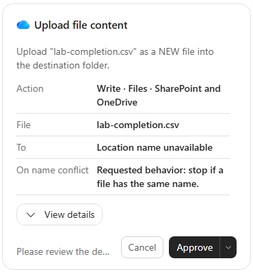
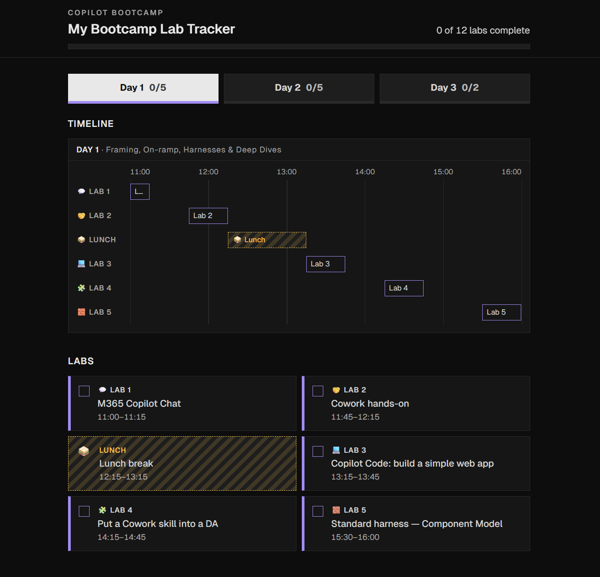
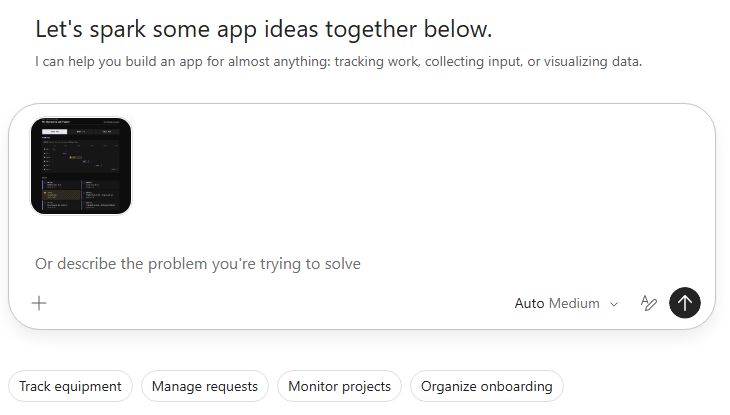
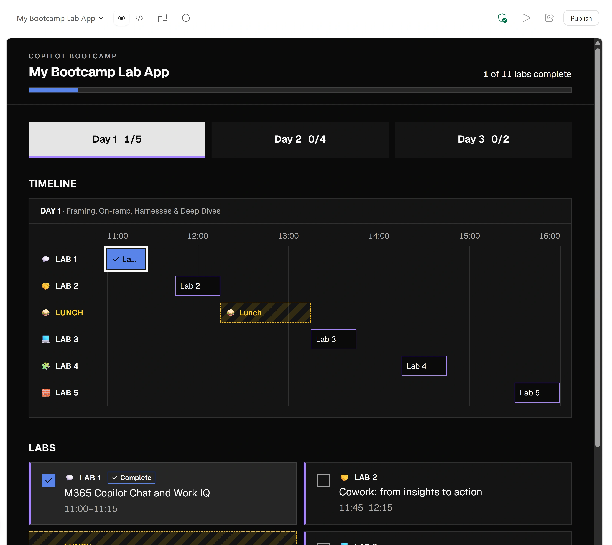
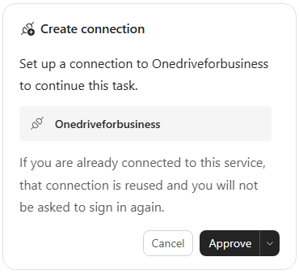
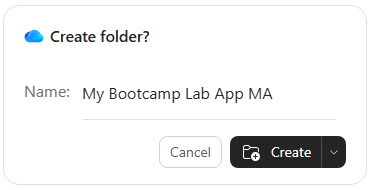

# 🧭 Managed Apps: prove saved progress

Build **My Bootcamp Lab App** from the live published agenda, prepare your own OneDrive CSV, then verify the app's read/save/reload behavior. This is a new app, not an HTML import or Copilot Code migration. Completing the earlier lab is not required. Keep everything in preview.



*A genuine storage-setup checkpoint. The unavailable location name must be resolved before approval.*

## 🧭 Lab Details

| Level | Persona | Duration | Purpose |
| --- | --- | --- | --- |
| 200 | Maker | 30 minutes | Build a preview and verify safe app-to-CSV persistence. |

**Pacing:** Build (8) → Prepare (8) → Prove (10) → Protect (4) = **30 minutes**. Repair is optional, about 5 more minutes. These are working budgets, not validated completion times; generation and approvals vary. Record unfinished checks rather than claiming completion.

## 🧭 Table of Contents

- [Evidence boundary](#-evidence-boundary)
- [Prerequisites](#-prerequisites)
- [Build](#-build)
- [Prepare](#-prepare)
- [Prove](#-prove)
- [Protect](#-protect)
- [Repair — optional](#-repair--optional)
- [Finish](#-finish)
- [Sources](#-sources)

## 🧭 Evidence boundary

The 6 November 2026 rehearsal verified in-memory UI, toggles, day switching, keyboard focus, reset and OneDrive setup/readback. Prompt 1 unexpectedly attempted publishing; it was stopped, and the app was later observed as **Draft**. The full amended Prompt 1 below, including its no-publish safeguard, has not been rerun from a new app.

Prompt 3 was submitted but generation stopped at a OneDrive forbidden-identity guard. **Live testing remains blocked until a person verifies the account; never bypass the guard.** App-to-CSV round trips, persistence/reload after wiring, rapid saves and error recovery are **unverified**. Prove and Protect describe expected learner checks, not passed results. The draft, CSV and connection were left intact, with no active generation.

All five screenshot pairs below are genuine light/dark captures from that rehearsal, cropped to exclude account chrome and identifiers. The app remains intentionally dark even in light Studio. `MA` is the rehearsal's isolation suffix; screenshot totals are historical. The unchanged `assets/actual-app.png` is a user-input design reference, not a newly captured result. No storage-wired or error-recovery screenshot is claimed.

## 🧭 Prerequisites

> **Taking part in a proctor-led event with a pre-provisioned user account? Skip this section.** Your account and environment access are prepared. Start at [Build](#-build); ask your facilitator if access is missing. You still download/upload the reference and create or verify your own connection and CSV in the missions. Those lab-specific artifacts are not assumed to be pre-created.

**Running in your own tenant?** Arrange Copilot Studio Apps access, image upload, preview and permission to read the public agenda. You need your own OneDrive for Business with file read/create/update permission and permission to use or create its connection in the environment. No prepared CSV, SharePoint list, database or VS Code setup is needed.

**Attendee readiness:** sign in to [Copilot Studio](https://copilotstudio.microsoft.com/) with your assigned training account in a separate browser profile/private window and select the assigned environment. Keep the [live agenda](https://microsoft.github.io/mcs-labs/events/bootcamp-latest/) beside the app. Use only your own connection/file; stop if identity is uncertain. Ask about credit availability and safe failure-test conditions. Do not publish, deploy or share.

## 🧭 Build

**8 minutes · Copilot Studio Apps**

**Outcome:** a synchronized in-memory preview that intentionally resets on reload.

### 🧭 Save and attach your design reference

Save the [provided reference screenshot](assets/actual-app.png), or use a screenshot of your earlier Copilot Code app. The original is intentionally dark and unchanged; use it for appearance, not its historical lab numbers or totals.



Open Copilot Studio in your assigned environment. If **Welcome from your admin** appears, read the terms, select **I have read and agree to the Terms of use**, then **Close**. Dismiss teaching bubbles with **Got it**.

Select **Apps (Preview) → New app**, then **Add attachments → Upload images and files**. Choose the reference and wait for its thumbnail above **Chat input**.

<picture><source media="(prefers-color-scheme: dark)" srcset="images/reference-attached-dark.webp"></picture>

### 🧭 Send Prompt 1 and watch the activity

Paste with the image attached. Watch agenda retrieval and build activity; wait for preview rather than submitting duplicates.

```text
Build a managed app called "My Bootcamp Lab App" using the
attached screenshot as a visual reference.

Reproduce its dark theme, square corners, day tabs, timeline,
lab cards, completion checkboxes, and overall progress indicator.

Fetch the current live published lab schedule from:
https://microsoft.github.io/mcs-labs/events/bootcamp-latest/

Include every day's scheduled "Lab N:" items and Lunch break.
Exclude other agenda items and optional labs. If you cannot read
the agenda, stop and tell me rather than inventing the schedule.

Keep timeline buttons, card checkboxes, per-day counts, and overall
progress synchronized. Lunch must never count toward completion.
Support keyboard interaction and visible focus.

For this first step, keep completion in memory. Do not add a
connector or data store yet. Do not publish, deploy, or share
the app. Show me the working preview.
```

If **App publish** starts, select **Stop generating response** and tell Copilot to keep the app in preview only. Ask the facilitator to check status: stopping an in-flight action does not prove that no changes occurred.

### 🧭 Test the baseline

1. Compare every day's lab numbers, titles and times with the live agenda. Include Lunch, exclude other items/optional labs, and check that all labs start unchecked.
2. Toggle a timeline lab button and then a card checkbox. Confirm both controls, day count and overall count agree.
3. Switch days and back; completion should remain during the session. Lunch must not be completable or counted.
4. Operate day tabs and completion controls with the keyboard; check visible focus.
5. Select **Reload preview**. Completion must reset because there is no persistent store yet.

<picture><source media="(prefers-color-scheme: dark)" srcset="images/completion-focus-dark.webp"></picture>

The app stays dark in both Studio themes. This is baseline evidence, not persistence proof; the `MA` suffix and totals belong to the rehearsal.

**Reveal — Appearance is not data, and a tick is not storage.** Attach appearance → read current agenda → test in-memory behavior. The image guides layout, the agenda supplies data, and the prompt defines behavior. Do not hide reset behind browser storage.

**Check:** Which source determines titles, times and total?
- The reference image. **Incorrect:** its data can be historical.
- The live published agenda. **Correct:** check every day's scheduled labs, excluding Lunch from totals.

**Stuck?** If the agenda cannot be read, stop and report it rather than inventing a schedule. Correct synchronization or outdated image-derived counts before adding storage.

## 🧭 Prepare

**8 minutes · Copilot Studio Apps + OneDrive for Business**

**Outcome:** a healthy own-account connection and safe CSV/readback, with existing progress preserved.

### 🧭 Send Prompt 2 in the same conversation

Continue after the baseline passes. Do not change app code yet.

```text
Set up storage for saving lab completion. Don't change the app's
code yet.

Use a CSV file in my own OneDrive, accessed through the OneDrive
for Business connector. Do not use SharePoint, Dataverse, browser
localStorage or sessionStorage.

You are authorized to create the OneDrive for Business connection
with my account if I don't have a working one. If the connection
is in an error state, stop and tell me before doing anything else.

File:
- Path: /Apps/My Bootcamp Lab App/lab-completion.csv
- Create it if it doesn't exist: one row per scheduled lab, using
  lab-N IDs from the live agenda's lab numbers, all incomplete.
  Lunch is never in the file.
- Columns: labId, completed (true/false), updatedAt (ISO time).
- If it already exists, don't change it.

Connect the app to OneDrive for Business so it can read and write
this file.

Then report: the connection state, whether the file was created or
already existed, and its current rows.
```

### 🧭 Confirm your connection

Check connection state before other actions. If **Create connection** appears, verify the OneDrive for Business service (the card says **Onedriveforbusiness**), select **Approve**, and sign in with your training account if asked. Reuse a working existing connection. If it is in error, stop and report it; use optional Repair only with facilitator guidance.

<picture><source media="(prefers-color-scheme: dark)" srcset="images/onedrive-connection-dark.webp"></picture>

A connection card alone does not prove working access.

### 🧭 Verify or create the dedicated folders

Compare this intended path with the actual destination. **Reference value—compare, do not send as a prompt:**

```output
/Apps/My Bootcamp Lab App/lab-completion.csv
```

If **Create folder?** appears for **My Bootcamp Lab App**, verify `/Apps` in your own OneDrive, then select **Create**. If `/Apps` itself is missing, first verify and approve **Name: Apps** at the OneDrive root, then create the app folder inside it. Reuse existing folders.

<picture><source media="(prefers-color-scheme: dark)" srcset="images/create-folder-dark.webp"></picture>

The screenshot's `MA` suffix isolates the rehearsal. Verify your actual destination instead of copying its folder name.

### 🧭 Approve only a confirmed missing CSV

Review **Upload file content** only after healthy access confirms the CSV is missing. Expand **View details**, verify your own app-folder destination and `conflict_behavior: fail` (stop on name conflict), then select **Approve**.

If **Location name unavailable** appears, request actual destination and missing-file proof first; stop if you cannot verify them. An empty search or failed read is not proof of absence. Never approve a new-file upload over an existing CSV.

<picture><source media="(prefers-color-scheme: dark)" srcset="images/upload-file-content-dark.webp"></picture>

The action label includes SharePoint and OneDrive; this exercise still targets only your own OneDrive.

### 🧭 Read back the setup report

Confirm connection health, whether the file was created or existed, and current rows. Verify `labId`, `completed`, `updatedAt`: one `lab-N` row per scheduled lab, no Lunch or optional labs. New rows must be `false` with ISO timestamps; preserve existing saved values. Confirm the app has the connection available but its code/behavior has not changed.

**Reveal — Storage is not app wiring.** Check own connection → verify destination/existence → preserve or create safely → read back rows. A failed read can mean denied access, not an absent file. Prompt 2 prepares storage; the preview is still in-memory.

**Check:** What permits creating the CSV?
- Any failed read or empty search. **Incorrect:** errors must not become destructive initialization.
- Healthy access, verified destination and confirmed missing file. **Correct:** use fail-on-conflict and preserve existing files.

**Stuck?** Stop for uncertain identity, a guard, or access/creation failure. Ask the facilitator. Do not switch to SharePoint, Dataverse, `localStorage` or `sessionStorage` to make the preview appear successful.

## 🧭 Prove

**10 minutes · Copilot Studio Apps + your OneDrive CSV**

**Outcome:** evidence of an app-driven tick/CSV/reload/uncheck/reload cycle, or an explicit blocker.

### 🧭 Send Prompt 3 after the storage gate

Confirm account identity, healthy connection and file readback. Submit in the same conversation. Wiring and acceptance checks were not completed in the rehearsal; a person must verify the account before any guarded-session continuation.

```text
Now make lab completion save to and restore from that OneDrive CSV.

Reading the file:
- Request the file content as raw bytes, not with content-type
  inference (for "Get file content", set inferContentType to false).
  A .csv returned as text/csv can be rejected by the app's data
  layer before your code sees it.
- The content may still come back as text, base64 or raw bytes;
  handle all three and treat anything else as an error.

App behavior:
- On open, read the file and restore completion. Keep checkboxes
  and timeline buttons disabled until the load finishes.
- If the file is missing for the current user, create it;
  never overwrite an existing file on a failed read.
- On each change, rewrite the whole file. Run saves one at a time
  so the file never goes backwards. Show "Saving…" while saving.
- If a save fails, undo the change on screen and show a message.
- If loading fails, show an error with a Try again button, and log
  which step failed (metadata, read, create or save).
- Keep the existing interface and behavior unchanged: timeline,
  checkboxes, day counts and overall progress stay in sync, and
  Lunch never counts toward completion.

Before you report done, confirm the read and save work through
the app itself, not only by calling the connector directly. If you
can't verify this yourself, say so and list it as a remaining check.

When done, tell me how to test it in the preview (tick, reload,
check the CSV). Don't publish until I say so.
```

### 🧭 Inspect the read contract

Ask Copilot to confirm **Get file content** uses `inferContentType: false` and handles text, base64 and raw bytes. Unsupported responses and failed reads must be errors, not reasons to initialize a file. This is required behavior, not a verified outcome of the interrupted rehearsal.

### 🧭 Tick, inspect, reload, undo

Use one open preview and your own verified OneDrive account.

1. Open the preview. Completion controls must stay disabled until loading finishes, then show saved values.
2. Complete one lab. Check synchronized controls/counts; wait for **Saving…** to finish.
3. Inspect the actual CSV in your OneDrive: the correct lab must have `completed: true` and an ISO `updatedAt`.
4. Select **Reload preview**. Confirm the tick and both counts return.
5. Uncheck the same lab, wait for saving, verify `false` in the CSV, then reload. It must remain unchecked with correct counts.
6. Change several labs quickly; wait for all saves. Compare screen and CSV with your final choices, not an earlier state.
7. Close and reopen the preview using the same account; confirm saved values return.
8. Count CSV rows: exactly the scheduled labs, no Lunch or optional-lab rows.

**These are expected learner checks, unverified after wiring in the rehearsal.** A direct connector call or surviving tick alone does not establish the app-to-file round trip.

**Reveal — Verify the whole path.** Change in app → inspect CSV → reload from file → undo and verify again. Serializing saves prevents an earlier write from replacing a later choice.

**Check:** Which evidence establishes persistence?
- Connection approval succeeded. **Incorrect:** setup is not app reads/writes.
- An app-driven save changes the actual CSV and reload restores it. **Correct:** repeat for unchecking and compare file and screen.

**Stuck?** If Copilot cannot verify the app path, retain it as a remaining check. Test it yourself only with verified account access; otherwise record the blocker. Never infer persistence from the baseline screenshot.

## 🧭 Protect

**4 minutes · App preview + facilitator-approved test conditions**

**Outcome:** recorded failure/recovery results, or clearly marked remaining checks.

Use only approved, non-destructive simulations. Never delete/corrupt the CSV, remove a shared connection or bypass a guard to induce failure. If no safe simulation is available, mark the check **not tested**.

- **Load failure:** expect an error, **Try again**, disabled completion controls and no overwrite. Inspect the logged step (`metadata`, `read`, `create` or `save`). After access is restored, retry and verify saved values load.
- **Unsupported response:** expect an explicit error, not an empty-file interpretation or initialization.
- **Save failure:** expect the attempted tick, counts and related controls to roll back to the prior saved state, with a message. Resolve the cause before retrying and check the CSV.
- **Missing file:** only a confirmed missing-file result may permit creation for the current user. Permission/connection failures must not.

All four runtime failure paths remain **unverified** in the rehearsal.

Record pass, fail or not tested for baseline, setup, round trip, rapid changes, reopening, load retry, unsupported response, save rollback and missing-file handling. Report blockers. Stop generation when finished; do not select **Publish** or **Share**. Mark the lab complete only when required checks pass.

**Reveal — Uncertainty must not erase saved work.** Detect failure → preserve saved state → show recovery → verify after retry. Initializing after a permission error hides the failure and risks data loss.

**Check:** What should a permission failure during load trigger?
- An error and retry path, with no overwrite. **Correct:** failed read does not mean missing file.
- A new CSV or silent browser-storage fallback. **Incorrect:** both hide failure; replacement can destroy progress.

## 🧭 Repair — optional

**5 additional minutes · Power Apps Connections**

Use only when blocked at the connection gate and a facilitator approves repair.

1. Open [Power Apps](https://make.powerapps.com), select the same environment and open **Connections** (under **Data** if shown). If **Welcome to Power Apps** asks for country/region and **Get started**, stop and ask the facilitator to complete setup. Navigation beyond this enrollment gate was not verified live.
2. Find your own broken **OneDrive for Business** connection; try updating credentials from **…**. If repair fails, have the facilitator confirm no apps or flows depend on it before considering **Delete**. Never delete shared or other learners' connections.
3. If replacement is approved, select **New connection → OneDrive for Business** and sign in with your assigned account. Keep the CSV intact.
4. Return to the app conversation and rerun Prompt 2 above. Verify healthy access and existing rows without reinitialization. Resume Prompt 3 only after checks pass; stop and report failure rather than repeatedly deleting connections.

**Reveal — Connection repair is not data reset.** Repair own access → read existing rows → resume integration. Replacing access does not justify replacing progress.

**Check:** What should remain intact?
- The existing CSV and other apps' or learners' connections. **Correct:** repair authorized access only and recheck saved rows.
- Nothing; delete all connections. **Incorrect:** that risks shared dependencies and is outside the lab.

## 🧭 Finish

Your finish line is **verified app-to-file persistence and safe failure behavior**, not a convincing UI. Until required checks pass, keep the draft and a precise remaining-check list.

- **Separate inputs:** image for appearance, live agenda for data, prompts for behavior.
- **Gate integration:** healthy own-account access and safe file setup precede wiring.
- **Prove the round trip:** tick, inspect CSV, reload, uncheck and repeat; test save ordering and recovery.

**Reflection:** What independent evidence would prove a saved change in an app at work survives reload without risking existing data?

**Cleanup:** stop active generation; keep the draft and CSV for review. Do not publish or share. No recurring work is required. Agree later cleanup with the facilitator; do not delete shared connections or files.

## 🧭 Sources

- [Microsoft Copilot Studio documentation](https://learn.microsoft.com/microsoft-copilot-studio/)
- [OneDrive for Business connector reference](https://learn.microsoft.com/connectors/onedriveforbusiness/)
- [Manage connections in Power Apps](https://learn.microsoft.com/power-apps/maker/canvas-apps/add-manage-connections)
- [Live published bootcamp agenda](https://microsoft.github.io/mcs-labs/events/bootcamp-latest/)
