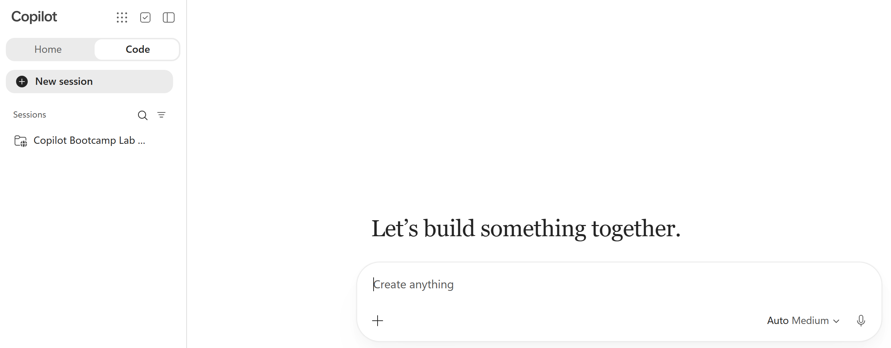
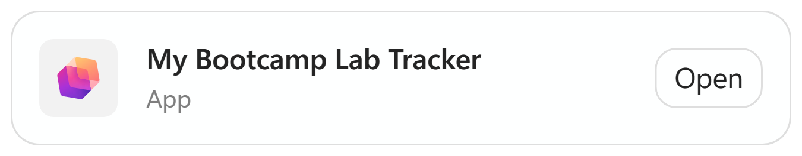
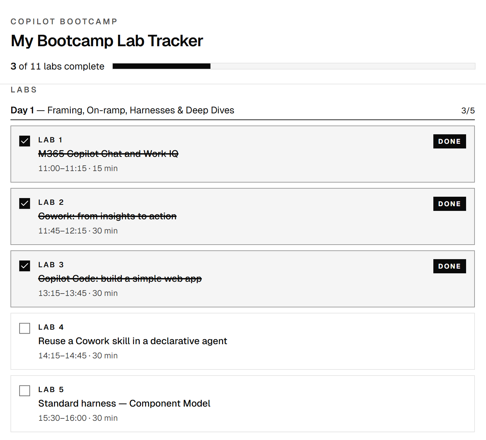
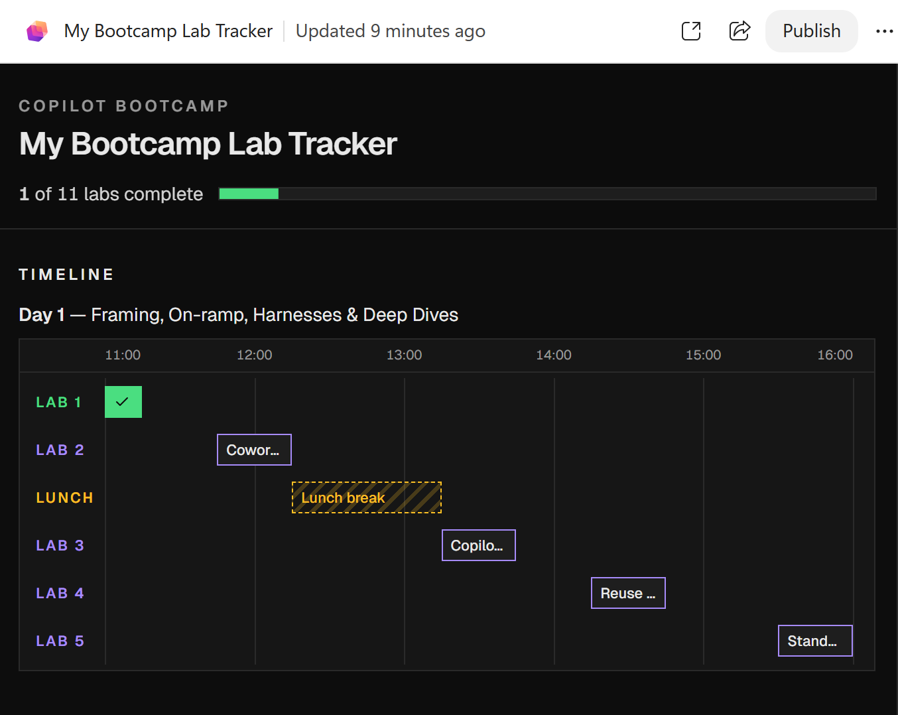
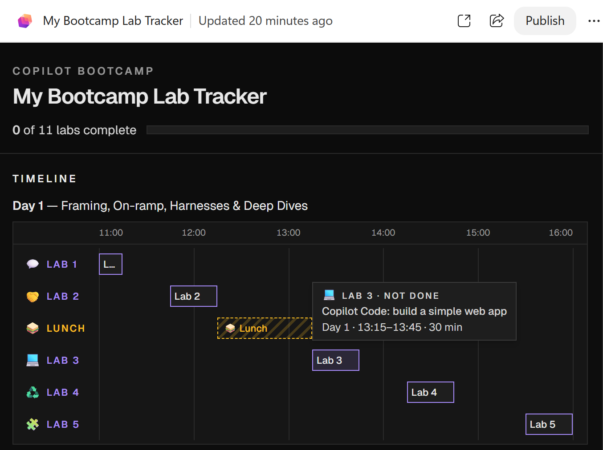
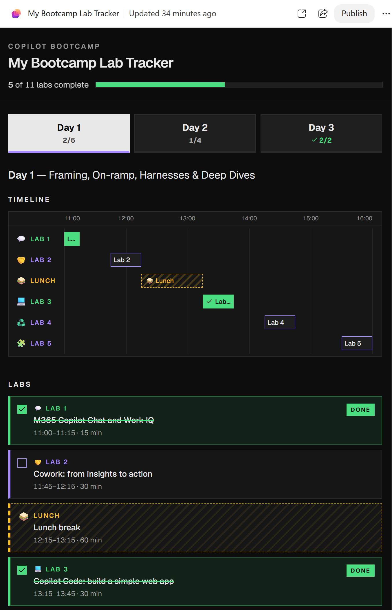
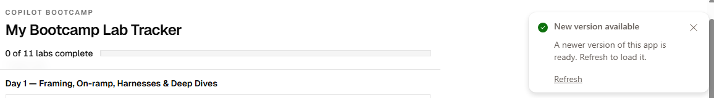
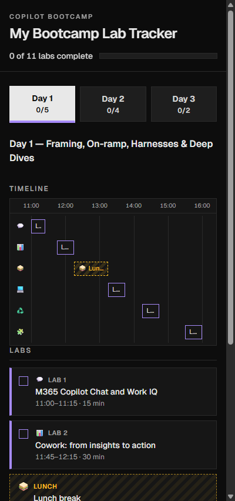

# Copilot Code: build a simple web app

Use four sequential prompts in Copilot Code to build a Bootcamp Lab Tracker from the published agenda, add a dark theme, emojis, and accessible day tabs, then publish it, all without writing code manually.

---

## 🧭 Lab Details

| Level | Persona | Duration | Purpose |
| ----- | ------- | -------- | ------- |
| 100 | Maker | 30 minutes | Build an interactive app through four prompts, check each stage, and refine its design and accessible navigation. |

---

## 📚 Table of Contents

- [Why This Matters](#-why-this-matters)
- [Introduction](#-introduction)
- [Core Concepts Overview](#-core-concepts-overview)
- [Documentation and Additional Training Links](#-documentation-and-additional-training-links)
- [Prerequisites](#-prerequisites)
- [Summary of Targets](#-summary-of-targets)
- [Use Case Covered](#-use-case-covered)
- [Instructions](#-instructions)
- [Use Case: Build and Refine Your Tracker](#-use-case-build-and-refine-your-tracker)
- [Summary of Learnings](#-summary-of-learnings)
- [Conclusions and Recommendations](#conclusions-and-recommendations)
- [Architecture Bootcamp Latest](#-architecture-bootcamp-latest)

---

## 🤔 Why This Matters

**Makers do not need to start with a blank code editor to try an app idea.** A clear description of the outcome can become a working prototype that you can open, use, and improve.

Think of the prompt as a brief you would give to a developer:
- **Without a clear specification:** the app may look convincing but count the wrong items, lose track of its controls, or be difficult to use with a keyboard.
- **With a clear specification:** the schedule, interactions, visual rules, and acceptance checks make the intended result explicit.

**Common challenges solved by this lab:**
- "I have an app idea, but I do not know where to start."
- "The generated page looks good, but how do I know it works?"
- "I want to change the design without breaking what already works."

**In 30 minutes, you will build and refine a small app step by step, checking the result after each prompt.**

---

## 🌐 Introduction

During the bootcamp, you need a simple way to track the labs you have completed across every day. Instead of maintaining a checklist by hand, you will ask Copilot Code to read the published agenda and create an interactive tracker from a supplied specification.

You will use four prompts in the same Code session: build a neutral-grey tracker, apply a dark theme, add emojis and shorter bar labels, then organize each day into an accessible tab. Wait for each update and check the result before moving to the next prompt.

The finished tracker combines a timeline and lab cards for each day, per-day counts on the tabs, and an overall progress indicator. Switching tabs must preserve the labs you have ticked. Each day's Lunch appears in the schedule but must never count as a lab.

Copilot Code is the **Code** view in Microsoft Copilot, a Frontier preview feature. You work in a cloud session in your browser, with nothing to install. Copilot Code builds the app from the published agenda, publishes it to Copilot Managed Runtime and gives you a link to open it in your browser. Later updates appear in the **Preview** pane next to the chat, and the link shows them once you publish again. Progress is kept in memory only and intentionally resets on reload.

### Why Start with a Small Prototype?

**The goal is to learn how to describe, check, and refine an app, not to set up a development toolchain.** A small tracker gives you a manageable result to inspect during the 30-minute lab, leaving time to experiment with prompts and check each change.

The prompts specify what the app should do without requiring a single HTML file or a particular framework. Whether Copilot Code uses plain HTML, CSS, and JavaScript or a framework such as React, check the same schedule, interactions, and accessibility requirements in the app itself.

- **Consider React** when a growing interface would benefit from reusable components and structured state management. A typical React project adds dependencies and build tooling.
- **Consider a full-stack app** when you need accounts, shared data, saved progress across devices, or integrations that require server-side credentials.

This tracker is a deliberately scoped prototype, not a production-ready service. The skills you practice here, including clear requirements, iterative prompting, and checking behavior, also apply to larger apps.

---

## 🎓 Core Concepts Overview

| Concept | Why it matters |
| ------- | -------------- |
| **Plain-language specification** | Describes the required content, behavior, and constraints before the app is generated. |
| **In-memory progress** | Keeps completion during the current session, including tab switches, but resets it on reload. |
| **Synchronized state** | Keeps timeline buttons, checkboxes, per-day counts, the overall completion count, and the progress bar consistent. |
| **Acceptance checks** | Turns "it looks right" into observable checks, including reverse actions and reload behavior. |
| **Accessible interaction** | Makes keyboard operation, visible focus, meaningful labels, and accessible day tabs part of the requirements. |
| **Iterative refinement** | Builds the app through four focused prompts, checking each stage while preserving existing behavior. |

---

## 📄 Documentation and Additional Training Links

These optional resources explain Copilot Code, where published apps run, and the web technologies and browser checks used in this exercise. No manual coding is required. The narrow-screen check is easiest with device emulation in your browser's DevTools.

- [Get started with Copilot Code (Frontier)](https://learn.microsoft.com/copilot/code/get-started)
- [Use Copilot Code (Frontier)](https://learn.microsoft.com/copilot/code/use-code)
- [What is Copilot Managed Runtime (preview)](https://learn.microsoft.com/microsoft-365/managed-apps/)
- [Get started with web development using Visual Studio Code](https://learn.microsoft.com/training/modules/get-started-with-web-development/)
- [Overview of DevTools (Microsoft Edge)](https://learn.microsoft.com/microsoft-edge/devtools/overview)
- [Accessibility-testing features in Microsoft Edge DevTools](https://learn.microsoft.com/microsoft-edge/devtools/accessibility/reference)

---

## ✅ Prerequisites

<p class="lab-setup-note">At a proctor-led event with a provided, pre-provisioned account? <strong>You're ready to start.</strong></p>

<details class="lab-setup" markdown="1">
<summary>Using your own tenant? View setup requirements</summary>

- A work account with a Microsoft Copilot licence and the **Code** view available in [Microsoft Copilot](https://copilot.cloud.microsoft).
- Enrolment in the [Frontier program](https://adoption.microsoft.com/copilot/frontier-program/): Copilot Code, and building and publishing apps to Copilot Managed Runtime, are Frontier preview features.
- Copilot Code must be able to fetch the [published bootcamp agenda](https://microsoft.github.io/mcs-labs/events/architecture-bootcamp/) while generating the app.
- A browser that can open the app's link (`play.managedapps.cloud.microsoft`).

</details>

No coding experience is needed. Copilot Code is in preview, so labels and screens may differ slightly from the screenshots.

---

## 🎯 Summary of Targets

By the end of this lab, you will be able to:

- Generate and publish an app with Prompt 1, open it, refine the same app with Prompts 2-4, then publish the finished version.
- Verify that every day's scheduled labs and Lunch match the published agenda.
- Check that timeline buttons, checkboxes, per-day counts, and overall progress indicators stay synchronized.
- Confirm that totals come from the parsed labs, Lunch is excluded from progress, and reloading resets completion.
- Apply a dark theme, add topic-specific emojis, and shorten lab-bar labels without changing the schedule.
- Check that day tabs support keyboard navigation and preserve completion when switching days.
- Check visible focus and emoji-only timeline row labels on a narrow screen.

---

## 🧩 Use Case Covered

| Step | Use Case | Value added | Effort |
| ---- | -------- | ----------- | ------ |
| 1 | [Build and refine your tracker](#-use-case-build-and-refine-your-tracker) | Build the basic tracker, then add a dark theme, emojis, and accessible day tabs through four prompts. | 30 min |

Complete all four prompts in order. Prompt 1 takes about 5-7 minutes to generate and each update about 1-2 minutes, so use the waiting time to read the next step. If generation or troubleshooting takes longer, ask your facilitator for help rather than submitting the remaining prompts together.

---

## 🛠 Instructions

---

## 🧱 Use Case: Build and Refine Your Tracker

Build the Bootcamp Lab Tracker from the published agenda, then refine the same app through four sequential prompts in one Code session.

| Use case | Value added | Estimated effort |
| -------- | ----------- | ---------------- |
| Build and refine your tracker | Create the app and add a dark theme, emojis, and accessible day tabs, checking each stage. | 30 minutes |

**Summary of tasks**

Start a new Code session, submit Prompt 1, and check the basic tracker. Continue with Prompts 2, 3, and 4 to add the dark theme, emojis and shorter bar labels, and accessible day tabs. Wait for each update and check the result before submitting the next prompt. Finally, publish the finished tracker and check it.

**Scenario:** You are attending the bootcamp and want one place to see every day's labs and mark them complete without counting Lunch or other agenda items toward your progress.

### Objective

Create and publish a multi-day tracker, refine its design and day navigation, and verify that the schedule and completion controls remain correct throughout.

### Step-by-Step Instructions

#### Get Ready

1. Go to [Microsoft Copilot](https://copilot.cloud.microsoft) and sign in with your lab account.
1. In the **Home &#124; Code** switcher at the top of the left pane, select **Code**.
1. Select **New session**. The page shows **Let's build something together.** and a **Create anything** box.



#### Prompt 1: Build the Basic Tracker

Paste **Prompt 1** below unchanged into the **Create anything** box, including the agenda URL and the final instructions, then select the send arrow. Do not submit Prompts 2-4 yet.

```text
Build an app called "My Bootcamp Lab Tracker". Progress is kept in memory only: it starts with every lab unchecked and resets on reload.

Fetch the agenda at https://microsoft.github.io/mcs-labs/events/architecture-bootcamp/ and use every day's "Lab N:" items and "Lunch break" as the app's data (day, number, title, start, end). Skip everything else, including optional labs. If the page can't be fetched, stop and tell me.

Layout (max 720px, centered):

- **Sticky header:** "COPILOT BOOTCAMP" eyebrow, title, "N of TOTAL labs complete" (aria-live) and a progress bar.

- **Timeline:** a Gantt chart for each day with hourly gridlines. Each row is labelled "LAB N" or "LUNCH". Lab bars are toggle buttons (aria-pressed) showing the title, truncated with "…". Hovering or focusing a bar shows a tooltip with its details. Lunch bars aren't clickable.

- **Cards:** grouped by day. Each lab card is a label around a checkbox, showing "LAB N", the title and the time. Done cards get a strike-through and a "DONE" badge.

Keep the bars, checkboxes, counter and progress bar in sync. Use neutral greys and square corners, with visible focus outlines. When done, give me a preview link I can open in my browser.
```

Copilot Code fetches the agenda, writes and checks the code, then publishes the app. This takes about 5-7 minutes; keep the tab open and let it finish. If Copilot Code asks for permission to continue, for example to search the web, approve it.

#### Open Your Tracker

When Copilot Code finishes, it replies that the app is published, with a link and a **My Bootcamp Lab Tracker** app card. Select **Open** on the card, or select the link, to open the tracker in a new browser tab. The same app also opens in the **Preview** pane to the right of the chat.



Copilot Code checks that the code builds and publishes, but it cannot click through the app itself, so the checks below are up to you. If there is no link or it does not open, ask Copilot Code for a working link before continuing.

#### Check the Basic Tracker

- Compare the tracker with the [published bootcamp agenda](https://microsoft.github.io/mcs-labs/events/architecture-bootcamp/). Confirm every day's scheduled lab numbers, titles, times, and Lunch appear in time order.
- Confirm that modules, welcome/re-cap, coffee breaks, Q&A, social, and all optional labs are excluded.
- Count the included labs and confirm the overall counter starts at **0 of TOTAL**, using that count rather than a fixed number.
- Click a lab's timeline bar. Its checkbox, styling, overall completion count, and progress bar should update together.
- Toggle a card's checkbox. Its timeline bar should update too.
- Uncheck a completed lab to reverse its completion.
- Complete every included lab and confirm the counter shows **TOTAL of TOTAL**.
- Confirm each day's Lunch cannot be toggled and never counts toward progress.
- Reload the page and confirm all labs reset to unchecked.
- Use **Tab** and **Space** to operate the controls, checking for visible keyboard focus.
- Confirm the app uses neutral greys and square corners. Dark colors, emojis, and day tabs are added by the next three prompts, so they are not expected yet.



If something does not work, flag it to your facilitator.

Once the basic tracker works, continue in the same session. Prompts 2-4 update the existing app; do not start a new app.

#### Prompt 2: Apply the Dark Theme

In the same session, paste Prompt 2 unchanged into the **Ask a follow-up or request changes** box and send it.

```text
Update with a dark theme, keeping everything else the same.
- Background #0d0d0d, surfaces #161616/#1e1e1e, borders #2a2a2a, text #d4d4d4, headings #e8e8e8.
- To do = purple #a78bfa (outlined bars, purple left border on cards).
- Done = solid green #4ade80 bars, green-tinted cards.
- Lunch = amber #fbbf24, with a dashed border and diagonal stripes.
Keep focus outlines visible and respect prefers-reduced-motion.
```

Wait for the update, which takes about 1-2 minutes. Copilot Code changes the app in the **Preview** pane only and says so in its reply; your published link keeps the basic version until you publish at the end of the lab. Check the result in the **Preview** pane. To give the app more room, select the expand icon at the top of the pane.

Check that incomplete labs are purple, completed labs are green, and Lunch is amber with dashed borders and stripes. Toggle a lab in both directions and confirm its bar, card, counter, and progress bar still agree. Each update reloads the preview, so labs you ticked earlier start unchecked again.



#### Prompt 3: Add Emojis and Shorter Bar Labels

Paste and send Prompt 3 in the same session.

```text
Update by giving each lab a distinct emoji that suits its topic; lunch is 🥪. Show it before "LAB N" in the timeline row labels, on the cards and in the tooltips. Lunch bars read "🥪 Lunch", and lunch cards show 🥪 instead of a checkbox. Hide emojis from screen readers. At ≤480px, the timeline row labels show the emoji only.

Lab bars should say "Lab N" instead of the title, which gets cut off. The full title stays in the tooltip, the aria-label and the card.
```

Wait for the update and check it in the **Preview** pane. Confirm each lab's emoji is consistent across its timeline row, card, and tooltip. Lab bars should now show **Lab N**, with the full title still available in the tooltip, accessible name, and card. Lunch must remain non-interactive. You will check the narrow-screen labels after publishing the finished tracker.



#### Prompt 4: Add Accessible Day Tabs

Paste and send Prompt 4 in the same session.

```text
Update so each day is its own tab ("Day N" plus an x/y count), using the accessible ARIA tabs pattern with arrow-key navigation. Each tab shows that day's timeline and cards. Keep the header's overall progress, and keep ticks when switching tabs.

Make the tabs stand out: full-width, equal-size buttons with bold text. Unselected tabs are #1e1e1e with a #2a2a2a border and light text, and get lighter on hover. The selected tab is near-white #e8e8e8 with dark #0d0d0d text and a purple bottom border. A day's count turns green when all its labs are done.
```

Wait for the update and check it in the **Preview** pane. Confirm the day tabs have equal-sized buttons, the selected tab is clearly highlighted, and each selected day shows only its own timeline and cards.



#### Publish the Finished Tracker

1. At the top of the **Preview** pane, select **Publish**. The button shows **Publishing…** for about 1-2 minutes. When it finishes, a **Your app is published** message appears with **Open app** and **Share**. You can also ask Copilot Code to publish.
1. Go back to the browser tab with your tracker. A **New version available** message appears; select **Refresh** to load the finished tracker. If you closed that tab, select **Open app**.



#### Check the Finished Tracker

Run these checks on the published tracker in its browser tab.

- Repeat the schedule and completion checks in [Check the Basic Tracker](#check-the-basic-tracker). The agenda data and overall total must not have changed.
- Complete a lab on one day, switch to another day, and switch back. The original tick must still be present, and the header must include completions from all days.
- Check each tab's **x/y** count against that day's completed and total labs. Complete all labs on a day and confirm its count turns green; uncheck one and confirm that complete-day styling reverses.
- Use **Tab** to reach the day tabs and the selected day's controls. Use the arrow keys to navigate between tabs, activating with **Enter** or **Space** if needed. Confirm focus remains visible.
- Verify that the lab bars, checkboxes, per-day counts, overall counter, and progress bar remain synchronized, and that Lunch never counts.
- Hover over or focus a lab bar and confirm its full title remains available. Check with a screen reader that decorative emojis are not announced and the lab still has a meaningful name.
- Make the page narrower than 480px, for example with device emulation in DevTools (**F12**, then **Ctrl+Shift+M**) set to a width of 400px. Confirm timeline row labels show only emojis and the day tabs remain usable. Test below 480px: some generated versions keep the full labels at exactly 480px.
- Reload the page. Completion should reset because there is no storage; this differs from switching tabs, which must keep ticks.
- Confirm square corners and the dark theme remain after all updates.



### Congratulations!

You have built, refined and published the tracker through four prompts, checking each change while preserving the original schedule and completion behavior.

### Test Your Understanding

**Key takeaways**

- **One action, several updates:** completing a lab must update both controls, its day's count, and the overall progress indicators.
- **The agenda is the source of truth:** lab counts come from the scheduled labs across every day, not a fixed number in the prompt.
- **A break is not a lab:** Lunch belongs on the schedule but not in the completion count.
- **Navigation is not a reload:** switching tabs keeps ticks; reloading resets in-memory completion.

**Lessons learned and troubleshooting tips**

- If the link does not open, ask Copilot Code for a working link. If the issue persists, tell your facilitator.
- If the link still shows an older version, Prompts 2-4 have only changed the **Preview** pane. Select **Publish**, then **Refresh** in the tracker's tab.
- Prompt 1 takes about 5-7 minutes. Do not send it again or start a new session while Copilot Code is still working.
- If labs you ticked are unchecked after an update, that is expected: each update reloads the app, and progress is kept in memory only.
- If lab bars look cut off in the **Preview** pane, expand the pane or check the published tracker in its own tab.
- If a check fails, tell your facilitator which action you took, what you expected, and what happened.
- Do not add storage to fix the reload reset: that reset is an explicit requirement.
- If Copilot Code cannot reach the agenda or find any labs, stop and tell your facilitator. Do not invent a schedule.

**Reflection questions**

- Why does Prompt 2 explicitly say to keep everything else the same?
- Why does Prompt 3 keep the full title in the tooltip, accessible name, and card after shortening the bar label?
- Why must completion survive a tab switch but reset after reloading the page?
- Why should you check the result after each prompt rather than submit all four together?

**Challenge: Apply this to your own use case**

Describe one further refinement you would request for your tracker. What existing behavior would you explicitly ask Copilot Code to preserve?

---

## 🏆 Summary of Learnings

Prompt 1 builds the basic app. Prompts 2-4 add the dark theme, emojis and shorter labels, and accessible day tabs.

- **Specify the outcome:** content, interactions, and constraints belong in the prompt.
- **Verify observable behavior:** exercise both completion and reversal, not just the initial screen.
- **Include accessibility:** check focus, keyboard-operated tabs, meaningful names, and narrow-screen labels.
- **Change one thing at a time:** keep refinement requests focused and recheck what already worked.
- **Separate navigation from reload:** changing day tabs must keep ticks, while reloading resets in-memory completion.

### Conclusions and Recommendations

- Keep the initial specification available as the reference for expected behavior.
- Open and use the published app before treating the task as complete.
- Check excluded items, reverse actions, and reload behavior as well as the happy path.
- State what must remain unchanged in a refinement prompt.
- Report unexpected results to your facilitator instead of accepting a convincing-looking screen.

---

## 🌐 Architecture Bootcamp Latest

This lab is part of [Architecture Bootcamp - Latest](https://microsoft.github.io/mcs-labs/events/architecture-bootcamp/).
