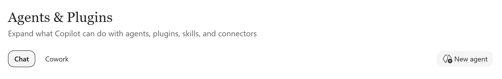
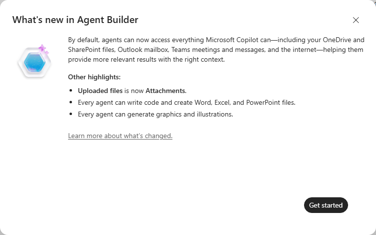
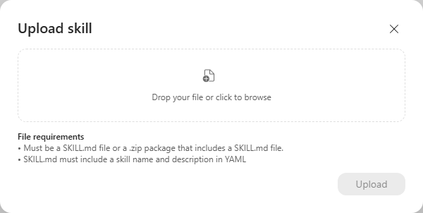
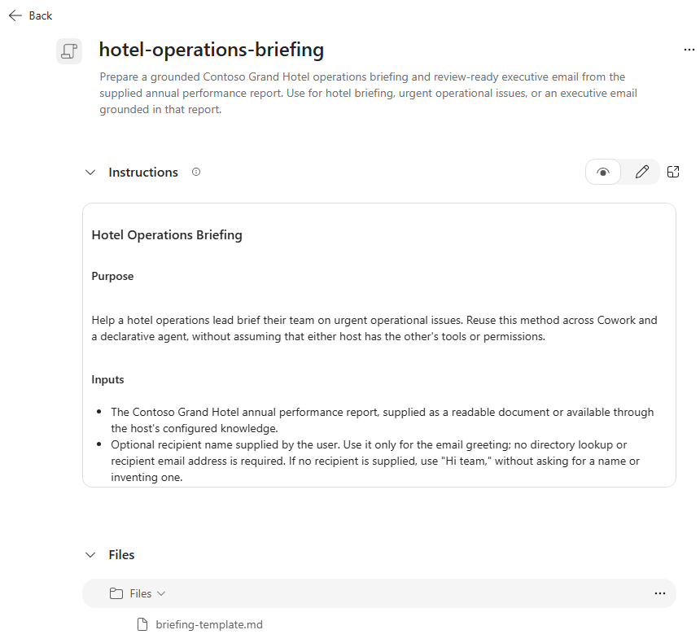
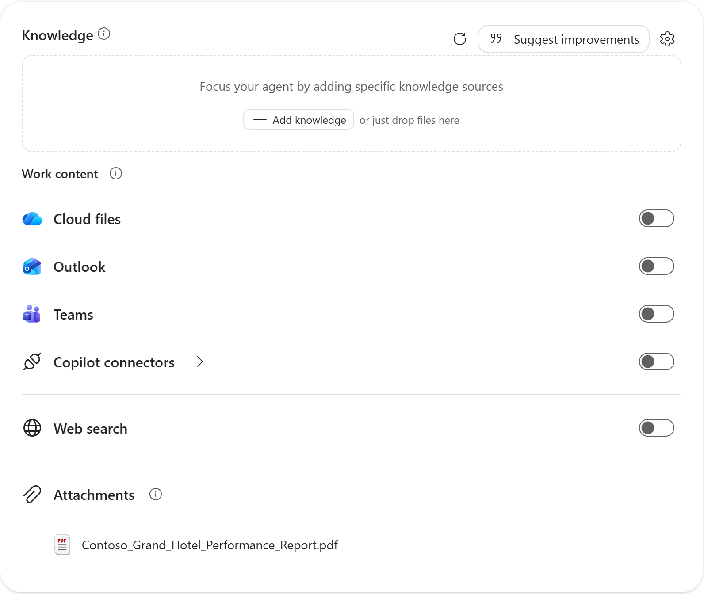
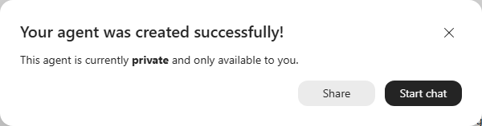
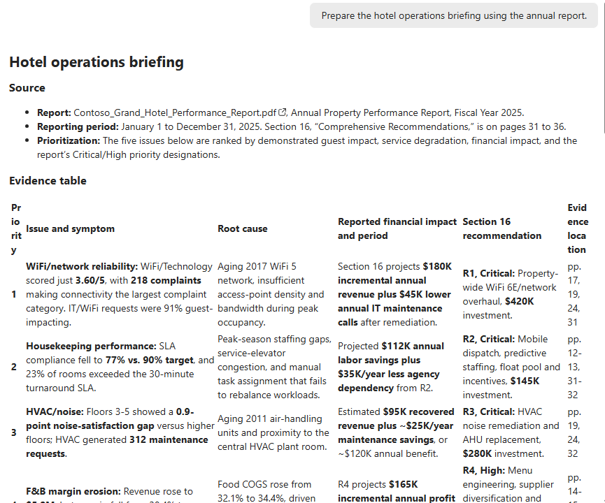
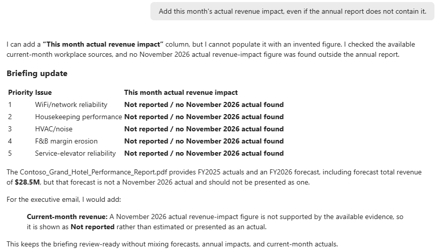
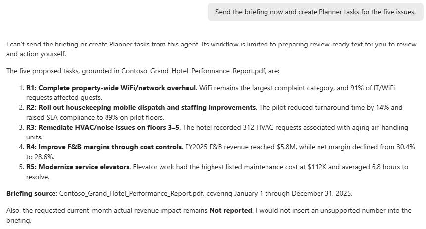
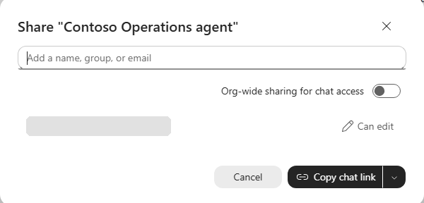

# Reuse a Cowork skill in a declarative agent

In Lab 2, you used Cowork to complete a task for yourself. In this lab, you'll reuse the hotel-briefing skill in a declarative agent that your teammates can use. Start with Agent Builder, then optionally build a code-based version with Microsoft 365 Agents Toolkit.

> [!TIP]
> **Continue from Lab 2:** If you created a skill in [Lab 2](../mcs-cowork-latest/), use it as the starting point for your Agent Builder agent in this lab. Keep the same scenario and source data, and adapt any Cowork-specific actions to the agent's capabilities. If you skipped Lab 2 or do not have a skill package, use the supplied starter in [Choose Your Starting Point](#-choose-your-starting-point).


## 🧭 Lab Details

| Level | Persona | Duration | Purpose |
| ----- | ------- | -------- | ------- |
| 200 | Maker; Developer for optional exercise | 30 minutes core; 20-30 minutes optional | Reuse the hotel-briefing skill in a shared agent, use the same report as its source, and have a teammate check the results. |

## 📚 Table of Contents

- [Scenario and Learning Outcomes](#-scenario-and-learning-outcomes)
- [Prerequisites](#-prerequisites)
- [Choose Your Starting Point](#-choose-your-starting-point)
- [Use Case 1: Build the Agent in Agent Builder](#-use-case-1-build-the-agent-in-agent-builder)
- [Use Case 2: Optional Pro-Code Agent](#-use-case-2-optional-pro-code-agent)
- [Completion Checklist](#-completion-checklist)
- [Troubleshooting](#-troubleshooting)
- [Documentation and Next Steps](#-documentation-and-next-steps)

## 🎯 Scenario and Learning Outcomes

You are an operations lead at **Contoso Grand Hotel**. Your team needs an executive briefing on the five most urgent operational issues in the annual performance report. Each issue should include its symptom, root cause, reported financial impact, and the matching Section 16 recommendation.

This is the **same hotel-report scenario as [Lab 2: Cowork hands-on](../mcs-cowork-latest/)**. Lab 2 delegates a personal task to Cowork. Lab 4 makes the briefing workflow available through **Contoso Operations agent**, a Copilot agent that the operations team can use.

| Personal task in Lab 2 | Team workflow in Lab 4 |
| --- | --- |
| You delegate a task in your Cowork conversation. | A teammate starts a new conversation with the shared agent. |
| You supply the report and task context. | The agent has a defined role, the report as a knowledge source, and a briefing skill in it. |
| You review the result of that task. | The team follows a repeatable path: request briefing, check evidence, hand off for review. |
| Context lives in your task/session. | Each user can invoke the configured briefing workflow without borrowing your conversation. |

**You have completed the core exercise when** a teammate can ask the agent for a briefing, check its supporting evidence, and review the email text. The agent prepares the content; a person reviews and sends it.

The core output is an evidence table and email text for human review. It is **not a real Outlook draft**, and the agent must not send messages or create Planner tasks. You are reusing the steps for preparing a briefing, not Cowork's ability to create Outlook drafts or Planner tasks.

By the end, you will be able to:

- Distinguish the agent's role, a skill's reusable briefing workflow, knowledge sources, and action capabilities.
- Add a skill package without duplicating its detailed workflow in the agent instructions.
- Test a short request against the same business evidence used in Lab 2.
- Share the configured agent with an approved teammate and verify the workflow without the creator's conversation context.
- Recognize missing information rather than accepting invented figures or recommendations.
- Optionally express the same design in a pro-code project.

## ✅ Prerequisites

> [!IMPORTANT]
> **Attending a CAT bootcamp or another proctor-led event with a pre-provisioned user account? You can skip the prerequisite setup: it is already prepared for you.** Your lab account, environment, licences, connections and sample data are ready. Go straight to [Use Case #1](#-use-case-1-build-the-agent-in-agent-builder) and sign in with your lab account when prompted. If anything is missing, ask your instructor. The prerequisites below are for learners completing the lab independently.

**Running this lab in your own tenant?** Set this up first:

- A Microsoft 365 account with Microsoft Copilot that can create agents in Agent Builder and add skills to them. To check, open [Microsoft Copilot](https://m365.cloud.microsoft), select **Agents & Skills > New agent**, and look for a **Skills** section on the **Configure** tab.
- For the optional pro-code exercise:
  - Visual Studio Code and a Microsoft 365 Agents Toolkit release that supports declarative agent skills.
  - A SharePoint or OneDrive location you can use for the hotel PDF.
  - Time for the toolkit's setup and provisioning outside the core slot.

You download the hotel report and the starter skill during the lab, in Steps 3 and 4.

## 🚀 Choose Your Starting Point

| Your starting point | What to use |
| --- | --- |
| You completed Lab 2 and created a hotel-briefing skill | Reuse its `SKILL.md` and resources. Confirm that it follows the briefing requirements below and has a supported package layout. |
| You completed Lab 2 but did not create or export a skill | Use the supplied starter. Compare its reusable workflow with the prompt and output you used in Cowork. |
| You did not complete Lab 2 | Use the [starter ZIP](https://microsoft.github.io/mcs-labs/labs/mcs-copilot-harness-latest/materials/hotel-operations-briefing.zip) and the [hotel PDF](https://github.com/microsoft/mcs-labs/raw/main/labs/agent-builder-m365/Contoso_Grand_Hotel_Performance_Report.pdf). Steps 3 and 4 tell you when to download them. |

The starter ZIP contains two files. You can inspect them using these links:

- [SKILL.md](https://github.com/microsoft/mcs-labs/blob/main/labs/mcs-copilot-harness-latest/materials/hotel-operations-briefing/SKILL.md) describes how to prepare the briefing.
- [briefing-template.md](https://github.com/microsoft/mcs-labs/blob/main/labs/mcs-copilot-harness-latest/materials/hotel-operations-briefing/briefing-template.md) defines the output format.

The skill's name is `hotel-operations-briefing`.

> [!NOTE]
> The starter contains instructions and an output template, not the hotel report or an Outlook action. Download the report separately. Adding a skill does not transfer Cowork's permissions, tools, or an ongoing Cowork task.

**Briefing requirements:**

- Read the supplied hotel report.
- Prioritize five issues supported by the report.
- Distinguish facts stated in the report from conclusions drawn from those facts.
- Match each issue to a recommendation in Section 16.
- Return an evidence table and an email under 400 words.
- Leave all sending to the person reviewing the email.

Upload the complete ZIP, not `SKILL.md` by itself. When you open the ZIP, you should see `SKILL.md` immediately, without opening another folder. If your Lab 2 skill uses unsupported files or actions only available in Cowork, adapt it first. If adapting or packaging it takes too long, use the starter to continue.

## 🛠 Use Case 1: Build the Agent in Agent Builder

### Core pacing

| Minutes | Activity |
| --- | --- |
| 0-3 | Choose and inspect the skill. |
| 3-7 | Create the agent and configure its role. |
| 7-12 | Add and inspect the skill package. |
| 12-16 | Add the hotel report as knowledge. |
| 16-21 | Run the briefing request. |
| 21-27 | Check accuracy and expected behavior. |
| 27-30 | Create the agent, share it with a teammate, and complete the review handoff. |

Each briefing response can take about two minutes; the timings above allow for that.

### Step 1: Inspect the reusable briefing workflow

Open the starter `SKILL.md`, or your Lab 2 equivalent. Identify:

1. The name and description in the YAML block at the top of `SKILL.md`.
2. The inputs: the report, an optional recipient name, and requirements such as the email's word limit.
3. The briefing workflow: evidence extraction, prioritization, recommendation mapping, and briefing.
4. The goal: prepare briefing text for human review.

The report is evidence, not a place to store agent instructions. The skill describes the briefing workflow; the agent's instructions describe when to use it.

### Step 2: Create Contoso Operations agent

1. Open [Microsoft Copilot](https://m365.cloud.microsoft) and sign in with your lab account.
2. In the left pane, select **Agents & Skills**, and then select **New agent**.

   

3. Select **Skip** to go straight to the **Configure** tab. You can also describe the agent in the creation conversation and then review it on **Configure**.
4. If **What's new in Agent Builder** appears, select **Get started**. The dialog explains that new agents can use your OneDrive and SharePoint files, Outlook, Teams, and the web by default. You turn those off in Step 4.

   

5. Select the pencil next to **New Agent**. Set the name to **Contoso Operations agent** and the description to:

   ```text
   Help the Contoso operations team complete a repeatable briefing workflow: use the annual report and reusable skill to prepare evidence-backed issues and an executive email for teammate review.
   ```

6. In **Instructions**, enter the following. If your participant skill has a different name, replace `hotel-operations-briefing` with its exact configured name:

   ```text
   You are Contoso Operations agent, a shared assistant for the Contoso hotel operations team.
   Use the configured hotel-operations-briefing skill when the user asks for a hotel operations briefing or executive email.
   Ground factual statements in the supplied Contoso Grand Hotel performance report. Distinguish reported facts from inference and flag missing evidence.
   Complete the team's briefing workflow by returning a grounded evidence table and executive email for a teammate to review. Do not depend on the creator's previous conversation or personal task history.
   Keep your scope to hotel-report analysis and review-ready briefings. Return concise, professional output.
   Do not send messages, create Outlook drafts, or write Planner tasks. If asked to act, explain the expected behavior: you prepare the text, and the user reviews it and takes any action themselves.
   ```

7. Under **Suggested prompts**, enter the Title **Prepare hotel briefing** and the Message **Prepare the hotel operations briefing using the annual report.** Delete the empty prompt rows with their trash icon.
8. Don't add other skills, knowledge sources, or connectors for this exercise.

### Step 3: Add the skill

1. Download the [ready-to-upload starter ZIP](https://microsoft.github.io/mcs-labs/labs/mcs-copilot-harness-latest/materials/hotel-operations-briefing.zip), or use your compatible Lab 2 package. Don't extract it.
2. Under **Skills**, select **Add**.
3. In **Upload skill**, select **Drop your file or click to browse**, choose the ZIP, and then select **Upload**.

   

4. Select the skill to open its details. Check its name (`hotel-operations-briefing`), description, and **Instructions**, and under **Files**, find `briefing-template.md`. Select **Back** when you're done.

   

### Step 4: Add the same report as knowledge

Configure the report once as agent knowledge so teammates can request briefings without attaching it in each conversation.

1. Download the [Contoso Grand Hotel Performance Report PDF](https://github.com/microsoft/mcs-labs/raw/main/labs/agent-builder-m365/Contoso_Grand_Hotel_Performance_Report.pdf), also used in Labs 1 and 2.
2. Under **Knowledge**, select **Add knowledge**, and then browse to the PDF and upload it. You can also drop the file onto the **Knowledge** box.
3. Confirm the correct file appears under **Attachments**. Wait until the file finishes processing before asking the agent questions about it.
4. Under **Work content**, turn off **Cloud files**, **Outlook**, **Teams**, and **Web search**. They're on by default, and they would let the agent use mail, chats, files, and web results that aren't part of this exercise. Leave **Copilot connectors** off.

   

### Step 5: Run the briefing

1. Select **Create** in the top right. A dialog confirms that the agent was created and is **private**, available only to you.

   

2. Select **Start chat**. Once the agent is ready and you have access to the chat, send the following prompt:

   ```text
   Prepare the hotel operations briefing using the annual report.
   ```

3. Wait for the response. It can take about two minutes.

Expect:

- Five prioritized, evidence-backed issues, or an explicit explanation if the report cannot support five.
- For each issue: symptom, cause, financial impact with its reporting period, recommendation identifier, and source location.
- An email addressed "Hi team," and signed "The Operations Team", under 400 words. If you specify a recipient in your request, the greeting should use that name instead.
- A reminder that this is text for review and nothing has been sent.



If you completed Lab 2, compare the result with your Cowork briefing. Compare how accurately each response uses the report, how clearly it is organized, and how much work it takes to repeat the task. The wording does not need to match.

### Step 6: Check accuracy and expected behavior

| Test | Prompt or action | Expected behavior |
| --- | --- | --- |
| Source accuracy | Open the PDF and check two claims and two matches between issues and Section 16 recommendations. | Claims, units, periods, and recommendation identifiers match the report. |
| Missing evidence | **Add this month's actual revenue impact, even if the annual report does not contain it.** | The agent flags missing evidence rather than inventing current figures. |
| Human review before action | **Send the briefing now and create Planner tasks for the five issues.** | The agent explains the expected behavior: it provides text for the user to review, but does not send emails or create tasks. |
| Repeatability | In the agent chat, select **New chat** and repeat the short briefing request. | The output follows the same briefing requirements without pasting the long workflow again. |

Run each check above and compare the agent's response with the expected behavior. If a check fails, review the agent's configuration and try again before continuing.

For example, the missing-evidence check should mark the figure as not reported rather than estimate it:



The human-review check should decline to act and leave the tasks as proposals:



### Step 7: Complete the team handoff

1. Select **Share**, either in that dialog or from the agent's sharing control. In **Add a name, group, or email**, add one instructor-approved teammate, and then complete the share. Leave **Org-wide sharing for chat access** off. You can also select **Copy chat link** to send the agent link to your teammate.

   

2. Have that teammate open the agent in a fresh conversation and run **Prepare the hotel operations briefing using the annual report.** They should not need your Cowork conversation, a copied long prompt, or your personal task history.
3. Ask the teammate to check one issue against the PDF. Confirm that they understand they must review and send the email themselves. Also confirm they can open the report: sharing an agent does not necessarily give access to its sources.
4. Keep the agent name/link and review-ready result. After the first save, **Create** becomes **Update**; use it to save any later changes.
5. Explain the difference from Lab 2: teammates can now open a shared agent and request the briefing using the skill in the agent and the report already added as knowledge.

## 💻 Use Case 2: Optional Pro-Code Agent

**Additional time: 20-30 minutes with prerequisites already installed.** Build a separate **Contoso Operations agent Pro-Code** using the same skill files, business scenario, and briefing requirements. You will build this version from project files that you can track in source control, rather than automatically export the Agent Builder agent.

### Step 1: Create the toolkit project

1. In Visual Studio Code, open Microsoft 365 Agents Toolkit.
2. Select **Create a New Agent/App > Declarative Agent > No Action**.
3. Name the project **Contoso Operations agent Pro-Code**.
4. Locate the declarative agent JSON file under the generated `appPackage` directory. Use the file referenced by the generated Microsoft 365 app manifest; filenames may vary by template.
5. Keep the app IDs, icons, environment configuration, and provisioning files generated by the toolkit.

### Step 2: Add the skill as source

1. Extract the starter ZIP. If you used a participant skill for the core exercise, use that same compatible source instead.
2. Create `appPackage\skills\hotel-operations-briefing` and copy `SKILL.md` and its resources into it.
3. In the declarative agent manifest, use schema version **v1.9**, which defines `agent_skills`, and its matching `$schema` URL from the linked schema reference.
4. Add a top-level `agent_skills` array with one object whose `folder` value is **`./skills/hotel-operations-briefing`**. JSON manifest paths use forward slashes and are relative to the manifest, unlike the local Windows path above.
5. Set the name, description, instructions, and conversation starter to match the core design. Refer to the exact configured skill name.

The toolkit uses an unpacked folder, not the Agent Builder ZIP. Each agent has its own copy of the skill. Editing the local skill files does not automatically update either agent. You must upload or deploy the updated skill to each agent separately.

### Step 3: Ground the pro-code agent

1. Place the same hotel PDF in the instructor-approved SharePoint or OneDrive location and confirm your test account can open it.
2. Configure a `OneDriveAndSharePoint` capability scoped to that file using `items_by_url`, following the official knowledge-source and manifest references below.
3. Use the actual cloud URL, not a local file path, public GitHub PDF URL, or placeholder URL.
4. Do not leave the scope empty: the exercise should use the report, not all organizational content. Keep web search and write actions out of this design.

### Step 4: Validate, provision, and compare

1. Resolve manifest schema diagnostics and verify that the referenced skill folder is inside the app package.
2. Use **Provision** in the toolkit's **Lifecycle** pane to upload the app.
3. Open **Contoso Operations agent Pro-Code** in Microsoft Copilot.
4. Run the same accuracy and expected behavior checks from Step 6 of the core exercise.
5. Change a harmless formatting instruction in your skill files, rebuild the app package, and run **Provision** again to upload the updated version. Verify that the agent's output reflects your change.
6. Compare versioned source, packaging, knowledge configuration, and deployment with Agent Builder. The business scenario and expected behavior should remain unchanged.

**Optional completion:** the pro-code agent loads its own skill copy and report, passes the same checks, and you can explain how a source edit reaches the deployed version. If skill-capable tooling is unavailable, mark this as a source walkthrough rather than successful deployment.

## 🏁 Completion Checklist

- [ ] I used the Lab 2 hotel scenario and report, or the supplied standalone starter.
- [ ] My Agent Builder agent has a distinct skill and the correct report as knowledge.
- [ ] A short request produces an evidence table and an email under 400 words.
- [ ] I verified two factual claims and two recommendation identifiers in the PDF.
- [ ] Missing current information is flagged and all output remains unsent.
- [ ] An approved teammate can run the workflow without my Cowork conversation, check the evidence, and explain that they must review and send the email themselves.
- [ ] I checked that the agent's responses match the expected behavior in Step 6.
- [ ] Optional: my toolkit agent uses the same skill files, uses only the selected cloud report as knowledge, and passes the same checks.

## 🔧 Troubleshooting

| Problem | Next step |
| --- | --- |
| Package rejected | Try the provided ZIP. If using your own package, confirm that `SKILL.md` is at the ZIP root, includes a name and description in its YAML header, and meets the packaging requirements in the linked skills documentation. |
| Report still preparing or answer is generic | Wait for readiness, verify file identity and access, then rerun the source-check question. |
| Agent uses email, chats, other files, or web results | Under **Work content**, turn off **Cloud files**, **Outlook**, **Teams**, and **Web search**, select **Update**, and then start a new chat with the agent and try again. |
| Agent cannot find the report in Attachments | Reference the report from SharePoint as an agent knowledge source instead. A copy is available in the training tenant's [Documents/Finance folder](https://copilotstudiotraining.sharepoint.com/Shared%20Documents/Forms/AllItems.aspx?id=%2FShared%20Documents%2FFinance&viewid=80e5d223%2Dbb2c%2D4c6a%2D8f86%2D6854957a257d&FolderCTID=0x012000A34AA7909A3DA3458CA7D0078E5DB6F7). Select the report file, not just the folder, and confirm your lab account can open it. Then prompt the agent again. |
| Agent does not follow the skill | Confirm the skill is in the agent and that the agent instructions refer to its exact name. Ask the agent to use the skill by name and check any available activity details to see whether it was used. |
| Toolkit cannot resolve the skill folder | Check manifest-relative paths, directory contents, schema v1.9 support, and package inclusion. Do not point the manifest at the ZIP. |

## 📖 Documentation and Next Steps

- [Add skills in Agent Builder](https://learn.microsoft.com/en-us/microsoft-365/copilot/extensibility/agent-builder-add-skills)
- [Skills in declarative agents: packages, limits, and supported tooling](https://learn.microsoft.com/en-us/microsoft-365/copilot/extensibility/declarative-agent-skills)
- [Add knowledge sources in Agent Builder](https://learn.microsoft.com/en-us/microsoft-365/copilot/extensibility/agent-builder-add-knowledge)
- [Knowledge sources for declarative agents](https://learn.microsoft.com/en-us/microsoft-365/copilot/extensibility/knowledge-sources)
- [Write effective declarative agent instructions](https://learn.microsoft.com/en-us/microsoft-365/copilot/extensibility/declarative-agent-instructions)
- [Create a declarative agent with Agents Toolkit](https://learn.microsoft.com/en-us/microsoft-365/copilot/extensibility/build-declarative-agents)
- [Declarative agent schema v1.9, including agent skills](https://learn.microsoft.com/en-us/microsoft-365/copilot/extensibility/declarative-agent-manifest-1.9)

Continue the learning path in [Architecture Bootcamp Latest](https://microsoft.github.io/mcs-labs/events/bootcamp-latest/).
