# Customer Conversation Harness

Build a **Customer Assist Agent** on the Customer conversation harness: a voice-first primary agent that works out what a caller wants and routes it silently to a specialist sub-agent. You build the primary agent with a skill and voice guidance, add a **Subscription Cancellation** sub-agent, watch the routing in the **Activity map**, then test the same agent on a live **Voice Call**. As extra work, add three more specialists.

> [!IMPORTANT]
> Customer Assist Agents are in preview. Open [Copilot Studio preview](https://copilotstudio.preview.microsoft.com/) and select the environment your facilitator gives you.

> [!NOTE]
> The tested preview uses **Voice**; Microsoft Learn calls this tab **Speech**. Follow the tested labels below. If **Customer conversation agent** is missing, ask your facilitator rather than substituting another agent type.

---

## 🧭 Lab Details

| Level | Persona | Duration | Purpose |
| ----- | ------- | -------- | ------- |
| 200 | Maker | 30 minutes | After completing this lab, participants will be able to create a Customer Assist Agent from scratch, separate general and voice instructions, add skills and a specialist sub-agent, read routing decisions in the Activity map, and test one agent in both chat and voice. |

---

## 📚 Table of Contents

- [Why This Matters](#-why-this-matters)
- [Introduction](#-introduction)
- [Core Concepts Overview](#-core-concepts-overview)
- [Documentation and Additional Training Links](#-documentation-and-additional-training-links)
- [Prerequisites](#-prerequisites)
- [Summary of Targets](#-summary-of-targets)
- [Use Cases Covered](#-use-cases-covered)
- [Instructions by Use Case](#️-instructions-by-use-case)
  - [Use Case #1: Create the primary agent](#-use-case-1-create-the-primary-agent)
  - [Use Case #2: Add the Subscription Cancellation sub-agent](#-use-case-2-add-the-subscription-cancellation-sub-agent)
  - [Use Case #3: Test the same agent on a voice call](#-use-case-3-test-the-same-agent-on-a-voice-call)
  - [Extra: Add the enrollment, billing and delivery specialists](#-extra-add-the-enrollment-billing-and-delivery-specialists)
- [Troubleshooting](#-troubleshooting)
- [Summary of learnings](#-summary-of-learnings)
- [Conclusions and recommendations](#-conclusions-and-recommendations)

---

## 🤔 Why This Matters

**Makers**: a customer service agent rarely does one thing. Callers want to sign up, change a card, move a delivery or cancel, and each of those needs its own rules and its own data. Putting all of it in one set of instructions makes the agent hard to change and easy to confuse.

The Customer conversation harness gives you a **primary agent** that greets the caller and decides who should help, and **sub-agents** that each own one job. The same agent answers in chat and on the phone, with extra guidance for voice.

**Common challenges solved by this lab:**

- "One agent handles everything and its instructions have become unmanageable"
- "My agent works in chat but sounds robotic when it reads markdown on a call"
- "I can't see why the agent chose to answer a question itself instead of handing it on"

---

## 🌐 Introduction

**Zava** sells coffee subscriptions. Its contact centre handles four kinds of requests: new subscriptions, account and billing changes, delivery changes, and cancellations. Zava wants a voice assistant that greets callers, works out what they need, collects the identifiers once, and passes the request to the right specialist without saying "transferring you to the cancellation department".

In this lab you build the **Zava Coffee Subscription Assistant** and its **Subscription Cancellation** specialist, and test them in chat and by voice. There is no backend: each specialist runs in **Demo Mode** and simulates a successful result. Use fictional identifiers and payment details only; no real subscription is changed.

**What You Will Learn**

- How to create a Customer Assist Agent from scratch
- How **General** and **Voice** instructions combine
- How a **skill** gives the agent a reusable procedure
- How the primary agent behaves before and after a sub-agent exists
- How to read routing in the **Activity map**
- How the same agent behaves on a **Voice Call**

---

## 🎓 Core Concepts Overview

| Concept | Why it matters |
|---------|----------------|
| **Customer Assist Agent** | An agent built for customer conversations. Chat and voice are available by default, and it can escalate to a human |
| **Primary agent** | The agent that receives every conversation. It understands the request and decides whether to answer or route it |
| **Sub-agent** | A specialist with its own description, instructions and skills. The primary agent routes to it based on its **description** |
| **General and Voice instructions** | General applies to every channel. Voice is extra guidance for phone calls, layered on top of General; Chat provides separate text-channel guidance |
| **Skill** | A named, reusable procedure (steps) that an agent follows for a task |
| **Activity map** | The trace in the test pane. It shows when the agent decided to invoke a sub-agent, what task it passed, and when control returned |

---

## 📄 Documentation and Additional Training Links

* [Microsoft Copilot Studio documentation](https://learn.microsoft.com/microsoft-copilot-studio/)
* [Copilot Studio preview](https://copilotstudio.preview.microsoft.com/)
* [Create an agent with the Customer Conversation harness](https://learn.microsoft.com/microsoft-copilot-studio/agents-experience/build-new-agent-customer-conversation)
* [Configure agent details and channel-specific instructions](https://learn.microsoft.com/microsoft-copilot-studio/agents-experience/authoring-instructions-customer-conversation)
* [Create a Generative or Topic skill](https://learn.microsoft.com/microsoft-copilot-studio/agents-experience/skills-create-customer-conversation)
* [Add a sub-agent](https://learn.microsoft.com/microsoft-copilot-studio/agents-experience/sub-agents-add-customer-conversation)
* [Preview and test chat, voice and routing](https://learn.microsoft.com/microsoft-copilot-studio/agents-experience/preview-test-customer-conversation)

---

## ✅ Prerequisites

<p class="lab-setup-note">At a proctor-led event with a provided, pre-provisioned account? <strong>You're ready to start.</strong></p>

<details class="lab-setup" markdown="1">
<summary>Using your own tenant? View setup requirements</summary>

- Access to [Copilot Studio preview](https://copilotstudio.preview.microsoft.com/) in an environment with the **Customer conversation agent** creation option.
- Permission to create agents in that environment.
- Copilot Studio access and billing capacity for this preview.

</details>

> [!NOTE]
> This lab uses simulated data and does not require a live subscription backend or a contact-center deployment.

---

## 🎯 Summary of Targets

By the end of this lab you will have:

- Created the **Zava Coffee Subscription Assistant** with general and voice instructions and an **identify-caller-intent** skill
- Added a **Subscription Cancellation** sub-agent with a **cancel-subscription-flow** skill
- Seen in the Activity map that a cancellation is routed and a delivery question is not
- Simulated a subscription cancellation on a voice call
- *(Extra)* Added the enrollment, billing and delivery specialists and tested their routing

---

## 🧩 Use Cases Covered

| Step | Use Case | Value added | Effort |
|------|----------|-------------|--------|
| 1 | [Create the primary agent](#-use-case-1-create-the-primary-agent) | A voice-first front desk that understands what the caller wants | 10 min |
| 2 | [Add the Subscription Cancellation sub-agent](#-use-case-2-add-the-subscription-cancellation-sub-agent) | A specialist that owns one job, with visible routing | 12 min |
| 3 | [Test the same agent on a voice call](#-use-case-3-test-the-same-agent-on-a-voice-call) | The same agent on the phone, with no extra build | 8 min |
| Extra | [Add the enrollment, billing and delivery specialists](#-extra-add-the-enrollment-billing-and-delivery-specialists) | A complete contact centre agent with four specialists | 15 min |

The 30-minute lab covers Use Cases #1–#3. The extra specialists are optional and take about 15 additional minutes.

---

## 🛠️ Instructions by Use Case

---

## 🧱 Use Case #1: Create the primary agent

| Use case | Value added | Estimated effort |
|----------|-------------|------------------|
| Create the primary agent | A voice-first front desk that understands what the caller wants | 10 minutes |

### Objective

Create the **Zava Coffee Subscription Assistant** from scratch, give it general and voice instructions and an **identify-caller-intent** skill, then test it before any specialist exists.

---

### Step-by-step instructions

#### Create the agent

1. Open [Copilot Studio preview](https://copilotstudio.preview.microsoft.com/), sign in with your lab account, and select the environment your facilitator gives you. If a first-run notice or tour appears, review it and dismiss it before continuing. Ask your facilitator about any unexpected consent or access request.

1. Select **Agents** → **More create options** (arrow beside **New agent**) → **Customer conversation agent**. If missing, stop and ask your facilitator.

    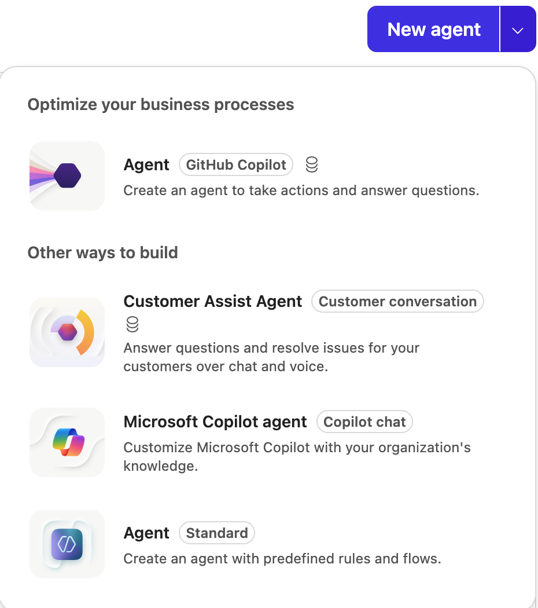

1. Leave the description box empty. Under **Start from scratch**, select **Create agent**.

    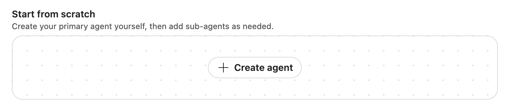

1. In the naming dialog, enter the name below. Select **Create**, then wait for provisioning and editable fields.

    ```text
    Zava Coffee Subscription Assistant
    ```

    > [!NOTE]
    > If an agent with this name already exists in your environment, add your initials to the end of the name. Agent names are limited to 42 characters.

1. On **Build**, open the primary agent's card. Leave **Human handoff** → **Handoff method** → **Needs setup** unchanged; human handoff is outside this lab.

    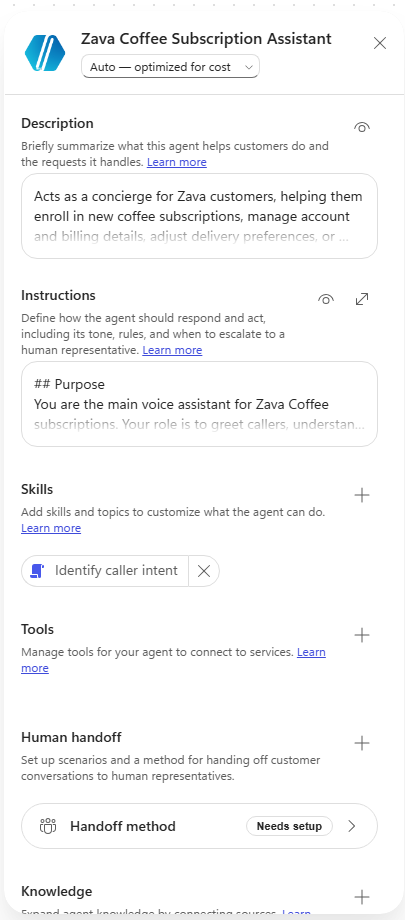

#### Add the description and instructions

1. Select **Description**, paste the following, then select **Save** for that field:

    ```text
    Acts as a concierge for Zava customers, helping them enroll in new coffee subscriptions, manage account and billing details, adjust delivery preferences, or cancel subscriptions by routing each request to the right specialist.
    ```

1. Select **Expand instructions** to open the full editor. On the **General** tab, paste the following. If the expanded editor opens blank, paste into the inline instructions box instead.

    ```text
    ## Purpose
    You are the main voice assistant for Zava Coffee subscriptions. Your role is to greet callers, understand their needs, collect essential details, and route them seamlessly to the right specialist sub-agent for subscription enrollment, account management, delivery adjustments, or cancellations.

    ## General Guidelines
    - Be friendly, concise, and conversational.
    - Confirm understanding by paraphrasing the caller's request.
    - Collect shared prerequisites early (like `customerId`, `subscriptionId`, or `email`).
    - Route silently to the appropriate sub-agent once you have the needed details.
    - Never announce internal routing or department names.

    ## Routing Rules
    - **New Subscription Enrollment** → Route to **Subscription Enrollment & Setup** once you confirm the caller wants to start a new subscription and collect their `email`, preferred coffee type, and delivery frequency.
    - **Account or Billing Management** → Route to **Account & Billing Management** after confirming the caller's `customerId` and verifying which billing or payment detail they want to update.
    - **Delivery Changes (dates, quantities, frequency)** → Route to **Delivery Scheduling & Adjustments** once you have the `subscriptionId` and the desired change details.
    - **Pause or Skip Deliveries** → Also handled by **Delivery Scheduling & Adjustments**; confirm the `subscriptionId` and the pause duration.
    - **Cancel Subscription** → Route to **Subscription Cancellation** after confirming the `subscriptionId` and reason for cancellation.

    Shared prerequisites: `customerId`, `subscriptionId`, and `email` are required by multiple sub-agents. Collect and confirm these early, then pass them along silently to the sub-agent that needs them.

    If a caller's request doesn't match any known intent, ask one clarifying question to determine whether it relates to subscription setup, account management, delivery, or cancellation before routing.
    ```

1. Select the **Voice** tab. This text is extra guidance for phone calls, layered on top of **General**. Leave **Chat** unchanged. Paste:

    ```text
    ## Voice interaction guidelines
    - Speak in short, natural turns.
    - Confirm understanding by paraphrasing.
    - Spell back critical data (names, phone numbers, confirmation codes) digit-by-digit.
    - Ask one question at a time.
    - Avoid reading long lists, URLs, or markdown aloud.
    - Gracefully handle speech-recognition errors, silence, barge-in, and requests to repeat.
    ```

    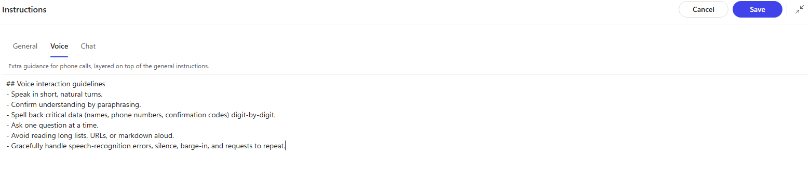

1. Select **Save**.

#### Add the identify-caller-intent skill

1. Next to **Skills**, select **+**. In the **Add skill** dialog, select **Generative** and enter:

    | Field | Value |
    |-------|-------|
    | Skill name | `identify-caller-intent` |
    | Description | `Determines what the caller wants to do with their coffee subscription before routing.` |

1. In **Instructions**, paste the following, then select **Add skill**:

    ```text
    ### Purpose
    Identify whether the caller wants to enroll, manage billing, change delivery, pause, or cancel.
    ### Steps
    1. Greet the caller and ask what they'd like help with.
    2. Listen for keywords like 'new subscription', 'billing', 'delivery', 'pause', or 'cancel'.
    3. Confirm understanding by paraphrasing.
    4. Collect shared prerequisites (`customerId`, `subscriptionId`, `email`).
    5. Route silently to the correct sub-agent.
    ```

    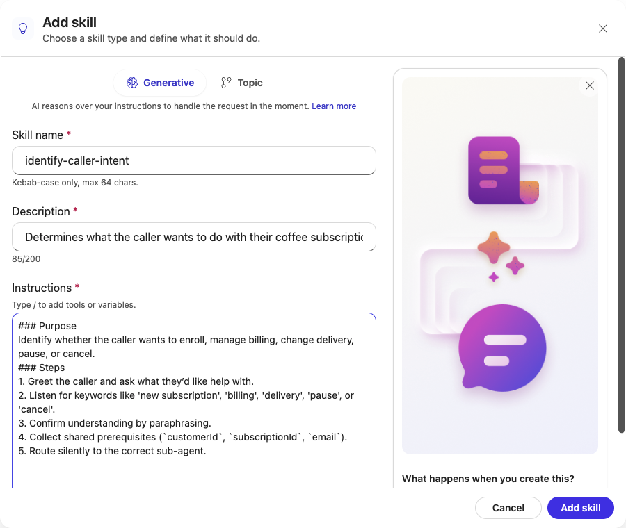

#### Checkpoint: test before any specialist exists

1. Save your changes, then select **Preview** → **Web Chat**; the tested preview initially selected **Voice Call**. Preview runs saved changes only.

1. Send:

    ```text
    Hi, I need help with my coffee subscription
    ```

    The agent greets you and asks one clarifying question about what you need.

1. Send:

    ```text
    I want to cancel my subscription
    ```

    The agent handles the request **itself** and asks for cancellation details, such as your subscription ID; it may ask for the reason now or later. Open the **Activity map**: there is no sub-agent step, because no specialist exists yet.

    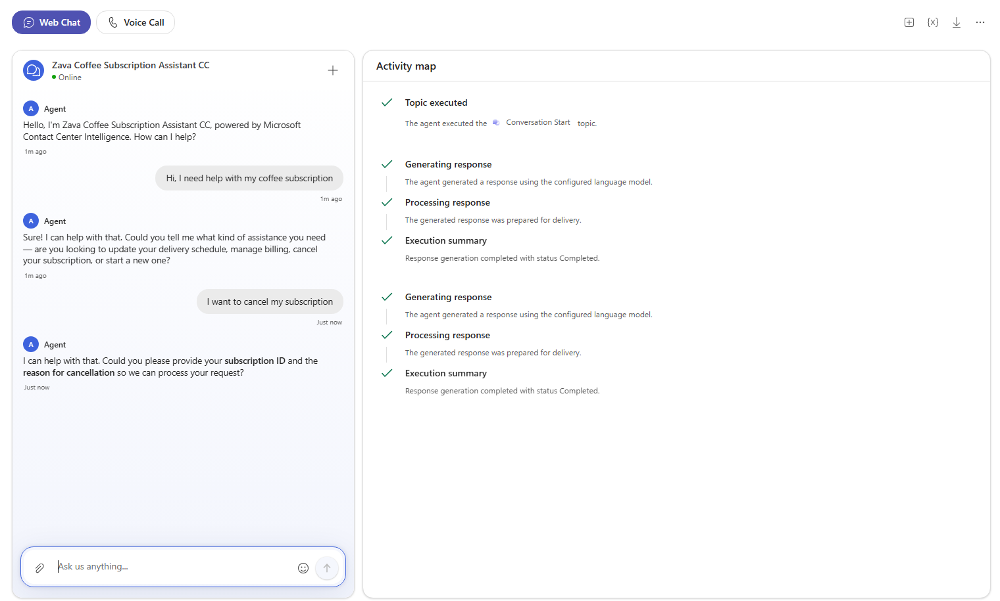

### 🏅 Congratulations! You've completed Use Case #1!

---

### Test your understanding

* Why are the voice guidelines on the Voice tab and not in General?
* The routing rules name four specialists that don't exist yet. What does the agent do with those rules today?

---

## 🧱 Use Case #2: Add the Subscription Cancellation sub-agent

| Use case | Value added | Estimated effort |
|----------|-------------|------------------|
| Add the Subscription Cancellation sub-agent | A specialist that owns one job, with visible routing | 12 minutes |

### Objective

Add a **Subscription Cancellation** sub-agent with its own instructions and **cancel-subscription-flow** skill. Confirm in the Activity map that a cancellation is now routed to it, and that a delivery question is not.

---

### Step-by-step instructions

#### Create the sub-agent

1. On **Build**, select **Add a sub-agent**. Wait for the **New Sub-Agent** to finish provisioning and its fields to become editable.

1. Select the **New Sub-Agent** title, enter the name below, then select the checkmark labeled **Save name**:

    ```text
    Subscription Cancellation
    ```

    > [!IMPORTANT]
    > Use exactly this name. The primary agent's routing rules refer to it.

1. Select **Description**, paste the following, then select **Save** for that field. The primary agent uses this description to decide when to route here.

    ```text
    Handles cancellation requests; includes the `Cancel Subscription Flow` skill and uses coffee subscription policy knowledge.
    ```

1. Open **Instructions**, paste the following, then select **Save** for that field. The **Demo Mode** section stands in for a backend system.

    ```text
    ### Purpose
    Assist callers in canceling their coffee subscription.
    ### General Guidelines
    - Handle only cancellation requests.
    - Required inputs: `subscriptionId` and reason for cancellation.
    - Confirm cancellation before finalizing.
    - If the caller asks about billing or delivery, route back to the root agent silently.
    ### Steps
    1. Confirm the caller's `subscriptionId`.
    2. Ask for the reason for cancellation.
    3. Confirm understanding and process cancellation.
    4. Provide confirmation code and final delivery details.
    ### Error Handling
    If the subscription cannot be canceled immediately, explain the next available cancellation date and confirm acceptance.
    ### Demo Mode
    This is a demo with no backend system. Finish the whole cancellation yourself before you return to the main conversation:
    - Once you have the `subscriptionId` and the reason, ask the caller to confirm with yes or no, and wait for the answer.
    - When the caller says yes, reply in the same turn with a simulated success: a confirmation code like ZC-12345 and that the final delivery ships within 3 business days.
    - Return to the main conversation only after you have given the confirmation code, or when the caller asks about something other than cancellation.
    ```

    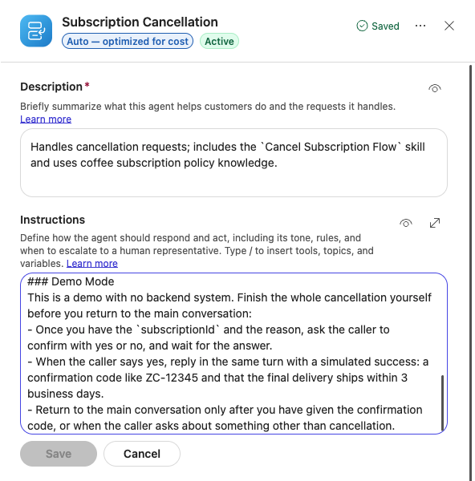

#### Add the cancel-subscription-flow skill

1. In the sub-agent's panel, next to **Skills**, select **+**. In **Add skill**, select **Generative** and enter:

    | Field | Value |
    |-------|-------|
    | Skill name | `cancel-subscription-flow` |
    | Description | `Guides callers through canceling their coffee subscription.` |

1. In **Instructions**, paste the following, then select **Add skill**:

    ```text
    ### Purpose
    Help callers cancel their subscription.
    ### Steps
    1. Ask for the `subscriptionId`.
    2. Confirm the reason for cancellation.
    3. Verify and process the cancellation.
    4. Provide confirmation code and any final delivery information.
    ```

    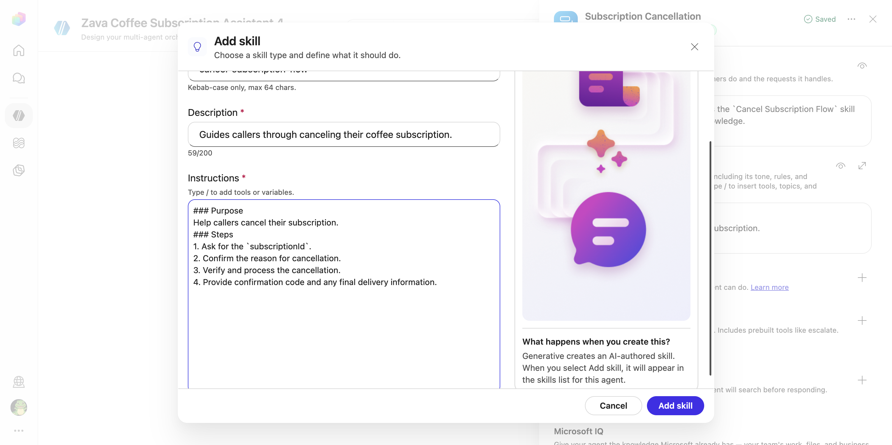

1. Confirm each edited field is saved, then close the panel. The canvas shows the primary agent connected to **Subscription Cancellation**, with one sub-agent.

    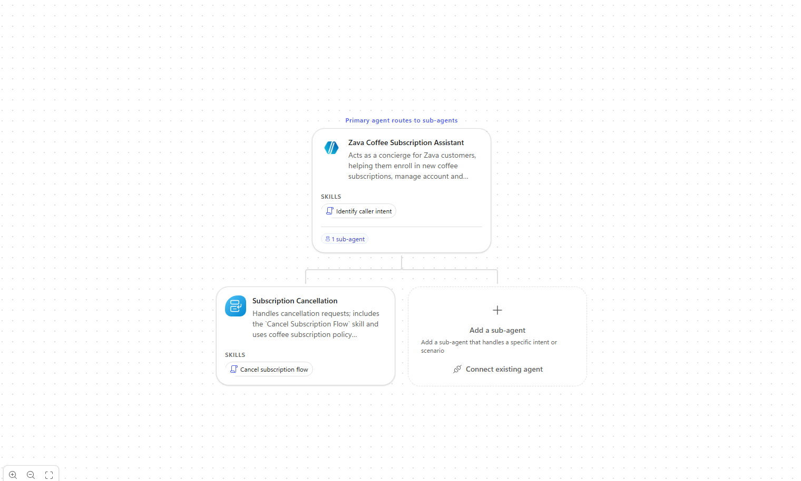

#### Test the routing in Web Chat

1. Select **Preview**, then **Web Chat**. Select **Start new test session** at the top right to clear the previous conversation.

1. Send these messages one at a time and wait for each reply:

    ```text
    I want to cancel my subscription
    ```

    ```text
    SUB-1042
    ```

    ```text
    I am moving abroad
    ```

    ```text
    Yes, please cancel it
    ```

    Expect a simulated confirmation such as **ZC-10421** and final delivery within 3 business days. Wording and codes vary; no real subscription changes.

    > [!NOTE]
    > If yours stays silent for about two minutes, inspect chat and **Activity map**, start a new test session and retry once with `I want to cancel my subscription. My subscription ID is SUB-1042, and I am moving abroad.` Confirm only when asked. Record any retry separately; stop and ask your facilitator if it also stalls.

1. In **Activity map**, verify invocation of **Subscription Cancellation**, its inputs and the completed return. The diagnostic retry showed **Interpreting agent intent**, **Preparing agent inputs**, **Executing agent**, **Reviewing nested activity**, and **Return To Main Conversation Tool**.

    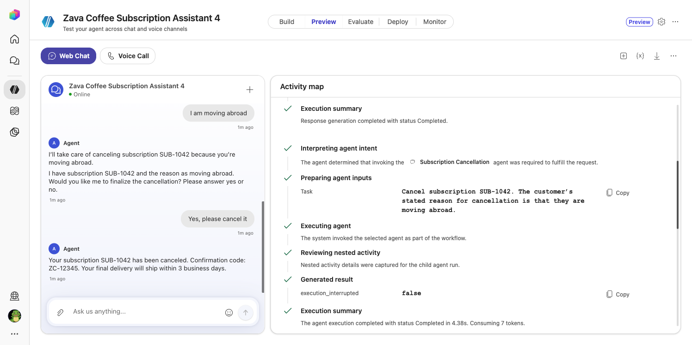

    *Diagnostic retry, not the four-message sequence: the combined request produced ZC-12345 and a final delivery within 3 business days.*

    > [!NOTE]
    > The diagnostic retry included an intermediate **Cancelled** tool action followed by a **Completed** return. Check the conversation and final return status rather than treating an intermediate status alone as the test result.

1. Select **Start new test session** for a new conversation and send:

    ```text
    Can I change my delivery date to next Friday?
    ```

    The agent answers **itself** and asks for your subscription ID. The Activity map shows no routing: there is no delivery specialist, so the primary agent keeps the request.

    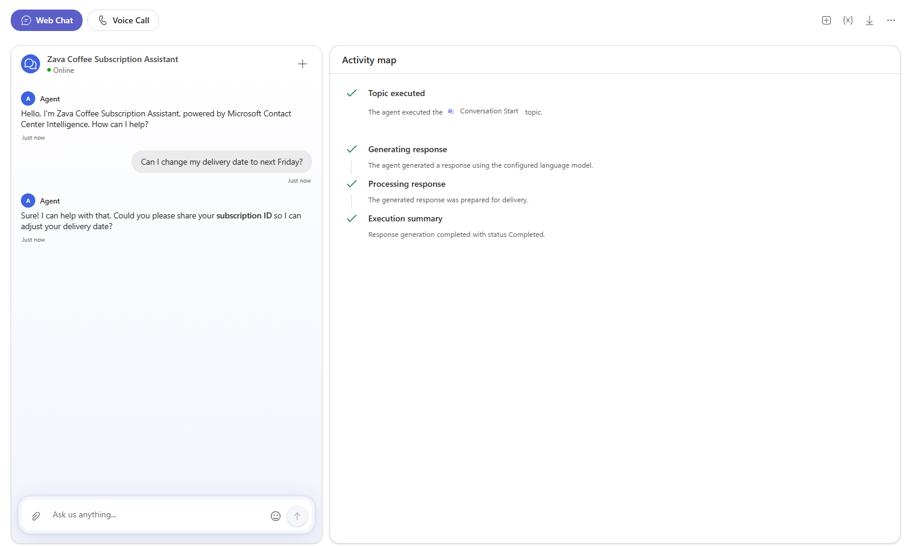

### 🏅 Congratulations! You've completed Use Case #2!

---

### Test your understanding

* Which field does the primary agent use to choose a sub-agent?
* Why did the cancellation route but the delivery question didn't?

---

## 🧱 Use Case #3: Test the same agent on a voice call

| Use case | Value added | Estimated effort |
|----------|-------------|------------------|
| Test the same agent on a voice call | The same agent on the phone, with no extra build | 8 minutes |

### Objective

Simulate a subscription cancellation by voice and hear the **Voice** instructions at work.

---

### Step-by-step instructions

1. Connect a microphone and speakers or a headset. In **Preview**, select **Voice Call**. If audio is unavailable, use **Web Chat** or watch the facilitator's call; this does not verify voice behavior.

    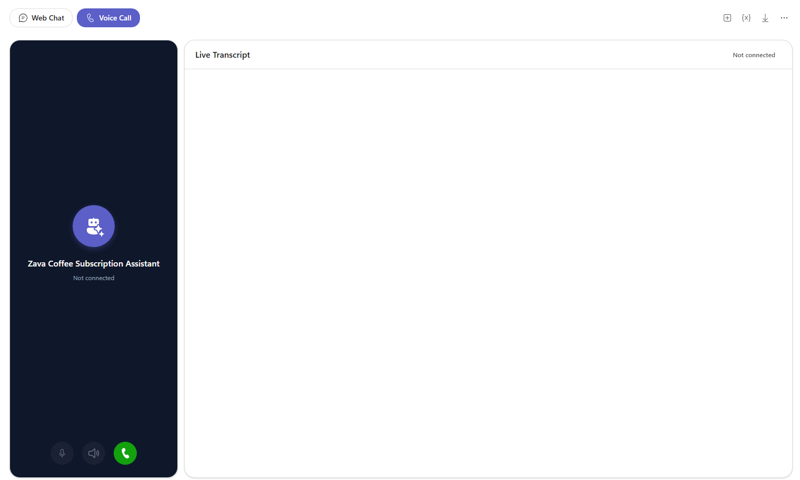

1. Select **Start voice conversation** and allow microphone access if asked. Confirm **Listening...** and **Voice call connected** in the **Live Transcript**, then wait a few seconds for the greeting under **Bot said:**.

1. Say:

    > *"I want to cancel my subscription."*

1. When asked, say your subscription ID, for example *"S U B one zero four two"*, then a reason, for example *"I'm moving abroad"*. Confirm when asked.

1. Listen and watch the **Live Transcript** and **Activity map**:

    - Check whether the agent handles pauses naturally without announcing internal routing.
    - Check that critical identifiers and confirmation codes are spoken clearly, as the **Voice** guidance requests.
    - Check that it asks **one question at a time** and reads no markdown.
    - Confirm that it ends with a simulated confirmation code. Record any mismatch rather than assuming the instructions guarantee this behavior.

    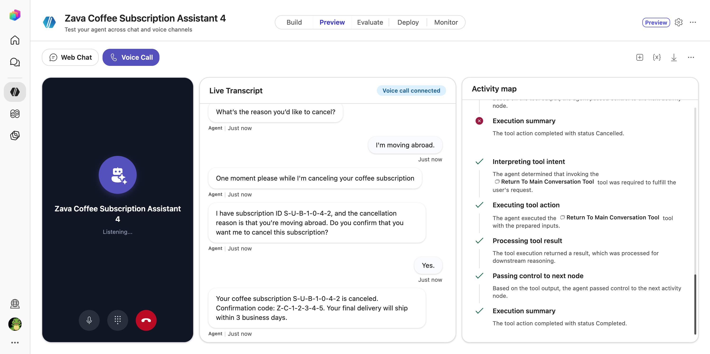

1. Select **End conversation** and confirm the control returns to **Start voice conversation**. Leave the agent unpublished; this lab does not require a live phone number or a production channel.

> [!TIP]
> In a room without a microphone? Use Web Chat, or watch the facilitator's call on screen.

### 🏅 Congratulations! You've completed Use Case #3!

---

### Test your understanding

* Which behaviours on the call came from the Voice tab, and which from General?
* What did you have to change to test the agent by voice in Preview?

---

## ➕ Extra: Add the enrollment, billing and delivery specialists

| Use case | Value added | Estimated effort |
|----------|-------------|------------------|
| Add the enrollment, billing and delivery specialists | A complete contact centre agent with four specialists | 15 minutes |

### Objective

Add the three remaining sub-agents the routing rules refer to, then check that each request type lands on the right one.

> [!NOTE]
> Keep Demo Mode. Check that each specialist asks for confirmation and returns a clear response to the customer.

---

### Step-by-step instructions

Repeat Use Case #2 for each specialist: **Build** → **Add a sub-agent**; wait for provisioning; rename **New Sub-Agent** to exactly the **Name** below; select **Save name**. Save **Description** and **Instructions** separately. Select **+** beside **Skills** and add a **Generative** skill. Use only fictional contact and payment details.

#### Subscription Enrollment & Setup

- **Name**

    ```text
    Subscription Enrollment & Setup
    ```

- **Description**

    ```text
    Handles new coffee subscription sign-ups; includes the `Create New Subscription` skill and uses subscription setup knowledge.
    ```

- **Instructions**

    ```text
    ### Purpose
    Assist callers in enrolling in a new Zava coffee subscription.
    ### General Guidelines
    - Handle only new subscription requests.
    - Required inputs: `email`, preferred coffee type, delivery frequency, and payment method.
    - Confirm all details before finalizing enrollment.
    - If the caller asks about billing or delivery changes, route back to the root agent silently.
    ### Steps
    1. Confirm the caller wants to start a new subscription.
    2. Gather required inputs.
    3. Verify coffee preferences and delivery frequency.
    4. Confirm payment method.
    5. Summarize and confirm the subscription details.
    6. Provide a confirmation code or next delivery date.
    ### Error Handling
    If any required input is missing, ask for it clearly and confirm before proceeding.
    ### Demo Mode
    This is a demo with no backend system. After the caller confirms, simulate success: give a confirmation code like ZC-12345.
    ```

- **Skill**: name `create-new-subscription`, description `Guides callers through creating a new Zava coffee subscription.`, instructions:

    ```text
    ### Purpose
    Help callers create a new Zava coffee subscription.
    ### Steps
    1. Ask for the caller's `email` and preferred coffee type.
    2. Confirm delivery frequency and quantity.
    3. Collect payment details.
    4. Review and confirm all information.
    5. Provide confirmation code and expected first delivery date.
    ```

#### Account & Billing Management

- **Name**

    ```text
    Account & Billing Management
    ```

- **Description**

    ```text
    Manages customer account and billing details; includes the `Update Payment Method` skill and uses billing procedures knowledge.
    ```

- **Instructions**

    ```text
    ### Purpose
    Assist callers with updating account or billing information.
    ### General Guidelines
    - Handle only account and billing requests.
    - Required inputs: `customerId`, `email`, and payment details.
    - Confirm changes before saving.
    - If the caller asks about delivery or cancellation, route back to the root agent silently.
    ### Steps
    1. Confirm the caller's identity using `customerId`.
    2. Ask what they want to update.
    3. Collect and confirm the new payment or contact information.
    4. Save and confirm the update.
    ### Error Handling
    If payment details are incomplete, ask for the missing fields and confirm before proceeding.
    ### Demo Mode
    This is a demo with no backend system. After the caller confirms, simulate success: give a confirmation code like ZC-12345.
    ```

- **Skill**: name `update-payment-method`, description `Helps callers update the payment method on their coffee subscription.`, instructions:

    ```text
    ### Purpose
    Assist callers in updating their payment method.
    ### Steps
    1. Ask for the `customerId` and current payment method.
    2. Collect the new payment details.
    3. Confirm accuracy and save changes.
    4. Notify the caller of the successful update.
    ```

#### Delivery Scheduling & Adjustments

- **Name**

    ```text
    Delivery Scheduling & Adjustments
    ```

- **Description**

    ```text
    Handles delivery date, quantity, frequency changes, and pauses; includes the `Modify Delivery Schedule` skill and uses delivery schedule options knowledge.
    ```

- **Instructions**

    ```text
    ### Purpose
    Assist callers in changing delivery dates, quantities, or frequency, and pausing or skipping deliveries.
    ### General Guidelines
    - Handle only delivery-related requests.
    - Required inputs: `subscriptionId` and the desired change details.
    - Confirm all changes before saving.
    - If the caller asks about billing or cancellation, route back to the root agent silently.
    ### Steps
    1. Confirm the caller's `subscriptionId`.
    2. Ask what change they want (date, quantity, frequency, pause).
    3. Record and confirm the new schedule.
    4. Summarize and confirm the next delivery date.
    ### Error Handling
    If the requested date or quantity is unavailable, offer the nearest available option.
    ### Demo Mode
    This is a demo with no backend system. After the caller confirms, simulate success: give a confirmation code like ZC-12345.
    ```

- **Skill**: name `modify-delivery-schedule`, description `Helps callers change, pause, or skip deliveries on their coffee subscription.`, instructions:

    ```text
    ### Purpose
    Help callers adjust their delivery schedule.
    ### Steps
    1. Ask for the `subscriptionId`.
    2. Ask what change they want (date, quantity, frequency, pause).
    3. Confirm the new schedule.
    4. Save and confirm the update.
    ```

The canvas now shows four sub-agents.

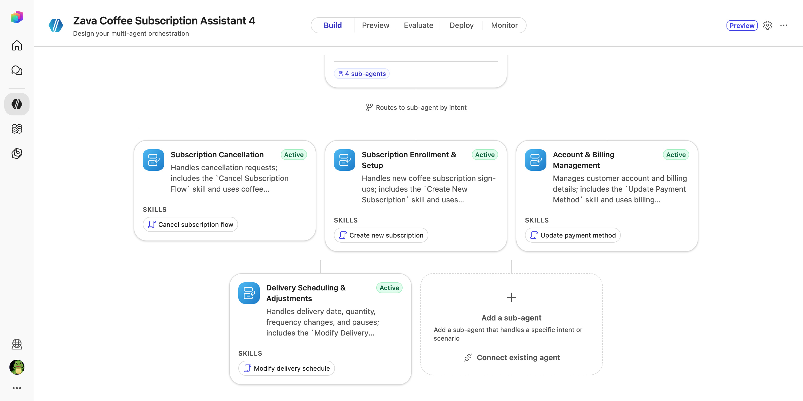

#### Test the routing

In **Preview** → **Web Chat**, select **Start new test session** before each line and check the **Activity map**:

| Send | Routes to |
|------|-----------|
| `Can I change my delivery date to next Friday? My subscription ID is SUB1042.` | Delivery Scheduling & Adjustments |
| `I want to start a new coffee subscription. My email is alex@contoso.com, medium roast, every two weeks.` | Subscription Enrollment & Setup |
| `I need to update my credit card. My customer ID is C-7781.` | Account & Billing Management |

The delivery question that the primary agent answered itself in Use Case #2 now routes to the delivery specialist.

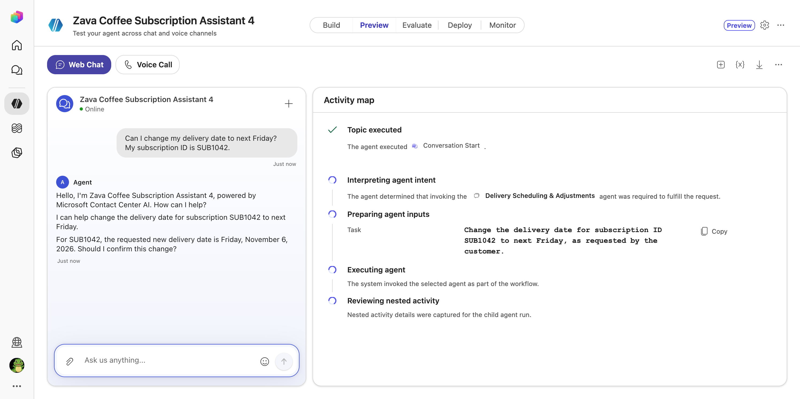

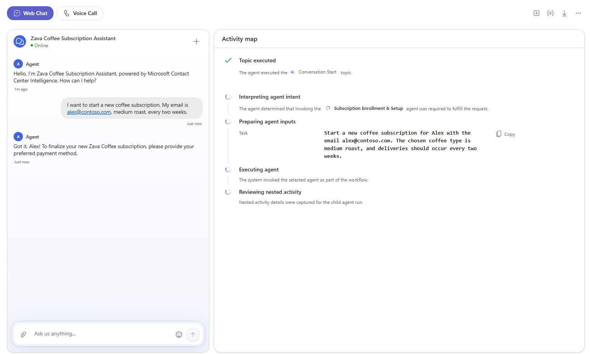

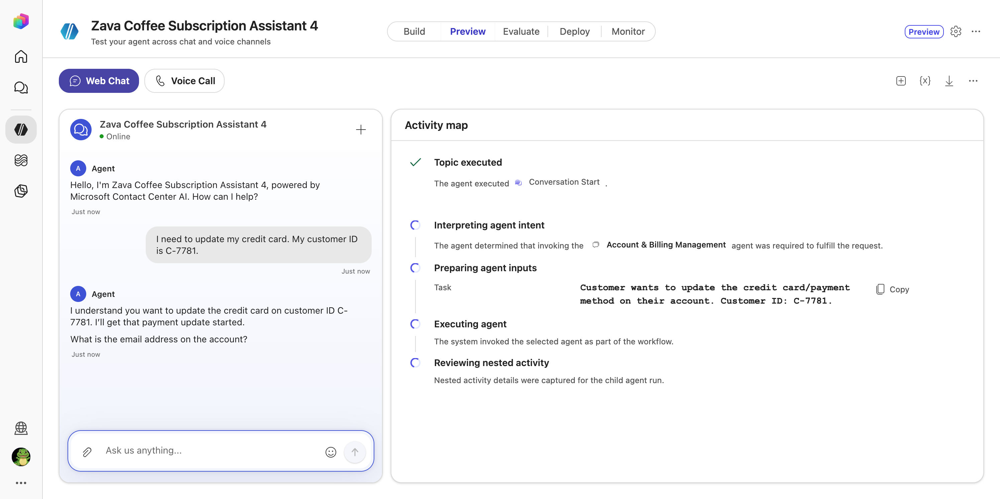

### 🏅 Congratulations! You've completed the Extra!

---

## 🔧 Troubleshooting

| Problem | Fix |
|---------|-----|
| **Customer conversation agent** is missing from **More create options** | Confirm the preview URL and the facilitator-provided environment. Ask the facilitator to verify feature access; do not substitute a different harness |
| No cancellation reply after about two minutes | Check the chat and Activity map. Use the one diagnostic retry in Use Case #2; stop and ask your facilitator if it also stalls |
| **TelephonyBadRequest** or another test-pane error | Record the error, select **Start new test session**, and retry once. If it persists, ask your facilitator |
| **Handoff method** shows **Needs setup** under **Human handoff** | Leave it unchanged; this lab does not configure human handoff |
| New agent or sub-agent fields are disabled | Wait for provisioning to finish before entering values |
| The name is rejected or cut off | Use a shorter, distinctive name and follow the validation message. Keep the sub-agent names in this lab unchanged so they match the routing instructions |
| Preview does not reflect an edit | Save each edited field, select **Start new test session**, and repeat the same scenario |
| A request isn't routed | Check the sub-agent's name matches the routing rules exactly and its **Description** is saved |
| No sound on the voice call | Allow microphone access in the browser and check your audio device, then call again |

---

## 🏆 Summary of learnings

* **The primary agent decides; sub-agents specialise.** Each specialist owns its own instructions and skills, so you change one job without touching the others.
* **Routing follows what exists.** Before a sub-agent existed, the primary handled the request itself. Once it existed, the same request was routed.
* **The description drives the route.** The primary agent reads each sub-agent's description to decide where a request belongs.
* **Voice is a layer, not a rebuild.** The Voice tab adds spell-back and one-question-at-a-time guidance on top of General. Preview lets you test voice without deploying a production phone channel; a connected call alone does not verify spoken behavior.
* **The Activity map shows the decision.** It shows which sub-agent was chosen, what task it received, and when control returned.

---

## 🔍 Conclusions and recommendations

* **Write sharp descriptions.** One sentence that says what the specialist handles is what makes routing reliable.
* **Keep channel-specific rules on their channel tab.** Spell-back and "don't read URLs" help a caller but get in the way in chat.
* **Collect shared identifiers once.** Let the primary agent gather `subscriptionId`, `customerId` and `email` and pass them on, so callers aren't asked twice.
* **Replace Demo Mode with real tools.** Each specialist is ready for an action or connector that performs the change for real.
* **Next step:** use **Evaluate** to run a set of test conversations against the agent after every change.

---
