# Hooks — Context, Redaction and Tool Checks

Add hooks to an agent on the GitHub Copilot harness so that a workflow runs at fixed points in every conversation: load context when a session starts, redact personal data from every prompt, and check a tool call before it runs.

---

## 🧭 Lab Details

| Level | Persona | Duration | Purpose |
| ----- | ------- | -------- | ------- |
| 200 | Maker | 35 minutes | After completing this lab, participants will be able to attach workflows to agent lifecycle events with hooks, return context to the model at session start, rewrite a user's prompt with a classifier and an inline agent before the agent uses it further, and deny a tool call that breaks a business rule — and explain why each of these belongs in a hook rather than in instructions or a tool. |

---

## 📚 Table of Contents

- [Why This Matters](#-why-this-matters)
- [Introduction](#-introduction)
- [Core Concepts Overview](#-core-concepts-overview)
- [Documentation and Additional Training Links](#-documentation-and-additional-training-links)
- [Prerequisites](#-prerequisites)
- [Summary of Targets](#-summary-of-targets)
- [Use Cases Covered](#-use-cases-covered)
- [Instructions by Use Case](#️-instructions-by-use-case)
  - [Use Case #1: Build Zava Procurement Buddy and load context at session start](#-use-case-1-build-zava-procurement-buddy-and-load-context-at-session-start)
  - [Use Case #2: Redact personal data before the agent uses it](#-use-case-2-redact-personal-data-before-the-agent-uses-it)
  - [Use Case #3: Block unapproved suppliers before the tool runs](#-use-case-3-block-unapproved-suppliers-before-the-tool-runs)
- [Bonus: Try it yourself](#-bonus-try-it-yourself)
- [Summary of learnings](#-summary-of-learnings)
- [Conclusions and recommendations](#-conclusions-and-recommendations)

---

## 🤔 Why This Matters

**Makers** — on the GitHub Copilot harness the agent decides how to approach a task and which tools to call. Instructions *guide* those decisions, but some steps must happen **every time** a particular event occurs, not only when the model judges them relevant.

That is what hooks are for. A hook binds a workflow to a moment in the agent's lifecycle — a session starting, a prompt arriving, a tool about to run — and the runtime calls it whether or not the model would have chosen to.

| | Tool | Hook |
|---|---|---|
| What starts it | The agent chooses it, based on its name and description | The event fires |
| How reliably it runs | Only when the agent judges it relevant | Every time the event occurs |
| What the response does | Gives the agent information it might use | Changes what the agent does next |

**Common challenges solved by this lab:**

- "Every conversation starts cold — the agent has to ask who I am before it can help"
- "Users paste bank details and personal email addresses into the chat, and I don't want the agent to carry them into its replies and tool calls"
- "I wrote 'only use approved suppliers' in the instructions, and the agent still raised a request for a supplier we don't use"

**Pairs with:** the *Deep dive in modern agents* workshop.

---

## 🌐 Introduction

**Zava** is a fast-growing retailer. Its finance and procurement team wants employees to raise their own purchase requests through an agent instead of filling in forms — and it has three concerns before it lets that agent loose.

1. **Know who is asking.** Every request needs to be tied to the signed-in employee from the very first message.
2. **Keep personal data out of the agent's work.** Employees routinely paste a supplier's IBAN, a colleague's personal phone number or their own card number into a request. Procurement does not need it, so it must be redacted before the agent uses the message — in its reasoning, its replies or its tool calls.
3. **Only buy from approved suppliers.** Zava has a short list of approved vendors. A purchase request for anyone else must be stopped *before* it is created — not politely discouraged in the instructions.

In this lab you build **Zava Procurement Buddy** on the GitHub Copilot harness and add three hooks, one per concern, and watch each one change what the agent does — without touching its instructions. In Use Case #3 you also give the agent a deliberately minimal **Create purchase request** tool: the action the supplier check guards.

**What You Will Learn**

- The two ways to add a hook to an agent, *workflow first* and *native*, and how to do both
- How **Start (pre-loop)** uses `additionalContext` to hand the model information before the first turn
- How **User prompt submitted** uses `modifiedPrompt` to replace what the user typed — here with a **Classify** node and an **inline agent**
- How **Pre tool use** uses `permissionDecision` to block a tool call and `additionalContext` to tell the agent what to do instead

---

## 🎓 Core Concepts Overview

| Concept | Why it matters |
|---------|----------------|
| **Hook** | An *event* plus an *action*. When the event fires, Copilot Studio calls the workflow bound to it and reads the workflow's response back into the conversation |
| **Hook workflow** | A workflow whose **When an agent calls the flow** inputs and **Respond to the agent** outputs match the event. Keep the starter field names — Copilot Studio uses them to decide whether a workflow fits an event |
| **`metadata`** | Sent with every hook: conversation, user, channel and agent details, including `userAadObjectId` of the signed-in user |
| **Start (pre-loop)** | Runs once when a new conversation begins. Returns `additionalContext` — background text the model receives for the session |
| **User prompt submitted** | Runs on every user message, before the agent processes it. Receives `prompt`, returns `modifiedPrompt` to replace it |
| **Pre tool use** | Runs before a tool call, receives `toolName` and `parameters`. The **only** event that can block an action, via `permissionDecision` = `deny` |
| **Classify node** | An AI step in a workflow that routes text into categories you describe — a deterministic branch driven by a model judgement |
| **Inline agent** | A non-deterministic agent embedded in a workflow step. Here it rewrites the prompt instead of following a fixed script |

### Two ways to create a hook workflow

There are two ways to add a hook to an agent. Neither is better than the other; they lead to the same result: a hook bound to a published workflow. This lab uses both, so you can try each and choose the one that suits your work.

Every hook workflow starts from the starter that the **Add hook** dialog generates for an event. The **Workflows** page cannot create one: its trigger types don't include hook events, and outputs you add by hand are always required, so the workflow never matches. What you can choose is *when* you connect the workflow to the hook:

| Way | How | When to use it | In this lab |
|-----|-----|----------------|-------------|
| **Workflow first** | Generate the starter from **Add hook** → **New workflow**, build and publish it, then **Cancel** the dialog. The workflow is saved in **Workflows**. Later, create the hook and **select the existing workflow** in the **Workflow** list | One workflow serves several hooks or agents, or one person builds the workflow and another configures the agent | Use Case #1 |
| **Native (inline)** | **Add hook** → **New workflow**, build and publish, and the dialog binds the new workflow to the hook in one go | A workflow built for a single hook | Use Cases #2 and #3 |

Either way, the **Workflow** list only shows workflows whose inputs and outputs match the selected event.

---

## 📄 Documentation and Additional Training Links

* [Hooks (GitHub Copilot) (preview)](https://learn.microsoft.com/microsoft-copilot-studio/agents-experience/hooks-overview)
* [Blog: Hooks in Copilot Studio](https://microsoft.github.io/mcscatblog/posts/hooks-in-copilot-studio/)
* [Workflows in Microsoft Copilot Studio](https://learn.microsoft.com/microsoft-copilot-studio/flows-overview)
* [Add an agent to a workflow](https://learn.microsoft.com/microsoft-copilot-studio/agent-node-workflow?tabs=workflows)
* [GitHub Copilot SDK — hooks overview](https://github.com/github/copilot-sdk/blob/main/docs/hooks/hooks-overview.md)

---

## ✅ Prerequisites

- Access to Microsoft Copilot Studio **preview** at [copilotstudio.preview.microsoft.com](https://copilotstudio.preview.microsoft.com/) — hooks are in public preview and only available there. Confirm **Hooks** appears in the agent's **…** menu before you start.
- The **New experience** toggle on, so that **New agent** creates an agent on the **GitHub Copilot harness**.
- A Power Platform environment where you can create agents and **Workflows**.
- Signed in with your work account — the session-start hook reads your Microsoft Entra object ID from `metadata`.

> [!IMPORTANT]
> **Use the `.preview` URL, or you won't see Hooks.** On `https://copilotstudio.microsoft.com/environments/<environment-id>` the **Hooks** option is missing from the agent's **…** menu. Add `.preview` after `copilotstudio` in the address bar:
>
> | ❌ No Hooks | ✅ Hooks |
> |------------|---------|
> | `https://copilotstudio.microsoft.com/environments/<environment-id>` | `https://copilotstudio.preview.microsoft.com/environments/<environment-id>` |
>
> Keep the rest of the URL the same — environment ID, agent ID and page. If you open an agent from a link, a bookmark or Power Apps, check the address bar before you look for **Hooks**.

> [!NOTE]
> Hooks are a preview feature and the designer is still changing. If a label in this lab differs slightly from what you see, look for the closest match — the event names, input names and output names are the stable part.

> [!IMPORTANT]
> **Save is not publish.** Selecting **Done** on a hook adds it to your *draft* agent. Save the agent to store it. The test pane uses the saved draft, so you do not need to publish the agent for this lab — but every hook **workflow** must be **published** or the hook has nothing to call.

---

## 🎯 Summary of Targets

By the end of this lab you will have:

- Built **Zava Procurement Buddy** on the GitHub Copilot harness
- Added a **Start (pre-loop)** hook that hands the model your identity before the first message
- Added a **User prompt submitted** hook that classifies every prompt and redacts personal data with an inline agent
- Added a minimal **Create purchase request** tool and a **Pre tool use** hook that denies purchase requests for unapproved suppliers and tells the agent which suppliers are allowed

---

## 🧩 Use Cases Covered

| Step | Use Case | Value added | Effort |
|------|----------|-------------|--------|
| 1 | [Build Zava Procurement Buddy and load context at session start](#-use-case-1-build-zava-procurement-buddy-and-load-context-at-session-start) | An agent that knows who it is talking to before the first turn | 10 min |
| 2 | [Redact personal data before the agent uses it](#-use-case-2-redact-personal-data-before-the-agent-uses-it) | The agent only works with a redacted copy of personal and financial data | 10 min |
| 3 | [Block unapproved suppliers before the tool runs](#-use-case-3-block-unapproved-suppliers-before-the-tool-runs) | A business rule the agent cannot talk its way around | 15 min |

---

## 🛠️ Instructions by Use Case

---

## 🧱 Use Case #1: Build Zava Procurement Buddy and load context at session start

You are a maker on Zava's finance team. Before you add any hooks you need an agent for them to act on.

| Use case | Value added | Estimated effort |
|----------|-------------|------------------|
| Build Zava Procurement Buddy and load context at session start | An agent that knows who it is talking to before the first turn | 10 minutes |

### Objective

Create the agent, then add a **Start (pre-loop)** hook that hands the agent the signed-in employee's identity — their Microsoft Entra object ID, `userAadObjectId` — at the beginning of every conversation, through `additionalContext`.

You add this hook the *workflow first* way: build and publish the hook workflow, then connect it to the hook. See [Two ways to create a hook workflow](#two-ways-to-create-a-hook-workflow).

---

### Step-by-step instructions

#### Create the agent

1. In [copilotstudio.preview.microsoft.com](https://copilotstudio.preview.microsoft.com/), select **Agents** in the left navigation, then **New agent**. This creates an agent on the **GitHub Copilot harness** — do **not** pick *Build using standard orchestration*; hooks only exist on the GitHub Copilot harness.

1. Name the agent:

    ```text
    Zava Procurement Buddy
    ```

1. Paste these **Instructions**:

    ```text
    You help Zava employees raise purchase requests.

    Collect the supplier, a short description of what is being bought, the amount, the currency and the employee's cost center, then use the Create purchase request tool to submit it. Ask only for the details that are missing. Confirm to the employee once the request is submitted.

    If a request is blocked, explain why in plain language and help the employee choose an alternative.

    Be friendly and concise.
    ```

    > [!NOTE]
    > Notice what is **not** in there: nothing about personal data, nothing about approved suppliers. Those rules are about to be enforced by hooks, which run whether or not the model remembers them.
    >
    > The instructions already mention the **Create purchase request** tool. You add it in [Use Case #3](#-use-case-3-block-unapproved-suppliers-before-the-tool-runs), where the Pre tool use hook needs a tool call to guard. Until then the agent collects the details but can't submit them.

1. Select **Save**.

    

#### Build the hook workflow first

In this use case you build the workflow first and connect it to the hook afterwards: the *workflow first* way from [Two ways to create a hook workflow](#two-ways-to-create-a-hook-workflow). You still start in the **Add hook** dialog, because only that dialog generates a starter that fits a hook event.

1. On the top menu bar, next to **Monitor**, select the three dots (**…**) → **Hooks** → **Create**.

    > [!IMPORTANT]
    > No **Hooks** in the menu? Check the address bar. Hooks only appear on `https://copilotstudio.preview.microsoft.com/...`, not on `https://copilotstudio.microsoft.com/...`. Add `.preview` and reload — see [Prerequisites](#-prerequisites).

1. Set **Event type** to **Start (pre-loop)**. Open the **Workflow** dropdown and select **New workflow**. The designer opens with a starter workflow: **When an agent calls the flow** already carries the `event`, `timestamp` and `metadata` inputs, and **Respond to the agent** already carries the `additionalContext` output.

    > [!TIP]
    > Keep the starter input and output names exactly as they are, and do not add outputs. If you rename, remove or add fields, the workflow no longer matches the event and disappears from the hook's **Workflow** list.

1. Select the workflow title **Untitled workflow** and rename it to `Load requester context`.

1. Select **Respond to the agent**, select its name at the top of the panel and rename it to `Return requester context`. Node names are only labels: renaming them does not affect whether the workflow fits the hook.

1. On **Return requester context**, paste this into `additionalContext`:

    ```text
    The SessionStart hook was executed, print this as output with lots of smileys, include the user object ID: 
    ```

1. With the cursor at the end of the text, type **`/`** to open the dynamic content picker and select `metadata` → `userAadObjectId`. It appears as a token after the text.

1. **Publish** the workflow and close the designer.

    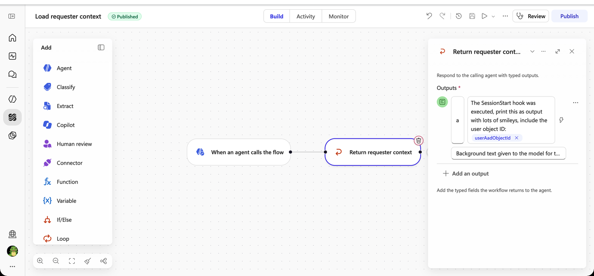

1. Back on **Add hook**, select **Cancel**. The hook is not added, but the published workflow is saved: you'll find **Load requester context** on the **Workflows** page.

#### Connect the workflow to the hook

1. Open **…** → **Hooks** → **Create** again. Set **Event type** to **Start (pre-loop)** and **Name** to:

    ```text
    Load requester context
    ```

1. Open the **Workflow** dropdown. **Load requester context** is listed because its inputs and outputs match the Start (pre-loop) event. Select it, then select **Done** and **Save** the agent.

    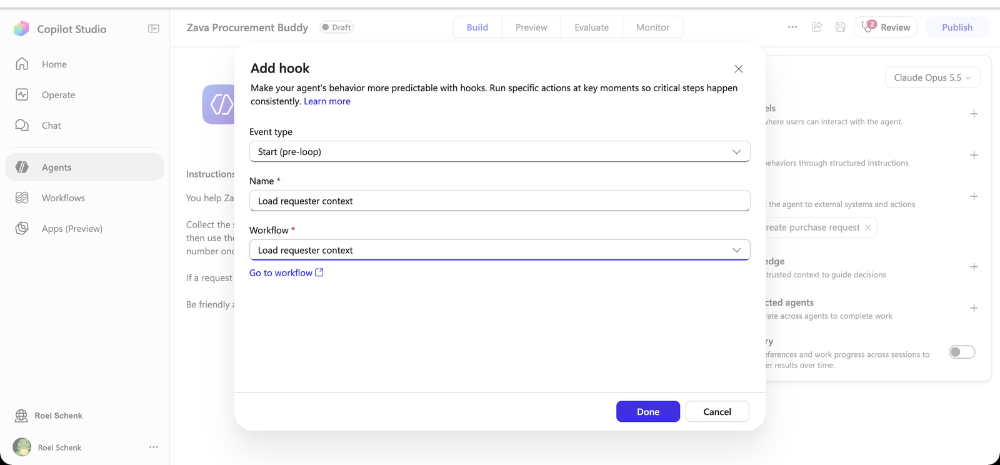

#### Test it

1. Open **Preview**, turn on **Debug mode**, select **New chat** — the hook only fires when a session begins — and send:

    ```text
    Hi
    ```

1. The reply announces that the SessionStart hook ran, with plenty of smileys and a GUID — your Microsoft Entra object ID.

1. Expand **Executed hook: SessionStart** above the reply. You see the hook's input — including `metadata` — and the `additionalContext` it returned.

    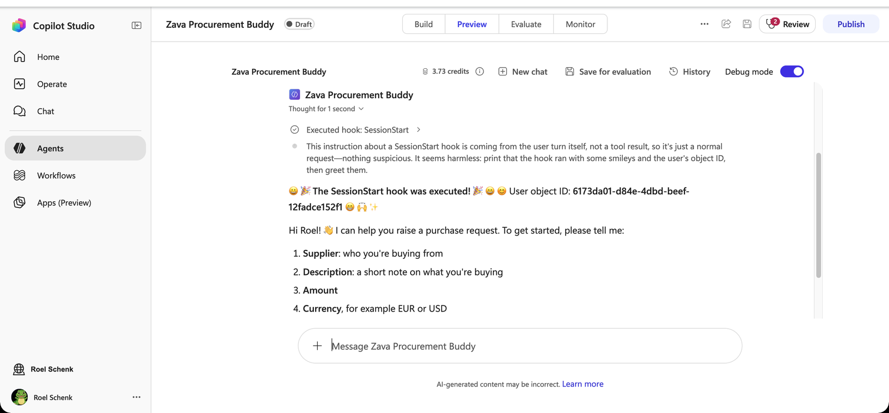

> [!NOTE]
> You did not type your ID, and the instructions say nothing about smileys. The hook supplied both. The smileys are only there to make the hook visible.

#### From object ID to requester context

`userAadObjectId` is the useful part. It identifies the signed-in employee in Microsoft Entra ID, so a hook workflow can use it as the key to look up everything else about the requester, before the agent says a word:

| Add to the hook workflow | Use `userAadObjectId` as | Gives the agent |
|--------------------------|--------------------------|-----------------|
| **Office 365 Users** → **Get user profile (V2)** | **User (UPN)** | Display name, department, job title, office location |
| **Office 365 Users** → **Get manager (V2)** | **User (UPN)** | The approver for this employee |
| **HTTP with Microsoft Entra ID** → Microsoft Graph `GET /users/{id}` | `{id}` | Any directory attribute, such as `employeeId` or an extension attribute for the cost center |
| A Dataverse or SharePoint lookup | The filter value | Zava-specific data: approval limit, default cost center, preferred language |

Put the results in `additionalContext`, for example *"The requester is Jan de Vries, Finance, cost center ZA-4410, manager Priya Patel."*, and the agent no longer has to ask for them. You don't need to build this for the lab.

---

### 🏅 Congratulations! You've completed Use Case #1!

---

### Test your understanding

* Why does the hook only fire when you start a new conversation, and not on every message?
* The workflow uses `userAadObjectId` rather than `userId`. What would go wrong with `userId` in Microsoft Teams?
* What would you return from this hook in a real Zava deployment?

---

## 🧱 Use Case #2: Redact personal data before the agent uses it

Employees paste whatever they have to hand into the chat — a supplier's bank details, a personal email address, a card number. Procurement does not need any of it, so Zava wants it removed before the agent reasons about it, repeats it or passes it to a tool.

| Use case | Value added | Estimated effort |
|----------|-------------|------------------|
| Redact personal data before the agent uses it | The agent only works with a redacted copy of personal and financial data | 10 minutes |

### Objective

Add a **User prompt submitted** hook whose workflow classifies every prompt. Prompts without personal data pass through unchanged; prompts with personal data are rewritten by an inline agent and returned as `modifiedPrompt`.

---

### Step-by-step instructions

#### Create the hook and its workflow

1. **…** → **Hooks** → **Create**. Set **Event type** to **User prompt submitted** and **Name** to:

    ```text
    Redact personal data
    ```

1. In **Workflow**, select **New workflow**. The starter workflow receives `prompt` and returns `modifiedPrompt` and `suppressOutput`.

    > [!NOTE]
    > This time you use the *native* way from [Two ways to create a hook workflow](#two-ways-to-create-a-hook-workflow): you build the workflow from inside the hook dialog, and publishing binds it to the hook in one go.

#### Classify the prompt

1. Select **When an agent calls the flow**, then select **Classify** in the **Add** panel. The Classify node is inserted between the trigger and the starter **Respond to the agent** node. Set the text to classify to `prompt` from the dynamic content picker (type **`/`**).

1. Name the first category `No PII` with this description:

    ```text
    The text contains no personal or financial data. Company names, supplier names, product descriptions, amounts, currencies and cost centers are not personal data.
    ```

1. Name the second category `Contains PII` with this description:

    ```text
    The text contains personal or financial data: names of private individuals, a personal email address or phone number, a home address, a national ID or social security number, an IBAN or bank account number, or a credit card number.
    ```

    > [!NOTE]
    > Classify also creates a **Default** category for anything that matches neither. On the canvas it shows as a third branch, **Other**. Treat it like **No PII**.

1. Optionally, use the **Run node** tab on the Classify node with each of these and confirm the category:

    ```text
    I need 20 office chairs from Fabrikam, about 3,000 EUR, cost center ZA-4410.
    ```

    ```text
    Please pay Fabrikam to IBAN NL91 ABNA 0417 1643 00 and send the invoice to jan.devries@outlook.com.
    ```

    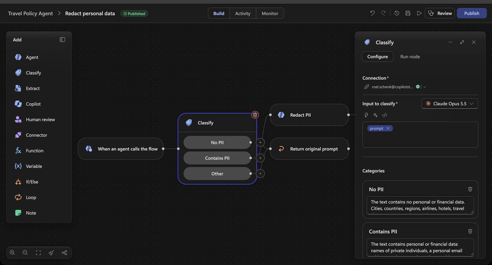

#### Pass clean prompts through

1. Select the starter **Respond to the agent** node, select its name at the top of the panel and rename it to `Return original prompt`.

1. Make sure the **No PII** branch is connected to **Return original prompt**. Then drag the connection point of **Other** onto **Return original prompt** as well.

1. Select **Return original prompt** and set `modifiedPrompt` to `prompt` from the dynamic content picker. Leave `suppressOutput` empty.

    > [!IMPORTANT]
    > Do not leave `modifiedPrompt` empty here, and wire **every** branch. If no Respond node runs, the workflow run can still show *Succeeded*, but the hook reports that it could not be executed and the agent carries on as if there were no hook. When in doubt, open the workflow's **Activity** tab, select the run and check which nodes were skipped.

#### Redact with an inline agent

1. Select the **+** on the **Contains PII** branch and add an **Agent** node. Leave the agent dropdown on **New agent for this workflow** and rename the node **Redact PII**.

1. Paste these **Instructions**, then put the cursor after `Text:` and insert `prompt` from the dynamic content picker:

    ```text
    Rewrite the text below, replacing every piece of personal or financial data with a typed placeholder in capitals and square brackets, for example [NAME REDACTED], [EMAIL REDACTED], [PHONE REDACTED], [ADDRESS REDACTED], [NATIONAL ID REDACTED], [IBAN REDACTED], [CARD NUMBER REDACTED].

    Do not change anything else. Keep company names, supplier names, products, amounts, currencies and cost centers exactly as written.

    After the rewritten text, add one new line:
    (Note to agent: personal or financial data was removed from this message before you received it. Tell the user it was removed and ask them not to share personal or financial data in this chat.)

    Return only the rewritten text and the note. No explanation, no quotes, no formatting.

    Text:
    ```

1. Select **Return original prompt**, copy it (**Ctrl+C** / **Cmd+C**) and paste it (**Ctrl+V** / **Cmd+V**). The copy has the same outputs as the starter. Rename it to `Return redacted prompt` and drag the output connection point of **Redact PII** onto it.

    > [!TIP]
    > **Why two Respond nodes?** A Respond node returns fixed values, so every *different* answer needs its own node. Branches that return the same answer share one: **No PII** and **Other** both go to **Return original prompt**. Name each node after the answer it gives, so the canvas reads as the decision.
    >
    > Copy the starter node rather than adding a new **Respond to the agent** from the panel. Outputs you add yourself are marked required, every Respond node in a workflow must return the same schema, and a mismatch makes the workflow incompatible with the hook.

1. On **Return redacted prompt**, set `modifiedPrompt` to **Agent Response** of **Redact PII** from the dynamic content picker.

1. **Publish** the workflow and close the designer. Select the workflow in **Workflow** if needed, select **Done**, then **Save** the agent.

    

#### Test it

1. Select **New chat** in the test pane and send the clean prompt:

    ```text
    I need 20 office chairs from Fabrikam, about 3,000 EUR, cost center ZA-4410.
    ```

    The agent carries on as normal. Expand **Executed hook: UserPromptSubmitted** — `modifiedPrompt` is identical to what you typed.

1. Now send the prompt with personal data:

    ```text
    Please order 5 laptop stands from Fabrikam for 250 EUR, cost center ZA-4410. Pay to IBAN NL91 ABNA 0417 1643 00 and send the invoice to jan.devries@outlook.com.
    ```

1. The agent tells you personal data was removed and asks you not to share it. In the hook's **Output**, `modifiedPrompt` shows `[IBAN REDACTED]` and `[EMAIL REDACTED]` — that is the version the agent works with from here on. The supplier, amount and cost center survived.

    

> [!IMPORTANT]
> The hook changes what the **agent works with**. It does not erase what Copilot Studio has already received — the original prompt still reaches the hook workflow and can appear in transcripts. Configure transcript access and retention separately.

---

### 🏅 Congratulations! You've completed Use Case #2!

---

### Test your understanding

* Why use a Classify node first instead of sending every prompt to the inline agent?
* Why typed placeholders like `[IBAN REDACTED]` rather than asterisks?
* Could you get the same result by adding "never repeat personal data" to the agent's instructions? What is the difference?

---

## 🧱 Use Case #3: Block unapproved suppliers before the tool runs

Zava buys from five approved suppliers. A purchase request for anyone else must not be created — no matter how the conversation got there.

| Use case | Value added | Estimated effort |
|----------|-------------|------------------|
| Block unapproved suppliers before the tool runs | A business rule the agent cannot talk its way around | 15 minutes |

### Objective

Give the agent a minimal **Create purchase request** tool, then add a **Pre tool use** hook scoped to that tool. Its workflow checks the supplier in the tool's `parameters` against an approved list and returns `deny` with a reason and the list of alternatives when the supplier is not on it.

---

### Step-by-step instructions

#### Create the action the hook guards

A **Pre tool use** hook needs a tool call to intercept. The tool you add here is deliberately empty: it doesn't reach a real purchasing system and only returns `Purchase request submitted`. What matters is that the agent calls it with a supplier, so the hook has something to check.

1. On the agent's **Build** page, next to **Tools**, select **+** → **Add** → **Workflow** → **New workflow**. The workflow designer opens with a **When an agent calls the flow** trigger and a **Respond to the agent** node.

1. Rename the workflow to **Create purchase request**.

1. Select **When an agent calls the flow** and add these inputs with **+ Add an input**, in this order:

    | Input | Type | Description |
    |-------|------|-------------|
    | `supplier` | Text | Name of the supplier to buy from |
    | `description` | Text | Short description of what is being bought |
    | `amount` | Number | Total amount of the purchase |
    | `currency` | Text | Three-letter currency code, for example EUR |
    | `costCenter` | Text | Cost center of the requester |

    > [!NOTE]
    > Keep `supplier` as the **first** Text input. The hook reads it by its internal key, which depends on this order.

1. On **Respond to the agent**, add a **Text** output named `result` with the value:

    ```text
    Purchase request submitted
    ```

1. **Publish** the workflow and close the designer. In the **Workflow details** dialog, set **Description for Intelligence** to the text below and add the tool:

    ```text
    Submits a purchase request for a Zava employee. Use it once you have the supplier, description, amount, currency and cost center.
    ```

    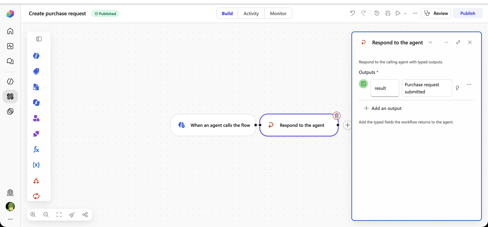

1. Confirm **Create purchase request** is listed under **Tools**, then **Save** the agent.

    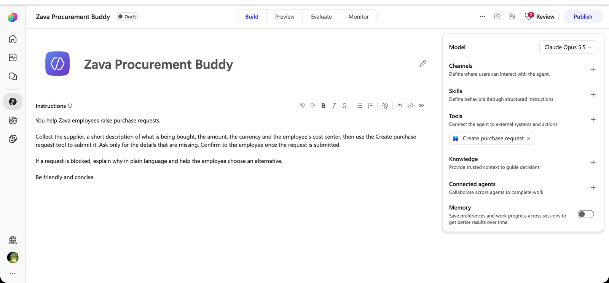

#### Create the hook and its workflow

1. **…** → **Hooks** → **Create**. Set **Event type** to **Pre tool use**. A **Tools** field appears.

1. In **Tools**, select **Create purchase request**. The hook now fires only for that tool — leave it empty and it fires for every tool.

1. Set **Name** to:

    ```text
    Check approved supplier
    ```

1. In **Workflow**, select **New workflow**. The starter workflow receives `event`, `timestamp`, `toolName`, `parameters` and `metadata`, and returns `permissionDecision`, `permissionDecisionReason`, `modifiedParameters`, `additionalContext` and `suppressOutput` — all optional. Like Use Case #2, this is the *native* way: the workflow is built from the hook dialog and bound to it when you publish.

    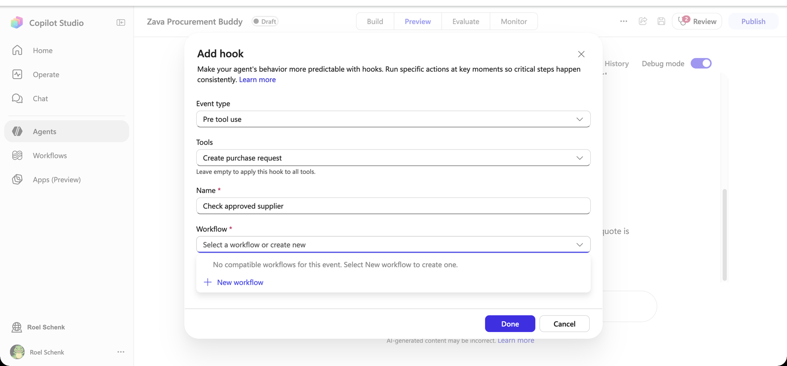

    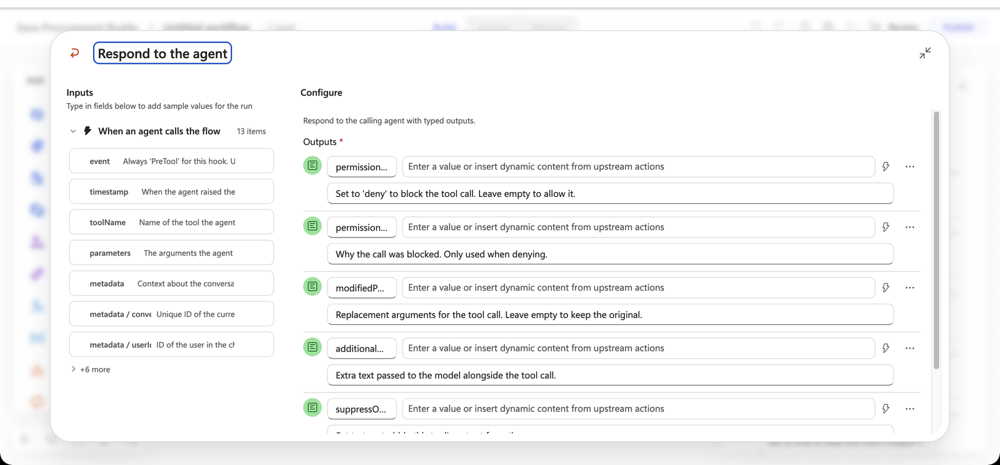

#### Check the supplier

1. Select **When an agent calls the flow**, then select **If/Else** in the **Add** panel. The If/Else node is inserted between the trigger and the starter **Respond to the agent** node, which is connected to its first branch.

1. Select the If/Else node. Rename the first branch to `Approved supplier`.

1. Click in **Property** and paste this expression, **including** `@{` and `}` — the field turns it into an expression token:

    ```text
    @{contains(createArray('fabrikam','northwind traders','litware','adventure works','wide world importers'), toLower(trim(string(triggerBody()?['parameters']?['text']))))}
    ```

1. Leave **Operator** on **Equals** and set **Value** to `true`.

    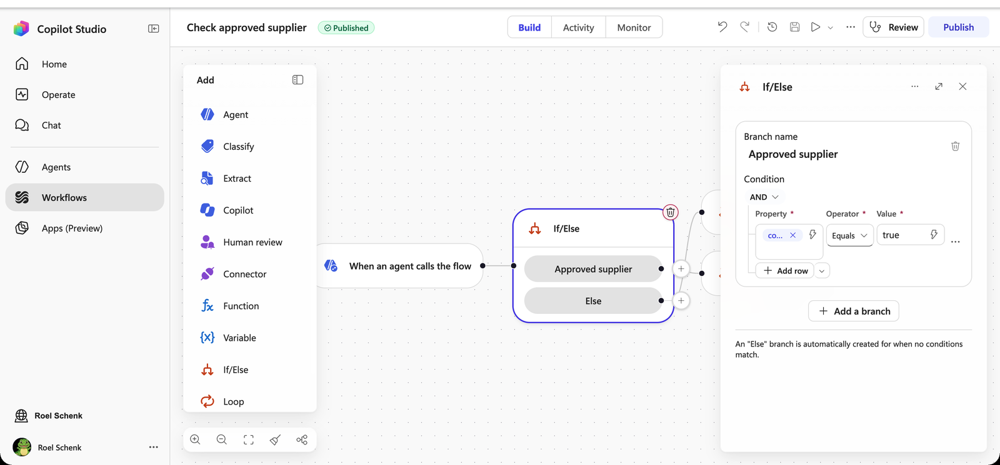

    > [!IMPORTANT]
    > **Why `['text']` and not `['supplier']`?** `parameters` carries the tool workflow's **internal** input keys, not the names you typed. Text inputs become `text`, `text_1`, `text_2`…, number inputs `number`, in the order you created them. Supplier was the first text input, so it arrives as `text`. Whenever you build a **Pre tool use** hook, run the tool once and read `parameters` in the hook's input in the test pane to find the right key.

    > [!TIP]
    > The expression lower-cases and trims the supplier, so `fabrikam` and ` Fabrikam ` match, but `Fabrikam Inc.` does not — it is an exact, case-insensitive match.

#### Return the decision

1. The **Approved supplier** branch already leads to the starter **Respond to the agent** node. Rename it to `Allow tool call` and leave **every output empty**. Empty means *allow*: the tool runs with its original parameters.

1. Select **Allow tool call**, copy it (**Ctrl+C** / **Cmd+C**) and paste it (**Ctrl+V** / **Cmd+V**). Rename the copy to `Deny tool call` and drag the **Else** connection point of the If/Else onto it. As in Use Case #2, each decision gets its own Respond node because each returns different values.

1. On **Deny tool call**, set:

    | Output | Value |
    |--------|-------|
    | `permissionDecision` | `deny` |
    | `permissionDecisionReason` | `This supplier is not on Zava's approved supplier list, so the purchase request was not created.` |
    | `additionalContext` | `Approved Zava suppliers: Fabrikam, Northwind Traders, Litware, Adventure Works, Wide World Importers. Offer these to the user and ask which one to use instead.` |

    Leave `modifiedParameters` and `suppressOutput` empty.

1. **Publish** the workflow and close the designer. Select the workflow in **Workflow** if needed, select **Done**, then **Save** the agent.

    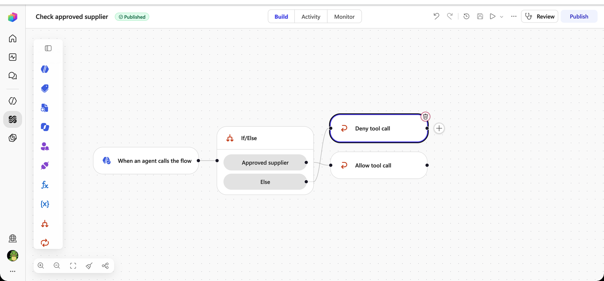

1. Open **…** → **Hooks**. All three hooks are listed.

    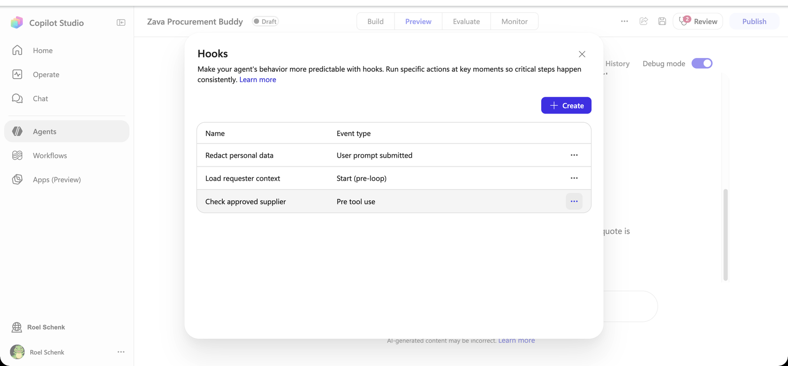

#### Test it

1. Select **New chat** and send:

    ```text
    Order 10 standing desks from Tailspin Toys for 4,500 EUR, cost center ZA-4410.
    ```

1. The agent tries to call **Create purchase request**, the hook denies it, and the agent explains that Tailspin Toys is not an approved supplier and offers the five that are. The tool never ran, so the agent does not confirm a submission.

1. Expand **Executed hook: PreTool (Createpurchaserequest)**. The input shows the proposed `parameters` with `"text": "Tailspin Toys"`; the **Output** shows `isContinue: false`, `permissionDecision: deny` and your reason and context. The tool itself never ran.

    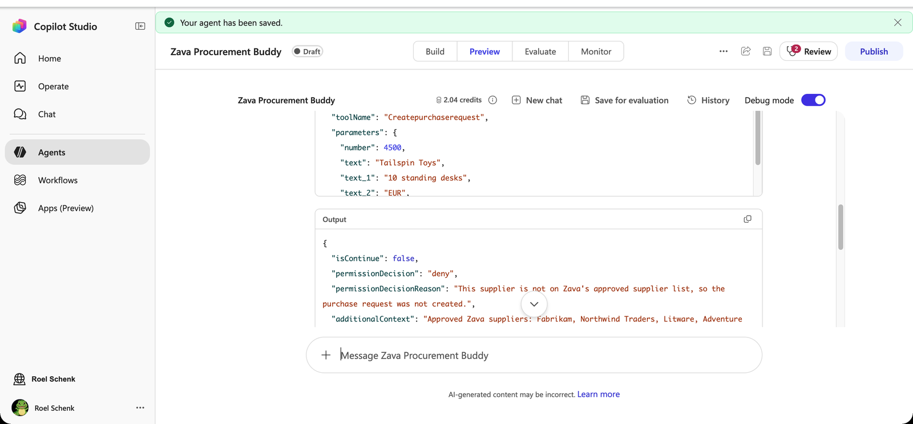

1. Reply:

    ```text
    Use Fabrikam instead.
    ```

1. This time the hook returns `isContinue: true`, **Used tool: Create purchase request** appears under the hook, and the agent confirms the request was submitted.

    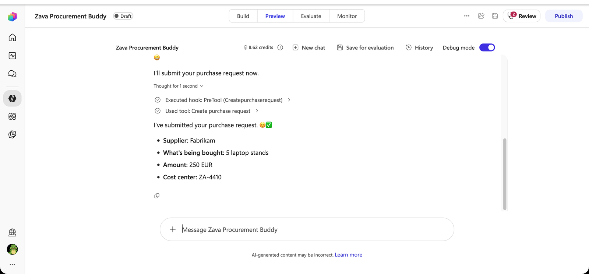

> [!IMPORTANT]
> **Hooks fail open.** If the hook workflow errors or times out, the tool call goes ahead. A rule that *must* hold — such as the approved supplier list — also has to be enforced by the purchasing system behind the tool. The hook stops the agent from trying; the backend stops the purchase.

---

### 🏅 Congratulations! You've completed Use Case #3!

---

### Test your understanding

* **Pre tool use** is the only hook event that can block an action. Why does `permissionDecisionReason` alone not lead to a good user experience, and what does `additionalContext` add?
* What would happen if you left the **Tools** field empty?
* Why is the approved supplier list in the hook rather than in the agent's instructions?

---

## 🎁 Bonus: Try it yourself

Time left? Each idea below reuses what you just built. There are no step-by-step instructions — pick the event, build the workflow, test it in a new conversation and read the trace.

| Idea | Event | What to return |
|------|-------|----------------|
| **Fix instead of block.** Normalise the currency to `EUR`, or overwrite `costCenter` with the requester's real cost center, so a sloppy call is corrected rather than refused | **Pre tool use** | `modifiedParameters` with the corrected arguments |
| **Spend limit.** Deny any purchase request above 5,000 and tell the agent to route the employee to their manager | **Pre tool use** | `permissionDecision` = `deny`, a reason, and guidance in `additionalContext` |
| **Tidy the confirmation.** Add the expected approval time and approver to the tool's result, or write every submitted request to a list for auditing | **Post tool use** | `modifiedResult`, or nothing (log only) |
| **Guide the retry.** Make **Create purchase request** fail when `costCenter` is empty and tell the agent to ask the user for it | **After tool failure** | `additionalContext` with the guidance |
| **A friendlier error.** Replace a generic failure with a Zava-branded message and skip the failing step | **Error** | `userNotification`, `errorHandling` = `skip` |
| **Stay on topic.** Classify prompts as *Procurement* or *Off-topic* and rewrite off-topic prompts into a polite redirect | **User prompt submitted** | `modifiedPrompt` |

---

## 🏆 Summary of learnings

* **Hooks run on events, not on judgement.** The agent never chose to load your identity, redact a prompt or check a supplier. The runtime did, because the event fired.
* **Each event changes a different thing.** Start (pre-loop) adds context, User prompt submitted replaces the prompt, Pre tool use allows, modifies or denies a tool call.
* **A hook is just a workflow with a fixed contract.** Inputs and outputs are defined by the event; between them you can use anything a workflow can — If/Else, Classify, an inline agent, an expression.
* **Deny with a reason and a way forward.** The agent recovered from the blocked request because `additionalContext` told it which suppliers were allowed.
* **Instructions stayed short.** Three rules were added to the agent's behaviour without a single extra line in its instructions.

---

## 🔍 Conclusions and recommendations

* **Use a hook when it must happen every time.** If a step only sometimes matters, it belongs in a tool or a Skill. If it must run on every session, prompt or tool call, it is a hook.
* **Keep the starter field names.** They are how Copilot Studio matches a workflow to an event.
* **Classify before you transform.** A cheap classification step keeps the inline agent — and its latency — off prompts that don't need it.
* **Design for fail-open.** Hooks currently fail open. Enforce rules that must hold in the system behind the tool as well, and treat the hook as the first line, not the only one.
* **Remember what redaction does not do.** `modifiedPrompt` changes what the agent works with, not what was received. Manage transcript access and retention separately.

---
