# Instructions and Skills Authoring

Build and test an RFP Response agent with an existing Skill, inspect its package, and chart source data in the sandbox. Optionally create your own Skill in an agent's Preview chat.

---


## 🧭 Lab Details

| Level | Persona | Duration | Purpose |
| ----- | ------- | -------- | ------- |
| 300 | Maker | 30 minutes | Attach, inspect, and test an existing Skill in a Copilot Studio agent, then use sandbox code execution to chart source data. Skill creation is optional extra credit. |

---

## 📚 Table of Contents

- [Why This Matters](#-why-this-matters)
- [Introduction](#-introduction)
- [Core Concepts Overview](#-core-concepts-overview)
- [Documentation and Additional Training Links](#-documentation-and-additional-training-links)
- [Prerequisites](#-prerequisites)
- [Summary of Targets](#-summary-of-targets)
- [Use Cases Covered](#-use-cases-covered)
- [Instructions by Use Case](#️-instructions-by-use-case)
  - [Use Case #1: Leveraging Skills in Copilot Studio agents](#-use-case-1-leveraging-skills-in-copilot-studio-agents)
- [Conclusions and recommendations](#-conclusions-and-recommendations)
- [Extra Credit: Create and test a Skill with Copilot Studio](#-extra-credit-create-and-test-a-skill-with-copilot-studio)
- [Extra Credit: Explore the agent harness](#-extra-credit-explore-the-agent-harness)
- [Extra Credit: Generate with AI](#-extra-credit-generate-with-ai)

---

## 🤔 Why This Matters

**Makers and Developers** - Have you written the same long instructions into three different agents, and watched them drift apart?

Think of a Skill as a playbook the orchestrator picks up only when it is relevant:
- **Without Skills**: Every rule lives in one agent's top-level instructions. The prompt grows, unrelated behaviour leaks into every conversation, and nothing is reusable anywhere else
- **With Skills**: "When to use me", "the material I work from", and "the procedure to follow" travel together as one component - loaded on demand, versioned, and portable across surfaces

**Common challenges solved by this lab:**
- "My agent instructions are thousands of words and I am afraid to touch them"
- "The agent loses track of the detailed procedure as its base instructions grow"
- "The agent sounds confident about things the company cannot actually commit to"

**In 30 minutes, build and test one Skill-equipped agent, inspect its playbook, and chart the RFP's evaluation weights. Creating your own Skill is optional extra credit, outside the core timebox.**

---

## 🌐 Introduction

A Skill packages a named, self-contained playbook: a description that tells the orchestrator when the Skill applies, instructions describing the procedure, and the reference material the work depends on. Instead of cramming every rule into an agent's instructions, you hand the orchestrator something it can load only when a request matches.

**Real-world example:** a proposal team answers RFPs. The rules are stable - match the request to an offering, answer from pre-approved language, never claim a certification the company does not hold. A Skill keeps that procedure and its reference material together, ready for the agent to load when someone attaches a solicitation.

Use Case #1 is the complete core lab: build an RFP Response agent with a sample Skill and watch it load. If you have extra time, the [optional Skill-creation exercise](#-extra-credit-create-and-test-a-skill-with-copilot-studio) shows how to create a guided project-intake Skill in an agent's **Preview** chat. It uses a separate agent so the procedures do not compete.

---

## 🎓 Core Concepts Overview

| Concept | Why it matters |
|---------|----------------|
| **Skill** | A named playbook - description, instructions, and bundled reference files - that the orchestrator loads only when a request matches it, keeping base instructions short and behaviour consistent |
| **Skill description** | The text the orchestrator matches a user request against. It is the single most common reason a Skill does or does not fire |
| **Skill generation and refinement** | Give an authoring assistant a process and examples, review its generated Skill, then test it in the target agent. Generation is a starting point, not proof that the Skill works |
| **Bundled references and scripts** | The `references/`, `assets/` and `scripts/` folders that travel with `SKILL.md`, so the Skill answers from vetted material and can run its own helpers rather than improvising |
| **Agent sandbox** | The runtime where the agent can execute code, analyze supplied files, and generate artifacts such as charts and PDFs; available libraries and tools must be observed rather than assumed |
| **Skill guidance versus validation** | A Skill guides model behavior but does not guarantee exact question ordering, field validation, or branching. Test the behavior and use deterministic validation when guarantees are required |

---

## 📄 Documentation and Additional Training Links

These resources cover agents and Skills powered by the **Microsoft Copilot harness** in Copilot Studio. This harness was previously named the GitHub Copilot harness, and some Microsoft Learn pages still use that name.

**Microsoft Learn: Microsoft Copilot harness and Skills**

* [Microsoft Copilot harness overview](https://learn.microsoft.com/microsoft-copilot-studio/harnesses-overview#github-copilot-harness) (the harness was formerly named "GitHub Copilot harness", and Learn still titles this section that way)
* [Skills overview for agents (GitHub Copilot)](https://learn.microsoft.com/microsoft-copilot-studio/agents-experience/skills-overview)
* [Add and manage an uploaded skill (GitHub Copilot)](https://learn.microsoft.com/microsoft-copilot-studio/agents-experience/skills-add-existing)
* [Manage and delete skills in an agent (GitHub Copilot)](https://learn.microsoft.com/microsoft-copilot-studio/agents-experience/skills-manage)

**CAT blog: The Custom Engine**

* [Agents Have Skills Now - Here's How They Work in Copilot Studio](https://microsoft.github.io/mcscatblog/posts/modern-mcs-agent-skills/)
* [Turn Your Daily Digest Into a Podcast You'll Actually Listen To (a podcast-script Skill in Copilot Studio)](https://microsoft.github.io/mcscatblog/posts/podcast-script-skill/)

---

## ✅ Prerequisites

<p class="lab-setup-note">At a proctor-led event with a provided, pre-provisioned account? <strong>You're ready to start.</strong></p>

<details class="lab-setup" markdown="1">
<summary>Using your own tenant? View setup requirements</summary>

- Access to Microsoft Copilot Studio with agents powered by the **Microsoft Copilot** harness (previously named the GitHub Copilot harness), and permission to create agents and add Skills in your environment
- Copilot Credits available in the environment. Agents on the Microsoft Copilot harness use usage-based billing; the core lab's RFP conversation used about 115 credits in our test
- Sandbox code execution with a charting library available, for the chart step in Use Case #1
- An account that can connect to the **Work IQ** tool
- **Optional Skill-creation extra credit only:** a reasoning-capable model, such as **Claude Opus 5.5** if it is offered in your environment, plus file attachments and sandbox ZIP-file generation and download in the agent's **Preview** chat. Model names and availability vary by environment

</details>

You download the sample Skill package, the test RFP and the extra-credit materials in the steps where you use them. No prior Skill-authoring experience is needed.

---

## 🎯 Summary of Targets

By the end of the core lab you will:

- Attach a Skill to a Copilot Studio agent and watch the orchestrator load it without being told to
- Read a Skill package and explain what its description, references, assets and scripts each do
- Use sandbox code execution to extract the RFP's evaluation weights and create a downloadable chart, checking the result against the source
- Explain why a Skill guides behavior but does not replace deterministic validation or guaranteed branching

**Optional extra credit:** turn a project-intake process into a Skill in a blank agent's Preview, upload the package, add agent instructions, and test the guided conversation.

---

## 🧩 Use Cases Covered

**Use Case #1 is the only required exercise.** The Skill-creation exercise and other extra-credit sections are optional.

**Suggested 30-minute session:** 5 minutes for orientation, 20 minutes for Use Case #1, and 5 minutes for review and conclusions.

These are planning timeboxes for a prepared tenant, not measured execution guarantees. If you are running this lab in your own tenant, complete the [Prerequisites](#-prerequisites) before the session. Allow extra time for connection prompts, model runs, or repairs. Extra-credit exercises are outside the 30-minute duration.

| Route | Use Case | Value added | Timebox |
|-------|----------|-------------|---------|
| Everyone | [Use Case #1: Leveraging Skills in Copilot Studio agents](#-use-case-1-leveraging-skills-in-copilot-studio-agents) | Upload, inspect, and test an existing Skill, then chart source data in the sandbox | 20 min |
| Optional extra credit | [Create and test a Skill with Copilot Studio](#-extra-credit-create-and-test-a-skill-with-copilot-studio) | Create a guided project-intake Skill in an agent's Preview chat, then upload and test it | 25 min extra |

---

## 🛠️ Instructions by Use Case

---

## 🧱 Use Case #1: Leveraging Skills in Copilot Studio agents

**Core exercise. Timebox: 20 minutes.** You do not need to publish the agent.

### Step-by-step instructions

#### Create the agent

1. Open [Copilot Studio](https://copilotstudio.microsoft.com/). On **Home**, select the **Agent** card. It creates an agent on the **Microsoft Copilot** harness. The harness was previously named GitHub Copilot, so the card's badge may still read **GitHub Copilot** in some environments, as in the screenshot below.

    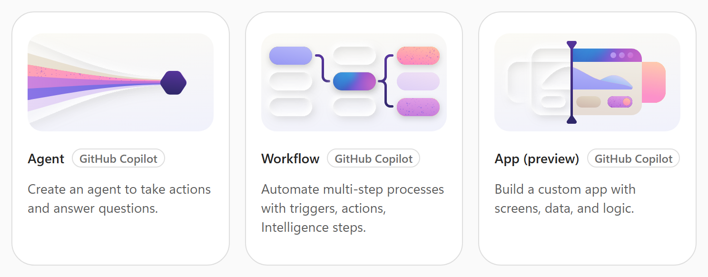

    The agent designer opens on the **Build** tab with a new, unsaved **Draft** agent.

    > [!TIP]
    > You can also start from **Agents**: open the menu next to **New agent** (**More create options**) and choose the **Agent** option for the Microsoft Copilot harness (labelled **Agent, GitHub Copilot** before the rename). A one-time **New name, same harness** bubble may appear there to confirm that the harness formerly named GitHub Copilot is now the Microsoft Copilot harness. Avoid the plain **New agent** button for this lab, because it may not create an agent on the Microsoft Copilot harness. The **Agents** list shows each agent's harness in the **Agent harness** column.

1. Select the name field at the top and replace **Untitled Agent** with:

   ```text
   RFP Response Agent
   ```

    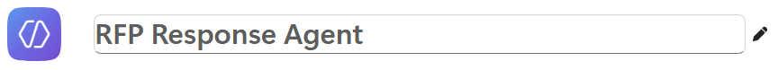

1. Take a moment to look at the **components panel** on the right (the agent configuration rail). This is where every
    component of the agent is attached: **Model**, **Channels**, **Skills**, **Tools**, **Knowledge**,
    **Connected agents**, and **Memory**. A new agent already has the **Work IQ** tool under **Tools**
    and **Search all websites** under **Knowledge**.

    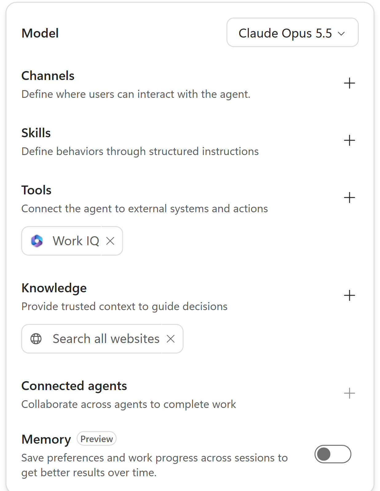

    > [!NOTE]
    > **Skills** sits above Tools and Knowledge. That ordering reflects how the orchestrator works: a Skill is the playbook that decides *when* and *how* the tools and knowledge below it get used.

#### Check the Work IQ tool

1. In the **Tools** section of the rail, select the **Work IQ** chip.

    > [!TIP]
    > If **Work IQ** is not listed, select **+** next to **Tools**, search for `Work IQ`, select the **MCP** tab to narrow the results, then select **Work IQ**.

1. The **Edit tool** dialog opens. Check that **Connection** shows a green check next to your account, and review the **Sources** the agent can use: **SharePoint**, **OneDrive**, **Outlook mail**, **Teams**, **Calendar**, and **People**. If the connection is not set, open the **Connection** list and sign in with the account you are using for this lab.

    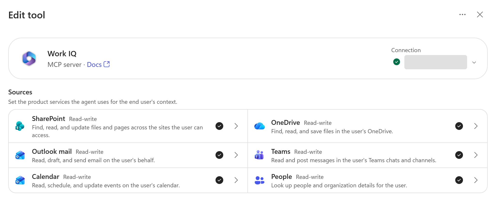

    > [!NOTE]
    > Work IQ covers Microsoft 365 operations - mail, calendar, files, chats and more. The connection is created under *your* identity, so the agent acts on the signed-in user's Microsoft 365 data.

1. Select **Done**. **Work IQ** stays under **Tools** in the rail.

    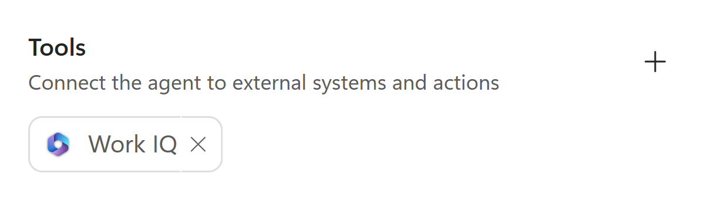

#### Give the agent its instructions

1. Select the **Instructions** box (it shows placeholder text until you type), then copy the entire block below into it. These are agent instructions, not a chat message.

   ```text
   You are the RFP Response Agent for our organization. You help our team write clear, accurate answers to customer RFPs (requests for proposal).

   When you are given an RFP question or document:
   - Find the material we already have: past RFP responses, product documentation, and company policies.
   - Draft the answer in our voice - direct, specific, and free of marketing filler.
   - Keep each answer self-contained so it can be pasted straight into the RFP form.
   - Never invent facts about our products, pricing, security posture, or certifications. If you cannot find a source, say so.

   Ask a clarifying question when the request is ambiguous. Keep answers concise unless the RFP asks for detail.
   ```

    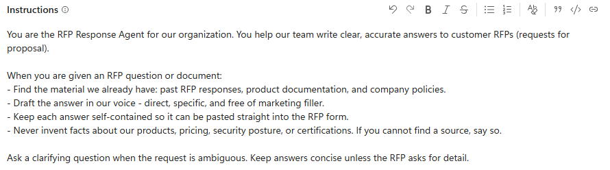

    > [!NOTE]
    > These instructions stay deliberately short. They describe *who the agent is* and the rules that always apply. The detailed "how to handle this kind of request" procedure goes into a **Skill** in the next section - which is exactly the split Skills exist to enable.

#### Add the RFP Response skill

1. Download the skill package:
    [rfp-response.zip](https://github.com/Dewain27/AgentDudeSamples/raw/refs/heads/main/samples/RFP%20Skill/packages/rfp-response.zip)

    The package contains a `SKILL.md` plus the reference material it draws on - an answer library,
    offering catalogs, past-performance and pricing references, and worked examples of RFP requests
    and responses.

    > [!NOTE]
    > The sample skill is written for a fictional company, **Aventra Software Group**. Its answers are grounded in that company's catalog, past performance, and pricing, so Aventra will appear in the agent's output even though the agent instructions say "our organization". In a real deployment you would swap the bundled references for your own.

1. In the components panel, on the **Skills** section, select **+** (**Add skill**).

1. Select **Upload a skill** to use the existing package. **Create from blank** is another option for authoring a Skill directly in the UI. The screenshot below shows the upload and blank-authoring options.

    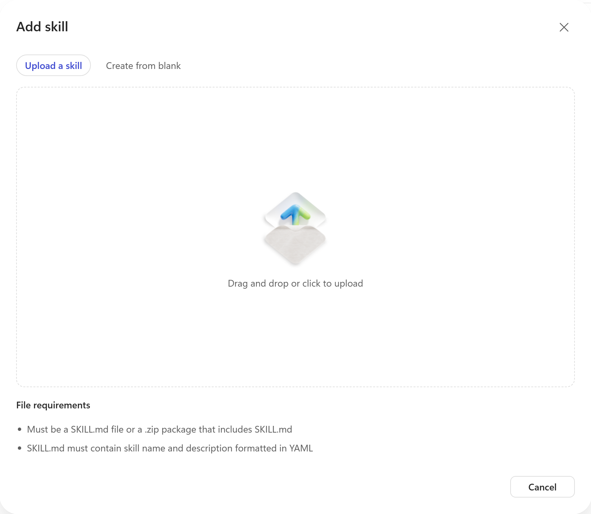

    > [!NOTE]
    > A skill file must be a `SKILL.md`, or a `.zip` package that contains one. The `SKILL.md` must carry a **name** and **description** in YAML frontmatter - that description is what the orchestrator matches a user's request against when deciding whether to load the skill.

1. Select the upload area and choose the `rfp-response.zip` you downloaded. Wait for
    **Saving skill...** to finish (about 10 seconds). The dialog closes on its own.

1. **rfp-response** now appears under **Skills** in the rail, above the
    **Work IQ** tool.

    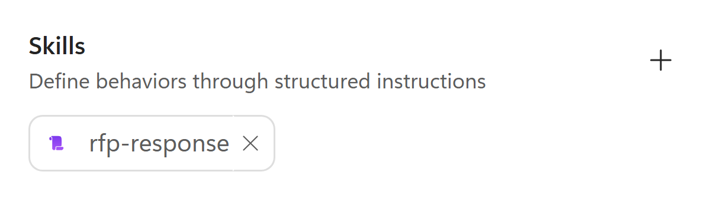

    > [!IMPORTANT]
    > Uploading the skill saves the agent. The URL changes from `/agents/new` to the agent's permanent ID, and the **Evaluate** and **Monitor** tabs become available. You can still select **Save** in the toolbar after later changes.

#### Inspect what you uploaded

1. In the **Skills** section of the rail, select the **rfp-response** chip to open the skill.

1. The viewer shows the whole package: **16 files** in a tree, with the size of the selected file
    at the top right. `SKILL.md` opens first - its **Name** and **Description** come from the YAML
    frontmatter, and **Instructions** is the body.

    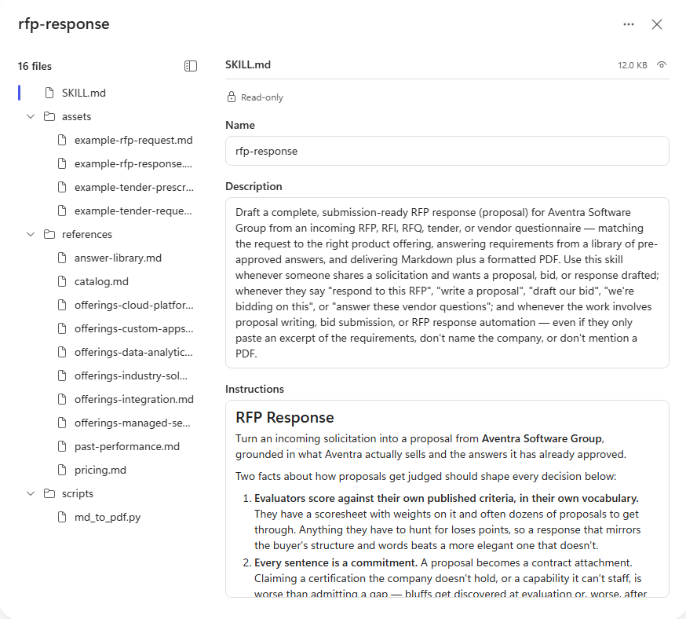

    > [!NOTE]
    > These fields are **Read-only**. An uploaded skill is changed by editing the package and re-uploading it, not in the portal. A skill authored with **Create from blank** is editable in place.

    > [!TIP]
    > Read the **Description** closely. It is deliberately packed with the phrasings a user might actually type - "respond to this RFP", "draft our bid", "answer these vendor questions". That text is what the orchestrator matches against, so a vague description is the most common reason a skill never loads.

1. In the tree, select **references/answer-library.md**. This is the pre-approved answer library
    the skill reuses instead of composing new prose - a topic-key table covering security, data
    privacy, accessibility, hosting, SSO, SLAs, and pricing.

    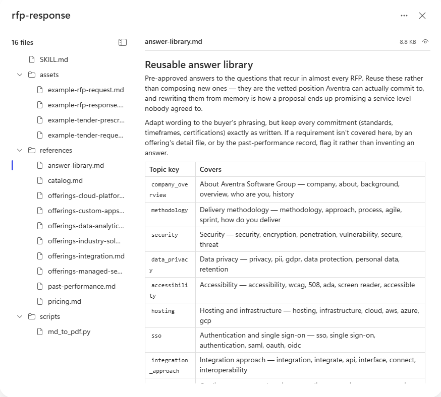

    > [!TIP]
    > This is what makes a Skill more than a long prompt. The instructions say *how to behave*; the bundled `references/` and `assets/` are the material it works from. Swap these files for your own catalog and answer library and the same skill drafts your proposals.

1. Close the viewer with the **X** at the top right to return to the **Build** tab. The **...**
    (**More options**) menu next to it has **Download**, to pull the package back out, and
    **Replace**, to upload an edited version.

#### Test the agent and watch the skill load

1. Select the **Preview** tab. The agent greets you, and the header shows the **credits** used,
    **New chat**, **History**, and **Debug mode** (on by default, which keeps the reasoning trace visible).

1. Download the sample solicitation:
    [01-westbrook-permitting-portal.md](https://github.com/Dewain27/AgentDudeSamples/raw/refs/heads/main/samples/RFP%20Skill/test-rfps/01-westbrook-permitting-portal.md)
    - a City of Westbrook RFP for an online permitting and licensing portal.

    > [!NOTE]
    > The sample solicitations carry fixed submission dates that have since passed, so the agent may open its response by flagging that the deadline is behind us. That is the skill being careful rather than a fault - read past it and judge the proposal itself.

1. In the **Preview** chat, select **+** (**Upload images and files**) at the left of the composer and attach the RFP. Copy the block below into the chat composer, then select **Send**:

   ```text
   We are bidding on this RFP. Draft our response.
   ```

    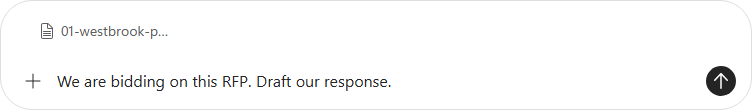

1. Watch the agent's turn. Before it writes anything, it notes that the rfp-response skill fits the
    request, and the trace shows **Using skill: rfp-response** (**Used skill: rfp-response** once
    loaded), followed by its reasoning about the offering, price, and gaps.

    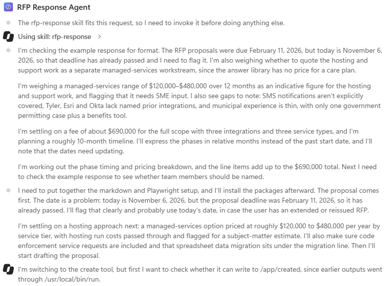

    > [!IMPORTANT]
    > **This is the whole point of the lab.** You never told the agent to use the skill. The orchestrator matched your request against the skill's **description**, decided it applied, and loaded it - then followed the skill's procedure: identify the matching offering, read `answer-library.md`, `past-performance.md` and `pricing.md`, and only then draft.

1. Select **Using skill: rfp-response** to expand it. The trace shows the skill **description**
    the orchestrator matched against, and the **Input** it passed: `skill: rfp-response`.

    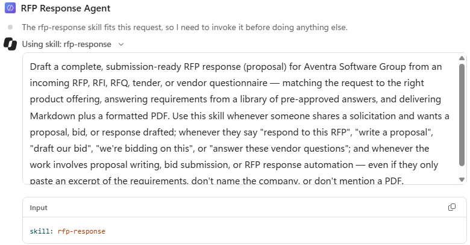

    > [!TIP]
    > This is the diagnostic to reach for when a skill does *not* fire. If the description does not contain the language a user would actually use, the orchestrator never matches it - and nothing in the transcript tells you the skill exists.

1. Let the run finish. The agent drafts the proposal, then uses the tools available to it to
    render it as a PDF.

    > [!NOTE]
    > The full draft-plus-PDF run takes several minutes (about 4 minutes in our test) - it is writing a nine-page proposal and then rendering it. The reasoning trace updates as it works and is worth reading; the agent has not hung.

1. Review the summary. It reports the matched offering, the fee and duration, how the proposal is
    structured against the buyer's scoring criteria, and a numbered list of items that need your
    input before submission. The exact wording and figures vary from run to run.

    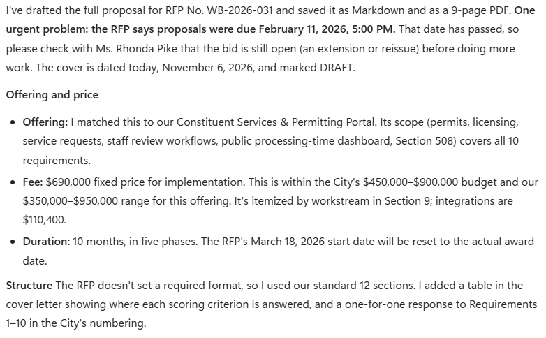

    > [!TIP]
    > Note what it flags instead of inventing: no named past experience with the City's systems (such as Esri ArcGIS, Tyler, or Okta) that its past-performance file does not show, and a hosting and support price marked **NEEDS SME INPUT** rather than a made-up figure. That restraint comes from the skill's guardrails and answer library - the vetted position the company can actually commit to.

1. Both artifacts are attached to the message as file chips: a Markdown proposal and a PDF
    proposal (for example `Aventra_Proposal_WB-2026-031.md` and `Aventra_Proposal_WB-2026-031.pdf`;
    the file names vary). Select a chip to download it.

    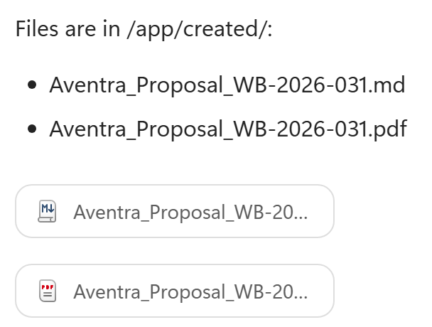

#### Use the sandbox to chart the evaluation weights

1. In the **same Preview conversation**, reattach the sample RFP if it is no longer available. Copy the block below into **Preview chat**, then select **Send**:

   ```text
   Use your sandbox to analyze section 4, Evaluation criteria, of the attached City of Westbrook RFP. Read the source file with code and extract the criterion names and numeric weights; do not use scores or coverage claims from our proposal.

   Execute code to create a horizontal bar chart using matplotlib if it is installed, or another charting library already available in your sandbox. Keep the criteria in source order, label every bar with its weight, and label the axis "Evaluation weight (points)". Title the chart "City of Westbrook RFP - Evaluation criteria".

   Check that there are five criteria and that their weights sum to 100. If the source differs, report the discrepancy rather than changing its values. Save the chart as westbrook-evaluation-weights.png, verify the image opens, and attach the actual PNG. Also show the extracted data table and name the charting library you used.

   Do not regenerate the proposal, install packages, call external services, or invent data. If sandbox execution, the source file, or a usable charting library is unavailable, report that explicitly instead of claiming to have created a chart.
   ```

1. Watch the run. It usually finishes in under a minute. Debug mode shows the agent's reasoning as
    bullets, but it may not show the individual sandbox tool calls. Look for concrete evidence that
    code ran: the attached PNG, the extracted table, and the library and version it names. A claim
    that code ran is not evidence on its own; if you see no such evidence, record execution as
    **unverified**.

1. The chart appears in the response as an image. Select it to open the preview, then select
    **Download** to save `westbrook-evaluation-weights.png`. Compare the chart and extracted table
    with **section 4 of the RFP**: Technical approach **30**, Relevant municipal experience **25**,
    Cost **20**, Project team **15**, and Timeline **10**. These are evaluation weights, not scores
    awarded to Aventra. Check the labels, all five bars, and the total of **100**.

    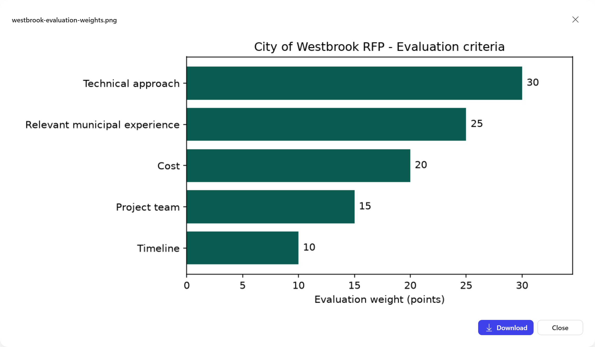

    > [!NOTE]
    > This step requires actual sandbox execution and a downloadable image, not a text-only chart or a suggested Python script. If it fails, capture the exact error and check sandbox access with your facilitator or admin. You can use the [Extra Credit Harness Explorer exercise](#-extra-credit-explore-the-agent-harness) to investigate the observed runtime and libraries; it is not required to run this step.

### 🏅 Congratulations! You've completed Use Case #1!

You have completed the core lab. Continue to the [conclusions and recommendations](#-conclusions-and-recommendations). If you have extra time, try [creating your own Skill](#-extra-credit-create-and-test-a-skill-with-copilot-studio).

---

## 🔍 Conclusions and recommendations

**Skill golden rules:**

- **Write the description for the user's words, not yours.** List the phrasings someone would actually type. That text is the matching surface, and everything else in the Skill is dead weight if it never fires
- **Keep agent instructions short and put the procedure in the Skill.** Base instructions describe who the agent is; the Skill describes how one kind of work gets done
- **Ground answers in files you control.** An answer library the business has approved is what lets a Skill decline to claim a certification instead of quietly implying it
- **Check generated artifacts against their sources.** Open the proposal and chart, verify the facts and evaluation weights, and do not treat a claimed file or tool run as proof of execution
- **Review before sharing.** A human should review the proposal's facts, certification gaps, and commercial numbers before it reaches a customer
- **Generate, test, and refine.** Check behavior against examples and bring concrete failures back to the authoring tool. A generated package or a confident self-review is not evidence that it works in the target agent

---

## 🧪 Extra Credit: Create and test a Skill with Copilot Studio

**Optional extra credit. Timebox: 25 minutes, outside the core lab.**

**Your goal:** use an agent's **Preview** chat to turn a project-intake process into a reusable Skill that asks for missing details and summarizes them for confirmation.

Try this after completing Use Case #1 if you have extra time. You need a reasoning-capable model and sandbox ZIP generation in Preview. No connectors or external data are needed.

Follow this sequence:

1. **Create** a Skill ZIP in a blank agent's **Preview** chat.
1. **Upload** that ZIP under the agent's **Build > Skills**.
1. **Configure** the agent by pasting the supplied base instructions into **Build > Instructions**.
1. **Test** the agent in two fresh **Preview** conversations.

Generating a ZIP does **not** install the Skill. The authoring prompt creates the package; the agent instructions define the agent's role; the test prompts check the uploaded Skill. Keep these three kinds of text separate. Publishing is not required.

### Get the source materials

1. Download and extract the [Skill-generation materials](assets/skill-generation/skill-generation-materials-v3.zip).

    > [!WARNING]
    > Do not extract the ZIP inside a **OneDrive for Business** folder. Your organization may automatically encrypt files saved there, and the agent will then be unable to read them. Extract the files to a location outside OneDrive.

1. Use only `project-intake-process-v2.docx`. Attach this individual document in the agent's **Preview** chat, not the materials ZIP. Ignore the other documents in the archive.

These are fictional source documents, not a ready-to-upload Skill. Use the supplied examples rather than real customer data.

### Project-intake Skill package checklist

**Reference checklist:** use this after the **Preview** chat steps below generate a Skill ZIP. You do not need to upload anything yet.

1. **Review the procedure.** Compare the generated Skill with the project-intake process. It must collect the four details, reuse supplied answers, accept unknowns, and request confirmation without implying project approval.

1. **Check the package.** Download the generated **Skill ZIP**, not the materials ZIP. It must contain `SKILL.md` at the root, YAML `name` and `description` fields, and all files referenced by the instructions. A prose response is not a completed package.

1. **Handle errors before continuing.** If file generation fails, capture the error and ask your facilitator or admin. If uploading fails, return the exact validation error and package structure to the authoring chat for repair.

### Guided project intake

> [!NOTE]
> Skills do not directly replace topics, but they can be used to **guide conversations in a similar way**. A Skill guides the model's behavior; it does not guarantee exact question ordering, field validation, or branching. Use deterministic logic when those are requirements.

You will create a Skill that collects four details: **business goal, intended users, desired outcome, and target date**. It should ask one missing question at a time, accept unknowns, and summarize the answers for confirmation.

Use a new agent for this extra-credit exercise, not your RFP agent. You will first use its Preview chat to **create the package**, then upload the package and start a fresh chat to **test intake**.

#### Create the Skill in the Preview chat

1. In [Copilot Studio](https://copilotstudio.microsoft.com/), create a new agent the same way as in Use Case #1 (**Home** > **Agent**). Name it **Project Process Assistant**. Do not reuse your RFP agent.

1. On **Build**, leave **Instructions empty** (only the placeholder text shows). If the new agent has generated instructions, clear them now. Do not add the intake instructions, a Skill, or connectors yet: the first conversation is for **creating a package**, not running intake. The **Work IQ** tool and **Search all websites** knowledge that come with a new agent can stay.

1. In the components panel, check **Model** and select a **reasoning-capable model**, such as **Claude Opus 5.5 if it is offered in your environment**. Model names and availability vary; ask your facilitator or admin which reasoning model to use if it is not listed.

1. Select the agent's **Preview** tab. In a **new chat**, select **+** (**Upload images and files**) and attach only `project-intake-process-v2.docx` from the extracted materials. Do not attach the ZIP file.

1. Copy the entire block below into the **Preview** chat, alongside the attachment, then select **Send**. **This is a chat prompt, not agent instructions.** Keep **Build > Instructions** empty while generating the package. The harness was formerly named **GitHub Copilot harness**, and the prompt keeps that name exactly as used in our successful test run; it refers to the current **Microsoft Copilot harness**.

```text
Create a portable Agent Skill named project-intake-guide for a Copilot Studio agent powered by the GitHub Copilot harness.

Use the attached project-intake-process-v2.docx as the procedure. Activate for requests such as "I want to request a project" or "Help me scope a new project", not for general questions about project management.

Collect the business goal, intended users, desired outcome, and target date. Reuse details already supplied. Ask only one missing question at a time. Accept "not yet known" and record it without asking again. Once all four fields have either a value or an explicit unknown, show a summary and ask for confirmation. Apply corrections without restarting. Confirmation means the summary is accurate, not that the project is approved.

Use your sandbox to create a real downloadable ZIP with SKILL.md at its root. SKILL.md must have valid YAML front matter with name and description, followed by Markdown instructions. Include a faithful Markdown version of the Word process under references/ and refer to it from the instructions. The finished intake Skill must not require tools, scripts, external services, or automatic actions. Keep the agent's base instructions separate from the Skill. Create the package now; do not start the intake interview or add agent instructions.

Before packaging, check the procedure against an incomplete opening request and a request that supplies all four fields. Report limitations; this drafting check does not prove the uploaded Skill works. Provide the actual ZIP file, not just a description or a suggested script. If file generation fails, report the error rather than inventing a download.
```

#### Upload the Skill, then add agent instructions

1. Check the response in **Preview**. The first prompt may already have created a downloadable **Skill ZIP**. If it has, skip the follow-up prompt below and continue to the download step.

    **Only if no downloadable Skill ZIP was created**, answer any clarifying questions, then send this follow-up in the **same Preview chat**. Use it if the agent returned only a draft or started the intake interview instead of creating the package:

   ```text
   Create the reusable Skill package from the process; do not run intake yet. Provide the downloadable ZIP.
   ```

    If it cannot generate a file, capture the error and ask your facilitator or admin; a text-only response is not a completed package.

1. Select the ZIP file chip in the response (for example `project-intake-guide.zip`) to download the generated **Skill ZIP**. Unzip it and review its contents using the [project-intake package checklist](#project-intake-skill-package-checklist).

1. In the **same agent**, go to **Build > Skills > + > Upload a skill**. Upload the generated ZIP and wait for it to save. Add only the intake Skill.

1. After the upload succeeds, paste the entire block below into **Build > Instructions** and wait for it to save.

```text
You help users capture and confirm project intake details. Use relevant Skills when requests match, and follow the loaded Skill's procedure for the conversation.

Never invent missing details or imply that a project has been approved, funded, or scheduled. Do not send messages or make changes to external systems. Answer general project-management questions without starting intake unless the user requests it.
```

#### Test the intake Skill in the Preview chat

In the **same agent**, open **Preview** and start a **new conversation**. No attachments are needed. Use the prompts below without naming the Skill, and check the reasoning trace to confirm that the Skill loads.

Keep replies for one test in the same conversation. Start a new conversation for Test 2 so the first test's answers cannot carry over.

##### Test 1: Complete missing intake details

Copy this block into the **Preview** chat, then select **Send**:

```text
I want to request a new project: an agent to help our support team.
```

Wait for the agent to ask for a missing detail. Copy **only the matching reply** below into the **same Preview chat** and select **Send**. Do not send all three replies together.

**If asked about the business goal:**

```text
Reduce repeat onboarding questions for our support team.
```

**If asked about the desired outcome:**

```text
A searchable FAQ assistant covering common onboarding questions.
```

**If asked about the target date:**

```text
Not yet known.
```

When the agent shows the summary, copy this confirmation into the **same Preview chat** and select **Send**:

```text
Yes, that summary is accurate.
```

**Check:** it reuses the support-team audience, asks one missing question at a time, and reaches a four-field summary without guessing a date. Confirmation must not mean project approval.

##### Test 2: Correct a complete intake summary

Start a **new Preview conversation**. Copy this block into the **Preview** chat, then select **Send**:

```text
Help me scope a new project. Goal: reduce repeat support questions. Intended users: our support team. Desired outcome: a searchable FAQ assistant. Target date: not yet known.
```

It should summarize without repeating intake questions. Copy this correction into the **same Preview chat** and select **Send**:

```text
Change the intended users to new support hires.
```

After it shows the revised summary, copy this confirmation into the **same Preview chat** and select **Send**:

```text
Yes, that summary is accurate.
```

**Check:** only the audience changes; the goal, FAQ outcome, and unknown date remain. It should request confirmation without restarting or claiming approval.

After both tests, use the refinement steps below if needed. If a test failed, keep its prompt and output for troubleshooting.

### Refine the intake Skill in Copilot Studio

**If both tests pass, you are done.** Record the result and continue to the conclusions. If a test fails, revise the Skill and test it again.

There is **no automatic synchronization** between the authoring chat and the uploaded Skill. Every revision needs a new ZIP and a manual replacement in Copilot Studio. Never share credentials or real customer data. A [Harness Explorer report](#-extra-credit-explore-the-agent-harness) can provide extra context, but is optional.

1. Create a separate blank agent with **Instructions empty** and a reasoning model. In its **Preview**, attach the intake process and latest Skill ZIP. Keep **Project Process Assistant** unchanged as your test agent.

1. Fill in the placeholders below with what actually happened, then send the completed block in the blank agent's **Preview**, not the intake test conversation:

   ```text
   Revise the Skill, not the test input or expected result.
   Test prompt: [paste]
   Expected behavior: [paste]
   Actual output or exact error: [paste]
   Skill loaded in the reasoning trace: [yes/no/not visible]
   Fix the procedure or activation description responsible for the mismatch.
   Keep the existing guardrails and provide a new downloadable ZIP.
   ```

1. Download the revised package. In **Project Process Assistant > Build > Skills**, open the uploaded Skill's menu and select **Replace**, then upload the new ZIP. See [Replace an uploaded skill](https://learn.microsoft.com/microsoft-copilot-studio/agents-experience/skills-add-existing#replace-an-uploaded-skill). Start new Preview conversations and rerun both intake tests to check for regressions.

1. If both tests pass, record the result; do not invent a failure to force another loop. Extra revisions and an out-of-scope prompt to check that the Skill does not activate unnecessarily are optional follow-on work.

> [!TIP]
> **Keep the 25-minute extra-credit timebox:** aim for one package, one upload, and two short tests. If generation or a repair runs longer, record the next change and continue later. An authoring self-check is not a substitute for testing the uploaded Skill.

### 🏅 Congratulations! You've completed the Skill-creation extra credit!

You created a project-intake Skill in an agent's **Preview** chat, uploaded it, and checked it in two conversations. Record the results; no further exercises are required.

---

## 🔎 Extra Credit: Explore the agent harness

**Extra Credit:** install the [Agent Harness Explorer Skill from the CAT Agent Skills gallery](https://microsoft.github.io/cat-agent-skills/skills/agent-harness-explorer/) to discover what an agent's runtime actually exposes: Python libraries, tools, Skills, and MCP servers. This is not a prerequisite for any use case.

1. Open the gallery page and review its instructions, source, and safety boundaries. Under **Add this skill**, read the **Add only what you trust** notice. Acknowledge it only if you trust the package, then select **Download bundle (.zip)**. Keep the downloaded ZIP if you will need it offline.

1. In Copilot Studio, create a **separate agent** the same way as in Use Case #1. Name it **Harness Explorer**. Keep it separate from your RFP and project-process agents so diagnostic requests do not interfere with their tests. **Copy the block below into Build > Instructions**, not into chat:

   ```text
   Help me understand the capabilities actually available in this agent's harness. Use the Harness Explorer Skill for runtime inspection. Distinguish observed capabilities from assumptions and unavailable observations. Never expose secrets or full environment-variable values.
   ```

1. On **Build > Skills > + > Upload a skill**, upload the downloaded gallery ZIP, preserving its bundled instructions, references, and scripts. Confirm that **agent-harness-explorer** appears under Skills. Do not add connectors just for this exercise; you do not need to publish the agent. A new agent comes with **Work IQ** under **Tools**: remove it for a minimal baseline, or keep it and expect its `work_iq` tools in the report.

1. Open **Preview**. Copy the block below into **Preview chat**, then select **Send**:

   ```text
   Inspect the harness. Use the Skill's passive probes only. Report the observed Python runtime and installed libraries, and the tools, Skills, and MCP servers actually visible to this agent. Clearly distinguish observed, not visible, and unverified capabilities. Do not install packages, make network requests, run active-safe probes, or read unrelated files. Generate a downloadable HTML harness report.
   ```

1. Check that the trace shows **Used skill: agent-harness-explorer** and that the response attaches `harness-report.html` (usually in under a minute). Select the report chip to download it, open it, and check that it describes observations from this run, not just a generic list of platform features. A Python script cannot independently see every agent tool or MCP server: **not visible does not mean unsupported**. If inspection or report generation fails, capture the error; do not treat an unexecuted probe as a successful check.

1. Copy this follow-up into the **same Preview chat**, then select **Send**:

   ```text
   Based on this snapshot, which installed libraries could create a chart like our RFP evaluation-weight chart, and which could help read documents or create PDFs? For each recommendation, give the observed package name and version, its purpose, and any unverified capability. Do not install or assume missing packages.
   ```

1. Optionally copy this block into the **same Preview chat** and select **Send**:

   ```text
   Export the latest snapshot.
   ```

    Download the JSON and Markdown exports. You can provide the report to your chosen authoring chat as supporting context when refining a Skill. Treat it as a snapshot of **this agent's observed runtime**, not a guarantee about another agent, tenant, future session, or tool permissions. Do not share reports containing sensitive information.

---

## 🧪 Extra Credit: Generate with AI

Copilot Studio also offers in-product Skill generation. **Generate with AI might not be available yet in your environment.** If the **Add skill** dialog shows only **Upload a skill** and **Create from blank**, skip this extra credit or try the [Preview-based Skill-creation exercise](#-extra-credit-create-and-test-a-skill-with-copilot-studio). This optional **Skills** menu is separate from the free-form **Preview** chat that generates a ZIP for you to upload.

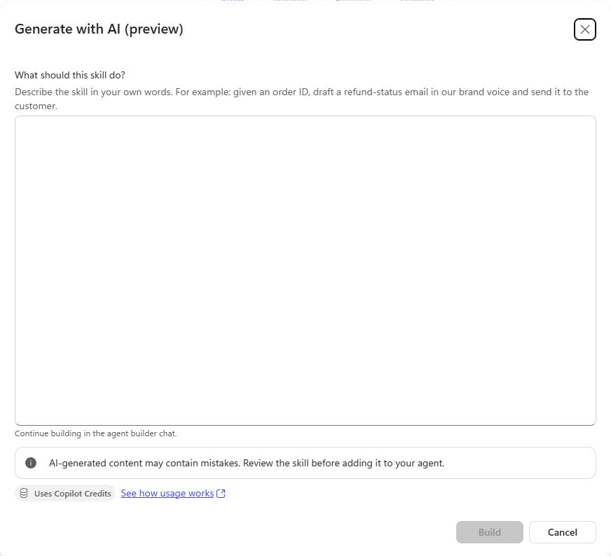

> [!NOTE]
> **The preview shown here does not accept file attachments.** Paste text from your source documents into its description box rather than trying to upload them. This limitation concerns Skill generation, not the agent's Preview chat where you test with documents.

To try it when available:

1. On the **Build** tab of a separate test agent, select **+** next to **Skills**, then in **Add skill** select **Generate with AI** (it may be labelled **Generate with AI (preview)**).
1. Use the project-intake authoring prompt from the [Skill-creation extra credit](#-extra-credit-create-and-test-a-skill-with-copilot-studio), then copy the text from `project-intake-process-v2.docx` into the same box. Remove the instructions about attachments and downloadable ZIP packaging.
1. Select **Build** and answer the questions Copilot asks. When the Skill is ready, select **View** to review it, then select **Add to agent**.
1. Run the same two tests in the agent's Preview chat. Generating a Skill does not validate its behavior.

See [Create a skill for an agent, including Generate with AI](https://learn.microsoft.com/microsoft-copilot-studio/agents-experience/skills-create).
