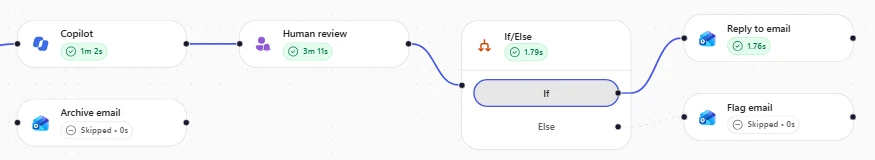
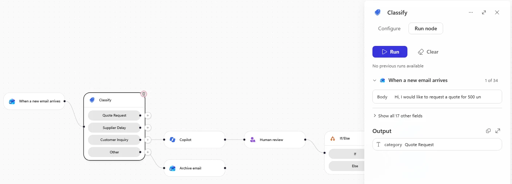
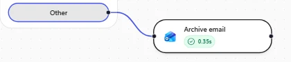
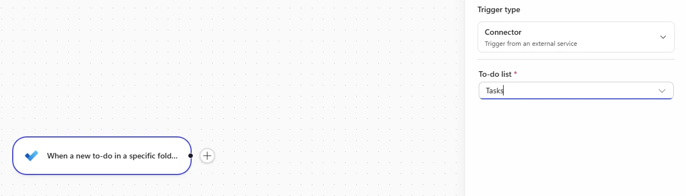
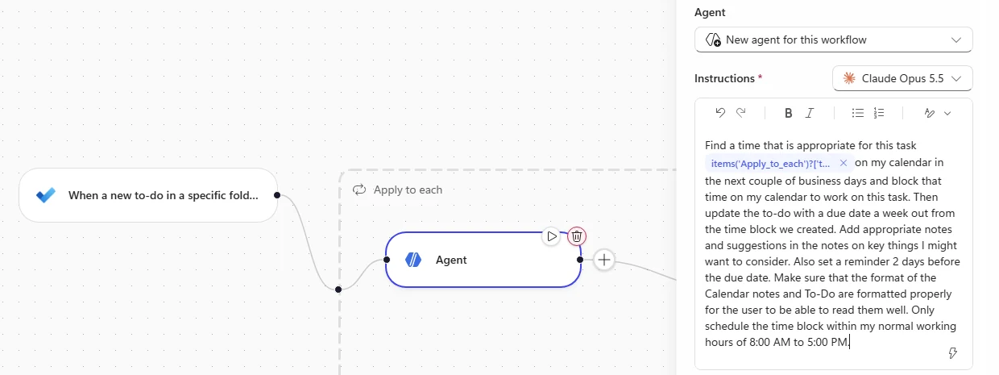
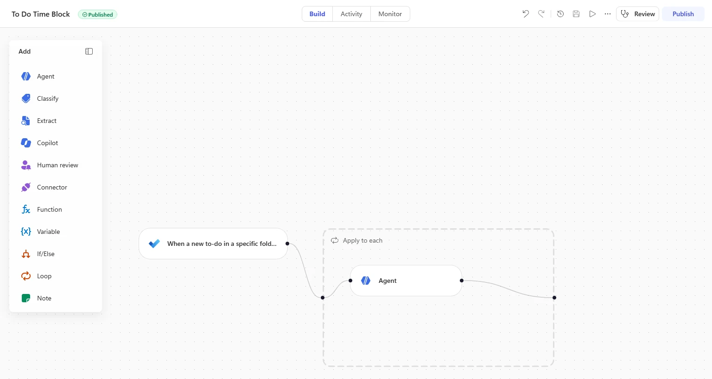

# Workflows

One incoming email. A verified, human-approved action. Leave with your own disabled Order Management copy, evidence of an archived test email, and a grounded reply you reviewed before delivery.



*A real approved Customer Inquiry run. The diagram proves the route executed; separately check the delivered email.*

## 🧭 Lab Details

| Level | Persona | Duration | Finish line |
| --- | --- | --- | --- |
| 300 | Maker / Developer | 30 minutes core | An isolated Order Management copy, two verified mailbox outcomes, and durable disabled state |

**Pacing:** Isolate (6) → Route (6) → Review (13) → Stop (5) = **30 minutes**. Optional extensions follow: Time-block (15), Inventory (15), Specialist (10). These are working budgets, not timing guarantees; trigger pickup, generation, and approvals vary. Inspect the existing run rather than sending duplicates.

**Scenario:** Your order desk receives unrelated promotions, customer questions, supplier delays, and quote requests. A workflow classifies the message; a grounded draft and human decision protect the customer-facing reply.

<details class="lab-validation" markdown="1">
<summary>What was tested</summary>

**Verified boundary:** the 6 November 2026 training run tested the original quote sample in **Run node**, archived the exact Other sample, and completed the exact Customer Inquiry sample through **Yes → Submit** to a received holding reply. The original starter was untouched and the copy was disabled after reload. The rejection branch, inventory MCP, and specialist quote delivery were not exercised. Screenshots are genuine, privacy-reviewed light/dark captures of those three tested states, not proof of untested branches.

</details>

This is the **Microsoft Copilot harness** workflow experience. **Standard harness** remains a separate experience; it has not been renamed. Only the former GitHub Copilot harness name changed. Supplied working instructions remain unchanged. The [classic Workflows lab](../mcs-workflows-latest/) remains available.

## 🧭 Table of Contents

- [Prerequisites](#-prerequisites)
- [Mission 1: Isolate](#-mission-1-isolate)
- [Mission 2: Route](#-mission-2-route)
- [Mission 3: Review](#-mission-3-review)
- [Mission 4: Stop](#-mission-4-stop)
- [Optional: Time-block](#-optional-time-block)
- [Optional: Inventory](#-optional-inventory)
- [Optional: Specialist](#-optional-specialist)
- [Troubleshooting](#-troubleshooting)
- [Finish and Clean Up](#-finish-and-clean-up)
- [Sources](#-sources)

## 🧭 Prerequisites

<p class="lab-setup-note">At a proctor-led event with a provided, pre-provisioned account? <strong>You're ready to start.</strong></p>

<details class="lab-setup" markdown="1">
<summary>Using your own tenant? View setup requirements</summary>

Use a development/training environment with Copilot Studio **Workflows**, available Copilot Credits, Outlook, and Microsoft Copilot access. Arrange the Order Management starter and connections before starting the timer. Mission 1 links the solution for self-paced import only if needed. Optional extensions require their additional assets; none is a prerequisite for the core.

</details>

Ask the proctor if an asset is missing. Do not import replacements or edit another attendee's workflow.

- Sign in to [Copilot Studio](https://copilotstudio.microsoft.com/) with the provided training account and select the assigned environment.
- Open [Outlook](https://outlook.office.com/) with the same account. Keep Studio and this lab side by side.
- Use synthetic self-addressed messages only. Check ownership, sender restriction, reviewer, To, CC, and BCC before publishing. Publication can start a trigger and consume Copilot Credits.

## 🧭 Mission 1: Isolate

**6 minutes · Copilot Studio / Workflows**

**Outcome:** an owned draft with healthy connections and a self-only sender filter; the starter is unchanged.

1. Select **Workflows → Order Management Workflow → Build**. Review and dismiss any first-visit notice or environment tour. Event attendees ask the proctor if the starter is missing. For self-paced setup only, import [LAB: Order Management Workflows](../mcs-workflows/assets/solutions/LABOrderManagementWorkflows_1_0_0_8.zip) and sign in to requested connections. It includes the starter and Price Quote Agent, not optional SharePoint pricing data.
2. Select the **designer header's More options → Create a copy**. Keep the default **Title**, **Order Management Workflow - Copy**, and select **Create**; if offered, **Open workflow** opens a **new browser tab**; continue only in that copy. The list row's **More actions** may offer only Delete; leave the original unchanged.
3. Open **When a new email arrives**, **Copilot**, and **Human review**, waiting for each lab-account connection to resolve. Reuse healthy connections. Only if Human review lacks one, select **Create new connection**, name it (for example **Human review**), retain **Authentication Type: Default**, and **Create**. It is marked **Premium**; sign in with the training account.
4. In the trigger, retain **Subject filter → string**. Hover to inspect `string('Order Management')`; do not replace it or assume an expression-mode switch. Select **Add advanced parameter → From**, enter your training email in the people picker, and resolve it. Every test must come from you and contain **Order Management** in the subject. Do not publish yet.

**Reveal — Isolation comes before automation:** A copy protects the starter; sender and recipient checks protect people. The subject selects the scenario, not the sender. Connections determine whose mailbox/data the nodes access. **Owned copy → own-account connections → subject and sender restriction.**

**Knowledge check:** Which setup is safe before an end-to-end test?
- **Correct:** An owned copy, retained subject token, resolved own-account From restriction, and checked recipients. These checks precede publication.
- **Incorrect:** The original starter with only the subject filter. A subject does not isolate senders; the starter must remain unchanged.

## 🧭 Mission 2: Route

**6 minutes · Classify / Outlook / Activity**

**Outcome:** Quote Request node output, plus a separate successful Other run and actual archived message.

1. Open **Classify**. Keep the current/default available model; replace one only if missing or flagged retired. Inspect **Quote Request**, **Supplier Delay**, and **Customer Inquiry**. **Other** is the automatic Default category, not a fourth configured category. Select **Run node**, paste into trigger **Body**, and select **Run**.

**Classify · Run node · Body**

```text
Hi, I would like to request a quote for 500 units of Product A.
```

Expect **Quote Request**. This node-only test does not execute the downstream agent or send a quote.

<picture><source media="(prefers-color-scheme: dark)" srcset="images/classify-quote-result-dark.webp"></picture>

*Genuine light/dark node-test captures. No quote specialist or downstream delivery ran.*

2. Before publication, inspect **Human review**: reviewer is incoming **From**, delivery is **Outlook**, and the proposed reply is visible. Inspect **Reply to email**: trigger **Message Id**, **To = From**, empty **CC/BCC**. With the sender restriction, reviewer and recipient must resolve only to you. Leave untested branches alone. **Save** (or **Ctrl+S**) → **Publish** automatically enables the copy; confirm **Enabled** on Workflows.
3. In Outlook, review **Your privacy matters → Continue** if shown. Compose to your training account, using **Check names** if needed. Paste the subject, then the body before sending.

**Outlook · Other test · Subject**

```text
Order Management - Congratulations! Your order desk has been selected
```

**Outlook · Other test · Body**

```text
Dear Order Manager,

Congratulations! Your order management team has been selected in our monthly
business draw and is entitled to claim an exclusive cash reward.

To release your reward, please reply with your full name and contact details,
and a small processing fee may apply.

Act soon, as unclaimed rewards expire.

Regards,
Promotions Team
MegaDraw Rewards
```

4. Recheck the resolved self-recipient and **Send**. This is deliberately irrelevant synthetic spam; do not follow its requests or send it elsewhere.
5. Refresh **Activity** and inspect the new run: expect **Other → Archive email**, **Succeeded**. Separately find the exact message in Outlook **Archive**. Processing varies; check publication, Enabled, sender restriction, subject, and existing runs before resending. If stopping here, disable/reload your copy; otherwise continue.

<picture><source media="(prefers-color-scheme: dark)" srcset="images/other-path-succeeded-dark.webp"></picture>

*Real run evidence, not a mailbox screenshot. The original run also had a separately verified archived email.*

**Reveal — Classification is not delivery:** Node output proves a category; an end-to-end test proves an action. **Body → category; self-email → trigger → Other → Archive → mailbox verification.**

**Knowledge check:** Does Quote Request output prove the specialist sent mail?
- **Correct:** No; Run node tested classification only. Downstream delivery needs a separate verified test.
- **Incorrect:** Yes; a category test executes every branch action. No specialist or quote dispatch ran here.

## 🧭 Mission 3: Review

**13 minutes · Copilot / Human review / Outlook**

**Outcome:** a reviewed answer or holding reply, a successful approved run, and its received email.

1. In your copy, open **Classify → Customer Inquiry → Copilot**. Confirm **Customer question** uses trigger **Body**. Read the supplied prompt in place: search the connection owner's earlier email threads, answer when evidence exists, otherwise write a holding reply without invented facts, addressed **Dear Customer,** and signed **Contoso Electronics Order Management**. The full preconfigured prompt was not supplied verbatim in the evidence; do not replace it with this summary. Copilot retrieves/drafts read-only; the reply node dispatches.
2. In **Human review**, confirm the message contains the draft, delivery is **Outlook**, reviewer is incoming **From**, and the single **Yes/No** input is **Approve**, question **Send proposed reply?**. Confirm **If/Else → Approve Equals Yes**. Check **Reply to email**: trigger **Message Id**, **To = From**, empty **CC/BCC**. Yes replies; Else flags. This exercise tests Yes only. Save/publish changes after checking self-only scope. If a previously disabled copy is **Draft**, resume deliberately through **Build → Publish**, not the list switch alone.
3. Compose to your resolved training account with this subject and body. The fictional signature is not authorization to contact a real customer.

**Outlook · Customer Inquiry · Subject**

```text
Order Management - Question about iPad Air warranty and MDM
```

**Outlook · Customer Inquiry · Body**

```text
Hi team,

Quick question before we expand our last order. What is the standard warranty
period on the iPad Air (M2), and can the devices be enrolled in our mobile device
management (MDM)? I think we asked something similar a few months back but I can't
find the reply.

Thanks,
Jordan Kim
IT, Alpine Ski House
```

4. Recheck the recipient and **Send**. Refresh **Activity**, select the new **Customer Inquiry** run, and distinguish the waits: trigger pickup, **Copilot** drafting, then **Human review** waiting for your decision.
5. In Outlook, open **Action Needed: Review Customer Enquiry Reply**. Read the draft. A holding reply is valid if the mailbox lacks warranty/MDM evidence; do not approve invented facts. The verified run produced a grounded holding reply, not a factual warranty promise. If safe, choose **Yes**, then **Submit**; confirm **Your response has been successfully submitted**. The tested card worked without actioning a possible **Trust sender** prompt. If unsafe, do not approve just to finish; stop and ask the proctor. No/rejection is not a validated fallback here.
6. Allow resumption and verify the actual received reply. The tested email used **Your inquiry - Contoso Electronics** and **Dear Customer,**; assess grounding and delivery, not exact generated wording or elapsed time. Confirm **Succeeded** and **Copilot → Human review → If → Reply to email** in Activity. **Flag email** and **Archive email** are expected skipped nodes on this path.

<picture><source media="(prefers-color-scheme: dark)" srcset="images/inquiry-path-succeeded-dark.webp"></picture>

*Real light/dark run captures. The parent run separately verified a received holding reply; no No/rejection run was performed.*

If approval is missing, inspect whether Copilot is drafting or Human review is waiting, then check reviewer and Connection. Repair only an unresolved/incorrect connection and republish. Check the original run before resending to avoid duplicate approvals.

**Reveal — Grounding and approval solve different problems:** Evidence constrains the draft; a person authorizes the send. **Question → grounded draft → Human review → Yes + Submit → reply → received message and successful run.**

**Knowledge check:** What is acceptable when the mailbox lacks warranty evidence?
- **Correct:** A holding reply without invented warranty/MDM facts. Grounding matters more than specificity.
- **Incorrect:** An invented warranty period to make the test complete. Never approve unsupported facts.

## 🧭 Mission 4: Stop

**5 minutes · Workflows / Activity**

**Outcome:** your copy stays disabled after reload and has no unattended running/waiting test.

1. On **Workflows**, turn off **Enabled** for your copy, reload, and verify it stays off. Do not change the original. The verified copy returned to **Draft**, with an unchecked disabled switch and **This workflow hasn't been published and can't be enabled from this list.** Leave it disabled. Resume an optional test only intentionally through **Build → Publish** after rechecking restrictions.
2. Inspect **Activity** for **Running/Waiting** tests. Disabling prevents new starts; it does not prove existing runs stopped. Finish safe approvals or cancel unfinished tests; ask the proctor if one cannot be stopped.
3. Remove only your synthetic emails, approvals, replies, and drafts when no longer needed. Keep shared connections, agents, MCP servers, knowledge, and starters. Record **Credit usage (last 30 days)** if available as a rolling total, not measured per-run cost.

**Reveal — Cleanup is observable:** **Disable own trigger → reload/still off → Activity/no unattended tests.** A completed run does not stop future pickup.

**Knowledge check:** Does disabling prove a waiting approval stopped?
- **Correct:** No; inspect Activity and finish or cancel outstanding tests.
- **Incorrect:** Yes; the switch proves earlier runs are gone. Trigger state and existing runs are separate.

## 🧭 Optional: Time-block

**15 additional minutes · Microsoft To Do / Inline Agent / Outlook Calendar**

**Outcome:** one verified personal calendar block and enriched task, with the workflow disabled afterwards.

1. In [Microsoft To Do](https://to-do.office.com/), sign in with the same training account. The workflow watches your default **Tasks** list; no new list is needed.
2. In Copilot Studio, select **Workflows → New workflow**; it opens as **Untitled workflow** in **Draft**. Rename it **To Do Time Block**: select the name in the designer header (*Click to rename*), type it, and press **Enter**.
3. In the **Start** node, switch **Trigger type** from **Manual** to **Connector**, select **Select trigger...**, search `to-do`, and under **Microsoft To-Do (Business)** select **When a new to-do in a specific folder is created**. **Connection → Create new connection → Create** with your training account, then **To-do list → Tasks**; the **Needs setup** badge clears. **+ → Agent**, reuse the training identity, and retain **New agent for this workflow**.

<picture><source media="(prefers-color-scheme: dark)" srcset="images/uc1-trigger-tasks-list-dark.webp"></picture>
4. Paste the first Instructions fragment, add a space, type **/** and insert trigger **Title**. An **Apply to each** can appear when this array-item token is inserted.

**Inline Agent · Instructions · Before Title token**

```text
Find a time that is appropriate for this task
```

5. Add a separating space after the actual Title token, then paste the second fragment. Do not leave a literal placeholder.

**Inline Agent · Instructions · After Title token**

```text
on my calendar in the next couple of business days and block that time on my calendar to work on this task. Then update the to-do with a due date a week out from the time block we created. Add appropriate notes and suggestions in the notes on key things I might want to consider. Also set a reminder 2 days before the due date. Make sure that the format of the Calendar notes and To-Do are formatted properly for the user to be able to read them well. Only schedule the time block within my normal working hours of 8:00 AM to 5:00 PM.
```

<picture><source media="(prefers-color-scheme: dark)" srcset="images/uc1-agent-instructions-dark.webp"></picture>

6. Under **Tools → +**, add **Find meeting times** and **Create event** from **Office 365 Outlook**, plus **Update to-do** from **Microsoft To-Do (Business)**. Check connector names; Eventbrite look-alikes are wrong. Reuse healthy own-account connections and enable **Web search**. Confirm calendar writes target only your calendar with no attendees. **Save → Publish** and verify **Enabled** before creating the task.

<picture><source media="(prefers-color-scheme: dark)" srcset="images/uc1-workflow-published-dark.webp"></picture>

7. Add the original title to **Tasks**. It requests a personal planning block, not a reservation or invitation to a venue; do not authorize external booking/outreach.

**Microsoft To Do · Tasks · Task title**

```text
Book Skull's Rainbow Room in Nashville for Next Friday
```

8. Refresh **Activity** until the polled trigger appears; inspect **Trigger → Apply to each → Agent**, tool calls and output. Check for a personal block within **8:00 AM–5:00 PM**, task due one week after that block, reminder two days before due, and readable notes. Open the real task and Outlook Calendar to verify, not just the narration.
9. Disable your To Do Time Block workflow, reload/still off, and inspect outstanding runs; otherwise every new task in **Tasks** starts another run. If the switch reports *Couldn't change the enabled state*, use [Power Automate](https://make.powerautomate.com/) **My flows → More commands (…) → Turn off** in the same environment. Remove only your test event and task when no longer needed.

**Reveal — Dynamic data makes the goal per-item:** **New task → Title token → agent/tools → verify writes → disable.**

**Knowledge check:** Why disable To Do Time Block after testing?
- **Correct:** It watches your default Tasks list, so every new task would start another run and consume credits.
- **Incorrect:** Disabling deletes the run history. A disabled workflow keeps its definition and history; it only stops new runs.

## 🧭 Optional: Inventory

**15 additional minutes · Inline Agent / Warehouse MCP / Dataverse MCP**

**Outcome:** if prerequisites work, one verified Task with arrival-plus-three-days due date and matching structured output.

> **Not live-exercised in the reviewed run.** Event attendees use installed assets and ask the proctor if missing. Self-paced users import [Enhanced Task Completion](../mcs-workflows/assets/mcp-servers/EnhancedTaskCompletion_1_0_0_2.zip) for Warehouse MCP and ensure Dataverse MCP can create **Task** rows.

1. In your disabled copy, **Classify → Supplier Delay → + → Agent**. Keep **New agent for this workflow**, default available model, **Expand**, and name it **Inventory Task Agent**.
2. Under **Tools → Model Context Protocol (MCP servers)** add **Microsoft Dataverse MCP Server** and **Warehouse MCP Server** (detail title **Warehouse MCP**). Verify **Get restock date**, Dataverse operations, and Connection. Reuse working connections. Only for **No tools found**, remove the affected tool from this agent, re-add it, save/publish safely, and recheck. If still missing, stop and ask the proctor.
3. Paste these exact instructions; replace its two input placeholders next.

**Inventory Task Agent · Instructions**

```text
Purpose
You triage supplier shipment-delay notices into restock tasks for Contoso Electronics. A delay notice names a delayed product but does not include stock levels, so you use the Warehouse tool to find the current stock and judge how urgent the delay is, then record a task in Dataverse.

Inputs
Delay notice: [email body]
Review by (Due Date): [due date]

Guidelines
Take the current stock and all restock details from the Warehouse tool; the email does not contain them.
Judge urgency from the current on-hand quantity: zero on-hand means the delay causes a stockout and is urgent; low but above zero means the buffer is at risk; healthy stock means the delay is tolerable.
The Warehouse is a sample-data service. If its next shipment date is in the past relative to the delay notice, state that the ETA is stale and must be reconfirmed. Do not invent a future shipment date or a warehouse location.

Steps
Read the product or SKU named in the delay notice.
Call the Warehouse restock-date lookup once, passing the exact SKU from the notice (no extra spaces). It returns the current quantity, next shipment date, expected quantity, and supplier. Do not call the stock-check tool.
Decide the urgency of the delay from the current on-hand quantity.
Use Dataverse to create one row in the Task table in the current environment, setting only these columns:
Subject: Restock delay - [product] ([SKU]).
Description: the current on-hand quantity; the next shipment date, the expected quantity, and the supplier returned by the tool; the urgency judgement; and a one-line action for the replenishment team. Include warehouse location only if the restock lookup supplies it. Flag a stale shipment date for reconfirmation.
Priority: High if the on-hand quantity is zero, otherwise Normal.
Due Date (scheduledend): set this to the exact Review by (Due Date) input above, which is the trigger email's arrival date and time plus three days.

Rules
Create exactly one Task row and set only the columns listed above.
If the product is not found in the Warehouse, record it as unrecognised for a person to check.
```

4. Replace **[email body]** using **lightning** with trigger **Body**. For **[due date]**, open lightning, then **diamonds → Ask Copilot to generate an expression** above search. Enter:

**Ask Copilot to generate an expression · Due Date request**

```text
Add 3 days to the date and time of arrival of the trigger email
```

5. Compare the returned expression with this **reference output**, then **Insert** only if it represents trigger arrival plus three days. This is not a message to send:

```output
addDays(triggerOutputs()?['body/receivedDateTime'], 3)
```

The Task due date is independent of shipment ETA. Flag a past tool-data ETA for reconfirmation; never invent future dates or locations.

6. Set **Output → Structured output**: `sku` **Text** (SKU named in notice), `stock` **Number** (current warehouse stock for that SKU), `risk` **Yes/No** (true when zero stock). If offered, inspect **Request human assistance when unsure** as an ambiguity mechanism, not a substitute for tool verification.
7. Recheck self-only sender/reviewer/recipients, **Save → Publish**, verify Enabled. In Outlook, address yourself and paste the subject/body. Send after checking the recipient; repeated tests can create duplicate Tasks.

**Outlook · Supplier Delay · Subject**

```text
Order Management - Shipment delay - LumiRead E-Reader
```

**Outlook · Supplier Delay · Body**

```text
Hello Contoso,

We're writing to let you know that the upcoming shipment of the LumiRead E-Reader
(16GB), SKU-LUMI, has been delayed and will not arrive on the originally planned
date.

We apologise for the inconvenience and will keep you updated.

Regards,
LumiRead Supply Team
```

8. Inspect **Activity → Classify → Supplier Delay → Inventory Task Agent**, warehouse lookup, Dataverse describe/create operations, and structured output. Expected sample values `sku = SKU-LUMI`, `stock = 0`, `risk = true` apply only if the actual lookup still returns zero. Preserve real tool data, not a manufactured expected result.
9. In [Power Apps](https://make.powerapps.com/) / same environment, **Tables → Task**, find your new **Restock delay - LumiRead E-Reader (16GB) (SKU-LUMI)** row. Use Subject **Filter by** and **Created On** to distinguish duplicates; **+N more** exposes columns, not rows. Check Description against lookup, High priority only for zero stock, and **Due Date = trigger arrival + three days**, accounting for displayed timezone. A blank date or missing row is not a pass even if the run succeeded.
10. Disable/reload your workflow, inspect outstanding runs, and remove only your verified test Task.

**Reveal — Typed output is not proof of persistence:** **Exact SKU lookup → stock/urgency/typed output → create one Task → inspect fields.** Preserve stale-data limitations and keep review date separate.

**Knowledge check:** Which date belongs in Due Date?
- **Correct:** Trigger arrival plus three days, independent of shipment ETA.
- **Incorrect:** An invented future shipment date when ETA is stale. Flag stale data instead.

## 🧭 Optional: Specialist

**10 additional minutes · Published Agent / SharePoint knowledge / Mail / Dataverse**

**Outcome:** if prerequisites work, a real self-received quote with traceable pricing and account lookup.

> **Not live-exercised:** the Quote Request node test did not run this agent. Use only your assigned Price Quote Agent. Self-paced users provide the SharePoint Sales & Pricing Guide and Dataverse Adventure Works/Fabrikam accounts; the solution does not contain them. Event attendees ask the proctor for missing assets.

1. Open **Agents → Price Quote Agent → Build**. Inspect **Tools: Microsoft Dataverse MCP Server and Mail**, **Knowledge: Order Management** (SharePoint), **Skills: price-quote**. Read the skill: account/employee lookup, tier, SKU/list price, discounts, terms, lead time, and sending. It can send mail. Broad instructions describe the role; procedural logic belongs to the skill.
2. Verify operations and connections. Mail can include **Add draft attachments**, **Update draft**, **Send email with attachments**; Dataverse should expose **Read query**, **Create record**, **Update record**. For **Not Connected**, connect your account. Only for **No tools found**, re-add that affected MCP tool, save/publish, and recheck. Preserve healthy tools/connections. Stop if operations stay absent; Succeeded with an inability explanation is not quote completion.
3. Verify the agent is **Published**; save/publish changes if needed. In your workflow copy, **Classify → Quote Request → + → Agent**, choose **Price Quote Agent**. Only published agents appear. Paste into **Message**:

**Quote Request · Agent · Message template**

```text
Prepare a price quote for this customer request:
Customer email: [email sender]
Request: [email body]
```

4. Replace **[email sender]** using arrow **>** / **lightning** with trigger **From**, and **[email body]** with **Body**. Delete leftover literal placeholders, not tokens. Confirm the resolved quote recipient is your training account before **Save → Publish**, which enables the trigger.
5. Compose in Outlook only to your resolved training account. Paste subject and body, recheck, and **Send**. The fictional signature/location does not authorize outreach elsewhere.

**Outlook · Quote Request · Subject**

```text
Order Management - Quote request - Adventure Works
```

**Outlook · Quote Request · Body**

```text
Hello Contoso team,

We're fitting out a new office and would like a quote for:
- 10 Sony WH-1000XM5 headphones
- 5 iPad Air (M2, 256GB)

Delivery to our Santa Cruz, California office. Could you confirm your best price,
the payment terms, and the delivery estimate?

Thanks,
Nancy Anderson
Procurement, Adventure Works
```

6. Inspect **Activity → Classify → Quote Request → Agent**, actual tool calls, and output. Verify account/employee lookup, knowledge-backed tier/prices, quantities, line totals, subtotal, discounts, terms, lead time; no estimates or invented handbook facts. Confirm the actual quote in your Outlook inbox. Claimed sending or green status with missing operations is insufficient; record blockers honestly.
7. Optional bonus: in the assigned agent's **Preview**, ask the original question. Inspect Dataverse `read_query` for Fabrikam employee count and SharePoint tier/discount evidence. The classic sample expects **Mid** tier, but verify current data. Keep tool recipients constrained; do not authorize mail to real customers.

**Price Quote Agent · Preview · Pricing question**

```text
What are the iPad Air prices applicable to Fabrikam?
```

8. This original template can invoke the sending skill. Only with self-only recipient scope verified, replace the brackets with the exact synthetic quote-test email above in Preview. Inspect whether **price-quote** loads and verify any real outcome; narration alone is insufficient.

**Price Quote Agent · Preview · Customer email template**

```text
We have received this customer email: []
```

9. Disable/reload your workflow, inspect outstanding runs, and remove only your test messages/drafts when no longer needed. Keep shared agents and connections.

**Reveal — Reuse the capability, verify the result:** **Published specialist + From/Body → account/pricing knowledge → quote → Mail → actual received message.** Publication exposes the agent; knowledge and tool results still need evidence.

**Knowledge check:** Why might the assigned agent be absent from the selector?
- **Correct:** Saved but not published. Verify publication.
- **Incorrect:** Message contains dynamic data. From/Body tokens are intended and do not replace publication.

## 🧭 Troubleshooting

| Problem | Next check |
| --- | --- |
| Event workflow or optional asset missing | Ask the proctor. Do not import into the shared environment, edit another attendee's asset, or count blocked work complete. |
| No email-triggered run | Check publication/Enabled, resolved From, subject token, identity, and existing Activity before resending. |
| Inquiry paused | Distinguish Copilot drafting from Human review waiting; check reviewer/connection and Outlook. Safe approval requires Yes then Submit. |
| Disabled copy cannot enable from the list | The reviewed copy became Draft. Resume only deliberately through Build → Publish after safety checks; disable/reload again afterwards. |

## 🧭 Finish and Clean Up

**Core complete:** isolated copy, node-only classification evidence, archived Other email, reviewed and received inquiry reply, and disabled copy with settled runs. Optional extensions are separate; skipped or blocked work is not a pass.

- **Route:** Classify picks a branch; its node-only test does not execute downstream actions.
- **Review:** Read-only grounding and human authorization precede dispatch.
- **Verify:** Check Activity and the actual mailbox/record, then disable and reload.
- **Extend:** Inline agents, MCP tools, and published specialists have separate prerequisites and unverified outcomes here.

**Reflection:** Which action in your workflow needs a human decision, and what external evidence would prove it really happened?

Disable only workflows you enabled and reload to verify they stay off. Inspect **Running/Waiting** tests; finish safe approvals or cancel unfinished runs, asking the proctor if necessary. Disabling does not prove existing runs stopped.

Remove only your synthetic messages, approvals, drafts, optional calendar event/To Do task, and optional Dataverse Task when no longer needed. Preserve original starters, other attendees' work, shared connections, MCP servers, knowledge, and agents. Leave Draft/disabled copies off; future testing may require **Build → Publish**. Rolling credit totals are not per-run cost measurements.

## 🧭 Sources

- [Workflows in Microsoft Copilot Studio](https://learn.microsoft.com/en-us/microsoft-copilot-studio/workflows-experience/flows-overview)
- [Workflow designer, testing, and run history](https://learn.microsoft.com/en-us/microsoft-copilot-studio/workflows-experience/flow-designer)
- [Add inline or published agents and tools to a workflow](https://learn.microsoft.com/en-us/microsoft-copilot-studio/workflows-experience/agent-node-workflow)
- [Event triggers for Standard harness agents (comparison)](https://learn.microsoft.com/en-us/microsoft-copilot-studio/authoring-triggers-about)
